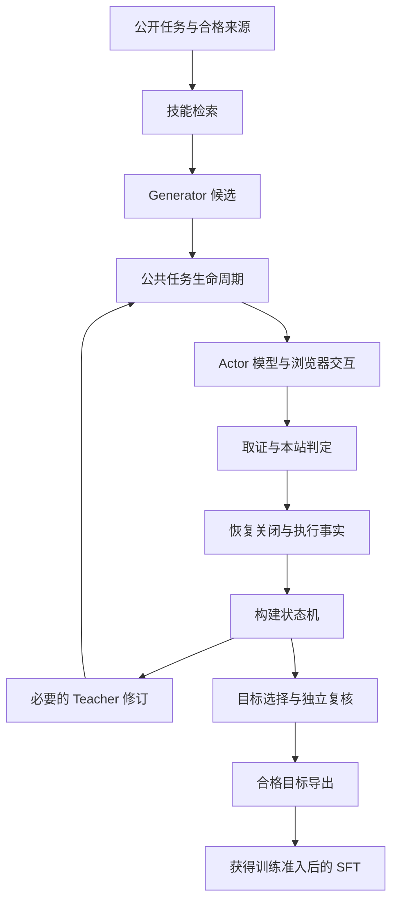
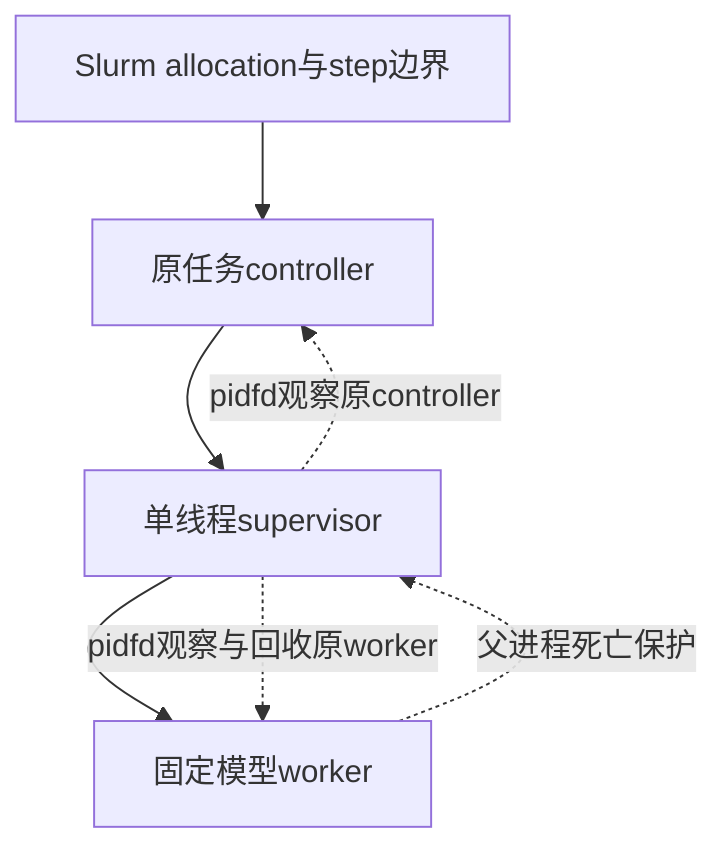

# Lab Generate Skill：AI 应用技术与面试备考手册

这份文档回答四个问题：**系统解决什么问题、各模块怎样实现、为什么这样设计、出错和并发时怎样管理。** 配合[代码阅读指南](CODE-READING-GUIDE.zh-CN.md)使用：阅读指南负责快速找代码，本手册负责解释机制、取舍和面试表达。

本发布副本的阅读版本为 `lab-generate-skill-current-preparation-consumer-v1-candidate-20261111`，核对日期 **2026-11-11**。原文以 Actor corrective v4 为阅读快照；本次只迁移文档入口与来源说明，未改变已实现/扩展设计的区分。实际部署、原验收和未发布材料范围见[发布说明](EXPORT.md)。

<a id="toc"></a>
## 导航与学习顺序

| 学习范围 | 章节 |
| --- | --- |
| 先讲清项目 | [1. 项目定位](#overview) · [2. 总体架构](#architecture) · [3. 数据合同](#contracts) |
| 技能与模型 | [4. 轨迹与技能库](#skill-bank) · [5. 检索](#retrieval) · [6. Generator](#generator) |
| 真实任务执行 | [7. 生命周期](#lifecycle) · [8. Actor与工具](#actor) · [9. 上下文](#context) · [10. 五站接入与判定](#sites) |
| 从执行到训练 | [11. Teacher](#teacher) · [12. 独立复核与导出](#review-export) · [13. SFT](#sft) |
| 工程重点 | [14. 线程与进程管理](#concurrency) · [15. 多Agent管理](#multi-agent) · [16. 治理方案](#governance) |
| 验证与表达 | [17. 测试和评估](#evaluation) · [18. 部署和性能](#deployment) · [19. 故障推演](#failures) · [20. 面试问答与复习](#interview) |

建议先读 1、2、7、8，理解执行主链；再读 4—6、11—13，理解数据闭环；最后重点复习 14—20。线程进程问题可直接从 [14.1](#concurrency-map)开始，多 Agent 面试可从[角色表](#agent-roles)开始。

**事实范围说明。** “实现”表示已在阅读快照中核到代码，不自动表示所有网站已经部署并通过真实验收；“现行规则”来自 [goal](DEVELOPMENT.md)、[AGENTS](../AGENTS.md)及[检查流程](FRAMEWORK_CHECK_WORKFLOW.md)；标为“扩展设计”或“建议指标”的内容用于方案讨论，不能当作已经完成的项目成果。本文不维护实时作业状态，也不改变现行规则。

<a id="overview"></a>
## 1. 项目定位：把浏览器经验变成可验证的技能目标

### 1.1 我们要解决什么问题

网页任务往往需要多步操作。模型不仅要知道“下一步点哪里”，还需要知道什么时候适用某种策略、完成条件是什么，以及失败后如何调整。项目把历史轨迹中的经验整理成技能，从技能库检索相关内容，让 Generator 生成面向当前任务的技能，再让 Actor 在真实环境中验证。Teacher 根据允许的执行证据修订技能，合格的正目标可用于后续训练。

另一条同样重要的目标是**结果可信**：模型说完成不代表业务完成；浏览器动作返回不代表修改已保存；进程退出不代表环境已恢复。系统把这些问题分别记录和验证。

### 1.2 一段可以用于面试的项目介绍

> 这个项目围绕五类网站任务，把技能检索、生成、真实执行、证据判定和训练数据构建接成一条链。核心工程是统一任务生命周期、基于端口的站点装配，以及可追溯的状态和证据管理。模型负责提出技能或动作，程序负责权限、预算、执行、判定与恢复。我的讲述会按具体代码和回执区分已实现、已验证和待完成部分。

这里的“我的”应替换成自己的实际职责；不要把整份手册覆盖的工作都说成个人独立完成。

### 1.3 三组容易混淆的概念

| 概念 | 在本项目中的含义 |
| --- | --- |
| Skill 与工具 | Skill 是文字策略，描述原则与适用条件；工具是受约束的浏览器动作或读取能力。Skill 标题不会自动注册成可调用函数。 |
| 推理与训练 | Generator、Actor、Teacher 在构建期间执行推理；只有经过导出与训练准入后，SFT 才更新模型参数。 |
| 角色与进程 | 一个角色不必对应一个独立模型进程；多个角色也不意味着同时执行。进程划分主要服务于资源、隔离和退出控制。 |

[返回导航](#toc)

<a id="architecture"></a>
## 2. 总体架构：业务编排与底层执行分开



图中的修订受固定轮次、资格和预算限制，不是失败后无限重跑。单次执行/评估也可以直接进入公共生命周期，不经过 Generator 和 Teacher。

### 2.1 分层职责

| 层 | 主要内容 | 设计初衷 |
| --- | --- | --- |
| `domain` | 数据结构、状态事件、身份与纯规则 | 先定义什么输入合法、什么状态能转换，避免各模块自行解释。 |
| `ports` | 模型、浏览器、证据、权限、准备和恢复接口 | 让业务编排表达“需要什么能力”，不绑定具体网站或模型实现。 |
| `policies` | 检索过滤、上下文选择、工具合同、导出资格 | 把可确定的业务规则从 I/O 中分离，便于精确测试。 |
| `application` | 执行、构建、复核、导出、训练流程 | 管理顺序与失败传播，保持公共流程与具体站点无关。 |
| `bootstrap` | 构造并绑定具体依赖 | 把源码版本、站点实现、权限和安装接到同一个消费者。 |
| `adapters / runtime` | 模型引擎、网站、文件、账本、进程与Slurm | 承接真实副作用，处理资源、期限、取消和结果回传。 |

**为什么不写一个大 Agent 类？** 如果模型请求、网页操作、费用、判定和恢复都混在一起，修改一个网站就可能破坏其他调用方，也很难用冻结产物单独调试下游。当前拆分让每一层有明确输入输出，但代价是更多合同、装配和版本管理，需要测试保证接口一致。

**代码锚点：** [TaskExecutionDeps][task-deps]定义公共执行需要的端口；[execute_task][execute]只编排这些端口；[Admin装配][admin-execution]和[Map装配][map-owned]提供具体实现。

<a id="contracts"></a>
## 3. 数据合同：先判断“是什么、属于谁”，再执行

### 3.1 严格数据模型

[Contract][validation]使用 Pydantic 的严格模式、禁止额外字段、冻结实例和实例重新校验。版本字段通常是字面量，例如 `evidence-ref/1`。目的是让错类型、错版本、错身份在产生副作用之前暴露。

`model_validate_json()`适用于进程边界上的 JSON 数据；严格的 Python 对象校验与 JSON 校验并不完全相同。例如 JSON 数组可进入声明为 tuple 的字段，但把未经处理的 Python list 交给严格 tuple 字段可能被拒绝。不要用绕过校验的构造方法来接受外部数据。

冻结模型也不是万能安全边界：嵌套可变对象、可信构造捷径和外部文件仍需各自约束。数据校验不能替代来源真实性或权限核验。

### 3.2 核心身份

| 身份 | 回答的问题 |
| --- | --- |
| task / split / goal group | 哪道任务？属于 train、dev 还是 test？是否与其他题共享来源或语义组？ |
| run / attempt | 哪次运行、哪次实际尝试？原尝试与后继如何区分？ |
| operation / request | 哪个阶段操作、哪次外部请求？是不是已经登记或发送？ |
| owner / claim / resource | 谁拥有这次执行和原资源？当前是否仍有权操作？ |
| release / schema / configuration | 使用哪个源码、接口版本、模型及参数配置？ |

### 3.3 证据引用为什么不只是文件路径

[EvidenceRef][evidence]包含 `uri`、`sha256`、`size_bytes`、`media_type`、`content_schema`、`visibility` 和 `producer`。消费者不仅检查文件存在，还要确认字节、格式、用途和生产者都与预期一致。

三种 visibility 是 `public / teacher / private`。它们是需要消费策略执行的标签，不是自动隔离文件的沙箱。哈希证明内容是否与指定字节一致，也不证明作者可信、当前权限有效或业务语义正确。

同一段文本的技能去重摘要与整份证据的内容摘要也不是一个概念：[CompactSkill.content_digest][skill]只对公开技能内容做确定性指纹，不能充当完整回执或来源资格。

**面试要点：** 我们用“严格 schema + 完整身份 + 内容校验 + 动态权限”共同约束数据，仅有其中一项不够。

<a id="skill-bank"></a>
## 4. 历史轨迹与技能库：保留经验，也保留来源

**设计初衷。** 直接把长轨迹塞给每次模型调用，成本高且不便复用。技能将经验整理为紧凑策略；来源信息仍独立保存，供过滤、追溯和资格检查。

**实现路径。** 早期 [skill_builder.py][skill-builder]负责从选定轨迹构建候选，[postprocess.py][postprocess]执行质量校验、向量化、聚类/去重等整理。统一框架中的 bank manifest、split 和 retrieval scope 则管理后续检索资格。两条链有关联，但不能把旧 CLI 的 `build` 当成统一 `construct_targets()`。

[CompactSkill][skill]的模型载荷只有三个字符串：

```json
{
  "title": "确认目标对象后再保存",
  "principle": "先核对当前对象和字段，再执行保存，并检查可观察的保存结果。",
  "when_to_apply": "任务要求修改已有记录，且页面能够确认目标对象。"
}
```

这是解释字段的示意样例，不是正式训练样本。生产生成提示要求的语言与格式以冻结 prompt 为准。

**治理。** 原轨迹、任务来源、数据 split、去重身份和技能正文分别保存；删除重复候选不意味着抹掉来源关系。相似技能是否合并要遵守原实现与配置，不能为了提高命中率把测试题经验混进训练库。

**取舍。** 紧凑技能有利于检索与输入预算，但可能遗漏任务前提。因此适用条件和可观察完成条件必须保留，Actor 仍要根据当前页面定位元素，不能照搬旧轨迹中的临时节点 ID。

<a id="retrieval"></a>
## 5. 检索：先做资格过滤，再做语义排序

**代码锚点：** [eligible_records / rank_retrieval][retrieval-policy]、[CpuSkillRetriever][retriever]、[CpuEncoder][cpu-encoder]。

### 5.1 实际步骤

1. 核对 query 是当前任务的准确公开目标，bank 与 split 使用同一冻结分区。
2. 排除当前题的来源、指定排除来源、同 goal group、被排除技能，以及与 heldout 相关的禁止内容；按站点筛选。
3. 读取明确的 encoder 文件和配置，在 CPU worker 中离线加载 SentenceTransformer。
4. 对完整有序候选文档和 query 编码；检查维度、类型、有限数值和单位长度。
5. 归一化向量做点积，相当于比较余弦相似度。
6. 按 `(-score, skill_id)` 稳定排序，取精确 top-6，并保存评分与输入摘要回执。

合法候选不足六个会拒绝，代码没有自动补无关技能的行为。当前实现是对合格集合评分，不应描述成已使用某个向量数据库或近似最近邻服务。

### 5.2 具体缓存机制

`CpuEncoder`常驻一个模型和配置，只缓存**完全相同、有序的整批文档**对应的向量；query 每次单独编码。调用在锁内串行，缓存向量复制后设为只读。发生异常会清空并关闭该实例，不自动重试。

这使复用条件可以解释和核验。代价是候选列表变化时整批缓存不命中，适合当前明确规模与冻结范围；不能据此宣称实现了任意粒度的通用向量缓存。

### 5.3 面试如何回答“这是 RAG 吗”

这是检索增强的一种应用：检索的是**策略技能**，结果供 Generator 构建当前任务的指导，而不是直接检索文档段落回答问题。RAG 的关键仍是来源、相关性、输入组织和效果验证，检索 top-6 只是其中一步。

**建议评估：** 在合法数据范围比较相关性、重复率、来源泄漏、下游任务质量、检索耗时和输入成本；这些是指标设计，不是本次测得的成绩。

<a id="generator"></a>
## 6. Generator：把公开任务和检索技能转成候选策略

**输入与输出。** [prepare_generator][gen-prompt]接收公开任务、初始观察、有序的六条技能，以及所选 Actor 能力声明；输出固定 prompt 版本、消息、seed 和 temperature。模型返回经过解析后形成 `GeneratedCandidate`，绑定请求和实际参数摘要。

[RecordedGenerator][gen-candidates]会检查初始观察、原响应字节、请求身份、实际采样参数及响应完整性。一次 `generate()`只调用一次注入的 inference 端口，持久化去重和执行所有权交给该端口及账本，不能依靠内存布尔标志。

### 6.1 构建方法的明确约束

阅读快照的 [ConstructionMethod][method]固定：四个候选、top-6、重复候选最多四次重采样、最多三轮 Teacher 修订，并保留首轮 Teacher 要求。生成 seed 按候选和重采样编号确定，temperature 有固定递增日程。调参会改变方法身份，不能临时修改而仍声称相同实验。

重采样是处理重复候选的算法分支；网络 unknown 的重新发送是外部请求恢复问题，两者不能混用。`max_generator_requests`描述最坏工作量，不授权把所有调用一律跑满。

### 6.2 为什么声明 Actor 能力

如果 Generator 假设 Actor 能使用不存在的工具，技能再流畅也不可执行。能力声明把策略生成与实际执行能力绑定，同时仍由 Actor 在现场检查元素和状态。

**面试表达：** Generator 产生的是待验证策略，不能直接当正确答案；我们保存它来自什么输入、用了什么参数，再通过统一任务执行链验证。

<a id="lifecycle"></a>
## 7. 公共任务生命周期：正常路径与异常收尾一起设计

**代码锚点：** [execute_task()][execute]、[TaskExecutionPlan][task-data]、[TaskExecutionDeps][task-deps]。

| 阶段 | 输入/输出 | 关键检查 |
| --- | --- | --- |
| 准入 | 计划、来源状态、run snapshot、Reset计划 | 原attempt没有执行过；来源、owner、资源和判定需求匹配。 |
| 获取与准备 | `acquire / prepare`返回可归属的证据引用 | 副作用前登记；部分获取失败也有恢复出口。 |
| 初始化 | `InitializedTask` | 初始观察、baseline、equivalence及Actor请求属于同一任务。 |
| Actor | `TraceSnapshot` | 轨迹身份、初始观察、次数上限和封闭条件一致。 |
| 取证 | `TaskCaptureResult` | 捕获使用原判定合同，必要过程监听在动作之前接好。 |
| 判定 | `Evaluation` | 对原task/attempt/contract作语义判断；缺证据保持unknown。 |
| 收尾与完成 | Reset、关闭记录、`TaskCompletionFacts` | 原资源恢复、物理退出和持久登记分别有证据。 |

### 7.1 为什么准备不等于初始化

准备可能包括资产、原生服务、浏览器和模型资源；初始化将网站置于本题规定起点，并产生权威公开初始观察。两者副作用和证据不同。`prepare-only`仍可能获取真实资源，不能当无副作用配置校验。

### 7.2 为什么要核 baseline 和 equivalence

两个候选如果看到不同账号、页面内容或数据库状态，就无法把成绩差异归因于技能。baseline 描述初态，equivalence 证明当前候选满足比较要求；私有初态证据不能泄漏给 Actor/Generator。

### 7.3 异常怎样传播

`effects_started`在获取资源前设置，使部分获取失败也进入 `_finish()`。主路径错误保存在 `primary`，收尾错误保存在 `cleanup_errors`；`TaskExecutionUnconfirmed`携带已知执行事实，而不是只抛一个无上下文的异常。

**设计取舍。** 完整收尾可能失败，此时系统宁可报告未证实，也不把“进程已结束”改写成“任务已恢复”。公共生命周期只返回中性事实，候选选择与训练资格留给上层。

<a id="actor"></a>
## 8. Actor：模型提出建议，程序决定能否执行

**代码锚点：** [RecordedActorRunner][actor-loop]、[模型生成][generation]、[工具合同][tools]、[响应解析][actor-response]、[浏览器动作][browser-action]。

### 8.1 一轮实际做什么

```text
当前公开观察与允许历史
  → 选择/复核上下文与回合预算
  → 登记生成意图和请求身份
  → 模型生成，保存原响应
  → 解析工具提议并校验
  → 拒绝并反馈，或登记并派发动作/读取
  → 保存返回与新观察
  → 更新轨迹，继续或按条件停止
```

工具调用由结构化 JSON 和允许的动作协议约束。节点 ID 来自当前观察；模型不能用技能标题、任意函数名或旧页面 ID 扩大工具集。动作与读取分别记录，生成次数和环境交互次数也分别计数。

非法提议可以形成可诊断反馈，再由冻结策略决定是否允许下一次生成。连续拒绝有停止条件；不能把纠错机制变成无限自动重试。具体阈值以选定策略版本为准，相关测试见[纠错测试][test-corrective]。

### 8.2 “工具调用成功”不等于“业务成功”

浏览器点击返回，最多证明调用返回；保存是否生效要看页面、原生状态或判定需要的证据。Actor 发出结束消息后，仍要由 collector/evaluator 完成取证和业务判断。

### 8.3 模型层为什么分两层

共享的 [CausalTransformersSession][causal-engine]负责离线加载、tokenizer、推理和硬件配置检查；Actor/Generator 的外层分别检查本角色的请求、预算和返回身份。这样能复用推理机械逻辑，同时保留不同角色的合同。

运行中通过 worker 协议传递版本化数据，不能在不同进程之间直接传浏览器句柄或模型对象。原生调用卡住时的退出能力来自进程监督，见[第14节](#concurrency)。

<a id="context"></a>
## 9. 上下文治理：保留关键事实，控制完整请求预算

**代码锚点：** [ControlledActorContext][context]、[上下文选择规则][context-budget]、[观察选择][observation-selection]。

### 9.1 预算计算

现行 Actor 目标为总窗口 65,536、默认输出 4,096。在其他开销为零时输入上限为 61,440；实际准入应使用：

```text
允许输入 = min(配置输入上限, 总窗口 − 输出预留 − 未计开销)
```

计数对象是最终请求，包括系统提示、任务、技能、观察、历史和工具定义；不是只算网页正文。输出减档禁用，不能为了过检查悄悄缩小输出。Generator、Teacher 与 SFT 分别有配置，不能直接套 Actor 的窗口。

### 9.2 实现思路

确定性结构整理、完整正文共享和保留原 ID 的观察视图，用于减少重复输入；候选选择后还要保护检查与发送复核。原始观察、动作绑定和完整证据继续保存，模型当前看到的视图可以更小。

`observation_read`将需要的有界内容与原观察绑定，再交给 Actor。读取能力是否启用必须看实际装配；不能把网站内部数据库分块读取说成 Actor 已拥有通用长文阅读能力。

### 9.3 如何判断压缩有没有伤害任务

需要检查实体、数值、状态、层级、关键正文和动作反馈是否保留，并在原合法业务范围观察任务质量。只报压缩率没有说服力。Teacher 所需的多候选、多轮证据，也不能用 Actor 的近期记忆窗口简单截断。

**建议指标：** 原始/发送 token、完整请求超限率、保护检查拒绝率、额外读取次数、任务判定质量及耗时。指标应绑定相同任务与配置范围。

<a id="sites"></a>
## 10. 五站接入与判定：框架统一，语义分别实现

源码按 `shopping_admin / shopping / gitlab / reddit / map`组织 [sites][sites]和[evaluators][evaluators]。[TaskRegistry][registry]按 site、family、contract version 及注册身份精确匹配，零匹配和多匹配均拒绝。

### 10.1 新任务接入需要什么

| 部件 | 需要回答的问题 |
| --- | --- |
| 参数与公开绑定 | 模型能看到什么目标和限制？哪些私有字段只用于核验？ |
| 原生准备与初始化 | 怎样启动依赖、进入本题起点，并确认账号与对象？ |
| Collector | 哪些事实必须在动作前后捕获？是否有下载、响应或保存证据？ |
| Evaluator | 原业务语义对应什么可观察结果？证据不足时怎样报告？ |
| 恢复与关闭 | 本题改变了什么？谁负责恢复原状态并关闭原资源？ |
| Bootstrap | 上述组件是否来自兼容的精确版本，并绑定相同来源和owner？ |

### 10.2 为什么 evaluator 不直接操作网站

判定只依赖已保存证据，才有机会独立复核同一次执行；若判定阶段又访问网站改变状态，原执行与判定就混在一起。缺失过程证据也不能事后用另一轮操作补成“原执行证据”。

语义例子：修改要核真实保存，查询要核实际答案，导出要核产物，查看要核目标对象和内容。正常空结果可以合法；页面没加载、报错或没证据不等于空结果。

### 10.3 三种业务判定与工程错误

[Evaluation][evaluation]区分 success、failure、unknown。有效失败说明有足够证据判断目标未达成；unknown 表示不能得出可靠判定。模型/网站/代码错误和清理错误还需要独立记录，不能一律编码为负奖励。

**面试表达：** 统一的是调用合同和证据链；具体业务正确性仍由本站任务族决定，不能只根据网址、HTTP 200 或终态截图判断完成。

<a id="teacher"></a>
## 11. Teacher：根据允许证据修订策略

**设计初衷。** Generator 可能给出表面合理、实际不可执行的技能。Teacher 读取多候选尝试与反馈，改进技能内容；它不替 Actor 执行网站，也不负责绕过框架权限。

[construction_messages][teacher-messages]将公开任务、初始观察、检索技能、允许的 attempts 和当前最好成功尝试组织成消息。[assemble_teacher_revision][teacher-assembly]负责证据组装，[RecordedTeacher][teacher-revision]执行修订合同。

Teacher 的输入包含比 Actor 当前轮更完整的构建历史。重复的共享事实可按合同整理，但每次尝试的动作、返回和反馈仍要可定位。后台隐藏答案或不允许的私有事实不能因为“Teacher 更强”就被加入。

### 11.1 目标选择如何进行

[select_target][construction-state]先拒绝包含 unknown 的选择输入；从成功尝试中选择实际环境交互数最少者，同分保持先出现者；没有成功目标则 rejected。这里优化的是定义好的可验证指标，不是让 Teacher 主观宣称哪个候选最好。

### 11.2 成本和修订边界

Teacher 使用原授权的模型路由，发送前独立核窗口、输出、计数、费用与权限。有限修订是算法分支；未知付费请求的重新发送是恢复问题，不得借修订轮次绕过。详见[预算治理](#budget-governance)。

<a id="review-export"></a>
## 12. 独立复核与导出：把“看起来成功”变成可追溯目标

**代码锚点：** [review_run][review]、[export_targets][export]、[prepare_export_examples][export-examples]、[导出资格规则][export-policy]。

### 12.1 独立复核检查什么

复核固定原执行、来源、release、上下文、候选/Teacher 历史和所选判定。`review_run`的职责是读取与核验，不启动网站或模型。阅读快照中的该入口针对同 release 的构建复核，不能泛称支持任意跨版本重判。

“独立”强调重新消费完整已保存事实并验证合同，不一定是再请一个模型打分。若原 trace 不完整，复核应拒绝或保留未证实，不能重新执行后替换原轨迹。

### 12.2 实际训练目标是什么

导出器把原 Generator prompt 保留为 system/user 消息，把**最终选中的技能 JSON**作为 assistant 目标。它保留 task、goal group、split、bank、retrieval、生成输入、目标技能、判定、review 和 qualification 的引用。

因此这条 SFT 链主要训练技能生成能力；不要把它误述为直接用所有浏览器动作训练 Actor。

### 12.3 什么情况下不导出

没有正目标、复核未确认、资格不符、工程判定冒充正式训练、重复来源等情况会被拒绝并记录原因。没有合格正目标时可以得到空导出，但不能把工程夹具换个标签当正式数据，也不能继续训练空集。

**取舍。** 严格准入会减少样本数量，但降低错误标签、数据泄漏和无法追溯样本进入训练的风险。业务有效失败仍保留，只是不作为这条正目标 SFT 的正样本。

<a id="sft"></a>
## 13. SFT：只监督目标技能，训练过程也要可恢复

**代码锚点：** [train_sft][train]、[数据编码][dataset-encoding]、[supervised_encoding][sft-encoding]、[torch_sft][torch-sft]。

### 13.1 编码与损失掩码

编码器分别对 prompt 和完整对话应用模型 chat template，并确认 prompt token 是完整对话的前缀。prompt 位置 label 为 `-100`，只监督 assistant 目标；padding 的 label 也设为 `-100`。超长样本拒绝，不静默截掉目标；没有目标 token 也拒绝。

可用下面的示意理解：

```text
input_ids: [system + user + assistant目标]
labels:    [-100  ... -100 | assistant目标token]
```

模型训练时内部进行自回归预测的位移对齐。损失关注目标技能文本，而不是要求模型复述题目和检索输入。

### 13.2 LoRA 实现

训练叶端使用单 GPU LoRA、离线加载的 causal LM 和 tokenizer、bfloat16、SDPA，并把 LoRA 接到注意力及前馈网络的投影层。代码中可见梯度检查点、梯度累积、AdamW 和带 warmup 的 cosine scheduler；实际超参数由冻结训练配置给出。

LoRA 的基本想法是冻结基础权重，用低秩矩阵表示可训练增量，可写为 `W' = W + (α/r)BA`。这样减少训练参数与对应优化器状态；基础模型、激活和其他开销仍存在，不能说显存只由 LoRA 参数决定。原理参考 [LoRA 论文](https://arxiv.org/abs/2106.09685)。

### 13.3 恢复需要哪些状态

只保存 adapter 权重不足以精确恢复训练。要核原数据/模型/运行合同，保存与恢复优化器、scheduler、训练进度及随机状态，并确认 checkpoint 与原 run 绑定。代码也为 DataLoader 的随机生成器做了隔离，避免恢复期间的评估迭代干扰训练随机序列。

底层 trainer 有评估数据接口不等于当前业务可随意读 dev/test；数据准入和训练阶段门仍由上层决定。checkpoint 文件存在、训练脚本退出和后续加载验证也分别需要结果。

**面试表达：** 我们的训练治理从样本来源开始，一直延伸到目标掩码、配置绑定和恢复状态；接口实现不能替代真实训练验收。

[返回导航](#toc)

<a id="concurrency"></a>
## 14. 项目已有的线程与进程管理

这部分只解释阅读快照已有机制。线程、进程、模型角色和 Slurm 作业属于不同层次，不能混为“多 Agent 并发”。

<a id="concurrency-map"></a>
### 14.1 先看实际使用地图

| 场景 | 已有机制 | 为什么这样做 | 代码 |
| --- | --- | --- | --- |
| Map资产复制 | 两个线程、最多两个在途文件、Event与Lock | 有限重叠I/O，避免无限排队，失败后停止领取新文件。 | [copy_queue][copy-queue] |
| Map原生分块读取 | 两个独立HTTP客户端、双线程池、统一绝对期限 | 并行读取独立区域，同时保存分支和完整合并证据。 | [native_batch][native-batch] |
| Map本地转发服务 | 服务线程、受限请求线程、socket登记和join | 接受本次允许请求，并能检查原连接和线程是否结束。 | [native_relay][native-relay] |
| 同一模型worker客户端 | 可取消等待的互斥锁、PID绑定、序列化交换 | 防止两个调用交错读写同一协议通道。 | [actor_worker_client][worker-client] |
| CPU检索编码器 | 一个模型实例、Lock、有界整批缓存 | 避免模型/缓存被并发修改，限制CPU线程与输入量。 | [cpu_encoder][cpu-encoder] |
| 模型子进程 | controller／supervisor／worker，pidfd和父死保护 | 子进程卡住时，外部监督仍可观察原owner与原worker。 | [owner_supervisor][supervisor] |
| 管道通信 | 非阻塞读写、selectors、长度帧和累计stderr上限 | 避免管道背压、无限输出和不完整消息被当成正常返回。 | [session_io][session-io] |
| 多进程账本写入 | 稳定文件锁、版本条件、持久提交 | 防止同一逻辑请求或状态被两个写者重复推进。 | [run_journal][run-ledger]、[request_ledger][request-ledger] |

这些组件存在于所选源码中；某个任务是否实际使用某条路径，仍要沿 bootstrap 和原运行回执确认。历史平铺模块中的其他线程池不自动代表当前公共主链。

### 14.2 双线程复制队列如何管理

`copy_files()`创建 `ThreadPoolExecutor(max_workers=2)`，以 `pending`字典保留在途 Future。只有在途数小于2时才从输入迭代器领取新文件，使用 `FIRST_COMPLETED`逐批回收结果。

共享状态包含停止 Event、错误列表和锁。写线程报告失败与主线程领取工作使用同一锁，保证失败登记后不再领取后续文件。主线程继续检查原操作控制；写线程拿到从原剩余时间派生的局部控制，不跨线程调用可能绑定owner的控制器。

退出时设置停止标记，`shutdown(wait=True, cancel_futures=True)`，汇总原错误与多个写者错误。返回的计数包括文件数、字节数和峰值在途数。

**保障边界：** `cancel_futures`只能取消尚未运行的工作；运行中的任务要在检查点协作退出。若底层文件 I/O 卡死，`wait=True`也可能等待，硬退出边界仍在外层 worker 监督。不能把“线程池调用了shutdown”当作所有I/O已经中断。

### 14.3 Map 原生读取不是任意重试

`complete_cap_response()`只在实际收到明确的原生节点数量上限响应后，按规则拆分区域。两个客户端必须独立且同源；所有子请求共用原绝对 deadline，并受请求数和深度限制。相同输入下按分裂路径组织结果，最终要求完整合并。

如果发生 unknown、非预期状态或超时，不把原请求无条件重发。失败路径取消客户端、尝试有界收回兄弟结果，并保留已完成、部分完成和收尾未知的记录。失败时线程池不无限等待，但这也不构成线程已经退出的证明。

**设计初衷：** 允许可解释的独立读并发，同时避免数据缺块、期限重置和未知请求重放。这里的独立HTTP客户端也避免跨线程共享同一个浏览器对象。

### 14.4 本地服务线程如何关闭

`NativeMapRelay`登记服务线程、处理线程、原socket和请求身份。关闭流程先停止接收，取消原exchange，关闭原连接及服务器，再对线程执行带剩余期限的join，并检查线程存活与监听socket状态。

实现中有 daemon 线程，但仍显式关闭和核验。**daemon只影响进程退出等待行为，不证明业务请求安全结束。** 清理失败会保留错误并进入隔离状态，不把设置停止Event当成完整收尾。

### 14.5 锁、线程归属和进程归属有什么不同

- **互斥锁：** `SupervisedActorEngine`和`FramedProcessSession`将一次协议交换串行化。等锁时使用非阻塞获取和短等待，并持续核deadline/cancel，避免无期限阻塞。
- **PID绑定：** 客户端或编码器记录创建时PID；对象被fork后带到另一个进程，不能直接继续使用原通道或缓存状态。
- **线程归属：** 某些authority、执行作用域和pidfd持有对象绑定 `(os.getpid(), threading.get_ident())`。这是防止跨上下文误用，不是用于提高并发的锁。
- **文件锁：** 负责跨进程共享账本的临界区，普通`threading.Lock`只能覆盖当前进程内的调用。

因此，不能为了并行，把一个owned执行对象直接丢进线程池。应先查端口是否允许共享，是否有独立客户端与数据边界。

### 14.6 模型进程的监督结构



[supervise_owner()][supervisor]要求在模型/原生线程启动前fork，并检查当前Python线程计数和SIGCHLD处理前提。子进程先设置父进程死亡信号，并复查父身份，避免设置保护期间父进程已消失的竞态；之后才运行固定子函数。

父监督进程通过pidfd轮询原controller和worker。worker退出后用`waitpid`回收，controller死亡或监督失败时停止原worker并有界等待。它不接受网络消息指定任意程序，不自动重启模型。

**限制：** Python线程计数检查不是对所有隐藏原生线程的完整枚举，仍须遵守“先启动监督结构，再加载模型”的装配顺序。这个监督器主要处理owner死亡和直属子进程退出；阶段超时还依赖操作控制、传输中止和外层资源管理，不能把一个轮询循环描述成所有阻塞都有严格硬期限。

### 14.7 为什么记录进程身份并使用pidfd

[ProcessIdentity][process-identity]包含节点、boot ID、PID和启动ticks。只有PID不够：原进程退出后，该数字可能分配给另一进程。[pinned_owner][owner-pidfd]围绕身份核验持有原pidfd，使后续观察和信号针对原进程对象。

[linux_pidfd][pidfd]明确限定当前实现支持的Linux ABI，失败不静默退回猜PID。监督器启动失败时，对自己尚未回收的直属子进程有特殊收尾路径；这不能推广成任意旧PID都可安全使用。

[pin_worker_processes][worker-stop]先核原step成员，再持有worker和supervisor的句柄；优先停worker，让supervisor正常回收，必要时再处理supervisor。pidfd退出事实仍不能替代Slurm/cgroup与其他资源的关闭证明。

### 14.8 管道、背压和协议串行化

[FramedProcessSession][process-session]使用固定绝对可执行文件与明确argv，启动新session，限制继承环境，并按需显式传GPU可见设备。客户端保存有限长度帧，stdout承载协议，stderr单独累计。

[exchange()][session-io]同时监听stdin可写、stdout可读、stderr可读，分块写入和读取；每轮检查剩余期限。帧不完整、提前EOF、超限stderr等情况会使会话失败。失败会话不自动重开；角色层还要核消息身份与序列，传输层拿到一段字节并不代表语义正确。

**为什么要边读stderr边写stdin？** 子进程若因stderr管道写满而阻塞，父进程再只等待stdout，就可能互相等待。多路监听能处理这类背压，且有明确内存上限。

### 14.9 取消、杀进程和“已关闭”的区别

[OriginalSignalCancellation][job-signals]将SIGTERM、SIGINT、SIGUSR1转成可查询的原取消通道；正常执行控制看到取消后停止新的工作，清理使用自己的有界预算。

[finish_process()][process-cleanup]在需要时向原session进程组发终止信号，等待直属子进程并记录`reaped/unconfirmed`，然后关闭原流。已回收后不会再次向可复用PID/PGID发信号。

必须区分：**请求终止 → 观察退出 → 回收直属子进程 → 核资源树 → 恢复网站 → 关闭持久记录。** 发送信号不证明退出；直属子进程回收不证明所有后代已结束；资源树控制仍依赖原Slurm/cgroup/namespace与资源owner。

### 14.10 Python线程适合这里吗

普通启用GIL的CPython中，纯Python计算不能简单依靠多个线程获得多核并行；等待网络/文件I/O仍适合线程。原生数值库也可能内部并行，因此“一个Python线程”不等于“只用一个CPU核”。不同解释器构建需分别核实，不能默认本项目使用free-threaded构建。[Python线程说明](https://docs.python.org/3/library/threading.html)。

项目在[检索加载器][sentence-loader]和[模型引擎][causal-engine]显式设置CPU线程数。部署时要同时考虑作业CPU配额、进程数、应用线程和算子线程，防止多层并行把CPU挤满。现有代码调用`set_num_threads`不表示所有底层库和所有线程池都已统一限流。

**面试总结：** 线程用于有限独立I/O和服务处理；锁保护共享会话；进程用于隔离模型及原生调用；外部监督和资源记录共同承担可靠退出。

[返回导航](#toc)

<a id="multi-agent"></a>
## 15. 多Agent怎么管理：角色可以多，控制权必须明确

<a id="agent-roles"></a>
### 15.1 本项目已有的角色协作

| 角色/组件 | 输入 | 产出 | 不应获得的权力 |
| --- | --- | --- | --- |
| Generator | 公开任务、初态、检索技能、能力声明 | 候选技能 | 自行改权限、执行网站或宣布业务成功。 |
| Actor | 当前公开观察、技能、允许历史与工具 | 动作/读取提议、执行轨迹 | 访问隐藏判定答案，修改预算或绕过工具校验。 |
| Teacher | 允许的多候选、多轮执行证据 | 修订技能 | 直接重放旧请求、放开费用或重写原判定。 |
| Evaluator / Reviewer | 固定证据和判定合同 | 语义结果、复核回执 | 无证据补成功，或为了判定再次操作网站。 |
| 构建控制器与authority | 冻结计划、状态、权限、预算 | 下一步选择、准入与持久登记 | 将自然语言建议直接当执行授权。 |

Evaluator和控制器不必是LLM。当前系统更接近**程序控制的多角色工作流**，不能据此宣称已有自由协商的Agent集群。

### 15.2 状态机比“大家互相聊天”更容易管理

[construct_targets()][construct]按[ConstructionProgress][construction-state]推进一次有界工作，区分生成、修订、执行、只登记和观察。模型产出是输入事实，状态机决定下一步是否具备前提。

同一候选结果被登记后，后续调用读取原记录；已有pending/unknown时观察原请求，不另换request ID继续发送。多个控制者竞争时，依赖原账本与版本条件决定谁能推进，而不是由谁先看完一段聊天记录决定。

### 15.3 Agent之间传什么

传版本化任务、消息和证据引用，不共享无限增长的聊天历史。关键绑定包括task/run/attempt、请求与操作身份、角色、release/config、允许输入引用、输出schema及期限/预算范围。这些信息在当前框架分布于原有合同，不能误说已经有一份统一“Agent消息协议”。

共享内容应优先是不可变证据。跨角色给出正文时仍核完整引用；模型看到的可见范围由角色策略决定。Generator和Actor共用权威公开初态，不意味着Teacher和判定器能互相开放所有私有资料。

### 15.4 哪些可以并行，哪些必须串行

| 工作 | 并行条件 |
| --- | --- |
| 只读静态证据检查 | 输入冻结、消费者无写副作用、资源预算允许。 |
| 不同独立网站实例的任务 | 来源与权限各自合格，可写状态和恢复范围独立。 |
| 同一实例的多个候选 | 必须先隔离或可靠恢复并核初态等价；不能直接同时操作同一浏览器/数据库。 |
| 同一模型会话 | 按已实现通道合同串行；不是加线程就能并行。 |
| 付费Teacher调用 | 现行共享授权下并发上限1，Agent数量不能扩大额度。 |
| 同一task/attempt的结果写入 | 通过原持久事务和版本条件协调，禁止多方覆盖同一结果。 |

四个候选是算法数量，不等于四个并行Actor。若共用GPU，也应核模型常驻、显存和会话隔离的实际资格。

### 15.5 Agent失败时如何处理

先判断失败在哪一层：无副作用的输入校验、已登记但未发送、已发送但unknown、已返回待保存、已保存待结算、已完成待恢复。不同状态决定只读观察、补元数据或原资源收尾，而不是统一“重试三次”。

某个Agent不再响应时，调度层不能只因心跳超时就认定它没有执行动作。要核原owner、请求账本和资源存活，再决定停止受影响范围。模型退出后，外部网站和费用责任可能仍未完成。

### 15.6 如果面试要求设计更大规模的多Agent平台

以下是**基于现有合同的扩展设计**，不是已部署能力：在保留原状态机与authority前提下，用有界工作队列分发已准入任务；调度器根据来源、实例、GPU和共享预算选择可执行项；worker只领取明确工作，不自行递归创建任务。

多节点需要额外验证共享事务存储、租约和过期写者隔离。例如递增的owner代次可用于拒绝旧worker迟到写入，但前提是每个实际写入端都校验该代次；租约本身不能撤销已发生的网站动作。当前本地文件锁不能未经验证就宣称支持任意多机故障语义。

分歧应由证据合同、程序判定和规定的人审出口解决，不由多个LLM多数票自动获得权限。新增调度能力也不能改变当前付费并发1、训练门和旧unknown不重放的规则。

<a id="governance"></a>
## 16. 治理方案：把风险变成明确的约束与证据

这里的治理包括数据、模型、工具、费用、状态、资源和发布，不只是增加日志或让模型承诺遵守规则。

### 16.1 治理总表

| 领域 | 主要风险 | 当前治理落点 | 仍需实际验证的边界 |
| --- | --- | --- | --- |
| 数据 | train/dev/test泄漏、同来源重复 | split、goal group、来源排除、导出资格 | 新来源与新任务映射必须重新核。 |
| 模型 | 非法输出、假成功、超窗口 | 固定prompt/参数、结构化解析、发送前计数、独立判定 | 流畅输出不证明业务正确。 |
| 工具 | 越权动作、旧节点、错误实例 | 工具合同、来源/owner/实例绑定、动态authority | schema合法仍可能语义错误。 |
| 费用 | 多worker重复扣款、unknown被清除 | 原子请求账本、唯一派发许可、未结算阻断 | 不控制供应商内部执行语义。 |
| 状态 | 重复执行、丢回执、错误覆盖 | operation/request身份、版本条件、原回执保留 | 需核持久存储与部署假设。 |
| 资源 | 孤儿进程、共享实例污染 | 副作用前登记、进程监督、原资源恢复 | kill或作业终态不能替代关闭证明。 |
| 发布 | 源码与安装不匹配、热修改 | 固定release、摘要、精确消费者与安装验证 | 一个GPU配置通过不覆盖所有部署。 |
| 观测 | 无法定位首错、泄露密钥 | 阶段和身份字段、主错/清理错分别保留 | 日志本身不替代不可变事实。 |

<a id="budget-governance"></a>
### 16.2 共享费用账本如何防重复发送

[FileRequestLedger][request-ledger]以同一authorization为共享范围，持有稳定锁与snapshot；[BudgetSnapshot][request-domain]重放历史并核预算和逻辑请求身份。`mark_dispatching()`在原子更新中核版本、未结算请求、当前授权，再形成派发许可；只有写入/同步和锁清理都成功后才返回许可。

```text
保留预算 → 持久登记dispatching → 获得唯一许可 → 发送
        → 保存可核实结果 → 结算实际费用
```

如果网络断开导致结果unknown，保留占用并阻断不合法的新发送。若完整响应已经保存，则只做结果核验和结算，不再次调用模型。实际费用即使超过原估计，也应如实登记并阻断后续，不截断账目来制造“未超预算”。

**不能夸大为端到端exactly-once。** 本地账本能约束受控调用方的重复派发，但无法让任意外部服务在所有网络故障下天然恰好执行一次。因此unknown必须是正式状态。

### 16.3 时限治理：为整个回合和收尾留时间

[ActorGenerationBudgets][windows]将准备、执行和结果保存分开；选定快照的回合公式为：

```text
round = preparation + execution + interaction + 4 × cleanup + return_window
```

具体数值由所选配置决定，旧wire对未显式保存窗口有兼容语义。发送前检查是否还有完整回合余量；不能等GPU调用超时后才发现没有时间保存返回、关闭浏览器或恢复状态。

耗尽执行预算也不能任意续长原deadline。收尾使用预先定义的独立有界控制；已经完成的返回可沿允许路径登记，但不重新执行动作。

### 16.4 提示注入与信息隔离

已有[Generator提示][gen-instructions]和[Actor提示][actor-instructions]把网页与检索技能视为不可信数据，并要求使用当前工具与观察。真正的权限边界仍在端口、authority和工具消费者；仅在prompt中写“忽略恶意指令”不能提供完整防护。

可以用于面试讨论的**补充验证方案**：用网页内伪造系统指令、请求泄露私有证据、诱导访问非授权资源等样例，检查模型提议和执行端拒绝是否一致；敏感操作按具体产品政策增加人审出口。这些是扩展安全验证，不代表本项目已有完整攻击评测覆盖。分层防护原则可参见 [OWASP 提示注入防护](https://cheatsheetseries.owasp.org/cheatsheets/LLM_Prompt_Injection_Prevention_Cheat_Sheet.html)。

### 16.5 敏感信息与可观测性

密钥只按原授权注入，不能写入命令历史、提交环境或日志。跨进程错误保留组件、阶段、身份与错误原因，同时避免把完整请求和敏感配置无条件序列化。

每条诊断至少应能关联run/task/attempt、operation、job/worker、deadline和证据位置。先保存主错，再保存清理错；“清理也失败”不能覆盖最初导致任务停止的原因。

<a id="evaluation"></a>
## 17. 测试与评估：证明哪一层，就只声称哪一层

### 17.1 四层证据

| 层次 | 能证明什么 | 不能顺带证明什么 |
| --- | --- | --- |
| 合同/纯规则测试 | 类型、状态、选择和边界行为 | 网站、模型或安装可用。 |
| 真实消费者的隔离组合测试 | 接口、产物传递、故障收尾和调用数 | 夹具等于原题业务证据。 |
| 精确安装与消费者验证 | 指定代码/环境/硬件/入口兼容 | 全部任务成功或训练已获准。 |
| 原业务运行与复核 | 本题在本次冻结中的实际结果 | 整个题池、其他站点或未来版本都通过。 |

### 17.2 最值得读的故障测试

| 机制 | 测试入口 |
| --- | --- |
| 冻结前序直接消费、上游调用为零 | [test_frozen_stage_consumers][test-frozen] |
| Reset正文、当前authority、丢回读 | [test_reset_body_handoff][test-reset] |
| 管道背压、累计stderr、失败不重启 | [test_process_session][test-session] |
| 原owner退出、监督器边界 | [test_owner_supervisor][test-supervisor]、[boundaries][test-supervisor-boundaries] |
| 双线程复制取消与错误聚合 | [test_map_copy_queue][test-copy] |
| 独立原生读取与服务线程收尾 | [test_map_native_batch][test-native-batch]、[relay][test-relay] |
| 跨进程唯一发送、发送后进程死亡 | [test_model_sender_processes][test-sender]、[request ledger][test-request-ledger] |
| 同版本竞争与pending历史保留 | [test_construction_journal_processes][test-construction-process] |
| 训练准入、空数据与丢回执 | [test_training_boundaries][test-training] |

上述是代码阅读定位；本次没有重跑测试，也不复述未核的测试数量。

### 17.3 怎么设计有说服力的业务指标

建议同时报告：合法尝试数、success/failure/unknown/工程错误分布、动作数、模型调用数、token、费用、阶段耗时、恢复/关闭完整率和合格导出数。说明分母与排除条件，不能只删掉unknown后展示更高成功率。

算法比较固定数据范围、来源隔离、初态、工具、模型及采样；系统优化比较相同合同下的耗时和资源。抽取质量、策略质量、执行质量与治理完整性分别分析。没有真实数据时给指标定义，不编造提升百分比。

<a id="deployment"></a>
## 18. 部署、调试与性能：先定位成本，再改受影响部分

### 18.1 实际入口从哪里来

原 Admin／Map wrapper（未发布，见[部署说明][admin-wrapper]）绑定项目路径、安装回执、硬件类别和外部输入。固定源码、安装payload、GPU配置和实际消费者要共同匹配；源码目录更新不等于生产已切换。

现行规则要求软件、import、安装、模型、网站、数据库和大规模证据操作走Slurm。登录节点用于轻量代码与文档工作。作业内可把固定资产暂存到本地目录，兼容组复用只读准备；可写网站状态独立或可靠恢复。

### 18.2 冻结阶段为什么比每次跑整链更有效

准备和初始化可能昂贵。已经通过的阶段产物冻结后，让下一生产消费者直接接收；缺接口只补对应端口。测试既检查输出正确，也记录前序source/prepare/initialize调用为零，防止“独立调试”实际偷偷重跑上游。

正文传递可以减少重复读，但必须绑定完整引用、原scope和生命周期，未交付依赖继续核验；动态authority仍逐门执行。它与跨run缓存一个“允许”布尔值是两回事。

### 18.3 性能拆解

```text
总耗时 = 排队 + 资产准备 + 服务/模型启动 + 初始化
       + 各轮上下文/推理/动作/证据交换 + 判定 + 恢复关闭
```

测量时要注明阶段是否嵌套，避免重复相加。记录逻辑读取数、实际交换数、唯一引用数和重复字节，有助于判断瓶颈是重复验证、共享文件I/O、模型推理还是网站等待。

优化顺序应由数据决定：先消除不必要的重复工作，再复用合法只读资产和模型驻留，再对独立I/O进行受限并发。并发可能增加CPU争用、内存、文件系统负载和长尾，不能只凭线程数推断提速。

**发布原则：** 先在隔离候选检查受影响代码和消费者，再做精确安装与必要协调；已提交输入保持冻结。最终业务失败回到对应阶段定位，不自动整链循环。

<a id="failures"></a>
## 19. 五个故障推演：面试时说明状态和责任

以下是基于代码机制的推演，不是新增实验结果。

| 场景 | 已知事实与下一步 | 为什么不能简单重试 |
| --- | --- | --- |
| Teacher发送后网络断开 | 账本已有dispatching；核原响应/供应商证据，保留unknown和费用占用。 | 对方可能已执行并收费，再发会重复。 |
| 模型返回完整，但证据发布失败 | 保留已知返回与原引用，按合同补保存/结算，保留原错。 | 推理已完成，重新生成会改变结果和成本。 |
| 网站修改已保存，但Actor后续崩溃 | 捕获允许的原证据并恢复原资源；业务判定依证据，关闭另核。 | 再执行可能重复修改，不能用新实例代替原恢复。 |
| 一个Map复制线程失败，另一个仍在写 | 登记首错、停止新工作、协作取消并收线程；卡住时由外层监督处理。 | 返回失败不代表另一个线程已经停止写入。 |
| 两个worker同时推进同一构建版本 | 原账本事务只允许合法版本推进；另一方读取实际结果。 | 两个都自认成功会重复生成、执行或提交。 |

还应能回答一个反例：**模型输出是合法JSON，但点了错误商品。** 类型检查只能证明结构合法；目标对象、当前状态和最终业务判定仍需独立核验。这正是把schema、权限和语义分层的原因。

[返回导航](#toc)

<a id="interview"></a>
## 20. 面试问答、项目表达与复习清单

### 20.1 高频问题与回答骨架

| 问题 | 回答要点 |
| --- | --- |
| 为什么使用多角色？ | Generator提出策略、Actor执行、Teacher修订；程序控制器管理状态，减少角色职责混杂，代价是更多调用和协调成本。 |
| 为什么不用一个模型直接操作到底？ | 单次任务可以直接执行；需要复用经验和训练目标时再启用构建链，多角色不是所有任务的默认前提。 |
| 怎样减少幻觉？ | 不声称消除；约束输入和工具、保存原响应、检查对象与状态、用独立证据判定结果。 |
| RAG和微调分别解决什么？ | 检索提供当前相关经验；SFT学习生成合格技能的映射。前者不更新参数，后者需要合格目标和训练门。 |
| 检索怎样防数据泄漏？ | 按split、source、goal group和当前任务排除，再做同站点评分；不能只过滤相同task ID。 |
| 为什么是top-6和四候选？ | 这是冻结方法的明确参数，比较时保持；是否更优需合法实验，不能编造最优性结论。 |
| 多个成功候选怎么选？ | 按原实现的环境交互数选择，同分稳定；unknown不能混入选择。 |
| 什么是幂等，项目做到哪一步？ | 对重复本地操作/登记用身份和版本约束；外部副作用不承诺普遍exactly-once，未知结果需要保留。 |
| 多线程会不会把模型调用打乱？ | 同一worker会话有锁和协议身份；线程池只用于明确独立工作，不把共享模型句柄任意并行化。 |
| 为什么普通超时参数不够？ | 底层原生调用或I/O可能不及时检查；需要外部进程边界、原进程身份、信号与退出观察。 |
| Future取消是否意味着任务停止？ | 否。尚未开始的可取消，运行中的要协作退出；底层阻塞需要外层监督。 |
| 为什么PID不够？ | PID会复用；核节点、boot/start身份并持有原pidfd，不能拿旧数字误杀新进程。 |
| kill成功是否可以标关闭？ | 否。要观察退出并核后代/资源、网站恢复和持久记录。 |
| 为什么缓存正文但不缓存权限？ | 冻结字节可按摘要复用；权限、claim、撤权和实例状态随时间变化，必须在当前门核。 |
| 64K为什么仍会超限？ | 工具定义、系统提示、历史和输出预留都占预算；必须对完整请求计数。 |
| SFT监督的是什么？ | 原Generator输入对应最终选中技能JSON；prompt和padding被mask，不直接把所有浏览器动作作为目标。 |
| loss下降是否说明网页任务更好？ | 不足以证明。还需按阶段门做实际任务评估，检查质量、费用、动作数及恢复完整性。 |
| 哪些能力尚不能宣称？ | 未核的全站部署、整题池成绩、正式训练结果、任意多机调度与全面注入防护。 |

### 20.2 三分钟讲述顺序

1. **问题与价值：** 网页任务经验需要复用，模型输出需要真实验证。
2. **核心链路：** 检索 → 技能候选 → 统一Actor执行 → 证据判定 → Teacher与选择 → 导出训练。
3. **一个工程难点：** 选择自己实际参与的unknown请求治理、冻结阶段接线、上下文预算或进程收尾，讲清失败窗口和解决方式。
4. **验证与边界：** 给出具体代码、测试/回执范围；分别说明软件通过、实际任务结果、未证实边界和下一步。

不要背没有依据的“成功率提升X%”。如果已有结果可用于面试，先从原回执核任务范围、版本、分母、成本与局限，再填写。

### 20.3 最小复习清单

- 能手画总体架构，并说明application为什么不直接依赖网站实现。
- 能从原包wrapper一路追到`execute_task`、Actor、判定和收尾。
- 能解释EvidenceRef、claim、request和进程身份各解决什么问题。
- 能区分有效失败、unknown、工程错误、恢复结果和训练资格。
- 能讲清top-6过滤、四候选方法、Teacher修订及目标选择。
- 能解释锁、Event、Future、非阻塞管道、pidfd、父死保护和Slurm各自的作用与限制。
- 能说明多Agent为什么仍需要一个明确的状态机、共享预算和受控写入。
- 能解释SFT的assistant-only监督、LoRA、checkpoint与数据来源绑定。
- 能用一个故障例子说明“已经执行”和“已经确认”之间的差别。

### 20.4 继续查什么

查具体代码走[代码阅读指南](CODE-READING-GUIDE.zh-CN.md)；查设计合同走[整体架构](design/codebase-architecture-v1.md)；查本分支范围走[发布说明](EXPORT.md)；查开发约定与阶段门走[开发说明](DEVELOPMENT.md)、[AGENTS](../AGENTS.md)和[检查流程](FRAMEWORK_CHECK_WORKFLOW.md)。实际结果和动态权限仍须回原 workspace 核验。本手册用于理解与备考，不替代这些权威入口。

[返回导航](#toc)

[actor-instructions]: ../src/lab_generate_skill/actor/instructions.py
[actor-loop]: ../src/lab_generate_skill/application/actor_loop.py
[actor-response]: ../src/lab_generate_skill/actor/response.py
[admin-execution]: ../src/lab_generate_skill/bootstrap/admin_navigation_task_execution.py
[admin-wrapper]: DEVELOPMENT.md#执行入口
[browser-action]: ../src/lab_generate_skill/application/browser_action.py
[causal-engine]: ../src/lab_generate_skill/adapters/models/causal_transformers.py
[construct]: ../src/lab_generate_skill/application/construct_targets.py
[construction-state]: ../src/lab_generate_skill/domain/construction_state.py
[context]: ../src/lab_generate_skill/application/actor_context_preparation.py
[context-budget]: ../src/lab_generate_skill/policies/context_budget.py
[copy-queue]: ../src/lab_generate_skill/adapters/map_runtime/copy_queue.py
[cpu-encoder]: ../src/lab_generate_skill/adapters/retrieval/cpu_encoder.py
[dataset-encoding]: ../src/lab_generate_skill/adapters/training/dataset_encoding.py
[evaluation]: ../src/lab_generate_skill/domain/evaluation.py
[evaluators]: ../src/lab_generate_skill/evaluators
[evidence]: ../src/lab_generate_skill/domain/evidence.py
[execute]: ../src/lab_generate_skill/application/execute_task.py
[export]: ../src/lab_generate_skill/application/export_targets.py
[export-examples]: ../src/lab_generate_skill/application/export_examples.py
[export-policy]: ../src/lab_generate_skill/policies/export_eligibility.py
[gen-candidates]: ../src/lab_generate_skill/generator/candidates.py
[gen-instructions]: ../src/lab_generate_skill/generator/instructions.py
[gen-prompt]: ../src/lab_generate_skill/generator/prompting.py
[generation]: ../src/lab_generate_skill/application/actor_generation.py
[job-signals]: ../src/lab_generate_skill/adapters/processes/job_signals.py
[map-owned]: ../src/lab_generate_skill/bootstrap/map_owned_execution.py
[map-wrapper]: DEVELOPMENT.md#执行入口
[method]: ../src/lab_generate_skill/domain/construction_method.py
[native-batch]: ../src/lab_generate_skill/sites/map/native_batch.py
[native-relay]: ../src/lab_generate_skill/sites/map/native_relay.py
[observation-selection]: ../src/lab_generate_skill/policies/actor_observation_selection.py
[owner-pidfd]: ../src/lab_generate_skill/adapters/processes/owner_pidfd.py
[pidfd]: ../src/lab_generate_skill/adapters/processes/linux_pidfd.py
[postprocess]: ../src/lab_generate_skill/postprocess.py
[process-cleanup]: ../src/lab_generate_skill/adapters/processes/cleanup.py
[process-identity]: ../src/lab_generate_skill/domain/process_identity.py
[process-session]: ../src/lab_generate_skill/adapters/processes/session.py
[registry]: ../src/lab_generate_skill/registry/resolve.py
[request-domain]: ../src/lab_generate_skill/domain/request_ledger.py
[request-ledger]: ../src/lab_generate_skill/adapters/ledger/request_ledger.py
[retrieval-policy]: ../src/lab_generate_skill/domain/retrieval.py
[retriever]: ../src/lab_generate_skill/adapters/retrieval/retriever.py
[review]: ../src/lab_generate_skill/application/review_run.py
[run-ledger]: ../src/lab_generate_skill/adapters/ledger/run_journal.py
[sentence-loader]: ../src/lab_generate_skill/adapters/retrieval/sentence_model.py
[session-io]: ../src/lab_generate_skill/adapters/processes/session_io.py
[sft-encoding]: ../src/lab_generate_skill/adapters/training/supervised_encoding.py
[sites]: ../src/lab_generate_skill/sites
[skill]: ../src/lab_generate_skill/domain/skill.py
[skill-builder]: ../src/lab_generate_skill/skill_builder.py
[supervisor]: ../src/lab_generate_skill/adapters/processes/owner_supervisor.py
[task-data]: ../src/lab_generate_skill/domain/task_execution.py
[task-deps]: ../src/lab_generate_skill/ports/task_execution_deps.py
[teacher-assembly]: ../src/lab_generate_skill/application/teacher_assembly.py
[teacher-messages]: ../src/lab_generate_skill/teacher/construction_messages.py
[teacher-revision]: ../src/lab_generate_skill/application/teacher_revision.py
[test-construction-process]: ../tests/framework/test_construction_journal_processes.py
[test-copy]: ../tests/framework/test_map_copy_queue.py
[test-corrective]: ../tests/framework/test_actor_corrective_examples.py
[test-frozen]: ../tests/framework/test_frozen_stage_consumers.py
[test-native-batch]: ../tests/framework/test_map_native_batch.py
[test-relay]: ../tests/framework/test_map_native_relay.py
[test-request-ledger]: ../tests/framework/test_file_request_ledger.py
[test-reset]: ../tests/framework/test_reset_body_handoff.py
[test-sender]: ../tests/framework/test_model_sender_processes.py
[test-session]: ../tests/framework/test_process_session.py
[test-supervisor]: ../tests/framework/test_owner_supervisor.py
[test-supervisor-boundaries]: ../tests/framework/test_owner_supervisor_boundaries.py
[test-training]: ../tests/framework/test_training_boundaries.py
[tools]: ../src/lab_generate_skill/policies/actor_tool_schemas.py
[torch-sft]: ../src/lab_generate_skill/adapters/training/torch_sft.py
[train]: ../src/lab_generate_skill/application/train_sft.py
[validation]: ../src/lab_generate_skill/domain/validation.py
[windows]: ../src/lab_generate_skill/domain/actor_execution_window.py
[worker-client]: ../src/lab_generate_skill/adapters/models/actor_worker_client.py
[worker-stop]: ../src/lab_generate_skill/adapters/processes/worker_processes.py