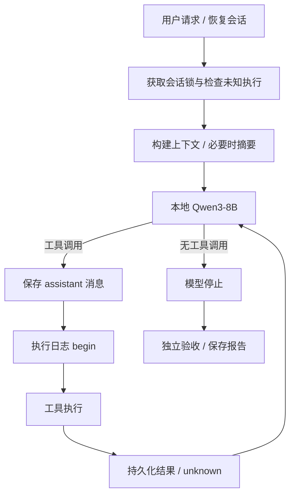

# 架构与关键设计

## 1. 模型与执行器的边界

模型决定调用什么工具；框架负责传递上下文、持久化、权限、执行与返回错误。独立验收器判断任务是否正确。`model_finished` 是模型停止输出，不是验收通过。

主要入口：`python/mini_claude/agent.py`，CLI 在 `__main__.py`，工具接口在 `tools.py`。上游保留 OpenAI 兼容与 Anthropic 两种后端；本次真实 GPU 实测只有本地 OpenAI 兼容链路，不能声称验证过全部商业 API。

## 2. 原子保存不等于操作原子性

`session.py` 在同一目录写临时文件，flush/fsync 后 `os.replace`，再同步目录。失败时保持旧会话可读，避免半截 JSON 被当成正常会话。损坏文件显式报错，不静默清空。

`execution_journal.py` 保存每次工具调用的 ID、工具名、参数摘要及状态。文件锁和线程锁保护日志；`session_lock.py` 使用非阻塞 flock 阻止两个进程同时运行同一会话。

| 已有记录 | 恢复行为 |
| --- | --- |
| 无记录 | 可以开始调用 |
| completed，ID/工具/参数一致 | 复用结果，不再次执行同一调用 |
| started，但没有 completed | 视为结果未知，阻止自动续跑 |
| 同 ID 不同工具或参数 | 冲突报错 |
| acknowledged | 保留核查记录，不自动重放原调用 |

顺序是：保存模型调用 → begin 持久化 → 执行 → complete 持久化 → 保存消息结果。崩溃可能发生在外部动作已经执行、complete 尚未落盘之间，这时无法凭日志知道真实结果，必须核查产物。因此没有“任意副作用恰好执行一次”的保证，也没有跨文件/外部服务事务。

恢复会校验工作目录与模型，并补齐悬空工具消息；不会在加载会话时偷偷重新执行工具。非确定副作用必须人工核查，再使用 `--ack-unknown` 写明原因。一个工具以新 ID 被模型重新调用，仍是新的调用，日志不是语义去重器。

## 3. 命令生命周期

`command_runner.py` 使用 subprocess 启动独立进程组，selector 增量读取 stdout/stderr。`tools.py` 通过异步包装避免阻塞整个事件循环，取消时设置事件并等待清理。

- 默认命令超时 30 秒；上层可以传入有效的有限超时。
- 超时/取消先向进程组发送 TERM，再在宽限期后发送 KILL。
- 父进程正常退出后也清理同组后台子进程。
- 返回状态、退出码、耗时、stdout、stderr、日志路径与截断标志。
- 输出预算 32,000 bytes，磁盘日志预算 2,000,000 bytes；超出后继续排空管道，但不无限保留。
- 日志权限 0600。故意 setsid 脱离进程组的程序不在清理保证内。

这个机制管理进程，不限制其文件/网络权限。权限确认、目录隔离、进程组都不等于安全沙箱。

## 4. 上下文与摘要

`context_summary.py` 定义六个字段：

| 字段 | 含义 |
| --- | --- |
| goal | 当前目标 |
| constraints | 用户的真实约束 |
| files_changed | path、attempted/applied/verified、detail |
| tests | command、planned/attempted/passed/failed/unverified、result |
| pending | 未完成事项 |
| facts | 继续任务必需的其他事实 |

历史以数据序列化后交给摘要模型，提醒不要把工具文本中的指令变成用户要求。摘要使用同一本地模型，不需要付费评审模型。

系统消息保留；默认保留最近两个完整用户轮次。对于单用户长工具循环，保留最近两个完整 assistant 轮次，并重复原始用户请求。切分拒绝悬空工具调用、重复 ID 或无对应调用的结果。

先保存旧状态，再请求摘要；验证 JSON 字段与枚举，要求替换后的序列化长度变短，归档旧历史，最后替换并保存。请求失败、格式不合法、没有缩短、无法安全切分等情况保留旧历史。序列化字符长度检查不是精确 Token 压缩比。

本地推理还用模型 tokenizer 和工具模板计算输入长度：上下文 16,384，预留输出 2,048 和 256 安全余量；接近有效预算 85% 时尝试摘要，超预算则明确报错，不静默截掉用户要求。上游的工具结果压缩层仍保留。

JSON 合法不能保证语义正确。真实摘要检查发现一次 failed 被写成 attempted，因此摘要状态不能替代执行日志或验收器。

## 5. 可观测性与停止语义

会话保存实际消息、工具调用和结果；执行日志记录副作用状态；命令日志保存有限输出；任务报告保存最终代码哈希和独立验收。

`stop_reason` 包括 not_started、running、model_finished、turn_limit、cost_limit、cancelled、runtime_error。轮数上限按已执行的工具轮次计数；下一轮请求被拒绝时写明 not executed。任务层把限额停止标成 budget_exhausted。

成本字段在本地为零只表示 API 费用，不包括 GPU 使用成本。摘要请求计入模型 token 累计。

## 6. 当前没有做什么

没有模型训练、通用安全沙箱、分布式事务、生产级并发恢复或大型编码 benchmark。MCP 与多 Agent 是保留的上游能力，不是本次独立集成验证的成果。运行中不同任务可以并行，各自工作目录、进程和状态隔离；同一会话并发恢复会被锁拒绝。
