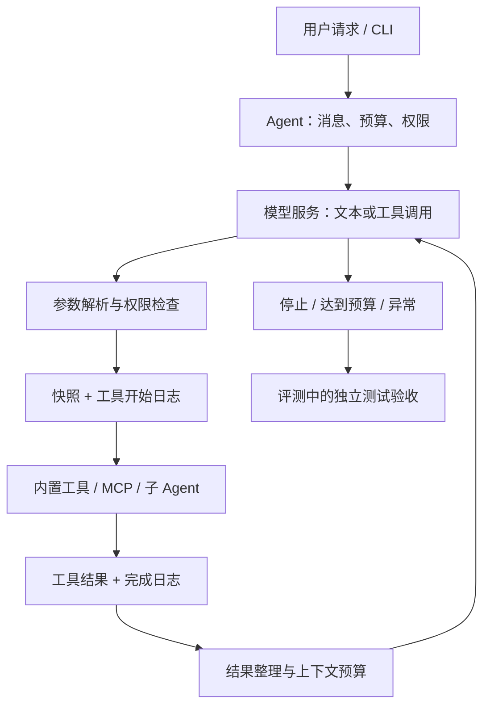
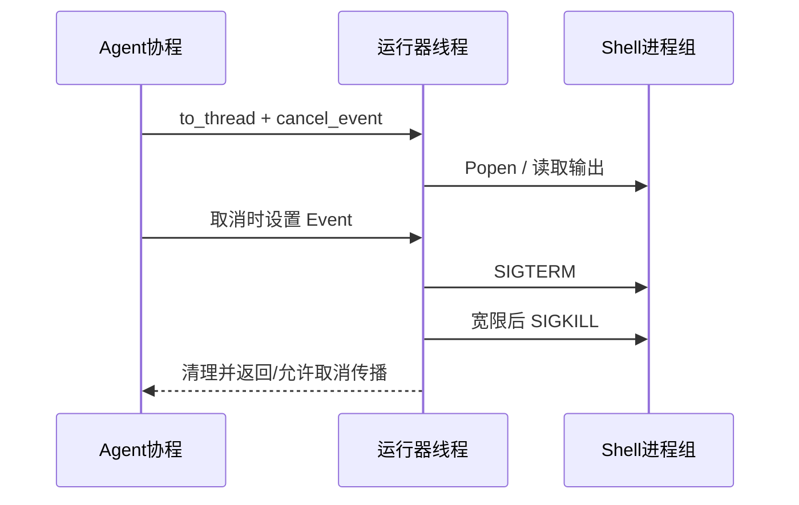

# Python Coding Agent：AI 技术应用岗位面试手册

> 核对日期：2026-11-11。主体依据代码阅读指南对应的 Python 版本 `4911e4b`，核心改进基线为 `4e0a43f`。后续反馈、rubic、Plan 和失败接续属于独立实验，见[版本与实验证据](#experiments)，不能混称为 GitHub 默认实现。
>
> 本文用于理解和讲解实际项目，不把未来方案写成已经完成的能力。代码链接相对于本文件，保留在仓库内打开即可跳转。原阅读顺序见[代码阅读指南](CODE-READING-GUIDE.zh-CN.md)。

<a id="navigation"></a>
## 导航与搜索

| 想回答的问题 | 阅读位置 | 建议搜索词 |
|---|---|---|
| 这个项目是什么，你贡献了什么？ | [项目定位](#position) | `个人贡献`、`上游` |
| 一道任务从输入到完成怎么走？ | [系统总览](#overview)、[Agent Loop](#loop) | `完整调用链`、`停止条件` |
| 进程、线程和协程分别在哪里？ | [并发总表](#concurrency)、[命令生命周期](#shell) | `to_thread`、`进程组` |
| 工具如何注册、校验和调用？ | [工具体系](#tools)、[权限](#permission) | `tool_definitions`、`Schema` |
| Skills 和 MCP 有什么区别？ | [Skills](#skills)、[MCP](#mcp) | `模板`、`JSON-RPC` |
| 多 Agent 怎样隔离、管理和维护？ | [子 Agent](#subagent)、[管理与维护](#multiagent-management) | `Supervisor`、`共享文件系统` |
| 历史太长怎么办？ | [上下文治理](#context) | `六字段`、`调用配对`、`预算` |
| Memory 怎么召回、去重和维护？ | [长期记忆](#memory) | `already_surfaced`、`冲突` |
| 进程关闭后如何接着做？ | [会话恢复](#recovery)、[持久化总表](#persistence) | `unknown`、`checkpoint` |
| 定时任务和任务清单有吗？ | [目标与调度](#autonomy) | `/goal`、`/loop`、`TaskList` |
| 如何判断真的成功？ | [评测与溯源](#evaluation)、[实验证据](#experiments) | `独立验收`、`24/60` |
| 出问题从哪里查？ | [维护手册](#operations) | `恢复步骤`、`故障定位` |
| 面试怎么组织答案？ | [问答与学习路线](#interview) | `一分钟`、`三分钟`、`追问` |

完整章节：

1. [项目定位与个人贡献](#position)
2. [整体架构与完整调用链](#overview)
3. [进程、线程、协程总表](#concurrency)
4. [启动与配置](#startup)
5. [Agent Loop 与停止条件](#loop)
6. [工具注册、分发与结果](#tools)
7. [权限和只读 Plan 模式](#permission)
8. [Skills](#skills)
9. [MCP](#mcp)
10. [子 Agent](#subagent)与[多 Agent 管理维护](#multiagent-management)
11. [上下文治理](#context)
12. [长期 Memory](#memory)
13. [会话与工具执行恢复](#recovery)
14. [Shell 命令生命周期](#shell)
15. [目标、调度与任务规划](#autonomy)
16. [持久化文件地图](#persistence)
17. [协议、评测和失败溯源](#evaluation)
18. [版本与实验证据](#experiments)
19. [维护、故障排查和建设顺序](#operations)
20. [面试问答与学习路线](#interview)

<a id="position"></a>
## 1. 项目定位与个人贡献

这是一个面向代码阅读、文件修改和测试执行的轻量 Python Coding Agent。模型选择下一步动作，程序负责检查权限、执行工具、收集结果，再把结果交给模型。它通过工具真正修改工作目录中的文件，不只是生成代码建议。

基础框架来自 `claude-code-from-scratch`；`learn-claude-code` 用于学习模块划分、工作流与日志设计。准确的个人定位是“开源复现与二次开发”，不是从零实现所有组件。

| 范围 | 可以怎样介绍 | 不能怎样扩大表述 |
|---|---|---|
| Agent 主循环、MCP、Skills、Memory、子 Agent | 理解、复现并集成已有能力 | 全部由自己原创 |
| 会话快照、执行日志、会话锁 | 重点改进中断后的状态辨认与结果复用 | 任意外部副作用 exactly-once |
| Shell 运行器 | 改进输出读取、超时、取消、进程组清理 | 任意平台、任意逃逸子进程都能回收 |
| 结构化摘要、归档和回退 | 改进上下文压缩的可检查性与可追溯性 | 摘要保证语义无损 |
| 协议修复和固定题集评测 | 用工程测试和独立验收区分不同失败来源 | 60 题证明所有系统能力有效 |

**面试开场可以这样说：**

> 我基于开源 Python Agent 做了二次开发，跑通模型推理、工具调用和测试反馈的完整链路。我的重点不是增加更多工具，而是处理长任务中的三个工程问题：执行中断后不知道做到了哪里、Shell 命令超时或取消后难以清理、历史压缩后容易丢失任务状态。我分别增加了会话与执行日志恢复、命令生命周期管理，以及结构化摘要和回退，并用固定任务集检查效果。

[返回导航](#navigation)

<a id="overview"></a>
## 2. 整体架构与完整调用链

代码入口：[CLI](../../python/mini_claude/__main__.py)、[Agent](../../python/mini_claude/agent.py)、[工具](../../python/mini_claude/tools.py)。



### 一次代码修改如何执行

1. CLI 解析模型地址、权限模式、预算和恢复参数，创建 Agent。
2. 用户请求进入 `chat()`；会话锁确保同一会话不会被两个进程同时推进。
3. 检查执行日志中是否有未解决的执行结果未知记录；有则停止派发新工具。
4. 构造系统提示、消息历史和可用工具定义，调用模型服务。
5. 模型返回工具调用，例如 `read_file`。程序解析参数、检查权限。
6. 执行前保存会话，并以调用 ID 记录 `started`；随后执行工具。
7. 记录 `completed` 和结果，将结果配对放入消息历史。
8. 模型根据结果继续编辑、执行测试，或只输出文本并结束。
9. 退出时保存状态、处理未配对调用。评测器另行运行测试确认任务是否通过。

程序的职责是管理执行和证据；模型的职责是提出动作。模型说“准备修复”和程序实际调用 `edit_file` 是两件不同的事。

### 三个容易混淆的成功

| 成功层次 | 例子 | 能说明什么 |
|---|---|---|
| 工具调用完成 | `edit_file` 正常返回 | 一次调用有了可记录的结果，结果也可能是业务错误 |
| 操作成功 | 文件确实替换成功 | 文件变化发生了，不能证明代码正确 |
| 任务成功 | 独立测试验收通过 | 在既定测试条件下满足要求 |

[返回导航](#navigation)

<a id="concurrency"></a>
## 3. 进程、线程、协程总表

**协程负责组织等待，线程承载部分阻塞工作，进程承载外部命令或服务。子 Agent 不自动等于子进程。**

| 组件 | 实际运行位置 | 并发方式 | 生命周期与维护 |
|---|---|---|---|
| CLI 和主 Agent | 一个 Python 进程 | `asyncio` 事件循环；交互输入仍有同步 `input()` | CLI 创建，退出时调用 `close()`；同步输入期间会阻塞事件循环 |
| 模型请求 | 主进程的异步 HTTP 客户端 | `await`/流式响应 | 复用客户端；退出关闭连接；模型权重在外部服务端 |
| 本地文件工具 | 主进程 | 只读工具可被 `gather` 调度，但很多处理器本身是同步函数 | 不应把协程分组等同于磁盘 I/O 已全面线程化 |
| Shell 运行器 | 线程池工作线程 + Shell 子进程 | `asyncio.to_thread()`、`threading.Event`、selectors | 工作线程监视输出；取消事件驱动进程组清理 |
| MCP Server | 每个 stdio 服务一个子进程 | stdout 读取协程、请求 ID 对应 Future | 建连与发现一次；关闭时取消 reader、kill 服务、失败 pending 请求 |
| 子 Agent / fork Skill | 同一 Python 进程中的另一个 Agent 对象 | `await sub_agent.run_once()` | 消息、角色和工具集合独立；共享文件系统，不是容器隔离 |
| Memory 预取 | 主进程后台协程 | `asyncio.create_task()` | 结果就绪后消费；新轮可取消尚未完成的旧预取 |
| `/goal`、`/loop` | 当前 CLI 进程 | 异步循环与等待 | 会话内调度，进程退出后不等于持久定时服务 |
| 60 题评测 worker | 计算节点上的独立 Python 进程 | 两个 worker 共享一个模型服务 | 每题隔离目录；另有工具子进程和独立测试进程 |
| vLLM | 计算节点外部模型服务进程及其内部工作进程 | 服务端调度 | 整批加载一次；Agent 请求不会为每题重新加载权重 |

### 为什么只读工具可以并发，修改工具要谨慎

同时读取两个无依赖文件通常不互相影响；同时修改一个文件可能覆盖彼此结果。当前 OpenAI 路径把连续的安全工具分组并发，修改和 Shell 等其他工具按顺序执行。安全集合包括 `read_file`、`list_files`、`grep_search`、`web_fetch`。

“并发安全”还需要具体分析。例如远程读取可能有服务端副作用，文件也可能被别的程序修改。工具白名单是工程策略，不是形式化安全证明。

当前没有 `blockedBy` 依赖图调度：调用 B 依赖 A 的结果时，应分成两轮，或由程序明确组织依赖。仅把 A、B 放进同一响应，不会自动形成“失败就跳过后续操作”的事务。

[返回导航](#navigation)

<a id="startup"></a>
## 4. 启动与配置

代码：[__main__.py](../../python/mini_claude/__main__.py)、[prompt.py](../../python/mini_claude/prompt.py)。搜索 `parse_args`、`main`、`run_repl`、`_one_shot`。

CLI 支持一次性任务和交互 REPL，核心参数有 `--model`、`--api-base`、`--max-turns`、`--max-cost`、`--resume-id` 及权限选项。`asyncio.run()` 启动事件循环，Agent 自身不会负责把本地模型权重加载到 GPU。

已安装本项目环境后，一次性调用可以写成：

```bash
export MINI_CLAUDE_STATE_DIR=/path/to/persistent/project-state
python -m mini_claude --model qwen3-8b-local \
  --api-base http://127.0.0.1:8020/v1 --max-turns 10 \
  "读取项目代码，实现需求并运行已有测试"
```

地址、模型名、凭证和 Python 环境必须与实际服务对应；示例不负责启动 vLLM。状态目录变量应在 Python 启动前设置，因为部分目录常量在导入时计算。

**进程维护：** 交互输入和确认回调使用同步输入，不是完整的非阻塞终端框架。一次性模式有信号处理和关闭路径；嵌入应用时也应使用 `try/finally` 调用 `await agent.close()`，不能只依赖正常返回。

**面试表达：** 我把模型服务和 Agent 执行器分开：模型服务负责推理，Agent 进程维护任务状态和工具执行，因此可以复用常驻模型服务。

[返回导航](#navigation)

<a id="loop"></a>
## 5. Agent Loop 与停止条件

代码：[agent.py](../../python/mini_claude/agent.py)。搜索 `chat`、`_chat_leased`、`_chat_openai`、`_chat_anthropic`、`run_once`。

这属于 ReAct 式“推理—动作—观察”交互，但不需要声称拿到了模型内部完整思维链。我们记录的是可见文本、工具请求和工具结果。

### 状态和预算

Agent 保存消息列表、当前调用轮数、Token 使用量、停止原因和工具读取状态。一次模型响应可以包含多个工具调用，不能把“10 个工具轮次”理解成“最多 10 个函数调用”。预算和停止条件由程序控制，提示词只是辅助。

OpenAI 与 Anthropic 的消息协议不同，所以代码有两条执行路径。不能只验证 OpenAI 路径，就说另一个后端在所有取消、并发和恢复场景下完全等价。

### 为什么会出现“我接下来修改”然后停止

普通路径收到没有 `tool_calls` 的回答，就认为这一轮模型执行结束。模型文本可以表示未完成，但程序并没有通用的语义完成判定。这也是近期实验中发现的重要问题。

`run_once()` 返回文本、停止原因和 Token；它不是成功判定器。外层调用方应检查任务证据，评测中用独立测试完成这一步。

### 维护重点

- 记录 `model_finished`、`turn_limit`、取消和运行异常，分别统计。
- 模型文本中承诺的动作不能写入“已执行”状态。
- 不因模型没有工具调用就无限续接；续接也消耗时间和 Token。
- 实验中的失败接续是一次性提醒，具体范围见[实验章节](#experiments)。

**面试表达：** 我区分了模型停止和任务成功。前者是执行循环的状态，后者需要工具证据或外部验收；我们确实遇到过模型指出测试错误却未执行修复的案例。

[返回导航](#navigation)

<a id="tools"></a>
## 6. 工具注册、分发与结果

代码：[tools.py](../../python/mini_claude/tools.py)、[Agent 分发](../../python/mini_claude/agent.py)。搜索 `tool_definitions`、`get_active_tool_definitions`、`execute_tool`、`_dispatch_tool`。

### 注册与调用

1. 工具定义表声明名称、用途和 `input_schema`。
2. API 适配层转换成模型服务需要的工具格式。
3. 模型返回名称与 JSON 参数。
4. 执行链处理解析、权限和日志。
5. `_dispatch_tool` 区分内置工具、MCP、子 Agent、Skill 等入口。
6. 普通工具由处理器映射调用具体函数。

这是“工具定义表＋分发入口”，无需包装成已经实现完整插件生命周期的企业级 Tool Registry。JSON Schema 描述也不自动等于运行时完整 Schema 校验；默认版本有解析和各工具自己的检查，候选版额外补了部分必填字符串检查。

### 工具范围

| 工具 | 用途 | 主要边界 |
|---|---|---|
| `read_file` | 获取当前文件内容 | 记录读取时的 mtime，用于编辑前检查 |
| `list_files`、`grep_search` | 找文件和定位文本 | 大量结果也会占上下文 |
| `write_file` | 写入文件 | 已存在文件需要先读取；写入不是代码正确性证明 |
| `edit_file` | 用新文本替换唯一旧文本 | 旧文本缺失、多处匹配或文件已外部变化时拒绝 |
| `run_shell` | 执行命令和测试 | 有副作用、时间和输出预算 |
| `web_fetch` | 获取外部内容 | 普通网络读取，不等于完整浏览器 |
| `tool_search` | 激活延迟暴露的工具 | 名称/描述搜索，不是任意新代码下载 |
| `agent`、`skill` | 委派或加载技能 | 由 Agent 内部分发处理 |

Benchmark 只开放前六个编码工具中的读取、列文件、搜索、写入、编辑、Shell，不开放 MCP、子 Agent、web_fetch 或长期 Memory。

### 编辑前读取检查

`read_file` 后记录绝对路径与修改时间。写入前若文件存在但没读过，或 mtime 变化，就要求重新读取。它能降低基于过期内容覆盖文件的风险，但不是文件事务：检查与写入之间仍存在竞争窗口，也不是所有文件系统都能靠 mtime 精确判断内容变化。

### 结果应该怎样呈现

后续候选改进把“操作是否发生”和“返回了什么”分开。比如旧文本不唯一应明确说文件没有修改；`old_string == new_string` 应说匹配到了但没有替换，而不是虚报编辑成功。此改进不在 24/60 的历史默认版本中，不能混写。

**维护重点：** 新增工具时同时检查定义、处理器、权限、日志、副作用、取消和输出上限。增加 description 不等于增加可靠执行能力。

[返回导航](#navigation)

<a id="permission"></a>
## 7. 权限和只读 Plan 模式

代码：[tools.py](../../python/mini_claude/tools.py)、[autonomy.py](../../python/mini_claude/autonomy.py)、[agent.py](../../python/mini_claude/agent.py)。搜索 `check_permission`、`_check_permission_rules`、`_child_permission_mode`。

### 现有逻辑

- 显式 deny 规则优先，即使 bypass 模式也先检查 deny。
- Plan 模式阻止 Shell 和普通文件修改，允许写指定计划文件。
- 只读工具通常直接允许；`acceptEdits` 放行编辑类工具。
- 需要确认时，交互入口询问用户；`dontAsk` 对需要确认的操作拒绝。
- Auto 模式存在模型分类器判断路径，不是基于形式化规则的安全证明。

不能说“所有修改都弹窗审批”：默认策略只对具体条件要求确认。也不能把这套应用层规则叫作操作系统沙箱。Shell 仍可触及当前用户有权限访问的资源；真正的评测隔离另由评测程序实现。

### 两种 Plan 要区分

| 概念 | 所在位置 | 是否相同 |
|---|---|---|
| 上游只读 Plan 模式 | 权限切换、计划文件、审批 | 普通 CLI 的工作模式 |
| 实验 `update_plan` | 可替换当前任务计划，注入下轮消息 | 后续 benchmark 候选功能 |

移除 benchmark 的 `update_plan`，并不等于删掉项目原有的只读规划模式。

**进程与维护：** 权限检查运行在主进程，配置按调用路径读取；它没有独立安全服务。评审 MCP、自定义子 Agent 和 fork Skill 时要检查实际工具集合和继承模式，不能只看角色提示中的“只读”。

[返回导航](#navigation)

<a id="skills"></a>
## 8. Skills：按需加载任务方法

代码：[skills.py](../../python/mini_claude/skills.py)、[Agent 的 Skill 执行](../../python/mini_claude/agent.py)。搜索 `discover_skills`、`resolve_skill_prompt`、`_execute_skill_tool`。

Skill 是一份带元数据的任务说明，解决“遇到某类任务时，应该按什么方法做”。Tool 则是执行动作的程序入口。二者不能混为一谈。

### 加载流程

1. 发现用户目录 `~/.claude/skills` 和项目目录 `.claude/skills` 下的技能。
2. 解析 frontmatter 和正文；同名项目技能覆盖用户级定义。
3. 用 `$ARGUMENTS` / `${ARGUMENTS}` 和 `${CLAUDE_SKILL_DIR}` 展开参数。
4. 普通模式把技能正文作为工具结果交回当前 Agent。
5. `context: fork` 模式创建子 Agent，在独立消息上下文中执行。

工具范围配置在 fork 创建子 Agent 时有实际过滤；普通模式返回提示内容，不应声称它自动为主 Agent 永久改写了工具权限。

**进程与持久化：** 发现和展开是同进程的文件读取；Skill 文件长期存在，发现结果有进程内缓存。修改文件后需要重启或使用缓存重置入口才能确保重新发现。fork 是 Agent 对象，不是 OS 的 `fork()`。

**维护：** 保留技能来源和版本；检查项目覆盖关系、参数展开、工具授权及是否过期。加载文档并不能把文档中的指令升级为用户授权。

**面试表达：** 我把技能当作按需注入的方法说明，把工具当作执行能力；这样不必把所有任务流程长期塞进系统提示词。

[返回导航](#navigation)

<a id="mcp"></a>
## 9. MCP：把外部工具接入同一调用链

代码：[mcp_client.py](../../python/mini_claude/mcp_client.py)。搜索 `McpConnection`、`_send_request`、`McpManager`。

本实现是轻量 stdio JSON-RPC 客户端。它通过配置启动 MCP 服务程序，进行初始化、发现工具、调用工具。不能据此声称已经支持所有 MCP 传输方式，例如完整远程 HTTP/SSE 服务管理。

```text
Agent 工具名 mcp__server__tool
  → McpManager 解析 server 和 tool
  → stdin 写 JSON-RPC 请求（带 ID）
  → MCP 服务进程执行
  → stdout reader 协程读取响应
  → 用 ID 找到 Future，交回调用结果
```

配置来源包含用户 `.claude/settings.json`、项目 `.claude/settings.json` 和 `.mcp.json`。工具前缀避免不同服务的同名工具发生冲突。

### 进程与维护边界

每个 stdio 服务有子进程和 stdout reader 协程；待返回请求保存在 `_pending`。关闭连接时取消 reader、kill 进程并使 pending 请求失败。

代码核对发现以下生产化缺口，面试时可以作为改进方向：

- 普通 `call_tool` 路径没有完整的逐请求超时与重连策略。
- stderr 建立了 PIPE，但此模块没有独立持续读取循环；高输出服务存在管道阻塞风险。
- 关闭调用了 kill，但没有完整 await wait 回收流程。
- `_send_request` 在写入并 drain 后才登记 Future，快速响应存在登记时序风险。
- 断流后 pending 请求的统一失败处理仍需补齐。

这些是静态代码检查发现的风险，不表示已经通过故障注入证明每一种都发生过。

**面试表达：** MCP 解决外部工具发现和调用协议统一的问题；工具的权限、超时、进程清理和结果可信度仍然需要 Agent 宿主负责。

[返回导航](#navigation)

<a id="subagent"></a>
## 10. 子 Agent：主 Agent 委派，结果返回

代码：[subagent.py](../../python/mini_claude/subagent.py)、[agent.py](../../python/mini_claude/agent.py)。搜索 `get_sub_agent_config`、`_execute_agent_tool`。

项目使用 Supervisor–Worker 式委派：主 Agent 给子任务，子 Agent 在独立消息列表中执行，返回结果后主 Agent 继续决策。

| 角色 | 工具配置 | 适合的任务 |
|---|---|---|
| Explore | `read_file`、`list_files`、`grep_search` | 定位代码、查调用链 |
| Plan | 同样只读 | 分析方案、列改动点 |
| General | 较完整工具集，排除再次调用 `agent` | 执行一个相对独立的任务 |
| 自定义角色 | 用户/项目 Markdown 配置 | 按职责限定工具和提示 |

用户级配置来自 `~/.claude/agents`，项目级来自 `.claude/agents`，项目优先。未写工具限制的自定义角色可能得到较宽的工具集合，因此“角色名像审计员”并不意味着真正只读。

### 隔离了什么，没有隔离什么

隔离的是消息历史、角色提示和工具集合。主 Agent 不需要接收子 Agent 每次检索的完整输出，只接收返回结果，因而有助于控制主上下文增长。

子 Agent 与父 Agent 仍在同一进程、同一工作目录和文件系统中。两个写入者可能冲突；当前委派入口是等待子 Agent 返回，不应宣传成完整平级 Agent Teams、分布式任务平台或 DAG 调度器。

### 资源与预算

子 Agent 创建自己的客户端，父 Agent 汇总返回的 Token。子任务失败返回错误说明。当前创建路径没有把父 Agent 的全部轮数/费用约束明确传入；调用结束也缺少统一的 `finally: await sub_agent.close()`。这两处应列为资源与预算治理的待改进点。

**面试表达：** 我用子 Agent 分离探索上下文和执行职责，不把它解释成进程隔离。真正并行写代码需要独立工作区或显式协调，不能仅靠不同角色提示防冲突。

[返回导航](#navigation)

<a id="multiagent-management"></a>
### 10.1 多 Agent 管理与维护：当前机制与建设方案

先给面试官一个清楚的判断：**当前项目有主 Agent 委派子 Agent 的能力，但没有完整 Agent Manager。** 角色、消息、工具和调用结果已有管理；跨 Agent 的全局预算、任务注册表、资源归属和自动恢复还不完整。

| 管理维度 | 当前代码 | 应补齐的管理方式（建议） |
|---|---|---|
| 创建 | `_execute_agent_tool` 按角色构造 Agent | 统一工厂登记 parent、child、task、版本和资源归属 |
| 任务输入 | 主 Agent 提供 prompt、type、description | 加目标、允许文件、验收条件和截止时间 |
| 上下文 | 子 Agent 有自己的消息列表 | 保持最小任务包，明确哪些父上下文可以传递 |
| 权限 | 工具集合过滤＋`_child_permission_mode` | 父子权限取交集，不能委派扩大权限 |
| 执行 | 当前入口 await 子任务返回 | 需要并行时增加有界调度及依赖检查 |
| 预算 | 子任务结束后汇总 Token | 派发前预留额度，运行中扣减，包含失败与取消成本 |
| 结果 | 返回文本或错误字符串 | 结构化状态、证据路径、修改清单和测试结果 |
| 关闭 | 有 `Agent.close()`，委派入口未统一调用 | 所有退出路径 finally close，并回收所属资源 |
| 恢复 | 子对象有 session 和 Journal；父调用也记日志 | 持久关联父调用与子 session，恢复时先确认原子任务是否已执行 |
| 文件协作 | 共享 cwd；读取时间检查降低过期编辑风险 | 按文件指定写者，或独立 worktree 后由主 Agent 审核合并 |

#### A. 主 Agent 如何拆任务

适合委派的是输入明确、输出可核验、与其他任务写入不冲突的工作。例如：

```text
主任务：修复登录接口并通过回归测试

Explore A：只读查找登录入口、调用链和配置位置
Explore B：只读检查相关测试、失败条件和覆盖缺口
主 Agent：汇总 A/B，决定需要修改哪些文件
Worker C：在限定文件中实施修复，返回 diff 和实际测试结果
主 Agent：检查修改和验收证据，决定是否完成
```

这个例子是建议的协作流程。当前代码没有自动把 A/B 建成并发 DAG，也没有自动给 C 创建 worktree。A/B 的结果都影响 C 时，C 必须等依赖满足；不能仅为了并行而提前修改。

不值得委派的情况包括：一条读取就能回答、子任务需要完整父历史才理解、不同 Worker 必须频繁交叉改同一文件。委派会增加模型请求、信息传递和验证成本。

#### B. 权限管理：当前存在一个需要说清的边界

`_child_permission_mode()` 保留父级 `plan` 和 `auto`；其他父模式会返回 `bypassPermissions`。因此当前不能声称“所有子 Agent 严格继承父级最小权限”。Explore/Plan 的工具列表仍然只读，但 General 或宽工具集合的自定义角色需要额外审查。

建议把能力视为集合：

```text
子 Agent 实际能力 = 父任务授权 ∩ 角色工具集合 ∩ 当前任务文件/操作范围
```

工具 schema 没暴露某能力，比只在提示词中说“不要用”更有约束力；但 Shell 一旦开放，还需要操作系统级文件/网络限制。空工具集合也要明确处理：当前构造器 `custom_tools or tool_definitions` 会让空列表退回全工具，不能把传 `[]` 当成安全的禁用方式。

#### C. 进程与线程归属

当前父子 Agent 是同进程对象；每个对象有独立 session ID、消息和客户端，但共享工作目录、Python 全局状态及命令活动注册表。

建议每次创建子任务时登记：

```text
parent_session_id → parent_tool_call_id → child_session_id → task_id
                                   ↘ 客户端、预取 Task、命令取消句柄
```

这样主 Agent 取消一个子任务时，可以只取消它拥有的命令，而不是调用进程级 `cancel_all_commands()` 影响其他任务。若以后把 Worker 放到独立进程，还要增加 IPC、进程退出回执与外部副作用核验；不是把 `asyncio` 换成 `multiprocessing` 就完成治理。

#### D. 生命周期与持久化

下面是建议状态机，不是当前代码已经具有的完整管理器：

```text
created → running → returned → verified
             ├→ failed
             ├→ cancelled
             └→ unknown
```

- `returned` 仅代表拿到子 Agent 回复，不能直接升级为 verified。
- `cancelled` 需要区分是否已经产生文件修改；取消不意味着回滚。
- `unknown` 表示父进程失去结果，但子任务可能已经执行，不能直接重建子 Agent 重跑。
- 恢复先查父调用日志，再查关联子 session 与实际文件；结果已完成就复用，状态不明则核验。

当前父工具日志会把一次子 Agent 调用纳入执行记录，子 Agent 自己也生成 session。缺口在于父子 session 的稳定关联、完整资源收尾和结构化任务状态，不是再多存一份聊天文本就能解决。

#### E. 结果如何汇总

当前主 Agent 主要收到文本。更可靠的建议格式是：

```json
{
  "task_id": "inspect-login-tests",
  "status": "returned",
  "summary": "定位到登录失败的测试与相关接口",
  "files_changed": [],
  "tests": [{"command": "实际执行的命令", "status": "failed", "evidence": "日志路径"}],
  "unresolved": ["尚未执行修复"],
  "evidence": ["文件位置或证据引用"]
}
```

这个 JSON 是接口设计示意，不是项目当前已经校验的协议。主 Agent 应核查路径、文件 diff 和测试，不把“子 Agent 说通过了”当唯一事实。子 Agent 返回的外部网页或文件内容也不能升级成新的用户指令。

#### F. 并发和预算怎样控制

建议把全局模型并发、子任务并发、同文件写入并发分开管理。例如模型服务可以承载两个请求，不等于允许两个 Agent 同时写同一文件。

- 使用 Semaphore 限制活跃子任务，但 semaphore 本身不表达任务依赖。
- 共享服务容量允许时并行只读探索；有顺序或写入冲突的任务串行。
- 为子任务分配轮数、总 token、时间限额，父任务保留汇总和验收额度。
- 请求派发前登记预算；失败、取消、摘要和未知请求也纳入统计，不能只统计成功返回的 Token。
- 父 Agent 停止时，先取消和等待子任务收尾，再关闭客户端；对失联任务保留 unknown 证据。

当前代码对子 Agent 返回后做 Token 汇总，不等于已经有上述共享预算账本。

#### G. 日常维护与故障定位

| 现象 | 应检查什么 | 避免的错误处理 |
|---|---|---|
| 子 Agent 一直不返回 | 请求状态、工具等待、轮数/时间预算 | 无上限重复创建 Worker |
| 同一文件被改乱 | 修改者、diff、工作区和读写时序 | 仅靠角色提示协调写入 |
| 主 Agent 已退出，命令仍在 | 子 session 资源归属、进程组、close 路径 | 按模糊进程名批量 kill |
| 子 Agent 声称完成但测试失败 | 原始测试日志、实际文件、验收条件 | 直接信任自然语言结果 |
| 成本超出父预算 | 是否传入子预算、失败请求是否记账 | 只在子任务完成后汇总 |
| 恢复后重复执行 | 父调用 ID 与子 session 关联、unknown | 新建 session 绕过原记录 |
| 权限比父 Agent 更大 | `_child_permission_mode` 和实际工具定义 | 把“继承角色”当“继承授权” |

建议补的针对性测试：父取消时子 Shell 收尾；子异常时客户端关闭；子任务超预算；同文件双写；父进程中断后的关联恢复；只读角色无法获得写工具；空工具列表不会扩大权限。这些属于建设清单，本次文档编写没有实现或执行它们。

**面试回答可以这样组织：**

> 我目前采用主 Agent 委派子 Agent 的方式，已有角色、独立上下文和工具集合管理。它适合把探索过程移出主上下文，但仍共享进程和文件系统。管理上我重点关注四件事：子权限不能超过父授权，子任务要有可核验的结果，取消必须带着资源一起收尾，恢复要关联父调用和子会话。当前还缺全局预算和完整生命周期管理，因此我会先补这些，再扩大并发，而不是只增加 Agent 数量。

[返回导航](#navigation)

<a id="context"></a>
## 11. 上下文治理：控制输入，同时保留工作依据

代码：[context_summary.py](../../python/mini_claude/context_summary.py)、[agent.py](../../python/mini_claude/agent.py)。搜索 `_persist_large_result`、`_run_compression_pipeline`、`_compact_structured`、`_prepare_local_context`。

### 先区分三种数据

- **工作上下文**：这次模型请求实际发送的消息、工具结果和系统提示。
- **历史摘要**：对过去任务状态的有损整理，用来减少重复历史。
- **原始证据**：工具执行日志、历史归档和实际文件，用来重新核对事实。

摘要不是原始证据，也不是跨会话通用知识库。

### 压缩分层

| 层次 | 实际方法 | 优点与代价 |
|---|---|---|
| 大结果落盘 | 默认版超过 30 KiB 的结果写文件，消息中放预览与路径 | 避免反复发送全文；模型可能需要再读取 |
| 工具结果预算 | 按当前利用率缩短较长结果 | 便宜；可能丢失中间细节 |
| 旧结果整理 | 清理较早工具正文，保留较近结果；考虑缓存是否仍热 | 降低历史重复；旧详情不再自动可见 |
| 结构化摘要 | 总结旧历史，保留近期完整交互 | 更紧凑；有模型成本和事实错误风险 |
| 发送前计数 | 本地 tokenizer 按消息和工具模板计数 | 超限明确报错，不静默左截断 |

30 KiB 是历史默认值；后续候选改成 4 KiB，并调整预览与按行读取。不要把这些版本的阈值混写。工具上游也有输出上限，所谓落盘完整结果是“运行器交给该层的完整结果”，不保证捕获无限原始 stdout。

### 六字段摘要保留什么

| 字段 | 作用 | 例子 |
|---|---|---|
| `goal` | 当前用户目标 | 实现函数并通过已有测试 |
| `constraints` | 用户约束 | 不修改测试文件 |
| `files_changed` | 文件变化及证据等级 | attempted / applied / verified |
| `tests` | 测试命令、状态和结果 | planned / attempted / passed / failed / unverified |
| `pending` | 未完成工作 | 仍有一个边界条件失败 |
| `facts` | 接续所需事实 | 接口返回值是整数而不是元组 |

压缩前先保存会话；拆分时保留最近两段完整交互，单个长任务则尽量保留最近完整助手轮次及原始用户请求。这里是代码中的 `keep_turns=2`，**不是另一 WebArena 项目的 Actor 六步历史**。

拆分同时检查工具调用 ID 和结果配对，不能把调用留在一边、结果留在另一边。模型摘要通过字段、类型、状态枚举和长度检查后，仍需确认整体更短；成功时保存压缩前的当前消息历史到 `context-archives`，然后替换上下文。失败则保留原历史。

### 如何减少重要信息丢失

1. 目标、约束和未完成项有固定位置。
2. 区分“准备做”“已经做”“已经验证”。
3. 近期交互保留完整配对，避免截断正在进行的工具调用。
4. 原始执行日志和压缩前归档提供回查依据。
5. 结构校验失败不强行使用摘要；任务事实仍由实际文件与测试确认。

**不能承诺语义无损。** JSON 合法不代表总结正确；归档也不会自动全部再次注入模型。早期工具正文若已被有损整理，压缩时归档保存的是当时消息状态，不能笼统称为永不丢失的全量原始轨迹。

### 线程与维护

摘要请求在同一 Agent 的异步执行链里等待，没有独立 Summary Agent 进程。文件归档是同步写入；大规模归档不应长期阻塞事件循环。当前摘要请求本身缺少完善的输入预检，实际实验中出现过“为了压缩而发出的请求也超限”。下一步应该给摘要请求独立计数、限制材料并保留回退，而不是直接调大总窗口。

**面试表达：** 我的目标是让压缩后的工作状态可检查、原始依据可追溯，而不是声称压缩无损或一定降低总 Token。摘要本身的费用和后续修复成本也要计入。

[返回导航](#navigation)

<a id="memory"></a>
## 12. 长期 Memory：跨会话复用信息

代码：[memory.py](../../python/mini_claude/memory.py)、[agent.py 的注入逻辑](../../python/mini_claude/agent.py)。搜索 `save_memory`、`select_relevant_memories`、`start_memory_prefetch`、`_consume_memory_prefetch_if_ready`。

### 保存什么，放在哪里

记忆是带 frontmatter 的 Markdown 文件，分为 `user`、`feedback`、`project`、`reference`。目录为：

```text
STATE_ROOT/projects/<当前工作目录字符串的 SHA256 前16位>/memory/
  MEMORY.md
  project_*.md
  feedback_*.md
  ...
```

`MEMORY.md` 是索引。通过相关文件工具写入记忆目录时会尝试更新索引。这里不是向量数据库，也没有 BM25/embedding 混合召回。

### 召回与注入流程

1. 扫描记忆文件头，构造名称、描述等候选清单。
2. 排除本会话已经注入过的文件路径。
3. 通过模型侧请求，选择与当前输入相关的文件名。
4. 校验选择属于候选集合，最多读取 5 个。
5. 加入保存时间或过期提示。
6. 后台预取完成后，在合适的消息位置注入文本，并记录路径和累计字节数。

模型请求和 Memory 预取是异步协程。新查询开始时会先尝试消费上次结果，必要时取消未完成的旧预取。它不是独立常驻 Memory 进程。

### 去重、合并、冲突：实际做到哪一步

| 能力 | 当前实现 | 边界或改进方向 |
|---|---|---|
| 注入去重 | `_already_surfaced_memories` 按路径排除 | 不是语义去重；同一路径内容更新后也可能不再召回 |
| 保存覆盖 | 类型与名称生成文件名，同名可覆盖 | 不是经过事实裁决的合并，slug 碰撞也需考虑 |
| 时间提示 | 用文件 mtime 生成新旧提示 | 不是自动判断事实已失效 |
| 冲突处理 | 提示与模型阅读层处理 | 没有版本化冲突解决器，不能声称已自动裁决 |
| 并发写入 | 普通文件写与索引重建 | 未采用会话快照同等级的原子事务与项目锁 |
| 跨重启去重 | 当前集合主要在内存中 | 恢复会话没有完整恢复该召回集合与累计计数 |

代码阈值包括：最多保留 200 个候选文件头（扫描阶段仍可能遍历更多文件）、单文件目标上限 4096 字节、会话累计目标约 60 KiB。会话上限是启动预取前的门槛，不是逐次注入精确裁剪；部分“字节上限”用字符串切片实现，对多字节字符也不是严格字节限制。不能把这些常量当作已经严格证明的 token 预算。

### 怎样规划更可靠的 Memory——以下为建议，不是已实现

- 为记忆保存稳定 ID、来源、更新时间和适用范围，避免仅以自然语言名称覆盖。
- 写入采用临时文件替换，加项目级锁；索引可从正文重建。
- 区分“重复事实”和“事实矛盾”：前者合并来源，后者保留版本或标记待核。
- 新事实明确取代旧事实时记录取代关系，不让模型静默覆盖历史。
- 使用文件内容哈希配合路径判断是否已注入；重新启动时恢复召回状态。
- 按实际 tokenizer 限制注入预算，再评价召回是否提高任务效果。

长期 Memory 适合偏好、稳定约定和资源指针。当前任务的待办与执行状态应由会话、摘要或独立任务状态保存，不要无差别写入长期记忆。

**面试表达：** 现有 Memory 是文件持久化加模型选择式召回，按文件路径去重。我不会把它说成完整知识图谱或冲突融合系统；真正需要加强的是来源、更新和失效管理。

[返回导航](#navigation)

<a id="recovery"></a>
## 13. 会话与工具执行恢复

代码：[session.py](../../python/mini_claude/session.py)、[session_lock.py](../../python/mini_claude/session_lock.py)、[execution_journal.py](../../python/mini_claude/execution_journal.py)、[Agent 恢复](../../python/mini_claude/agent.py)。

### 三类记录分别负责什么

| 记录 | 保存内容 | 解决的问题 |
|---|---|---|
| 会话快照 JSON | 模型、cwd、消息历史、Token、压缩事件、停止原因 | 重启后恢复对话上下文 |
| 工具执行日志 JSONL | 调用 ID、工具名、参数/摘要、开始与完成、结果未知 | 判断动作是否可以复用，避免盲目重放 |
| 文件与测试证据 | 实际代码、日志、测试结果 | 核对现实世界发生了什么 |

会话恢复不是只加载聊天文本；但它也不是整个操作系统进程的 checkpoint。

### 原子保存如何工作

`save_session` 在目标同目录写临时文件，flush 后 fsync 文件，再 `os.replace()` 替换目标，最后 fsync 目录。这样避免读到只写了一半的 JSON，并加强崩溃后的持久性。

原子替换解决“半写文件”；会话锁解决“两个写者覆盖彼此”。二者职责不同。Linux 下 `flock` 用于跨进程互斥；它也不等于分布式多主事务。

### 一次工具调用的日志顺序

```text
保存会话 → begin(call_id, tool, args) 并落盘
         → 真正执行工具
         → complete(call_id, result) 并落盘
         → 工具结果进入消息历史
```

| 恢复时看到的状态 | 行为 |
|---|---|
| 同 ID、同参数、completed | 复用已记录结果，不重新执行 |
| 同 ID、不同参数 | 报冲突，不能偷换执行身份 |
| started 或 unknown | 停止自动重放，要求核验副作用 |
| 快照有调用但没有开始记录 | 补充“派发前中断、未执行”的协议结果 |
| 完成记录存在但消息缺结果 | 从日志补回 tool result |

`completed` 代表调用有确定返回值，包括“文件匹配失败”这样的结果，不表示任务成功。

### 最重要的崩溃窗口

文件已经写入，但 `complete` 还没保存就崩溃。此时不能确定重放是否会重复副作用，系统记录为结果未知并阻止继续派发。核验后可通过 `--ack-unknown` 记录说明；这不是把原调用变成可安全重跑，也不是自动证明操作成功。

```bash
# 在原工作目录、使用原模型和相同状态目录恢复
python -m mini_claude --model qwen3-8b-local \
  --api-base http://127.0.0.1:8020/v1 --resume-id SESSION_ID

# 只有确认实际文件/外部状态后，才记录核验说明
python -m mini_claude --model qwen3-8b-local \
  --api-base http://127.0.0.1:8020/v1 --resume-id SESSION_ID \
  --ack-unknown "已核对具体文件与操作结果，记录核验依据"
```

### 恢复边界

- 校验模型和工作目录，避免换项目后误接旧状态。
- 不恢复已结束的 Shell 进程、网络连接、MCP 服务内部状态或模型 KV cache。
- 当前快照没有覆盖所有运行字段，例如完整调度任务、读取 mtime 状态、Memory 去重状态和跨重启轮数预算。
- 完成结果复用以同一次调用 ID 为依据，不是把所有相同命令当作缓存；环境变了的新调用仍应重新执行。
- 当前流程对 unresolved 调用采取较保守的阻断，不只针对已证明有写副作用的工具。

**面试表达：** 我的恢复语义是“完成结果复用，未知副作用先核验”。我没有声称在本地日志和外部系统之间实现通用 exactly-once，因为两者并不存在一个共同事务。

[返回导航](#navigation)

<a id="shell"></a>
## 14. Shell 命令生命周期

代码：[command_runner.py](../../python/mini_claude/command_runner.py)、[tools.py](../../python/mini_claude/tools.py)。搜索 `run_command`、`cancel_all_commands`、`_signal_group`、`asyncio.shield`。

### 正常执行

Shell 工具通过 `asyncio.to_thread` 把阻塞运行器放到线程池；运行器用 `Popen(..., shell=True, start_new_session=True)` 创建进程，并把 stdout、stderr 设置为非阻塞，通过 selectors 交替读取。

这样避免顺序读完 stdout 才读 stderr 造成管道堵塞。输出使用增量 UTF-8 解码，保存日志并可回调给界面。

### 取消如何传递



Python 不能安全强杀一个线程。取消 `await` 也不会自动杀掉外部 Shell，所以工具层设置 `threading.Event`，再用 `shield` 等待线程完成进程清理。

默认终止宽限约 0.3 秒；输出读取也有退出边界。finally 中即使 Shell 父进程已退出，也会清理所属进程组，处理父进程提前结束但后台子进程仍活着的情况。

### 输出与保证范围

- 返回/UI 输出默认总上限 32,000 字节；磁盘日志上限 2,000,000 字节。
- 记录退出码、完成/失败/超时/取消、耗时、日志路径和截断状态。
- 当前实现面向 POSIX/Linux。
- 子进程如果自己创建新 session 逃离进程组，不在完整回收保证内。
- `cancel_all_commands()` 使用进程内共享活动集合，多个 Agent 同进程时可能取消其他会话命令；长期服务应改成按会话归属取消。

**维护：** 区分命令非零退出、测试断言失败、测试发现为零、超时和取消。不要把 `exit code = 0` 单独当作有效测试通过。日志有界意味着不能承诺保留无限输出；必须显示是否截断。

[返回导航](#navigation)

<a id="autonomy"></a>
## 15. 目标、调度与任务规划

代码：[autonomy.py](../../python/mini_claude/autonomy.py)、[agent.py](../../python/mini_claude/agent.py)、[CLI](../../python/mini_claude/__main__.py)。搜索 `pursue_goal`、`run_loop`、`schedule_wakeup`。

`/goal` 在一轮结束后检查目标条件，未完成时可继续；`/loop` 按间隔或动态唤醒重复运行请求。这些是当前会话的驱动逻辑，有迭代限制与停止处理。目标判定中的模型判断不等同于独立测试验收。

### 当前没有完整持久 TaskList 平台

不能因为摘要中有 `pending` 字段，就说已实现可恢复 DAG 任务系统。当前没有完整持久化任务依赖、租约、多个 worker 领取任务和重启后恢复调度的统一机制。`/loop` 也不是操作系统 cron 或可靠后台队列。

如果面试官问“关掉会话还能接着执行吗”，应该区分：

- 能通过会话快照和日志加载任务上下文，继续对话与执行。
- 不代表关闭 CLI 后定时任务仍在后台执行。
- 不代表存在一个独立持久任务清单可以自动调度全部未完成工作。

### 如需建设持久任务清单——建议方案

保存 `task_id`、目标、验收条件、`status`、`depends_on`、关联 `session_id`、最近证据引用、更新时间和版本号。状态可用 pending/running/blocked/completed；completed 必须关联验收证据。启动时先检查原执行者是否仍活跃以及日志中的 unknown，再决定接续，不直接把所有 running 改回 pending。

任务清单管理“应该做什么”，执行日志管理“具体调用发生了什么”，会话保存“模型当时看到了什么”。三者互相引用，不要全部塞进一个长 Markdown 文件后声称具备事务语义。

[返回导航](#navigation)

<a id="persistence"></a>
## 16. 持久化文件地图

默认状态根目录按 `MINI_CLAUDE_STATE_DIR` → `ATUIN/coding-agent-demo-state` → `~/.mini-claude` 选择。集群使用时优先显式设置到项目 workspace，避免大量小文件占用 home/vault 配额。

| 内容 | 位置/入口 | 是否重启后保留 | 维护要求 |
|---|---|---|---|
| 会话快照 | `STATE_ROOT/sessions/*.json` | 是 | 与原模型、cwd 对应；坏文件报错保留 |
| 执行日志 | `STATE_ROOT/journals/*.jsonl` | 是 | 与会话一起备份；未决 unknown 不丢弃 |
| 会话/日志锁文件 | 对应锁目录 | 文件存在不代表锁仍被占用 | 检查 OS 锁与进程，不按文件存在判断 |
| 历史归档 | `STATE_ROOT/context-archives/` | 是 | 保留与摘要关联的依据 |
| 大工具结果 | `STATE_ROOT/tool-results/` | 是 | 移动会破坏历史路径引用 |
| 命令日志 | `STATE_ROOT/command-logs/` | 是 | 有大小上限；结合截断标记判断完整性 |
| Memory | `STATE_ROOT/projects/<hash>/memory/` | 是 | 工作路径变化会改变 hash；迁移需明确映射 |
| Skill/角色配置 | `.claude/skills`、`.claude/agents` 等 | 是 | 有发现缓存；审查用户级和项目级覆盖 |
| 计划文件 | `~/.claude/plans/plan-<session>.md` | 文件可保留 | 不代表所有 Plan 运行状态都恢复 |
| 预取 Task、HTTP 连接、Shell 进程 | 内存/OS | 不随 JSON 恢复 | 重建资源并核对未知副作用 |

“保留重要信息”的可维护方式是：持久证据完整可追溯、当前摘要短而清楚、引用可定位。不是每次请求都把所有日志重发给模型。

[返回导航](#navigation)

<a id="evaluation"></a>
## 17. 协议、评测和失败溯源

代码：[tool_protocol.py](../../python/mini_claude/tool_protocol.py)、[评测说明](../../benchmarks/paired-v2/README.txt)、[worker](../../benchmarks/paired-v2/worker.py)。

### 非法 JSON 为什么可能连续破坏后续请求

模型输出了非法参数，工具返回错误；如果继续把原来的非法 function arguments 放在历史里发送，后端可能连下一轮请求都拒绝。问题由“本次工具参数错误”扩大为“整个对话协议错误”。

修复采用投影：原调用和反馈保存到审计记录；向模型发送的历史把非法调用转换为可读错误证据，合法调用保持不变。必须有明确调用/结果配对；缺失或冲突不能靠猜补齐。程序不擅自替模型修好参数并执行。

### 60 题实际测了什么

固定 Exercism Python 开发题集，24 易、24 中、12 难。给模型题意、源码和公开测试，参考解与 Agent 可见材料分开。固定模型 Qwen3-8B，使用 vLLM 服务，最多 10 个工具轮次，关闭 thinking、长期 Memory 和 MCP，不开放子 Agent。

每题在独立工作目录中运行；工具子进程受文件和网络隔离约束。最后用原始测试重新验收，不能让模型修改测试后自证通过。两 worker 共享常驻模型服务；这与普通 CLI 的工具运行位置不同。

这套公开题已用于反复调试，应称开发评测集，不能当成全新无污染的泛化测试集。它主要验证编码闭环；MCP、多 Agent 和长期 Memory 需要各自实验。

### 证据链怎样定位失败

| 层 | 查什么 | 可定位的问题 |
|---|---|---|
| 请求 | 实际 system、工具定义、参数、窗口、返回错误 | 提示未生效、服务端拒绝、预算超限 |
| 模型输出 | 文本与 tool_calls | 只描述动作、参数非法、选择错误工具 |
| 工具调用 | call ID、参数、开始/完成/unknown | 是否执行、能否复用、是否需要核验 |
| 工具结果 | 文件修改回执、命令日志、退出状态 | 匹配失败、代码未改、测试失败 |
| 会话 | 原始历史、摘要与压缩事件 | 是否丢失配对、摘要失败、状态过期 |
| 独立验收 | 测试数量、失败项、最终文件 | 真正完成程度，与模型自述对照 |

可称“任务级可追溯证据链”，不要说已经接入完整 OpenTelemetry 分布式追踪。模型内部原因和外部服务内部状态仍有不可见部分。

### 一个适合面试讨论的案例

`house` 任务里，模型把要求的顶层函数写成类方法。测试报导入错误后，它准确描述了修复方法，但没有发出新的编辑调用，普通 Agent Loop 就结束了。改进方向是利用可见的失败测试证据，在仍有预算时给一次受控接续，而不是继续添加更长的计划提示。

**面试表达：** 我会先把错误归到模型决策、工具执行、上下文或验收层，再做单变量改动。模型不再发工具调用，不代表完成；反复报错也不一定是模型智力问题，可能是协议历史或执行器反馈有缺陷。

[返回导航](#navigation)

<a id="experiments"></a>
## 18. 版本与实验证据

截至本次核对，结果如下。不同批次旧版分数有波动，因此优先比较同批配对，历史基准单列。

| 版本/实验 | 对照 | 候选 | 能支持的结论 |
|---|---|---|---|
| 历史 v2，共同协议修复，旧提示词 | 原版 18/60 | 改版 24/60 | 当次开发集通过题更多；总 Token 也更高 |
| 实验 update_plan | 同批旧版 20/60 | 9/60 | 该组合退步；不能全归因于 Plan，因为相对历史还改了其他机制 |
| rubic-only | 同批旧版 18/60 | 11/60 | 移除 Plan 没有恢复历史表现 |
| rubic-only＋失败接续 | rubic-only 10/60 | 13/60 | 同批多通过 3 题，没有丢失对照通过题；Token 约增加 7.6% |

失败接续候选 `1d2e32e` 基于 rubic-only `5a39473`，仅识别有限直接 unittest/pytest 命令；若测试失败或为零、随后没有成功编辑、模型仅输出文字且还有预算，最多提醒一次。它不自动执行命令，也不读取独立验收器的隐藏结果。

候选并未替代历史默认版本；不应在简历里写成“所有优化都提高成功率”。同样，不能凭 13/60 的一次运行宣称统计显著提升。

### 面试时哪些数字可以讲

- 题集规模 60，道题级成功由独立测试判定。
- 历史同批从 18/60 到 24/60，但总 Token 从约 153.54 万增加到约 181.96 万。
- 后续失败接续的小对照从 10/60 到 13/60，成本也有增加。
- 长期 Memory 在这些实验中关闭，不能把 Token 增长归因于检索了旧记忆。

主要证据位置（本集群绝对路径，仅用于本地复核）：

```text
/anvme/workspace/r102bf10-lab-generate-skill/experiments/
  coding-agent-benchmark-20261109-v2/runs-4970017/
  coding-agent-update-plan-20261111-v1/runs-4980396/
  coding-agent-rubic-only-20261111-v2/runs-4982216/
  coding-agent-test-continuation-20261111-v1/runs-4982251/
```

每个实验应一起查看 frozen manifest、实际 worker、逐题结果和轨迹。Slurm COMPLETED 只能证明作业结束，不能代替逐题验收。

[返回导航](#navigation)

<a id="operations"></a>
## 19. 维护、故障排查和建设顺序

### 19.1 恢复步骤

1. 确认原工作目录、源码版本、模型配置和状态目录。
2. 检查是否仍有活跃写者；不要启动两个进程恢复同一会话。
3. 读取会话及 Journal，先找 unresolved 调用。
4. 对 unknown 核对文件、外部系统或命令日志，写明核验结果。
5. 恢复消息并复用已完成结果；新操作仍通过正常权限和日志流程。
6. 重新执行必要验收，不把旧摘要中的“已通过”直接当当前状态。

### 19.2 故障定位表

| 现象 | 首先检查 | 后续处理 |
|---|---|---|
| 模型说要修改却结束 | 最后一条是否有 tool_calls、stop_reason、剩余轮数 | 判断是否应受控接续，不先假设 Memory 丢失 |
| 文件没改却报告完成 | 工具实际回执、最终文件 diff、no_change | 修正反馈语义；模型自述不作依据 |
| 编辑一直匹配失败 | old_string 是否唯一，是否刚读过当前文件 | 提供足够上下文、重新读取；不要循环盲替换 |
| Shell 卡住 | 退出码、stdout/stderr 管道、子进程组 | 验证取消链和超时边界 |
| MCP 一直等待 | 服务存活、pending Future、stdout/stderr | 核超时、断流和 reader；不要无限重试有副作用调用 |
| 退出后还有进程 | Shell 进程组、MCP kill/wait、子 Agent close | 按归属清理，禁止全局误杀 |
| 恢复被阻止 | Journal started/unknown、锁、cwd/model | 先核验原操作，不删日志绕过 |
| Token 突然增大 | 实际请求长度、重复结果、轮数、摘要请求 | 将输入、输出、摘要成本分别统计 |
| Memory 过期或重复 | 路径、mtime、已注入集合、保存覆盖 | 核来源，更新/失效；不是单纯扩大检索数量 |
| 文件额度上升 | command-logs、tool-results、归档、评测副本 | 归档已完成批次，维护引用；未决执行证据保留 |

### 19.3 测试与维护按模块对应

| 模块 | 现有测试入口或检查方式 |
|---|---|
| 会话与日志恢复 | `test_recovery.py`、`test_agent_recovery_integration.py` |
| 命令取消与清理 | `test_command_runner.py` |
| 摘要结构与回退 | `test_context_summary.py`、`test_summary_integration.py` |
| 非法调用历史 | `test_tool_protocol.py` |
| 候选工具反馈与接续 | 候选树 `test_feedback.py`，不在历史版冒充已存在 |
| MCP/Memory/子 Agent | 需要针对服务断流、资源关闭、召回正确性和共享写冲突另行验证 |

运行测试要使用记录的环境。在本集群，软件测试和归档重放提交计算节点；登录节点只做代码、文档和轻量元数据工作。本文交付只做文档检查，不启动新的模型实验。

### 19.4 建议建设顺序

**近期：** 在较强的历史基准上单独验证失败接续；修复摘要请求的输入预算；保证错误反馈和非零测试验收清楚。

**随后：** 子 Agent 统一 finally close、预算继承；MCP stderr 排空、pending 登记顺序、超时与 wait 回收；取消按会话归属管理。

**有真实需求再建设：** Memory 原子写入和版本化冲突管理，持久任务清单与调度恢复，更多隔离工作区。不要为了面试术语一次性加入全部组件。

[返回导航](#navigation)

<a id="interview"></a>
## 20. 面试问答与学习路线

### 一分钟版本

> 这是一个轻量 Python Coding Agent。我复用了开源的 Agent Loop、工具、MCP 和子 Agent 能力，重点改进执行恢复、Shell 生命周期和上下文管理。模型通过工具读取、修改代码和运行测试；程序记录调用 ID、开始与完成状态，发生中断时复用完成结果，对未知副作用先核验。Shell 使用线程承载阻塞 I/O，管理子进程组并处理超时取消。历史用结构化摘要保留目标、约束、变更和测试状态，同时保留近期交互与回查证据。我通过固定 60 题开发评测区分模型停止和任务成功，也发现增加提示词不一定提升效果，所以后续用单变量实验定位问题。

### 三分钟版本的组织顺序

1. **场景：** 代码任务需要持续读取、编辑和测试，普通聊天容易只描述不执行。
2. **架构：** 模型决策，程序控制工具、权限、预算和状态；模型服务常驻。
3. **个人改动：** 快照＋Journal 恢复，线程＋进程组取消，结构化摘要＋回退。
4. **一个案例：** 文件修改后、完成日志落盘前中断，如何处理 unknown；或测试失败后模型只描述修复。
5. **验证和取舍：** 展示 60 题结果，同时说明 Token 成本与退步实验，不夸大泛化。

### 高频追问

**Q1：为什么不直接用一个大提示词？**

提示词可以表达目标，但不能保证工具真的执行、进程被清理或文件已落盘。可靠性边界必须放在执行器、状态记录和验收层。

**Q2：子 Agent 就是多个进程吗？**

本项目不是。它是同进程中的不同 Agent 对象，隔离消息和工具集合；Shell 和 MCP 才会创建外部进程。并行写文件还需要额外隔离。

**Q3：为什么 `asyncio.gather` 不一定让读取更快？**

协程只有在 await 处才让出执行权。文件处理器如果执行同步阻塞读取，放进 gather 也不会自动变成多线程 I/O。

**Q4：取消协程为什么还要 Event 和进程组？**

取消 await 不会自动结束工作线程和外部命令。Event 通知线程，线程向进程组发信号并回收，shield 让清理完成后再传播取消。

**Q5：会话快照与日志为什么都要？**

快照回答模型当时看到了什么，Journal 回答具体调用是否开始、有无确定结果。只有快照可能重复副作用，只有 Journal 又缺少对话上下文。

**Q6：恢复是否保证 exactly-once？**

不保证任意外部副作用。相同调用的完成结果可以复用；开始后没有完成记录时必须核验。真正跨系统 exactly-once 还需要外部幂等键或事务支持。

**Q7：如何保证摘要不丢重要信息？**

固定目标、约束、变更、测试和待办字段，保留近期完整配对，原历史可回查，失败则回退。但语义正确性仍需证据核对，不能仅凭 JSON 校验保证。

**Q8：Memory 是 RAG 吗？有向量库吗？**

当前是文件清单加模型选择式召回，可以视为一种检索增强思路，但没有向量数据库或混合检索。应直接描述实现，不靠术语扩大能力。

**Q9：Memory 冲突怎样处理？**

当前只有路径去重、同名文件覆盖和时间提示，没有完整自动冲突裁决。下一步需要来源、版本、失效和冲突标记，不能让覆盖写替代事实判断。

**Q10：为什么不是所有功能都放进 60 题评测？**

编码正确性、进程取消、恢复与 Memory 召回是不同问题。短编码题不一定触发压缩或中断，MCP 也可能完全用不到，需要分别设计针对性验证。

**Q11：旧版 24/60，后面却更低，说明什么？**

说明增加规则和工具不必然带来收益。提示负担、输出习惯、停止策略、服务端波动和预算都会影响结果。应该回到强基线，用同批单变量对照，而不是挑最高数字讲故事。

**Q12：会话结束后靠 TaskList 自动接续了吗？**

目前靠快照与日志恢复上下文和执行结果，未实现完整持久 TaskList 调度。未来可增加独立任务状态，与 session 和 call ID 关联，但不能把这个规划说成当前能力。

### 建议的四轮学习

| 轮次 | 目标 | 要亲手追踪的代码 |
|---|---|---|
| 第一轮 | 讲清完整链路 | CLI → chat → 模型 → read_file → tool result |
| 第二轮 | 讲清个人贡献 | save_session → journal.begin/complete → restore；run_command 取消 |
| 第三轮 | 讲清上下文与扩展 | split_history、Memory 召回、MCP ID 路由、子 Agent 工具集合 |
| 第四轮 | 用实际失败讲取舍 | house 的文本停止、非法 JSON 历史、摘要请求超限、配对实验 |

### 不建议在简历或面试中直接使用的表述

| 容易夸大的表述 | 更准确的说法 |
|---|---|
| 从零开发企业级 Agent 平台 | 基于开源框架复现并二次开发轻量 Coding Agent |
| 完整多 Agent 团队协作 | 主 Agent 委派独立上下文的子 Agent |
| 长期记忆自动去重融合冲突 | 按文件路径去重召回，语义冲突管理仍待完善 |
| 断点恢复保证不重复任何副作用 | 复用已完成调用；未知结果阻止自动重放 |
| 压缩无损且显著降低 Token | 保留结构化工作状态和回查依据，收益需单独评测 |
| 模型完成率等于任务成功率 | 模型停止与独立测试验收分别统计 |
| 具备持久化任务 DAG 和后台调度 | 有会话内目标/循环机制，持久调度仍属规划 |

[返回导航](#navigation)
