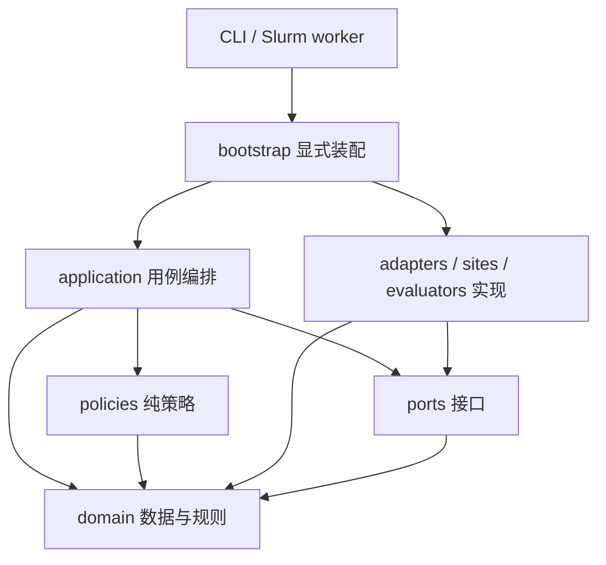

# Codebase 整体框架与模块接口设计 v1

2026-11-03 五站Actor前置实施指引：独立前置模块与纯配置提前集中实现并分别验证，再按真实依赖合并受影响组合；以完整兼容组核差异，已就绪成员批量执行，不逐题重做接线或每修一处重启网站。按版本/资产、组、实例、attempt区分复用；动态权限、初态和收尾仍现场核。实施沿用现有端口；通用生命周期保持网站与构建无关。

操作详情：五站执行交接（workspace 材料，未发布）；完整goal提示词（workspace 材料，未发布）。此入口细化现行流程；下方历史时点不覆盖最新方法和后继状态。

状态：**目标合同与分阶段实施并存**。实现、接口切换和验收范围沿原包及精确回执核定。

本设计响应用户对模块独立、网站/task 共用接口、判定器接入、workspace 迁移及彻底收尾的要求。设计依据为 2026-10-25 的 workspace 代码快照和接口审计；运行进度仍以原始作业回执及交接文档为准。本次仅修订设计，不修改冻结运行代码、正式任务范围、方法参数或付费授权。

文档修订：**第235次修订（当前初态整图消费的 owner 分离）**。本页定义目标合同，不维护实时作业进度；详细修订中的完成/待办只对应其原证据版本。当前流程见[开发检查规则](../FRAMEWORK_CHECK_WORKFLOW.md)，实际状态查[原包与回执](../EXPORT.md)。修订号不是运行release，也不授予运行或训练资格。

## 1. 目标、范围与现状

系统要稳定支持四条业务链：离线轨迹生成检索 skill bank；网站任务执行与独立判定；Generator 候选构建、Actor 验证、Teacher 修订、正式目标导出；SFT 及后续在线 RL。训练、开发、测试共用执行契约，但各自的数据准入和使用权限独立。

本次重构的交付标准是：**替换一个网站实现、判定器或模型函数时，只修改其模块及明确声明的接口绑定；其他调用方通过契约检查确认兼容，不依赖历史脚本的隐含约定。** 不承诺模块之间完全没有依赖；要求依赖显式、单向、可测试。

### 1.1 原重构审计背景与设计处理（历史快照）

| 现有证据 | 说明 | 设计处理 |
|---|---|---|
| `run_site_navigation_skill_once.py` 为 1,158 行，包含会话构造、网站 hooks、Actor 调用和终态收集 | 入口承担多个变化原因 | 拆为入口、应用编排、浏览器适配、网站插件、证据采集 |
| `admin_sft_episodes.py`、`map_route_family_sft_episodes.py` 导入其他运行脚本 | 脚本被当作底层库使用 | 可复用实现移入 package；scripts/CLI 只做参数解析和调用 |
| 1,983 个计划、89 个 runtime capsule 已审计 | 多套冻结版本共存，需要完整覆盖表 | 每个新 RunPlan 绑定一个闭合发布清单，登记所有当前调用方 |
| 原2026-10-25审计的 formal-start 指针与当时 v4 入口不一致 | “当前”存在多个解释 | 一个当前发布指针，一套提交/执行/复核/导出契约 |
| 1,983 个队列计划已绑定 T8，但均未声明 T7 策略 | 原审计只证明当时的策略声明/部署范围，不能推出T7必须全量启用 | 计划明确关闭/不适用或选定版本；启用时执行和复核一致，旧冻结计划不回写 |
| 源码、文档、Python v2、已识别模型/浏览器资产已迁入 workspace 并验证；其余资产和全部调用方仍按切换清单验收 | 文件迁移与模块重构、默认入口切换是不同状态 | 将资产、调用方、发布指针与实际路径一并验收 |

代码规模和计划覆盖是原审计快照；迁移状态已按迁移报告（workspace 材料，未发布）更新，不用于推断当前作业成功率。历史冻结版本仍用于原结果复核；它们不再是新任务的默认执行入口。

### 1.2 方法与业务边界

- 保留既定 top-6 检索、4 个候选、最多 3 轮 Teacher 修订及现有成功目标选择规则。方法变化另行版本化，不混入目录重构。
- 统一判定器输入/输出及证据契约，各网站保留自己的业务成功语义。
- 具体长输入消费者的有界读取按[专项设计](five-site-long-input-handling-20261101.md)接入，复用现有观察、预算及证据接口。
- RL 本轮定义接缝，不把接口设计记作 RL 已接通。按用户最新要求，新框架实现及整体验收完成后，用新框架继续推进测试集和开发集；在该门槛前不提前扩展开发集，详见 9.5。

### 1.3 可选工程改进的装配与验收范围

按[goal现行范围](../DEVELOPMENT.md)复用任务/初态、输入、执行/判定/复核、证据与恢复模块；五站Actor/Teacher接入共用上下文处理。具体长输入消费者的有界读取按[专项设计](five-site-long-input-handling-20261101.md)实现和验收，Actor记忆与Teacher整理按任务显式选定策略。构建、复核导出和SFT沿原主线推进，纯执行/评估仅装配所需能力。保留现行RunPolicies字段及冻结运行归属，功能是否完成按原包证据判断。

2026-11-02 当前42题工程包的职责细化：公共 `execute_task` 只编排准备、初始化、Actor、取证、判定与恢复关闭，返回 `CompletedTaskExecution/TaskCompletionFacts`；不读取 ConstructionProgress、不解释候选序号/Teacher轮次，不按 source_kind 选择业务结果或schema。`TaskLifecycleAdmission` 由 bootstrap 注入；ConstructionTaskAdmission 核构建进度/pending/修订资格，ExecutionTaskAdmission 核原单次来源/claim/RunPlan/显式Actor策略及初态。两者每个live门复核，不能缓存允许标志。构建和单次结果由各自适配器转换并沿原CAS生产者发布，原构建wire和历史证据保持；异常保留原首错、清理错和未知，不授予重放。候选实现、软件回执与实际生产资格分别登记在现有42题工程包，非新通用平台或独立串行阶段。 单次来源绑定/发布只核并冻结既有RunPlan、输入/策略、qualified context和持久claim，不创建许可；manifest身份先于私有依赖读取核验，发布后再核当前源与claim。真实权限由原资源owner供应，不能以来源快照、Unit权限或一次允许取代逐门检查。


<a id="initialized-task-tail-entry"></a>

`execute_initialized_task` 从当前 `baseline_verified` attempt 消费完整 `InitializedTask`，与完整入口共用 `execute_task_tail` 的 Actor、取证、判定和收尾实现；不调用 acquire、prepare、start。`RecordedTaskExecution.execute_initialized` 必须持有原有界 resource-owner scope，并核精确 revision、原已发布计划/正文、scope、baseline/等价引用及现场来源、claim、资源和预算。确认 executing 写入前，物理清理及丢确认协调仍归原 owner；确认后沿原 `_finish` 收尾。旧关闭/停止 run、失效现场和冻结旧策略不能由此重绑定或升级；新策略验证须另具合法当前计划及有效现场绑定。软件、安装与两题真实消费分别以原包回执证明。

<a id="stage-validation-claim"></a>

`SourceStageValidation` 显式绑定原claim、选定变更release及Actor至关闭范围；原私有任务和scope保持，授权描述或run/job变化不产生同release的第二槽位。`FileSourceStageValidations` 在同一可信目录使用既有原子事务保留独立验证记录，原canonical claim不改写；父记录原锁/正文缺失或错配即拒绝。`SourceStageValidationAuthority` 必须逐门核真实授权、父终态/无未知、恢复关闭及合法当前调用方/计划，描述对象不授予权限。

固定只读worker用显式 `claim-read-command/2` 消费验证描述，按child→parent锁序核两份记录；原v1字节及入口保留。读回后仍由外层动态authority核权；此存取接缝不替代正式来源、当前恢复现场/浏览器绑定或安装切换，不重标旧来源scope或续跑关闭run。实际装配和业务资格沿原包另核。

`FrozenExecutionOrigin` 将验证描述绑定原 `execution-task-source/1` 完整引用；显式 `execution-task-source/2` 保留原上下文scope，另绑当前run、计划和验证claim。原v1字节不变，普通claim与冻结验证来源不能混用。固定worker分别核原材料及当前读scope；生产来源适配器逐门核当前存储/控制器、父准入及实际claim，同次不可变来源正文可复用，权限不缓存。此接口不替代当前初始化采用、初态等价、正式阶段authority或现场恢复；其实现和资格沿原包核定。

`StageValidationAuthorization` 固定当前计划/私有任务、原来源与父run/trace/初始化/两次Reset和完整资源图。`RetainedStageParentChecks` 只接受已封闭、无未决请求或业务动作的原无效提案错误；完整不可变正文可在同次读者内复用；显式装配现有`CurrentEvidenceChecks`且绑定同一受控存储时，已验完整引用的授权正文一并复用，每次仍核当前存储、原选定授权/来源绑定及期限。未装配该端口的旧读者继续受控重读；变更已验来源拒绝，不缓存权限决定。`StageExecutionClaimAuthority` 复用真实Slurm控制器核验，限定原train工程范围、未付费Actor、64K/O4096及显式3/3策略；旧策略、错配或既有验证历史拒绝。显式validation/2沿原父级提交锁串行化不同target，再取child→parent锁；按target保留记录，旧validation/1字节不变。既有验证默认继续拒绝。显式 `task-stage-validation-authorization/2` 才可选择私有 `ClosedPreAttemptStageEvidence/1`：审查原canonical claim、Source2谱系、无attempt的错误封闭run、完整成功且已结算的metadata、原batch Actor物理关闭及完整Slurm incarnation的明确FAILED/非零退出；有attempt、unknown、取消/超时或未闭合事实均拒绝。审查只认可原任务/父来源/范围，当前owner、job/run及release须独立；每门重读canonical历史并核当前授权选择、存储与调用方，原claim/结果不改写。显式 `task-stage-validation-authorization/3` 另可选择私有 `ClosedPreRegistrationStageEvidence/1`，仅接受原唯一attempt在acquiring准入拒绝后封闭、原生资源尚未登记/启动的错误：核原安装适配器与完整异常链、权限门位于register/start之前、无模块副作用的准备失败、未构造浏览器的关闭事实和原资源/metadata/Slurm证据；原收尾错误保留，不补造Reset。私有冻结材料由有界数据包发布，既有attempt不能套用无attempt分支；authorization/1–/3的原合同与默认拒绝保留。

显式 `task-stage-validation-authorization/4` 才可选 `EndedPreparationStageEvidence/1`，仅审查既有验证历史中的已终止隔离准备失败，不改变父来源必须封闭且合格的要求。原唯一attempt只能到acquiring/preparing，准备确认只含原站点启动/取得、无候选副作用；须保留准备/收尾错误，核未构造浏览器及原task请求、Actor派发为零。原site关闭证据和私有保留不可复用声明须精确绑定注册token、安装、实例目录及原物理域；Actor沿既有`same_allocation`合同核原execution、writer、controller、GPU和cgroup，观察时间变化不替换身份。原metadata须已成功结算，或仅末次原site关闭只读交换unknown：其不可变正文另行完整核验，原controller、metadata worker、Actor进程及cgroup的终止证明与完整原作业incarnation匹配。未知写入、业务动作、已派发Actor或不明物理状态均拒绝；进程消失本身不结算unknown、不补造Reset或把原账本改为closed。Admin/Map共用有界私有材料发布器和所选版本；每门仍核canonical历史、当前caller、owner/claim及授权选择，不按任务ID/网站特判，也不能自动换release或owner获得执行。`admit_stage_validation_source` 仅装配现有来源/claim消费者，不创建原生实例、不调用初始化或模型；实际安装、当前初态采用/等价及现场权限仍须独立核定。

`InitialAdoptionBinding` 将显式Source2与当前尝试绑定，旧公开上下文和完整初态图保留原身份。仅选定的`InitialAdoptionAuthority`允许跨owner读取；每个采用/等价门复核当前来源、父级、claim与取消。checks/receipt版本2携带采用绑定；版本1字节不增加字段，普通任务不进入采用路径。现有`RecordedTaskInitialization`连续完成当前唯一观察、完整baseline和真实比较，候选/Actor消费同一输出；采用不创建新生命周期或恢复任务。具体Map/Admin规则通过显式`TaskAdoptedInitialComparison`消费完整采用绑定，原`compare`保留同owner约束；纯来源/候选谱系核验不授予现场权限。初始化器、当前context authority重算和闭合复核使用同一真实内容规则；缺该能力在初始化入口拒绝。原同owner比较正文优化不冒充跨owner采用，当前显式分支直接读完整快照，每门仍核实际采用、资源和claim。bootstrap显式选择正式stage来源，并允许装配原站点包装器，原生现场、资源权限和两题实际终态仍须逐题证明。 Map frozen origin可通过 `TaskOriginContextSourceProof` 消费同次完整来源证明及其原公开context scope；当前意图、私有任务、run/claim和站点controller仍各核当前身份，读回receipt须等于完整原scope。普通缺该端口的消费者保留同owner约束；端口报错不回退，不重标记旧数据或缓存权限。

`FrozenStageConfigurationSource`只为配置消费固定Source1正文及完整上下文，严格核原任务/身份/安装与不同的当前owner/release；普通配置仍核原同owner来源门。显式父来源的纯配置沿原只读CAS适配器读取完整旧图并在同次证明内复用正文；原始路径、完整引用及当前controller先核，数据不改owner。正式stage准入继续使用当前受控存储、实际transport和逐门权限，不把只读正文或缓存当许可。新会话可在初始化前复制已核不可变CAS正文，目标须为空，部分写入不重播；原session/run/claim历史不复制、不接管。显式冻结父来源在供应及连续入口均核原canonical claim的完整任务、run和引用；普通任务保留未claim拒绝门，父来源数据核验不授予新工作。当前成员退出沿原RunJournal核当前caller/claim及全部attempt诊断封闭，再登记closing/sealed；入口显式传递已验配置中的metadata清理期限，未选择的旧调用保留原默认期限，cleanup仍有界且不授予execute权。首错与收尾错分别保留，部分提交只读回核定，不重放。账本seal不证明物理关闭或safe Reset。共用收尾操作ID随父操作区分，新的只读核验不复用已绑定的不同context；来源owner、run及metadata撤权的首错和全部收尾错保留。当前软件清单和实际安装同时供普通连续入口与显式阶段入口核验，普通任务不增加采用或恢复任务。配置和复制验收不代替正式stage准入、模型/原生资源权限、连续业务入口及独立复核。

<a id="same-call-source-admission"></a>

单次来源准入的可选 `TaskPhaseResourceReads/TaskPhaseResourceRead` 只在本次同步检查交付已核验来源事实；原单次资源检查消费同一事实，经 `ExecutionTaskSourceRechecks` 现场复核原 owner、当前 claim 与存储准入。返回前可通过 `TaskPhaseResourceRechecks` 消费同次完整正文，重新核当前权限、claim、存储及 RunJournal；未适配来源保留完整重读。传递对象的资源核验及返回检查各一次、退出关闭，拒绝跨线程、重复及关闭后使用；不写持久 schema、不缓存允许标志，也不替代实际资源权限。关闭准入可沿 `TaskPhaseRunReads` 交付同次完整来源与 RunPlan，前后各核当前来源权限及原账本；历史 execute 截止失效时仍只用原独立 cleanup 窗口。该局部对象退出即清除，拒绝跨线程、重复消费和关闭后使用；未适配来源保留原三次读取及完整 RunPlan 检查。来源资格的 acquired 检查可返回同次 acquisition/spec 事实；状态消费者仅在完整 EvidenceRef 相同时复用 spec，不同引用仍读取。固定安装、消费者与实际效果以原包回执为准。

初始化生产者可沿 `TaskInitializationBodyAuthority.verify_with_inputs` 交付本次已读取的声明、准备结果/计划、获取结果、TaskBinding 和 ResetPlan。`InitializationAdmissionInputs` 核各规范正文的完整引用、大小、摘要、schema、可见性及原计划关系；各门仍重新核原 starting attempt、现场资源、来源、权限和账本。该对象只在一次 start 的局部调用链存在，错引用/正文立即拒绝；旧 authority 保留原读取路径，不给历史 attempt 或跨作业续跑授权。 原 owned 准备包装器须透传已有 `PreparationReceiptReads`，避免丢失同次完整准备正文。 捕获测量通过可选 `TaskInitialMeasurementReads.record_complete` 消费已有 `EvidenceInitialObservations.publish_complete`，将准确发布读回、唯一初始输入和准备回执一起交给初始化器；逐项核引用/schema/来源、selection及原prepared，直接组成baseline。原标量record接口保留，未适配端仍完整读取；捕获一次性限制、发布前后现场authority、写入失败的引用和首错保留，禁止重新捕获补丢失回执。本题 `InitialObservationReader` 已完整核验的 `InitialObservationInputs` 可在该次 start 的 baseline/等价发布调用中交付原权威；核相同 selection、原线程及准确操作。原 owned 任务可由已有 `TaskInitializationInputs` 保留同一正文至本次生命周期退出，成功或异常均清除；不跨任务、线程或作业保留。候选初态策略、当前资源/claim/存储与原生环境核验仍现场执行；独立消费保留完整读取，不把该正文作为权限或跨调用缓存。

<a id="same-task-capture-initial-inputs"></a>

捕获与判定的可选 `InitialObservationReads` 只传递上述完整初态正文。Map/Admin 的 owned 装配把原 `TaskInitializationInputs`、准确初始化生产者及原计划交给 `TaskCaptureInitialReads`；读取须核原 active 作用域、生产者同一载体、initialized 状态、完整 selection、scope/public task、原进程/线程及准确 capture/evaluate/原计划操作，缺失或不符立即拒绝，不回退重新初始化。`RecordedTaskCapture`、终页核验及其判定器消费同一显式端口，分别校验准确 selection；原独立历史读取未选择该接口时保持完整图读取。该接口不保存允许结论：捕获正文使用前及终页核验前现场重核原 `TaskCaptureAuthority`，既有页面采集、浏览器关闭、原生 final guard、判定准入及恢复门继续执行。初态正文复用不能补造缺失终态、final guard 或完整 captured selection，也不授予已关闭旧实例续跑、业务或训练资格；无新持久 schema 或 ready 状态。

Map/Admin 的 owned 装配可显式选择 `capture_admission_handoff`，由 `TaskCaptureAdmissionInputs` 把已核准备声明中的 TaskBinding/ResetPlan、原初始化的 browser acquired/Actor请求及冻结capture声明直接交给原 `TaskCaptureAuthority`。每次消费核 active 任务作用域、原生产者、完整引用/正文和当前来源context；browser事实保留原排序/空格编码，Actor引用保留原 `task-execution-v1` 发布身份。缺正文或引用/来源不符拒绝，不补建前序；其他引用仍走原真实存储。

该路径只减少同次已核不可变正文交换：每次原 `TaskStateAdmission` 的来源、claim、RunJournal前后复核、原资源authority、sealed trace及storage当前门仍执行；不保留允许结论或改变capture/清理期限。原输入作用域退出后不可消费，不增加持久schema或跨作业缓存；未选择的调用方保留完整读取。实现、精确安装及当前题目的原生guard/判定/恢复关闭仍分别取证，正文传递不补造旧run事实。

<a id="same-task-terminal-proof-inputs"></a>

受监督的 Map导航1／Admin导航1 owned 装配用显式 `TerminalEvidenceReads`，将终态selection、原完整初态、判定合同及准确操作交给固定终态只读消费者。复用 `ManagedEvidenceStore.read_scope` 与 `original_state_proof`：前后核真实存储准入、原namespace版本/出生、实际父进程及固定安装，受原父期限约束并确认子进程退出；子进程仅调用本站纯终态算法，无网站、模型、发布、恢复或账本写能力。完整命令/回复限13MiB，最多256个完整JSON引用；错schema、来源/任务、引用正文、版本、安装或未确认退出拒绝，保留原错误及子进程捕获，不回退逐叶重读或重发动作。普通本地文件读者不适用此进程策略；受监督命名空间缺少真实原source transport必须拒绝。命名空间装配沿所选`SupervisedExecutionTaskSourceChecks.require_current`：普通来源保留同owner/controller/release门，显式Source2沿已有stage检查核当前caller/存储与父准入，历史material身份保持原样；仍使用当前受监督终态消费者，不回退逐叶读取。

成功证明的 `TerminalReadBodies` 由装配层仅用返回正文再次执行同版纯消费者，缺失或多余依赖拒绝，不补读原存储；随后只沿同一 `TaskInitializationInputs` 交给后续纯判定：核完整原请求、任务/初态/合同及原进程线程；已交付引用的规范正文直接消费，后续closure/guard及其额外依赖仍走原真实存储。进入/退出消费均重新核当前准入，每次读取仍核原active作用域和期限；关闭后不可读，正常/异常退出清除全部正文。它不保存允许标志，不省略原browser关闭、native final guard、判定或Reset门。显式 `retained_data` 证明可在实际读者的独立只读namespace复核旧数据，始终标记为旧数据；当前owned正文端口只接受 `same_task` 且当前执行owner/安装相等，不以旧数据证明授予续跑、重发、直接captured或训练资格。实现、安装、原题恢复/整体闭环分别查原包。

<a id="retained-restore-navigation-capture"></a>

原在线取证失败且资源已关闭时，可显式选择本站 `*-navigation-retained-restore-capture/1`，只消费原终页、环境、浏览器关闭和原 `ResetSelection`；它是新的离线证据修订，不补造原 `SiteCaptureIntent`、直接 guard 返回或在线成功。独立消费者须核完整引用/正文、原 task/run/attempt/context、同一实例、完整关闭/恢复图及恢复前后的顺序；bootstrap 将所选环境中的实际 site/started 与调用方配置相等比较，并核原 worker 已观察安装及独立批准的原生代码字节。代码或事实不符立即拒绝，不回退重跑。原初态、Actor、Reset 与物理关闭已有适用证据直接复用，必要读取不执行生产者。

Map 的替代事实限原 `MapFrontendReset.begin` 在 retire/clear 前执行的完整 `require_unchanged`：原 resume 正文保留 `before_sha256`，消费者须重算原初态和 resume 的完整持久状态文件，再核同一原生计划/实例、原 browser 关闭及恢复谱系；摘要存在不够。Admin 的原 guard 只证明持有恢复材料完整性；相同批准版本的成功 restore 在变更前验证原 DB、文件及 search snapshot/preflight，消费者逐项核原恢复正文与 snapshot。它不证明任务终态数据库未变，也不伪造独立 verify 命令返回。

两站用明确的 `retained-restore1` 判定版本及对应 evidence requirements，沿原纯页面规则判定；缺事实保持 unknown，原在线 timeout、首错、费用、claim、资源和任务登记分别保留。原直接捕获合同不变，原失败不回写；工程离线复核不授予旧实例续跑、重发、训练或正式来源资格。实现、安装、原题完整复核及协调是否通过仍查原包。

<a id="source-reuse-execution-inputs"></a>

Map 所选来源差异由 bootstrap 的 `map_source_reuse_inputs` 沿原组清单、任务卡发现回执和兼容性回执生成，保留找到的完整/部分引用及共同软件、安装证据。冻结差异显式选择原完整来源消费者或只补当前实例事实；缺发现、错绑定、缺消费产物均在构建前拒绝，禁止退回完整重建。历史 admission 按原摘要及已核归档引用消费，其旧路径只保留为谱系；不重开可变旧树，也不代替当前 owner/claim/初态/恢复。差异是原提交输入，不是独立权限或状态账本；候选入口的安装与逐题实际效果查原包。

Admin 导航的对应差异由 `bootstrap/admin_source_reuse_inputs` 消费原71题发现与兼容性回执，绑定准确原生输入及私有规格。选定入口把同次已核原字节、完整引用和规格直接交给原 supplier，不再加载全71题或重做历史 admission 验证；完整材料交给既有来源消费者，部分材料只补声明的当前实例事实。错题、摘要/规格/分支错配、缺材料及已消耗或未决 claim 在昂贵获取前拒绝，不静默回退完整构建。原 supplier 仍核实际安装、owner/controller、namespace、权限及后续现场门；旧来源、返回与 claim 不因差异获得重放或跨作业消费权。实际消费与闭环范围仍以原包回执为准。

Shopping 类目导航由 `bootstrap/shopping_category_source_inputs` 消费原18题发现及历史合同兼容回执。CLI 的冻结差异绑定同一份原生字节、完整引用及公开任务，准确解码后的规格向原 supplier 和执行入口传递；同次入口不重开历史产物、不重复解码相同正文。完整/部分来源分支由差异显式选择，缺失、错配或与外部完整来源冲突时拒绝，不回退重建。来源链装配同一准备图/浏览器正文端口，并分别保留实际执行与复用计数；成功发布携带计数，失败保留原 progress。来源实例、唯一观察、当前权限、原 claim 和恢复关闭仍按原合同核验，静态正文不授予运行或历史接续权。

原 owned 准备生产者可沿 `PreparationDeclarationInputs` 把首次真实读取的准备声明、site spec、ResetPlan 和 TaskBinding 向后交付；`owned_task_execution` 将同一载体绑定到准备生产者、准备准入、原生任务权限核验和初始化入口。载体只接受原生产者核验的完整引用与规范正文，限原 task/run/owner/attempt 及进程/线程的一次调用；完整性与声明关系集中核验一次，后续只传递同一不可变正文对象，换对象或缺正文/引用不符即拒绝，不重新构图。准备准入沿原 `TaskStateAdmission.reset_input` 消费已核 ResetPlan，同时逐次核当前来源/claim、RunJournal、资源及存储权限；准确发布读回与独立消费保留原检查。成功或失败退出均清除正文，原生 snapshot/prepare/restore 等实例动作不因静态正文复用而省略；实际重复读取是否消除，由对应消费者物理读取和调用数回执证明。

原 owned 任务的 `TaskInitializationInputs` 同时交付已验准备检查与浏览器固定输入。`PreparationCheckInputReads` 仅复用同一 checker、完整相同输入的通过结果；换 checker 只补该纯检查，当前 PreparationAuthority 和存储/来源门每次执行。`PreparedBrowserInputs` 只在原任务调用内保留固定 site/request/environment 正文及相同检查实现的结果；资源账本仍逐次锁读，acquired 引用变化拒绝，退出清除。浏览器实际发布端可将上一步观察、原始返回和新观察的准确 `VerifiedEvidenceBody` 交给 `TraceInteractionInputReads`；登记核相同原操作/动作/完整引用并现场核原权限，其他声明依赖仍走真实存储。仅保存原事实，无重发、重捕获或历史轨迹追加权。

来源生产链内部可沿同一端口装配 `SourcePreparationInputs`：`SourceQualificationRecords` 的原准备生产者、准确发布读回、测量及 `PreparedBrowserBinding` 共用该次已核准备图和检查结果。先绑定原发布者返回的完整 `PreparedPublication`，首次消费仍真实读回正文；更改引用即拒绝，不以内存产物替代落盘证明。`PreparationRecordScope` 只描述原 task/run/owner/attempt 与本次载体边界，`PreparedBrowserInputScope` 只交付固定浏览器输入；二者不要求伪造 TaskExecutionPlan 或改写原操作。每次消费仍经原 native authority 核当前 caller、资源账本及存储权限；错 scope、引用、正文、撤权和取消拒绝。载体限原进程/线程的一次来源调用，正常或失败均清除，未装配消费者保留原路径。实际 graph/check/readback 的执行与复用次数分别记录；分支名、历史审核或软件通过都不能替代内部调用数证明。本实例 snapshot、prepare、唯一观察及必要恢复关闭仍按合同执行，闭站后的独立发布/整图复核也不因准备正文复用自动省略。

<a id="current-initial-read-owner"></a>

显式阶段验证的当前准备和baseline整图消费使用`closed-source-read-command/3`的`current_initial_owner`，只允许`preparation_inputs`或`baseline_inputs`，该owner须与实际受控读取scope及请求operation相等。固定子进程按当前owner核准备环境或baseline完整图，按历史material原owner核已合格TaskBinding；两种身份不互相改写。`SupervisedStageValidationContexts`在读取前后仍核当前存储、调用方及父准入，原Preparation/State authority继续核当前claim、资源与事实；完整正文沿已有端口交付，不退回逐叶读取。旧command1/2禁止该字段并保留同owner语义与原字节，错owner、版本、输入或撤权均拒绝。该接口只消费不可变事实，不授予已关闭实例续跑、原生请求重放或Reset/unknown结算；实际安装与逐题初态、Actor、判定及收尾另验。

原固定整图读取器可用显式`closed-source-read-command/2`的`execution_source_claim`请求，在同一证明内读取完整来源及原`source-claim/1`，以`reply/6`返回准确`SourceClaimReceipt`；旧请求和回执的字节保持。父端只把该正文放入本次`ClaimedExecutionSourceFacts`，`SourceClaimBodyChecks.require_source_verified`重核完整引用、run和私有task，并重新锁读原持久claim及核实际caller。来源证明与同次recheck仍现场核原存储准入、namespace和quarantine；正文不授予权限、不跨调用缓存，下一次来源证明重新读取。缺claim、错正文/引用/版本、撤权、账本缺失或未决存储均拒绝，不重建历史或回退；未适配消费者保留原CAS读取路径。此接线不改变claim创建、独占、恢复、原失败及跨作业边界，实际安装和逐题效果另验。

收尾的同次来源读取可经`TaskPhaseClaimRead.claim`交出该证明内的完整claim；仅原进程/线程的开放读取期可消费，关闭即失效。`AttemptClaimBodyChecks.require_verified`核原attempt、完整引用及正文，并在收尾准入前后分别重新锁读实际claim账本、核caller；两次来源recheck、run journal及原native收尾权限仍执行。此接口只省同次已验不可变正文的CAS重读，不缓存动态许可，不回写旧回执或接续旧题；未提供正文或未适配接口的消费者保留原完整读取。

计划对可选策略显式记录关闭/不适用及理由，或具体版本与适用范围；字段必填不代表功能必须开启。bootstrap只装配本次必需角色/能力及已选优化，关闭不加载优化专有依赖；启用却缺依赖、兼容性或验证证据时拒绝，不静默降级。原始证据、实际请求和独立复核固定同一选择，不在运行中跟随新的默认策略。

各模块、发布及整体Review的完成门覆盖已批准的必需能力和已启用优化；未选用T项标不适用，不记已完成，也不列全局阻塞。不可用按需名义删除真实预算/权限、初态/输入隔离、判定、证据、资源收尾等正确性要求，或缩减既定数据与后续RL目标。仅本次关闭某优化不改写原冻结运行/历史结果。

实现时补启用/关闭、缺依赖、错版本、执行与复核错配、关闭无额外调用/资源副作用的契约测试；检查范围按9.1选择。此修订是装配要求，尚未实现的配置合同/加载器须同步生产消费端后验收，不在现有严格schema中临时塞字符串或用占位组件伪装关闭。

## 2. 总体方案与技术选型

采用**单一 Python 项目中的分层模块架构**，结合显式注册表与依赖注入。保留 Slurm 作业和作业内网站/模型进程，不新增微服务、消息队列或常驻跨作业平台。

| 领域 | 选型及理由 | 边界 |
|---|---|---|
| Python | 沿用已验证的 Python 3.11 workspace 运行环境；项目包集中安装 | 不以这次重构为理由升级全套依赖 |
| 数据模型 | 边界使用现有 Pydantic v2 的严格模型；内部用不可变 dataclass/Enum | 禁止用无约束 `dict`、`**kwargs` 传递整个运行上下文 |
| 接口 | `typing.Protocol`、明确返回类型、组合注入 | Protocol 只定义调用形状；语义仍须契约测试和版本检查 |
| 浏览器/网站 | 复用 BrowserGym、Playwright、现有网站隔离和固定镜像 | BrowserGym/数据库对象不直接暴露给应用编排 |
| 模型 | 复用 Transformers、现有 OpenRouter Teacher 后端；SFT 沿用已验证训练栈 | 通过模型端口调用；凭据只存在于受控内存传输链 |
| 调度 | Slurm 适配器；应用层只操作 JobSpec/JobReceipt | 登录节点准备代码与元数据；测试及实际运行在计算节点 |
| 持久化 | JSON/JSONL、SHA-256 引用、只写一次的回执与封闭归档 | 小文件按阶段归档；读历史证据不等于动态导入历史代码 |
| 发布 | 不可变 release manifest + 单个原子 current 指针 | 一次运行开始后不再次追随 current |
| 资源复用 | 兼容批次持有模型/服务；workspace 资产每作业暂存到节点本地一次 | 可写状态不跨并发任务共享；兼容性显式计算 |

版本锁来自实际已验证环境和镜像清单，而不是在文档里猜测最新版本。workspace 仍可能是共享存储；加速依靠减少热路径文件读取、作业内暂存和资源复用，并记录实际耗时。

### 2.1 依赖方向



图中箭头仅表示允许的依赖方向，不表示一次运行必须装配所有层内组件或启用全部T项；实际装配按1.3的运行用途与显式策略决定，图的拓扑无需改变。

箭头表示允许的代码依赖。`domain` 不导入 Slurm、Torch、浏览器或网站实现；`application` 不导入具体网站包；网站和判定器实现不导入应用入口。只有 `bootstrap` 同时认识接口和实现，用于创建对象并注入依赖。

允许的项目内部依赖以此表补全；第三方库依赖由对应 adapter 封装。静态导入、类型导入和动态装载都必须遵守同一边界。

| 模块 | 允许依赖 | 约束 |
|---|---|---|
| domain | 标准库和已选数据校验库 | 不依赖其他项目层 |
| ports、policies、task_families | domain；ports 可引用其他端口类型 | policies/task_families 只含纯规则，不做 I/O |
| application | domain、ports、policies | Actor、Teacher、Generator、runtime 均通过端口注入，不导入其具体实现 |
| actor、teacher、generator | domain、ports、policies | 相互不直接调用；应用层安排角色间交接 |
| runtime | domain、ports、policies | 注入模型/网站 provider，不导入具体网站；不依赖 application |
| adapters、sites、evaluators | domain、ports、policies、纯 task_families | 网站间不得互导；evaluator 仅可额外导入本站无副作用的 evidence_schema |
| registry | domain | 解析/校验声明式元数据，不实例化组件 |
| release | domain、ports、policies、registry | 发布与存储操作走端口，不装载网站/模型 |
| bootstrap | 上述层 | 唯一解析组件 ID 并装配具体实现的位置 |
| cli | bootstrap、domain | 薄分发；history reader 仅在显式历史读取流程中装配 |

`ports/actor.py`、`ports/teacher.py`、`ports/generation.py` 和 `ports/runtime.py` 分别声明角色及资源接口；同名实现放对应目录。网站特定 DB/backend 可由 bootstrap 注入本站 task/collector，但其句柄不能穿透到 application、Actor 或 Teacher。

网站端口输出标准证据；判定器消费证据。两者只共享该网站的版本化证据 schema，不互相调用。主流程不出现 `if site == ...` 或 `if legacy_version == ...` 的业务分支。能力差异通过经过验证的组合注册表达。

## 3. 目录、模块职责与所有权

下列包内模块为**目标目录**，尚未按此结构完成实现；workspace 可编辑源码树已迁移建立。沿用包名 `lab_generate_skill`，迁移期间在 workspace 工作副本开发；已发布的冻结副本不原地修改。

```text
workspace/
  code/lab-generate-skill/                 # 已建立的唯一可编辑源码树；内部待分模块重构
    pyproject.toml
    src/lab_generate_skill/
      domain/                             # 数据类型与纯业务规则
        identity.py  task.py  evidence.py  evaluation.py
        execution.py  lifecycle.py  generation.py  release.py  errors.py
        skill.py  dataset.py  training.py  model_evaluation.py
      ports/                              # 抽象接口，一类职责一个文件
        site.py  task_family.py  browser.py  evaluator.py
        model.py  retrieval.py  evidence.py  scheduler.py
        claims.py  requests.py  training.py  lifecycle.py  capture.py
        actor.py  teacher.py  generation.py  runtime.py
      application/                        # 业务用例，无具体网站实现
        preflight.py  execute_task.py  construct_targets.py
        review_run.py  export_targets.py  train_sft.py
        build_bank.py  resume_run.py  run_batch.py  evaluate_models.py
      actor/
        runner.py  protocol.py  memory.py  budget.py
      teacher/
        evidence_projection.py  messages.py  feedback.py
      generator/
        prompting.py  candidates.py  selection.py
      runtime/
        assets.py  staging.py  model_pool.py  site_pool.py
        compatibility.py  lifecycle.py
      adapters/
        browser/browsergym.py
        models/transformers.py  models/openrouter.py
        scheduler/slurm.py
        storage/filesystem.py  storage/archive.py
        ledger/claims.py  ledger/requests.py  ledger/run_journal.py
        ledger/resource_journal.py
        retrieval/skill_bank.py  training/sft.py
      sites/
        shopping_admin/                    # 其他四站同层，各自独立
          plugin.py  config.py  environment.py  reset.py
          observe.py  capture.py  evidence_schema.py
          tasks/customer_create.py  tasks/creditmemo_view.py
          tasks/billing_edit.py  tasks/export.py
        shopping/  gitlab/  reddit/  map/
      task_families/
        navigation.py  query.py  mutation.py  export.py
      evaluators/
        shopping_admin/customer_create.py  shopping_admin/billing_edit.py
        shopping_admin/creditmemo_view.py  shopping_admin/export.py
        shopping/  gitlab/  reddit/  map/
        review_integrity.py                # 证据完整性，不含各站成功规则
      policies/
        dataset.py  authorization.py  input_visibility.py
        retry.py  export_eligibility.py
      registry/
        schema.py  resolve.py  validate.py
      release/
        manifest.py  validate.py  publish.py  leases.py
      bootstrap/
        controller.py  worker.py  reviewer.py
      cli/
        main.py  commands.py  worker.py
      history/
        schemas.py  readers.py             # 历史证据转换；新执行不能依赖它
    tests/
      unit/  contracts/  integration/  replay/  acceptance/
    configs/registry/                      # website/task/evaluator 显式绑定
    cluster/                              # 薄 Slurm 提交模板
  tools/code-releases/<release-id>/        # 已发布源码，不可变
  tools/python-releases/<runtime-id>/      # 已验证运行环境，不可变
  assets/<kind>/<digest>/                  # 模型、浏览器、镜像、地图等
  releases/<release-id>/manifest.json      # 完整依赖闭包
  configs/system-current.json             # 目标唯一运行发布入口（尚未上线）
  runs/<run-id>/                           # 新结构下的计划、请求和结果
  experiments/                            # 现有实验与历史证据，保留原目录
  docs/design/                            # 架构和接口依据
```

### 3.1 不允许混放的职责

| 模块 | 负责 | 不负责 |
|---|---|---|
| `cli` | 参数、退出码、命令分发 | 业务规则、网站启动、模型生命周期 |
| `application` | 阶段顺序、组合端口、保存阶段结果 | SQL、网页选择器、Slurm 命令、Teacher HTTP 请求 |
| `sites/<site>/environment.py` | 网站进程与健康检查 | Actor 决策、成功判定、导出准入 |
| `sites/<site>/reset.py` | 一致初态、快照和完整重置证明 | 修改公开任务、制造正例 |
| `sites/<site>/tasks/*.py` | 单类任务参数校验、初态准备、所需证据捕获 | 模型调用、费用授权、独立判定 |
| `evaluators/<site>/*.py` | 用指定证据判断本任务族的完成条件 | 操纵网页、补跑 Actor、改写原轨迹 |
| `actor` | 动作循环、公开历史、动作预算 | 私有答案、业务判定、训练数据发布 |
| `teacher` | 完整允许证据的投影、消息构建、反馈过滤 | 网站读写、训练资格判断 |
| `runtime` | 资产暂存、模型/服务持有、健康与清理 | 决定 task 成功、挑选训练正样本 |
| `policies` | split、信息可见性、费用、重试、导出资格 | 实际执行模型或数据库操作 |
| `release` | 依赖验证与整组发布 | 自动扩大任务范围或付费额度 |

**不同职责必须在不同 Python 文件中。** 同一个任务也必须将 `tasks/customer_create.py` 与 `evaluators/shopping_admin/customer_create.py` 分开；PHP/SQL 等原生辅助代码随其所属网站模块发布并纳入哈希。避免新增 `common.py`/`utils.py` 大杂烩。小型纯函数可以按同一职责组合，不机械地每函数一文件。

脚本不得互相 import；网站插件不得跨站 import；公共复用只能提取到明确的端口或无网站依赖的纯模块。循环依赖检查、禁止目录导入规则与包安装后导入检查都是发布门，不依赖开发者记忆。

## 4. 核心数据结构与接口

以下签名是目标契约草案，不是已经上线的 API。所有跨进程数据都有 `schema_version`；所有可重放记录使用稳定 ID 与内容引用。函数返回数据而不是随意修改共享字典。

### 4.1 数据结构

| 类型 / 定义文件 | 必要字段或约束 |
|---|---|
| `TaskIdentity` / `domain/identity.py` | `source_task_id, task_id, split, site, family, contract_version`；来源 ID 与本地派生任务 ID 分开 |
| `PublicTask` / `domain/task.py` | identity、公开目标、起点、允许动作/公开输出要求；无后台答案和私有初始化差异 |
| `TaskBinding` / `domain/task.py` | public_task_ref、private_spec_ref、baseline_ref、registration_id；只供受信任的执行装配层使用 |
| `EvidenceRef` / `domain/evidence.py` | `uri, sha256, size_bytes, media_type, schema_version, visibility, producer`；不能只靠绝对路径判同一内容 |
| `Observation / ResolvedObservation` / `domain/observation.py` | 独立于证据地址类型；ID、任务/context/attempt、序号、URL/标签页、正文或工件引用、加载/错误状态；解析正文保留精确UTF-8，与实际发给Actor的内容关联 |
| `BrowserAction / StepResult` / `domain/browser.py` | 精确协议动作文本及实际环境返回、原操作与前后观察引用；不执行或解释动作文本 |
| `ActorGeneration / ActorDecision` / `domain/actor_generation.py` | 实际尝试的模型请求/输入/参数/响应或故障、解析决策；与费用结算分开 |
| `InteractionEvent / InteractionTrace` / `domain/interaction.py`、`domain/trace.py` | 原生成、动作、实际返回/不完整返回/未发送/未知、连续观察链；模型调用及已确认返回分别计数，见4.2.1 |
| `TracePlan / TraceCapacity / TraceSnapshot` / `domain/trace_plan.py`、`trace_journal.py` | 原attempt与实际RunPlan上限、持久意图/观察历史、全局revision、逐前缀结果/封闭空间，见4.2.2 |
| `BaselineReceipt` / `domain/baseline.py` | 独立于运行事件历史；attempt/context、环境与准备/初态检查引用、权威observation、规范引用/实测摘要与等价范围；由应用层汇总签发 |
| `Evaluation` / `domain/evaluation.py` | `status=success/failure/unknown`、`reward=1/0/null`、逐项检查、reason_code、证据引用、判定器身份与版本 |
| `AttemptResult` / `domain/execution.py` | task/attempt/claim ID、baseline、轨迹、完成状态、evaluation_ref、资源关闭与重置回执 |
| `RequestRecord` / `domain/generation.py` | authorization_id、budget_id、request_id、角色、输入/参数摘要、revision、状态、预留/实际费用和响应引用；不包含 key |
| `Money / BudgetAuthorization / BudgetScope` / `domain/budget.py` | 整数纳美元、固定 USD/scale=9；授权总上限及唯一子预算、授权引用；同授权跨 run/worker 共用，构造类型不代表用户已批准 |
| `RequestIdentity / Reservation / OutcomeProof / RequestReceipt` / `domain/generation.py` | 完整来源/候选/修订/角色/调用索引、原 owner、provider/model、输入/参数摘要；稳定预留、可校验响应/非执行/费用修订证据、原结算回执 |
| `BudgetSnapshot` / `domain/request_ledger.py` | 单授权的 reserve/dispatch/outcome 全局事件历史；重放逐笔验证历史额度，派生每个请求的费用与未结算预留；纯合同不等于持久账本 |
| `RunPlan` / `domain/run_plan.py` | 独立任务批次计划：run_id、release_ref、完整任务绑定、purpose/split、方法、角色模型/参数引用、共享预算与容量、资源配置、bank/split/任务清单引用；与 execution 状态历史分文件 |
| `RunBinding / AttemptBinding` / `domain/execution.py` | 原 owner、冻结 plan/release 引用、稳定 submission_key；attempt 另绑定 task identity 与 claim 引用。这些身份引用不代替完整 RunPlan 或 claim 审查 |
| `RunEvent / AttemptEvent / RunRecord / AttemptRecord` / `domain/execution.py` | 显式前序 operation、状态、输入/输出证据、aware 记录时间、组件/job/worker/node、停止原因及首错/清理错；原始事件只追加，任务评分仍由 Evaluation 独立保存 |
| `SubmissionObservation` / `domain/execution.py` | submission_key、accepted/uncertain/confirmed_not_submitted、已确认 job IDs 和核对证据；仅 accepted 带非空且唯一的 job IDs，结构校验不代替 Slurm 事实审查 |
| `ReviewReceipt` / `domain/evaluation.py` | run/attempt/ref、证据完整性、实际输入重建结果、baseline/reset/closure 核验、判定引用与准入结论 |
| `ReleaseManifest` / `domain/release.py` | code/runtime/assets/registry/model/协议/判定器/reviewer/policy 的完整引用及版本兼容声明 |
| `OperationContext` / `domain/lifecycle.py` | operation/run/attempt ID、deadline、取消标记引用、allocation/recovery 引用；只含数据，不是服务容器 |
| `AllocationToken / RecoveryPlan` / `domain/lifecycle.py` | 资源/恢复 ID、owner、作用域、受保护状态、恢复目标、执行器版本；在副作用前登记 |
| `PreparedTask` / `domain/preparation.py` | 独立的准备产物；scope/public_task、preparation_ref、私有检查规范和recovery_ref；不生成initial_observation，私有字段不交模型 |
| `EvidenceRequirements / CaptureReceipt` / `domain/evidence.py` | 所需事件/快照/schema/可见性；实际订阅、序号范围、缺项与工件引用，绑定 attempt/context |
| `EvaluationContract / ReviewPlan` / `domain/evaluation.py` | 前者固定任务完成条件、证据要求及评价范围；后者固定原执行与新判定两套 release、原证据、契约及 supersedes，见 4.4 |
| `CompactSkill / BankManifest / RetrievalResult` / `domain/skill.py`、`bank.py`、`retrieval.py` | 分别负责skill内容、bank/来源谱系及检索评分/有序命中；划分与别名另在data_scope.py，见4.6 |
| `TrainingExample / DatasetManifest` / `domain/dataset.py` | 公开输入、目标、资格与选择/复核证据、任务分组和划分版本、样本清单摘要；见 4.6 |
| `CheckpointRef / ModelBinding` / `domain/training.py` | 权重或 adapter/base-model 组合、tokenizer、配置、数据/训练 run 身份与加载兼容关系；见 4.7 |
| `ModelEvaluationPlan / BatchEvaluation` / `domain/model_evaluation.py` | 固定模型与任务集合、split、方法、seed、逐题回执及明确分母的汇总；见 4.7 |

公共与私有信息采用不同类型和不同视图。`PublicTask` 不包含 `private_spec_ref`；不是将完整 TaskBinding 交给模型序列化器再临时删几个字段。类型区分不构成安全沙箱，仍须检查实际模型请求字节及其来源。

#### 4.1.1 冻结任务批次计划与容量生产消费

`domain/run_plan.py` 的 RunPlan/3 服务任务构建与逐题执行；重判、导出和训练各自仍须实现对应专用计划，不能把它们伪装成空任务执行。purpose 区分 training/evaluation/engineering，workload 显式区分 construct_targets/execute_tasks。training 必须是 train 构建；evaluation 不执行 Teacher 目标构建；构建不能消费 dev/test 反馈。任务清单非空，task_id 和 source_task_id 分别唯一、split 一致。引用使用不可变 EvidenceRef，不以 cwd、current 或历史文件名替代版本。

`domain/construction_method.py` 单独保存 ConstructionMethod/1：显式四候选、top-6、四次重复重采样、最多三轮 Teacher、首轮必做、seed、五个 Generator 温度值及既有 `recorded_environment_step_returns_v1` 选择计数。按 candidate/resample 推导 seed+candidate+4×resample；Teacher seed 为 seed+round−1。冻结值与 v1 温度日程一致，保留输入数值到后续参数摘要，不在插件中另选默认值。进度/去重/选择决定哪些有界调用实际需要执行；最大次数不是重发未知请求或重跑有效失败的权限。

构建每题最多7个实际 attempt、20个 Generator 请求和3个 Teacher 请求；execute_tasks 每题一次 attempt，输入策略及任务输入清单显式固定，生成候选的评估方法需其专用后续计划，不在此接口暗中新增模型角色。Actor 请求上限等于 attempt 上限乘资源计划的 max_actor_generations_per_attempt；实际交互次数另设上限，不能混作生成次数。run_capacity.max_attempts 必须等于批次推导值。角色模型绑定必须恰好覆盖 workload 所需角色，保留 provider/model、model_binding_ref、parameters_ref 和 paid 属性；其内容兼容性仍由模型/发布准入验证。

RunBudget 保存完整 BudgetAuthorization、BudgetJournalCapacity 及每个付费角色的子预算和正预留上限；本地角色不伪造付费账本。付费请求最坏数量不能超过共享容量；按角色最坏调用数×预留额汇总到子预算及授权总额，超额计划在领域校验时拒绝。此预检不扣费、不重新给予各 run 独立额度，也不保证现有共享账本还有余额；真实 reserve/dispatch 仍检查历史占用。实际超额收费仍按6.2保留事实和阻断后续发送。

`ports/run_plan.py` 的 RunPlans：`publish(plan, op) -> EvidenceRef` 与 `load(binding, op) -> RunPlan`。`adapters/plans/evidence.py` 的 EvidenceRunPlans 复验严格类型、operation 范围及全部直接输入引用；publish 只接受对应 run 的 execute 操作，CAS 保存 private run-plan/3。相同计划重复发布得到相同内容；提交丢确认只核对同一内容。load 核对原 run/owner、plan schema/可见性、release 与实际字节，并在任何运行账本创建前用真实 RunBinding 外壳进行容量预检。cleanup 可有界只读加载；attempt 范围或错 owner 拒绝。

RunPlan.check_binding 使用 run-journal-snapshot/2 的完整绑定/容量外壳预检，预算容量同时按实际授权外壳验证。计划发布只保存元数据，完整 run 外壳在绑定后的消费者预检；消费者通过前不创建资源或提交任务。后续 bootstrap/application 必须先加载并验证计划，再将其容量原样传给账本，不能自行另设容量。纯类型、CAS 存取和账本装配测试不等于发布/数据划分/模型配置/真实授权内容已获准；递归 release 闭合、claim、运行资源、逐任务进度及完整入口接线均保持独立门。

#### 4.1.2 显式可选策略与计划版本（修订52）

`domain/optional_policies.py`单独定义InactivePolicy、EnabledPolicy和RunPolicies/1。RunPlan/3新增必填policies，actor_memory（T7）和teacher_template（T8）均须显式选择；没有默认开启、默认关闭或缺字段迁移。一个批次冻结同一策略选择，需不同策略的任务显式分计划，不根据页面或失败临时换策略。

InactivePolicy.status为disabled或not_applicable，必须给出非空且不超过2048字符的reason，不允许同时夹带component/config/validation等字段。EnabledPolicy固定component_id、完整contract_version、private optional-policy-config/1引用、独立reviewer_component_id及reviewer_contract_version、private optional-policy-validation/1引用和理由；执行/复核组件ID不得相同。接口版本格式为major.minor，不从默认配置推测。策略配置与验证的引用不是验证已经通过或允许执行的证明；未来准入须解析实际内容，核原release绑定、兼容性与独立证据来源。

RunPlan/3沿用既有workload精确角色集合；execute_tasks拒绝启用Teacher模板，Actor记忆可按需要显式选择。构建仍按既定方法保留Generator/Actor/Teacher，不因关闭T8删除Teacher或改变修正方法。关闭优化使用既有合格基线接口，不得解释为不需要原始证据、真实请求重建或独立复核。

RunPolicies.references只返回已启用选择的配置与验证引用；RunPlan.references统一纳入这些输入。EvidenceRunPlans发布/加载均读原输入并冻结完整选择，缺已选输入拒绝、发布前拒绝不产生计划写入；关闭项不额外读取策略专有对象。只读回计划不实例化任何组件。来源claim的计划绑定、实时TraceJournalEvidence及全部当前fixture同步使用run-plan/3；旧/1、/2留原release复核，当前新调用拒绝，不能回写旧冻结证据或偷补默认值。

此增量验收范围为配置合同、真实CAS生产/消费和直接调用方兼容。已选组件是否存在/加载、配置和验证内容是否合格、实际输入保存与reviewer匹配、关闭时无模型/服务/插件副作用由后续bootstrap/角色准入验收；不得以引用可读或本轮单测替代这些门。可选项未选用不进入必做清单，但启用项必须在上述门通过后才能执行。

### 4.2 网站、浏览器与取证生命周期端口

公开观察合同（修订19）独立在`domain/observation.py`，不能把浏览器事实、地址存储和环境资格堆入evidence.py。Observation/1保存完整TaskIdentity、context/attempt/observation ID、非负序号、aware采集时间、唯一tab ID及当前tab、原正文或public observation-text/1引用、命名公开工件和last_action_error。ready/loading/error/unavailable显式区分；error/unavailable必须带原因，没有标签页只能是后两种状态。ready至少有实际正文（允许显式空串）或工件；空正文不等于读取失败，错误也不能伪装成空正文。正文不得trim、摘要、替换非法UTF-8或同时提供两份竞争内容；观察URL保留about:blank、浏览器错误页等实际scheme，不允许嵌入凭据或原始控制/空白字符。

`ports/observations.py`只描述已采集事实的存取，不启动浏览器。`adapters/plans/observations.py`的ObservationReader复验实际Observation、所有正文/工件字节及UTF-8，返回原record和精确解析text；`initial`另核同task/context、序号0、ready且无动作错误。检索输入与构建计划共用此检查，不能再仅read初始观察引用而不解析。`PublicConstructionContext`必须引用public observation/1，旧开发占位JSON拒绝；本结构门不能代替环境基线、来源、初态等价、关闭或模型实际请求审查。

`adapters/storage/observations.py`的EvidenceObservations.publish要求同attempt的execute，预检全部依赖后发布；load允许run级或同attempt的有界execute/cleanup。相同已采集内容可精确重复发布，不触发再采集。发布已返回引用后最终checkpoint失败抛ObservationCommitUnconfirmed，携reference和原异常，可独立清理操作读回；底层put未返回时保留全部原异常，不假定未发布，也不自动重新打开浏览器。该存取端口不建立跨进程writer权限或全局序号唯一性，后续会话/claim及事件账本负责这些约束。

下面的 Protocol 位于 ports；其数据参数位于 domain。`OperationContext` 用于所有可能阻塞或产生副作用的操作；取消状态由注入的控制端口读取，不能将后台对象放入此上下文。

```python
# ports/site.py
class SiteProvider(Protocol):
    def acquire(self, spec: SiteSpec, assets: LocalAssets,
                allocation: AllocationToken, op: OperationContext) -> SiteLease: ...
    def recover(self, allocation: AllocationToken,
                op: OperationContext) -> ClosureReceipt: ...

class SiteLease(Protocol):
    def health(self, op: OperationContext) -> HealthReport: ...
    def restore_environment(self, baseline: BaselineSpec,
                            op: OperationContext) -> EnvironmentBaseline: ...
    def browser_endpoint(self) -> BrowserEndpoint: ...
    def close(self, op: OperationContext) -> ClosureReceipt: ...

# ports/browser.py
class BrowserSession(BrowserActions, Protocol):
    def evidence_source(self) -> BrowserEvidenceSource: ...
    def start(self, task: PublicTask, op: OperationContext) -> Observation: ...
    # step由BrowserActions继承，显式传原control，见4.2.3。
    def close(self, op: OperationContext) -> BrowserClosure: ...

# ports/capture.py
class BrowserEvidenceSource(Protocol):
    def capabilities(self) -> EvidenceCapabilities: ...
    def subscribe(self, spec: SubscriptionSpec, sink: EvidenceSink,
                  op: OperationContext) -> Subscription: ...
    def snapshot(self, spec: SnapshotSpec,
                 op: OperationContext) -> SnapshotRef: ...

class EvidenceSink(Protocol):
    def accept(self, event: BrowserEvidenceEvent,
               op: OperationContext) -> CaptureAck: ...

class EvidenceCollector(Protocol):
    def attach(self, source: BrowserEvidenceSource,
               requirements: EvidenceRequirements,
               op: OperationContext) -> CaptureSession: ...

class CaptureSession(Protocol):
    def seal(self, trace: TraceRef, op: OperationContext) -> CaptureReceipt: ...
    def close(self, op: OperationContext) -> ClosureReceipt: ...
```

`BrowserEvidenceSource` 是带版本的只读事件/快照接口，只提供声明过的订阅与事实读取能力；不暴露 Playwright/BrowserGym page，不允许 collector 导航、点击或修改状态。事件至少按任务需要声明 before_action、after_action、response、download、terminal，包含 context/attempt/action ID、单调序号和内容引用。能力缺失在启动前拒绝；事件丢失/采集器故障进入 EvidenceError，不静默继续。

`evidence_source()` 在首次导航前可用；`attach()` 返回前订阅必须生效。浏览器 adapter 保证需要同步采样的 before_action 监听完成后才执行动作，动作后观察与同一 action 绑定。`seal()` 在活会话关闭前完成末次快照和已发生下载/事件的有界排空，记录完整性；排空超时保存缺项，不能以最终页面代替缺失的历史事件。采集器内部可用本站注入的只读 backend；公开浏览器输入与私有判定证据分开存储。

collector 持有并关闭 Subscription，sink 只接受声明的事实事件并返回有界确认；不接收任意可执行 callback 字典。快照规范只描述受支持的只读事实，不能携带任意脚本。同步采样必须在浏览器适配器允许的重入边界执行，不得让网络回调阻塞自身事件循环；原生集成检查覆盖这一时序。

`application/execute_task.py` 唯一安排 attach → start → Actor 的逐步调用 → collector.seal → task.capture → 关闭采集器/浏览器 → reset；判定使用封闭证据，在 capture 后执行，失败也必须进入清理。Actor 不认识具体采集器或网站 hooks。Map 默认导出范围、下载等事件证据必须由此协议承接，不能退化成 Actor 结束后才开始采集。

`SiteLease` 由兼容批次持有；浏览器和采集器由 attempt 持有。两种作用域分别产生 closure：attempt 可逐题封闭，批次结束追加独立 run closure，不改写已封闭 attempt。训练准入核对其依赖的全部关闭/恢复回执；未完成的批次关闭不能伪造为已通过。`close()` 幂等，返回既有关闭事实或明确尚未完成；失败实例隔离，不归还池。provider 即使未成功返回 lease，也必须能凭预先登记的 allocation 清理资源，详见 6.1。

### 4.2.1 生成、动作及轨迹事实（修订28）

`domain/browser.py`保存BrowserAction/1和StepResult/1。动作带action_id、protocol_id、name及未经裁剪的UTF-8文本，最多65536字节；纯合同不eval文本，协议适配器必须独立核语法、name和允许动作。StepResult保存同一StateScope/operation/action、前观察和新观察引用、实际browser-step-return/1私有原始返回及terminal；正常返回带动作错误仍算一次环境交互，不代表任务失败。浏览器适配器需先持久保存返回和观察再提供此完整结果；中途保存失败用下述不完整返回记录，不能据异常重做动作。

`domain/actor_generation.py`定义ActorGeneration/1和ActorDecision/1，分别保存实际尝试调用与解析结果。请求/生成ID、前观察、actor-model-input/1、model-parameters/1及actor-model-response/1或generation-failure/1固定；未发送的预算预留不算生成。completed表示收到响应，不表示解析成功。决策为action或invalid，invalid携actor-parse-failure/1，不捏造环境动作；响应已保存但尚未处理时可保留空decision，轨迹必须以error/cancelled结束。此类记录与共享付费RequestLedger结算独立，不能据模型错误重发未知请求。

`domain/interaction.py`的InteractionEvent绑定原generation、完整action、前观察和本次动作operation。returned必须带同scope/operation/action的StepResult；returned_incomplete保留已确认返回但后续观察/保存失败的私有interaction-failure/1；not_dispatched与uncertain也带明确诊断，不构造虚假后观察。存在返回事实的前两类计入interactions；uncertain单列uncertain_interactions，不能把已确认计数当作未知执行的完整总数。

`domain/trace.py`独立组织TraceTurn和InteractionTrace/1。初始观察、完整scope、封闭operation、显式generation/interaction预算（与RunPlan同为1–10000上限）、最多10000个有序turn及trace-stop/1停止证据固定。每个turn把生成、解析和动作连在一起；request/generation/action/operation不可复用，下一生成必须消费上一实际返回观察。未知、未处理响应、调用失败、不完整返回、terminal及达到交互上限后均禁止再追加新生成。finished只表示环境terminal，不是Evaluation success；generation_limit/interaction_limit须由实际计数证明。计数是派生属性，调用方不能写一个更小的字段掩盖历史。

`ports/traces.py`声明TraceRecords和必需TraceAuthority。`adapters/plans/trace_evidence.py`在生产消费两端重验合同、加载全部声明的实际依赖，复用ObservationReader核正文/工件；初始ready序号0，后观察必须同task/context/attempt、唯一ID且连续序号。authority另核原attempt/初态及计划上限、writer、模型输入/参数/响应、动作协议/允许范围、真实返回及先后事实；没有生产默认放行。

`adapters/storage/traces.py`只负责有界CAS发布/加载。写入使用原封闭操作或同run/owner/attempt/allocation/recovery且父身份指向原操作的新cleanup；旧deadline和事实不改。读取允许run级或本attempt操作。put返回后checkpoint失败保留TraceCommitUnconfirmed及已知引用/原异常；只读回或保存相同事实，不重启模型或浏览器。底层对象超限拒绝，不截断turn或覆盖原事实；实时账本与逐前缀容量预检见4.2.2；真实执行器的正式装配、长历史运行及跨节点崩溃接续仍独立验收，类型上限不保证任意文本组合能放入对象存储。

本节提供实际记录的组合与存取，实时账本与容量合同见4.2.2；实时ActorRunner、浏览器原生step、collector订阅/seal、AttemptResult及真实恢复执行器仍须独立接通。公开观察与整份私有轨迹分开；Teacher投影和判定只通过后续明确消费者读取。按9.3覆盖正常/重复、边界与非法输入、错配、实际依赖缺损、authority拒绝、过期/取消、提交丢确认和大小拒绝；按9.5整体入口验证后才继续正式test/dev。

### 4.2.2 实时轨迹账本与副作用前容量预留（修订29）

`domain/trace_plan.py`固定TracePlan/1：原AttemptBinding、完整StateScope、唯一初始观察、generation/interaction上限及显式TraceCapacity。存取创建时读实际run-plan/2，核任务成员、原run/release与资源上限；不能由插件减换计划或默认补容量。当前TraceCapacity最多50001事件、8MiB快照及8MiB最终轨迹，另有max_event_bytes；这些是持久记录预算，不要求运行到所有方法上限。空间不足必须在下一副作用之前停止，不能借改owner、capacity或目录重开空历史。

`domain/trace_events.py`区分GenerationPlanned、GenerationObserved、DecisionRejected、ActionPlanned、InteractionObserved和TraceSealed。GenerationIntent保留预先确定的generation/request/输入/参数/前观察及将执行的原operation；ActionPlanned保留实际解析决策和原动作operation。登记/结果事件operation与执行operation分开且不可复用，观察结果必须精确绑定原意图。未派发预算预留不自动变成ActorGeneration；无结果的意图保持待核对，不能自行捏造失败/返回以封闭。

`domain/trace_progress.py`负责纯顺序投影。只有无pending、未停止且未到方法上限时可新登记生成；有原响应后才能登记解析失败或动作；动作结果必须对应原执行operation、完整action及前观察。尚未返回的生成/动作不能直接seal，也不能重新开始。已收到响应而决策未提交，可按4.2.1保留未处理响应并以error/cancelled封闭。没有隐式模型/动作重试；未知/不完整返回按原轨迹合同停止。

`domain/trace_journal.py`负责不可变TraceSnapshot/1、revision/replay及容量。每个历史前缀核实际编码字节和事件数，为当前pending的结果链及seal保留完整max_event_bytes：待生成结果4条、待解析响应3条、待动作结果2条、可继续/已停止1条、sealed 0条；初始外壳须容纳至少一个完整turn。另预留最终轨迹外壳并在seal核实际输出字节。结果重放返回原快照；GenerationPlanned/ActionPlanned即使完全相同也抛DispatchAlreadyCommitted，不能从重复登记获得第二次执行机会。

`ports/trace_journal.py`定义create/read/append及必需TraceJournalAuthority（含TraceAuthority）。`adapters/plans/trace_journal_evidence.py`读实际RunPlan/初态和事件依赖，核新观察身份/序号；封闭时复用完整TraceEvidenceReader。authority必须核真实claim/writer、计划、输入/参数/解析/返回来源；在锁内只作本地验证，不执行模型或网站。只读查询、事实重放及账本提交都不能替代实时资源独占或付费一次性发送许可。

<a id="same-task-trace-inputs"></a>

原 owned 任务可沿 `ports/trace_body_inputs.py` 将本次事件核验中真实完整读取的 EvidenceRef 事实及已解析不可变观察正文交给封闭消费者。`TaskTraceEventInputs` 绑定同一原 TracePlan 和 `TaskInitializationInputs` 生命周期；`TraceEvidenceReader` 仍核完整轨迹、连续观察及当前 authority，只省去已核引用的再次物理读取。新事件正文仍须完整性核验；缺失已核事实、换历史/计划、关闭后使用立即拒绝，不重建历史。仅原事件投影的封闭轨迹及其同次准确发布可复用，退出清除；不保留跨任务二进制缓存、不授予提交/发送/恢复权限。未适配端继续原完整读取，预算停止、error/unknown 与判定资格规则不变。实际安装及逐题封闭/Reset 仍按原包核实。

`adapters/ledger/trace_journal.py`的FileTraceJournal复用AtomicSnapshotFile；一个受信任root中按run_id+attempt_id命名，完整plan/capacity及原创建命令固定。新意图先过状态/容量/实际权限，再原子提交，只有事务和描述符清理成功才确认。提交丢确认先读原历史，意图重放拒绝再次执行；旧writer及子进程终止、恢复权限仍由原协议验证，不凭锁可得或进程ID改变接管。

观察事实先严格验证关联和实际证据，再存私有trace-journal-event/1 CAS，最后提交快照；提交、容量或清理失败时以TraceJournalCommitUnconfirmed保留event_ref及完整首错/清理错。新有界cleanup须关联原事件operation且run/owner/attempt/allocation/recovery不变，只能补已有事实，不能登记新调用。超过声明单事件上限的真实结果保留CAS，原pending和历史不改；可能需要显式容量迁移或人工核对，不能宣称自动封闭。物理清理不等待这份账本成功，仍由已登记资源的独立有界清理负责。

seal后可从快照投影得到原InteractionTrace，再交TraceRecords发布；不生成第二套计数或执行事实。读取快照仅为诊断，最终消费者仍核实际完整依赖。验收包含实际CAS/文件故障、组合清理异常、容量拒绝后封闭、丢确认、独立进程退出/重开及竞争的一次确认；进程内文件标记仅模拟副作用，不代表生产模型、原生浏览器、跨节点接管或完整入口通过。实际sender/collector/AttemptResult及RunPlan正式装配继续独立验收。

### 4.2.3 浏览器单动作的应用接线（修订78，工程接缝已验，实际浏览器待）

当前实际断点：新框架已有TraceJournal动作意图/完成状态，但没有浏览器执行消费者；旧cli仍走历史链。首条工程接入以shopping_admin商品描述更新代表10cdae7af1322acbc6a3为锚点，需要真实保存动作前持久登记、未知不重发和实际返回记录。本增量只接一次动作，不引入新日志、权限体系或自动恢复平台；网站原生实现/捕获/start/close及整题入口仍待。

`ports/browser.py`的BrowserActions.step(action: BrowserAction, operation: OperationContext, *, control: OperationControl) -> StepResult定义已初始化会话的动作能力。沿用domain/browser.py的精确动作及实际返回，调用方传原control；后续完整BrowserSession组合此能力，不能再提供无control的平行step签名。实现必须核真实claim/资源/协议权限，实际采集应已挂载，返回真实持久观察/raw引用；抛异常不能默认重试。此能力不接私有TaskBinding，不负责创建/关闭会话。

`domain/browser_dispatch.py`定义BrowserDispatch/1：原ActionPlanned、expected_revision、独立result_operation。动作已解析，登记/执行均execute且同attempt；三条operation ID不同。result_operation为关联原执行的有界cleanup，保留allocation/recovery、无原取消引用；输入先完整验证。该对象不授予浏览器权限。

`application/browser_action.execute_browser_action`只依赖domain和ports：绑定原control→TraceJournal.append首次持久确认ActionPlanned→核精确回执与原control→BrowserActions.step一次→重验原scope/action/operation/before观察→以独立result_operation提交InteractionObserved→确认前缀和实际返回不变。新append的mandatory TraceJournalAuthority及已授权浏览器能力分别负责准入和当前资源；不提供默认准入。重复意图由原DispatchAlreadyCommitted拒绝，不以read回的pending获得新执行权。

异常BrowserDispatchFailure保留phase、primary/__cause__、原request、已确认快照、原返回和可用InteractionObserved。意图提交/关闭丢确认时不调用浏览器；step抛错保持pending，不伪造not_dispatched。实际返回后即使原动作取消仍用独立命令记录事实；结果持久化未知只读回或用新cleanup经既有TraceJournal补记原event，不再调用dispatcher。非法返回仅留诊断，不计实际有效步数。该函数不替代外层会话关闭和持久隔离；控制器死亡后的返回恢复还须实际worker证据。

验收使用真实FileTraceJournal/CAS及显式工程browser：正常、重复、非法/空输入、期限/取消、意图提交前后失败、错误返回、结果提交前后丢确认及原事实补记。复用未变账本状态合同，不以工程browser冒充真实网站；实际浏览器worker、collector及production authority继续按首链表接通。4758500定向/Black/Mypy通过，结合4758478有效行为证据共39不同用例；真实浏览器待接。见本增量报告（workspace 材料，未发布）。

### 4.2.4 实际BrowserGym叶端与证据发布（修订79，loopback叶端已验）

本增量直接填补78的真实BrowserActions能力。选定已有BrowserGym 0.14.3与workspace Chromium，不改变生成/Teacher方法，不操作正式网站。worker内同步叶端、观察投影、动作映射、事件缓冲与CAS发布分文件；生产外部监督/固定入口/安装权限、资源登记及完整collector另须组合，不能据同步库的timeout声称硬I/O完成。

`domain/browser_session.py`定义BrowserSessionSpec/1（原scope、仅PublicTask、固定Chromium绝对路径、seed、动作期限、显式requirements、4–4096事件上限）及BrowserReadout（载荷版本browser-initial-return/1或browser-step-return/1，原scope/operation/action、完整Observation、事件、实际reward/terminated/truncated与协议终止）。原始环境reward不作为任务成功判定。当前叶端捕获首次导航前标记、响应URL/status及动作前后/终止；不收响应body、下载或自定义事实，要求这些能力时启动前拒绝，不能静默省略。异步response不按到达时刻伪造action归属。

`ports/browser_authority.py`要求真实start/step/close准入，核原claim、资源、scope、发布资产、动作语法及取证能力；cleanup不能因run停止封死。无默认放行实现。工程权限仅用于明确loopback夹具，不成为正式装配。

`adapters/browsergym/actions.py`复用原strict/multiaction=False/retry_with_force=False与原生checkbox/分类字段映射；native_controls保存原已核语义。字面量单调用与声明protocol/name匹配，拒绝执行表达式、展开/重复参数。公开观察由observation.py组合ax_native/ax_inline/ax_drag/ax_options/control_projection；保持原完整公开AX/DOM增强，不推断私有数据，不静默换简化投影。当前按完整观察实现，启用其他观察策略需显式适配复核。

`BrowserGymEngine`为单进程/线程拥有的new→busy→ready/terminal→closed或quarantined叶端。start一次，在OpenEndedTask.setup原goto之前挂载事件；返回唯一sequence0初态。step沿原scope/control并消费唯一action/operation ID，实际返回才增加序号，失败不自动reset/retry。容量/回调失败保留并拒绝后续有效取证；last_native_return在投影/回调后处理之前保留已得环境返回，last_readout保留已构造原事实。close逐项尝试task、chat、context、browser、原Playwright driver，保存全部错误并保持隔离；closed仅是叶端关闭完成，不是原资源树/网站恢复证明。

<a id="browser-return-publication"></a>

`EvidenceBrowserSession`将真实初始/step readout保存私有证据，Observation保存公开CAS；step实现BrowserActions并返回原action/operation/before/new观察和raw引用。选用`BrowserReturnPublication`时，owned任务装配将原Actor已声明的1–60秒结果收尾期限，经原retained/registered浏览器交给发布端；原生step仍用原执行control，取得真实返回后才独立保存原readout及公开观察。保存期限同时受“本次返回时刻加所选时长”及“原动作deadline加所选时长”约束，保留原owner/attempt/allocation/recovery，每个原操作只绑定一次；不增加Actor、任务或作业总预算。未选择该能力的历史直接消费者沿用原control；初始观察发布仍用原初始化期限。公开BrowserActions与持久schema保持原合同。发布失败隔离且保留内存事实与已返回CAS引用；非ready再次调用须在清理这些引用前拒绝，不能因此再执行动作或重新start。该组合必须由已登记/受监督的原worker使用；具体候选、软件、安装与真实业务验收范围查原包清单。

<a id="public-viewport-capture"></a>

同次视口扩展（修订201）：保持`observation/1`完整公开AX及现有命名工件合同，以`public-viewport`引用独立`observation-viewport/1`。工件只投影原公开AX已有ID的visibility/bbox，视口尺寸取同次BrowserGym截图；绑定task/context/attempt、观察ID/序号/时间、活动tab/URL及全文摘要，不另读页面，不公开原始DOM。坐标/可见性有限值、唯一ID、65536节点及4MiB边界提前核；无测量显式unknown，不能当屏幕外。专用`browser-worker-reply/4`同时携带原readout及完整工件正文，/3原字节不变且不允许悬空视口；客户端核同次绑定，发布端先保存并确认工件身份再发布观察，失败保留原返回、禁止重采。文本Actor只增认此已命名的公开元数据，其他附件仍拒绝；生产与只读复核均须有有界工件reader，缺依赖/错配/损坏不回退结构视图。初始局部候选可将真实可见节点原行及必要祖先/完整表行加入既有导航、状态和目录，不能将这些额外保留内容称纯视口；未展示/未测量内容仍按同快照读取。scroll走原动作与新观察，按新引用重建视口和索引，不用旧窗口。原计数/硬门、动态权限、单激活读取、关闭及训练门不变；采集、软件、安装、实际使用与效果分别取证。

验收先跑配置/动作/容量/语义保留与依赖预检，再用真实Chromium访问loopback表单，初始请求捕获→fill→原生save→实际状态返回/持久化→重复拒绝→独立close。无正式网站、付费请求或训练；本地真实浏览器不替代shopping_admin数据库保护/独立重判/恢复和五站验收。失败先最小修复，按77流程只复测受影响项。

修订79叶端的真实loopback与故障验收见报告（workspace 材料，未发布）：4758760真实Chromium行为通过，4758785/4758847定向及Black/Mypy通过；按影响分析复用未变路径。此处不代表正式外部监督或完整业务入口通过。

### 4.2.5 固定浏览器worker接线（修订80，安装工程接线已验）

必要性：真实BrowserGym叶端为同步调用，不能让控制器直接承担导航/原生库阻塞；EvidenceBrowserSession原来绑定具体引擎，无法替换成已监督的会话。本增量只接这一实际消费者，复用FramedProcessSession、supervise_owner、ProcessOwnerGuard和ReleaseInstallation核验，不建立第二套调度/资源/恢复账本。

| 文件 | 输入、输出与责任 |
|---|---|
| ports/browser_session.py | RawBrowserSession统一spec/state/last_readout和start/step/close/quarantine；只返回BrowserReadout，不泄漏page或CAS。EvidenceBrowserSession改为依赖该端口。 |
| adapters/browsergym/worker_protocol.py | BrowserWorkerConfiguration/1固定原spec、ReleaseInstallation和显式浏览器缓存/动态库路径；command/1固定session、连续sequence、phase、原OperationContext、剩余期限，首次start才携controller/config，step才携action。reply/1核精确命令摘要/身份、原scope/action/operation及实际安装/父子进程事实。16MiB帧、最多10000命令，末位保留close。 |
| worker_service.py | 有序子进程服务；核原guard与实际安装后才创建叶端，消费序号先于效果；返回真实readout，错误保留已有结构化返回、首错及清理错；未确认的准入字段不作为成功事实返回，避免协议二次错误遮蔽首错，未知不重发。固定factory由bootstrap注入，wire不能传模块名或可执行代码。 |
| worker_stream.py | 有界帧读写，截断/坏包/无进展拒绝；EOF/异常使用独立有界清理，组合错误保留。 |
| bootstrap/browser_worker.py | 固定-I -B -m入口，先父进程独立监督与PDEATH，再安装核验及BrowserGym；环境只设明确的浏览器资产路径，正常stdout不污染wire。 |
| worker_client.py | SupervisedBrowserSession消费已登记/已启动的channel，必需原BrowserAuthority；start/step/close沿原control，核回复及连续观察序号，失败隔离和有界abort，退出未确认或清理错误不得标closed，保留reply/capture，不launch、不retry。fixed_browser_argv只生成固定入口参数，不授予启动权限。 |

真实资源获取仍必须先由现有ResourceJournal确认首次获取，再启动channel；此客户端不是正式发布/准入或独立恢复入口。parent每命令执行任务/资源权限，child只验证原parent委托与安装，不能把它解释成独立网站权限。浏览器原生子进程仍须归原Slurm资源域；进程监督只证明已观察的原直接子进程，不据其推断完整树清洁或网站恢复。

成功start/step必须返回实际完整BrowserReadout；失败若已构造该事实则跨wire保留并隔离。投影失败时原始native返回可能含不可序列化对象，仍只在叶端内存中；本增量不宣称它已经持久恢复。父证据发布失败只保留事实和引用、关闭/隔离，不重执行。正常close须确认原监督者成功退出，异常则保留退出事实及错误；独立cleanup不继承执行取消。父级期限/取消实际传递与原生阻塞回收须通过安装测试，不能以单元fixture代替。

验收顺序：协议/路径/状态/错误组合及消费者预检→固定安装真实start/step/close→实际超时/原父结束与回收边界→资源/入口组合。仅跑新增模块与直接影响；复用不变叶端语义、共享进程基础证据及安装准备。固定安装正常浏览器流程4759074、有页面侧进入标记的实际期限4759223及相关故障/格式/类型已通过，见工程验收报告（workspace 材料，未发布）。不同源码的未变路径按报告影响分析复用；不能据本轮宣称正式启动权限、资源账本/业务入口、完整后代树或浏览器专属controller死亡恢复已通过。

### 4.2.6 浏览器资源的一次性获取与收尾（修订81历史接线）

本节保留81的合同和原验收范围；当前合同/启动方式由4.2.8替代，不能继续按Spec/1或直接channel作为现行资源接口。

实际消费者是80的已启动channel和EvidenceBrowserSession：固定worker不能由业务入口直接任意启动。本增量复用现有ResourceJournal.register/begin_acquire/advance及ResourceAcquisitionIntent；只补浏览器provider适配，不新增通用资源或恢复平台。

| 模块 | 职责/接口 |
|---|---|
| domain/browser_worker.py | 将80的BrowserWorkerConfiguration纯数据合同迁至唯一domain位置；schema/字段/编码保持，全部当前消费者同步，无旧导入别名。 |
| domain/browser_resource.py | BrowserResourceSpec/1固定attempt AllocationToken与完整配置，同owner/attempt且provider为fixed-browser-worker/1；check_operation核完整allocation/recovery。BrowserResourceStarted/1保留guard、实际安装及初态/原返回引用；BrowserResourceAttempt/1保存启动尝试、原launcher和可确认的guard/started。 |
| ports/browser_resources.py | 必需BrowserResourceAuthority：启动前业务/发布/资产准入、实际started独立核对、完整浏览器资源关闭证明；沿用每命令BrowserAuthority。关闭API或leader reaped不能替代该证明，无默认放行。 |
| adapters/browsergym/resource.py | registered_browser(spec, operation, journal/evidence/controls/clock/authority) context manager；固定channel及client，无重试。注册→持久完整配置/获取意图→首次begin确认→start/唯一初态发布→核原launcher/started权限→acquired事实确认后才yield可用会话。 |
| resource_authority.py | BoundBrowserAuthority只把每命令固定到原完整allocation/recovery及原浏览器spec，再委托真实authority；不生成权限。 |
| resource_records.py | 私有配置/事实编码和精确token/state/revision/operation/evidence确认；不启动或判定任务。 |
| resource_cleanup.py | 只收尾原确认的获取。读回必须原token及原acquisition/intent后才能closing；持久化或注入时钟失败仍独立尝试原client close，必要时直接abort原拥有channel。确认原退出与真实authority ClosureReceipt后才closed，否则quarantined或保留待补记事实。 |

异常出口：begin抛错/丢确认时不启动，也不清理可能属于旧获取的资源；首次确认后的启动/body失败进入独立cleanup。首错和全部清理错保留，ending事实已保存但账本提交未知时附引用供补记，不能据此重发或新开namespace。物理关闭、完整资源证明、收尾持久化三个结果分别核对；网站状态恢复仍由site/task负责。

启动已取得的原guard/安装/初态引用必须保存；初态发布失败时同时保留startup_reply和last_readout，不能由后续close回复覆盖。ending持久化失败也在异常上保留实际观察/启动回复与已知引用。未确认的候选不能当原拥有进程。channel或子进程已退出不自动证明Chromium全部后代/网站资源清洁。外层仍需监督账本/authority阻塞与原controller死亡；本适配器不是生产Slurm资源域或独立恢复实现。

本轮先以真实CAS/ResourceJournal与合成worker检查正常、重复、丢确认、非法scope、准入/记账/物理关闭/时钟/完整证明失败，再做固定安装及真实动作组合。4759461定向、4759654实际资源→TraceJournal→一次真实保存→关闭/持久隔离通过，4759710/4759808/4759828完成测试类型修复、原返回保留及唯一配置入口检查，最终Black/Mypy641通过；详见工程组合报告（workspace 材料，未发布）。实际资源终态quarantined，Actor为工程夹具，未验完整树关闭或正式网站成功。正式权限/资源域/网站恢复及原整体门保留。

### 4.2.7 浏览器独立CPU step（修订82工程资源域）

本节记录82当时的接线范围；当前ResourceJournal已按4.2.8接入，以下“仍直接启动”仅指82快照。

实际消费者是4.2.6的浏览器provider：同batch直接child无法独占证明浏览器后代结束；复用现有Slurm/cgroup观察，不新造恢复平台。固定CPU step先通过4760011实际格式探测及4760308真实安装浏览器动作/原域关闭；当前registered_browser仍直接launch，不能据此称其已切换或closed。

- domain/slurm_step统一升级SlurmStepTarget/2与SlurmControllerStep/2：必需resources=`single_gpu`或`cpu_only`，GPU类型与profile一致；旧/1、缺字段、错类型或自动推断拒绝。原execution/launcher/worker membership与scope校验保持。当前Generator调用方全部显式single_gpu，GeneratorStepStarted拒绝CPU。
- adapters/slurm/step_launch共用纯固定组装，公开fixed_generator_step_argv与fixed_browser_step_argv；batch Generator provider/2用一完整GPU，attempt browser provider/1用--gres=none。精确原job/node/token摘要名与已安装固定模块，启动权另核，不接受任意命令。
- step_codec/step_text分JSON与独立UID/文本核对。CPU严格cpu=1/node=1/正内存，无GPU/额外TRES；GPU维持单完整有类型GPU。不放宽解析器兜底未知资源布局。原step观察/absence和cgroup pin/quiescence实现复用。
- 实际安装工程检验：导航前采集→唯一初态→一次填写/原返回发布→正常关闭→原user cgroup空闲→原step消失。正常原域清洁不代表任意逃逸后代、父死亡恢复、生产网站恢复或业务权限。
- 下一接线须持久冻结browser Slurm配置，区分srun launcher与supervisor，原target获取/关闭证据在ResourceJournal消费者核验；不能直接替换argv却沿用supervisor==launcher。部分启动/期限/取消/收尾故障及真实authority仍需定向验收。

4760179发现启动参数错误限定Generator provider/1；4760231已按当前/2最小修复并复测，未变解析证据复用。4760384补非Python静态夹具摘要，新增/删除/修改/置空均使旧复用失效；格式化只处理Python。静态夹具统一tests/framework/fixtures或显式登记；旧检查范围不可外推。详见本轮报告（workspace 材料，未发布）。完整框架、accepted75及9.5/9.6整体门保留。

### 4.2.8 资源账本的原CPU step接线（修订83历史增量）

以下保留83的实际发现；其中原生阻塞收尾缺口已由4.2.9在原controller存活范围修复验收，不能把83隔离结果改写为当时closed。

职责由domain/browser_step、domain/browser_resource、ports/browser_resources、adapters/browsergym/step与step_records、resource与resource_cleanup分开；原raw序列化抽至adapters/slurm/step_evidence供Generator/browser共用，不复制controller或cgroup解析器。

- BrowserSlurmBinding/1固定完整原scalar execution、原batch parent membership和命令路径。BrowserResourceSpec/2必需该binding且owner job一致；Started/2附原CPU step事实，Attempt/2区分launcher PID/完整身份、target、guard和started。原/1缺Slurm字段明确拒绝，直接模式不是生产fallback；固定worker协议/安装配置保持。
- registered_browser在业务authority准入后核原controller和parent membership；原Spec/2及获取意图持久化、首次begin确认后才srun CPU step。核原launcher属于batch、guard supervisor/worker属于同一numeric step，固定原cgroup句柄、核CPU controller与重复worker身份，保存事实，authority确认后acquired/yield。已observed状态拒绝再次观测启动覆盖pin。
- verify_closed明确接原BrowserStepClosed或未确认空值。先独立物理close/abort原channel，再核原退出、固定cgroup的quiescence/removal及原controller absence、释放pin；完整authority和持久确认均通过才closed。读取/写入/时钟/证明/关闭句柄失败分别保留，不能因其他步骤成功消去错误。
- 结束事实保留startup_reply、last_readout、原step闭合事实及step_diagnostic_candidates；写入丢确认或诊断不可保存时保留候选引用，不当成实际存在证明。初态发布在step核验前失败，原target未知时关闭未确认并隔离；不重启浏览器来补观察。
- 必需BrowserResourceAuthority仍负责正式run/source/release/assets及原Slurm execution准入；类型对象、测试authority和本模块kernel事实不替代业务权限。同步内核/账本/authority的硬监督与原controller恢复门保持。

4760630真实资源→动作账本→一次保存→正常原域关闭通过，正常closed、authority拒绝quarantined。4760650诊断引用与正常边界通过；4760679实际标记后的原生阻塞期限生效，但srun已reaped时原worker仍存在，原域未确认，故隔离正确。**测试绿不等于物理收尾解决，本模块仍不总体验收。** 下一步仅补原已核监督进程/step的有界停止，核原资源域退出后才进入网站联调；不放宽quiescence、不猜PID、不取消整个job、不扩大期限。详见阶段报告（workspace 材料，未发布）。

### 4.2.9 原浏览器进程停止与资源域收尾（修订84，原controller存活的实际链已验）

实际缺口是83只abort本地srun，原worker仍存在；只读核验不能替代物理停止。新增adapters/browsergym/step_processes复用pinned_owner：在已核原CPU target及guard/membership后固定worker、supervisor的pidfd，失败释放已取得句柄，不按数字PID或新查询发现对象。BrowserStepState保留原句柄，重复started拒绝覆盖。

BrowserProcessStop/1只记录原target/guard、两个信号请求及pidfd退出观察。正常已退出不发信号；活worker优先停止，原supervisor正常回收。最多10次0.05秒短观察仍未退出时，才signal原supervisor句柄；始终受独立cleanup control约束。请求标记先于syscall；ProcessLookupError不等于退出，信号错误/期限/未知保持，跨进程线程/已关闭句柄拒绝。pidfd退出不当reaped或完整树clean。

resource_cleanup沿用既有15秒step收尾control，在原channel物理close/abort后停止原进程，再核原step消失、独立固定cgroup quiescence/removal及authority；所有进程/cgroup句柄独立关闭，任一失败保留并隔离。ending事实保存process_stop、原step证明和原错误/诊断引用。原controller死后没有这些内存句柄，仍须独立恢复权限与持久原资源事实，不能套用这里的成功。

SlurmStepObserver保持最多10次同一原RUNNING状态观察、不重试失败查询、不接受错身份；观察间隔使用min(1秒,剩余原期限/(10-index))。真实强制退出后Slurm异步回收不应在约1秒内耗尽所有查询。总期限和次数均未扩大；原step消失后仍须kernel证明，不能以等待足够久推断清洁。

4760854实际两个原进程退出但controller观察过早耗尽，隔离原件保留；4760923在原15秒收尾期限内取得原step消失及SlurmUserRemoval/1，动作一次、原超时仍保留、资源closed。真实正常及authority拒绝组合也已验。4760847/4760923/4760949定向及最终Black/Mypy652通过，4760854同源码复用静态，无全回归。详见验收报告（workspace 材料，未发布）。这是原controller存活的工程模块验收，不是任务成功、正式权限、网站恢复或完整框架完成。

### 4.3 任务准备、权威初态与恢复所有权

```python
# ports/task_family.py
class TaskFamily(Protocol):
    def validate(self, binding: TaskBinding) -> ValidationReport: ...
    def recovery_plan(self, binding: TaskBinding) -> RecoveryPlan: ...
    def prepare(self, site: SiteLease, binding: TaskBinding,
                recovery: RecoveryPlan, op: OperationContext) -> PreparedTask: ...
    def check_initial(self, site: SiteLease, prepared: PreparedTask,
                      observation: Observation,
                      op: OperationContext) -> InitialStateChecks: ...
    def capture(self, site: SiteLease, prepared: PreparedTask, trace: TraceRef,
                captured: CaptureReceipt, op: OperationContext) -> EvidenceBundle: ...
    def restore(self, site: SiteLease, recovery: RecoveryPlan,
                op: OperationContext) -> TaskResetReceipt: ...
```

`recovery_plan()` 是纯声明。应用层先通过 ResourceJournal 持久登记，再调用 prepare；准备期间发现的新资源必须先登记后创建。restore 依赖已登记的 recovery，不能依赖 prepare 成功返回，因此部分写入后抛错也可恢复。task 自身恢复与环境恢复覆盖的状态必须显式列出，不能遗漏邮件、缓存、文件或站外可写副作用。

准备声明的原 TaskBinding 引用须等于本次判定合同引用，并保持公开任务、baseline、scope及恢复谱系。原生私有输入可为原私有规格的规范执行封装，两者不要求引用相同；实际原生 authority 须读取两个精确对象，并在派发前调用必需的本站 `SiteTaskInputChecks` 核其完整关系、固定配置摘要与恢复合同。共同声明检查不替代该语义核验，也不凭封装存在放行原生动作。

`OriginalTaskNativeAuthority` 先核当前生产者已登记、尚待派发的精确请求。首次 snapshot 调用本站输入检查时，先前 `snapshot_bytes` 与 `snapshot_request` 均为空；当前已登记意图仍由原 pending 状态和 CAS 字节核验，不能冒充先前已完成快照。后续 prepare/restore 继续传入原完整快照正文及其请求，保留引用、scope、权限与恢复核验。此参数区分不授予派发权，也不修改原一次性意图或 unknown 处理。

| 顺序 | 唯一责任方 | 产物与前置条件 |
|---|---|---|
| 1. 环境恢复 | site 实现，runtime 持有实例 | EnvironmentBaseline；实例健康且没有其他任务占用 |
| 2. 任务初始化 | TaskFamily.prepare | PreparedTask/准备回执；recovery 已持久登记，允许做声明的初始化 |
| 3. 采集器挂载与浏览器启动 | collector + browser adapter | BrowserSession.start 产生唯一权威初始 Observation；允许的登录/导航初始化均包含在此阶段 |
| 4. 最终初态核验 | task 提供 checks，application 汇总 | BaselineReceipt 绑定步骤 1–3、实测状态、观察与 attempt/context；核验后不得再做私有初始化 |
| 5. 模型执行 | application 调用角色端口 | Generator/Actor 的公开初态视图均派生自同一权威观察，并记录各自投影版本 |
| 6. 取证、清理与恢复 | application 统一排序 | task.capture 只读取证；关闭 attempt 资源，再 task.restore、site.restore_environment 和最终健康/保护状态检查；application 汇总唯一 ResetReceipt |

同一任务先冻结用于生成 skill 的 PublicContextRef；后续每个候选恢复后，按声明的等价规则核对实际初态与该上下文。context ID、原观察、投影及等价检查均保留；不要求每候选 observation ID 相同，也不允许改写原上下文来消除差异。任务 prepare 不再返回另一份 initial_observation。

Group 前后原生状态对照复用上述端口：唯一初始页面返回后、初态检查发布前，由原 TaskInitialization 权限核准一次 native before；页面与原生引用共同进入现有基线。TaskCapture 绑定原初始化声明及 InitializedTask、初始检查、封存 trace、真实最后返回和终页，确认原浏览器关闭后再采 native after。供只读判定的不可变 selection 同时保留原 capture 声明、浏览器 ResourceRecord 与 ClosureReceipt，复用 Group 原判定语义；它不新增运行状态账本，也不授予来源、执行或训练资格。单题与构建入口仅在 bootstrap 装配各自原 owner/source/claim 权限，公开任务原地址、完整快照和恢复范围不因组合而归一化或缩减。

显式 Group 端点由 `GitlabGroupWorkerInputs/1` 绑定原 StateScope、原生合同与私有输入摘要及精确 loopback origin；仅用于 `SiteWorkerConfiguration/8`，旧 v6/v7 序列化保持原字节。bootstrap 复用既有端口租约的 required_prefix，不换端口回退；原 worker 核启动端点及每次 task/attempt/input，来源与任务准备消费者另核完整 scope。声明不授予端口、实例初态或来源权限；原快照、恢复及有效失败规则保持。 单题来源准入由 `gitlab_group_execution_admission` 复用同一固定安装的整图读取端口和原 claim 装配；`GroupClaimedSiteAuthority` 在原控制器下逐次核完整 Reset scope、原生/私有输入与公开原端点，不缓存动态权限。`gitlab_group_owned_execution` 只向中性 owner 装配现有 Group 阶段组件；中性 bundle 只读 initializer 的 `original()` 输出，具体延迟生产器保持原类型及 once 语义。

恢复目标是下次可安全初始化的声明基线，不一定等于当前任务准备后的状态。任务恢复失败仍尝试环境级清理，但实例保持隔离，不能仅凭网站恢复成功掩盖任务外部副作用。最终 ResetReceipt 的覆盖范围、各项结果及失败原因必须明确。

来源阶段的 `SourceRecoveryBudgets/1` 只声明准备回执、浏览器关闭、restore、resume、Reset 核验与网站关闭的有界时长，由原 source records/measurement/recovery 接口消费；不改变原 owner、权限、未决动作或恢复语义。显式配置下，浏览器外层关闭与原 registered resource 使用同一关闭预算，嵌套控制不重复相加；按已知准备/关闭、取消和 unknown 的实际分支组合串行路径。未提供配置只兼容既有调用行为，不能当作新组时限已经核准。实际入口仍须冻结所选配置，核执行、外部 Slurm 硬截止、停止信号、独立收尾与必要复核的总余量；纯配置及路径上限不代替真实耗时或来源资格。

Map/Admin/Group 的来源装配可在副作用前显式传入同一原控制者的 `publication_root`：须为独立 execute 根操作，保留 run/owner、取消通道及兼容 attempt，不带资源或恢复身份，期限覆盖 acquisition。现场操作期限保持原值；只有完整恢复和原资源关闭后，才在原总执行窗口内另限 `metadata_seconds` 发布来源。发布仍逐门核现场原 owner、当前权限、完整 Baseline/Reset 和关闭证据；根窗口到期、停止信号、恢复缺失或未决动作均不放行。不传该参数时保留原 acquisition 期限。该接口不支持跨作业补发来源或重放动作。

准备/初态/正常重置数据合同（修订20）按职责分文件，独立于运行状态历史和崩溃接管协议：

- `domain/state_checks.py`：InitialStateSpec/1固定任务身份及environment/preparation/initial/equivalence/task-reset/environment-reset/health七组非空唯一检查名；StateChecks/1的结果只能是声明范围的有序子集。pass/fail必须有私有证据，缺项或任一unknown使整体unknown；完整结果中存在fail则fail，否则pass。不能删掉未完成检查取得成功。
- `domain/state_scope.py`：StateScope/1固定完整原ResourceOwner、TaskIdentity、attempt/context；StateFact核操作的run/owner/attempt和execute或cleanup阶段。记录中的deadline是历史事实，不因读回延长；纯构造不运行时钟或发放执行权。
- `domain/preparation.py`：EnvironmentBaseline保存原allocation、规范引用、实测摘要与检查，操作须明确对应allocation；PreparationReceipt绑定原task binding、同一规范、环境回执及预声明recovery；PreparedTask仅提供公开task及私有准备/检查/recovery引用，不允许第二份initial_observation。
- `domain/baseline.py`：InitialStateChecks绑定prepared与唯一公开Observation；assemble_baseline核实际输入值间的task/owner/attempt/context、同一规范、环境→准备→观察检查依赖、原task binding/公开任务及完整检查范围，阶段operation不得复用。返回BaselineReceipt/1；原始规范引用、实测摘要和equivalence_scope保留。缺项/unknown或观察未ready/带动作错误时unknown，完整已知失败时rejected，否则ready；跨身份/引用错配直接拒绝，不能降级成可用初态。
- `domain/reset.py`：ResetPlan/1在prepare之前冻结原父operation、规范、task/environment recovery与完整attempt allocations，不依赖prepare或baseline成功返回。正常清理事实按closure→TaskResetReceipt→EnvironmentResetReceipt→ResetHealthReceipt引用；assemble_reset核同一scope/原父operation、全部原token及顺序、原恢复owner/attempt和完整state_coverage。batch资源不得混入attempt关闭，物理资源不能换allocation ID重复登记。任一关闭未confirmed closed、task/env/health失败或缺项均quarantined；全部通过才safe。task恢复失败不能由env恢复成功覆盖，safe不等于batch关闭或训练准入。

上述assemble函数是纯数据组合接口，输入是已解析的完整BaselineInputs/ResetInputs，输出是不可变回执；相同输入和operation重复计算结果相同，不写文件、不启动环境、不延长原操作。后续存取适配器必须按每个EvidenceRef读取实际字节、复验所有内容绑定并重新计算回执，真实provider/claim/来源与状态事实还需可信核验。单独构造ready/safe对象、合成引用或纯JSON往返均不能授予生产资格；候选相对冻结公开context的实际等价检查、注册前持久登记、原生网站清理、物理先后顺序及整条应用入口保持独立待验。

状态证据存取（修订21）：`adapters/plans/state_reads.py`只遍历已声明的Contract/tuple引用，按schema/visibility解析已知结构，不递归猜任意JSON字段；`baseline_evidence.py`读取真实spec、environment、preparation、prepared、TaskBinding、PublicTask、Observation和InitialStateChecks，重算并逐字段比较BaselineReceipt。另解析task和站点的RecoveryPlan，核原owner/attempt及规范要求的完整恢复范围，读取私有检查、测量证据、原恢复baseline和protected_state。EnvironmentBaseline统一使用batch站点allocation，与正常reset的batch环境恢复一致；attempt浏览器/collector资源单独关闭。

修订22将声明引用遍历统一到`domain/evidence_dependencies.py`的evidence_references，供构建证据与StateReads共同使用，删除两份局部实现。它保持字段/tuple顺序与重复项，不解释原始dict/list/字符串；实际读取去重由消费者决定，不形成状态模块对构建模块的反向依赖。

<a id="supervised-state-read"></a>

`ports/state_qualification.py`的纯`StateQualificationChecks`可由bootstrap显式选用固定只读工作进程；`EvidenceStateQualifications`的原动态authority、发布与原生恢复端口保持独立。每次证明持有原`ManagedEvidenceStore.read_scope`，前后核实际存储准入、namespace完整快照及原父进程，核固定安装与子进程退出；工作进程调用原本站算法，只在本次证明内复用已核验正文，返回`EnvironmentBaseline`或`QualifiedResetChecks`，不写CAS、不操作网站、不领取任务或缓存权限。相同摘要的正文可合并读取，每次完整引用仍核CAS地址、长度/摘要及原schema/语义；引用元数据与动态权限不随正文合并。下一次证明重新读取；缺失、损坏、撤权、取消、未决会话或未确认退出不得返回成功或回退重放。编译绑定按site/family/contract/split精确选择；当前候选选择Admin导航和Group创建的纯证据检查，Map额外的原生文件读取权限继续由原实现核验，不能因共用接口把该能力默授子进程。实际部署和逐题资格仍查原包回执。

Map导航候选可显式装配`MapStateInputsTransport`：固定只读worker只收集既有环境/恢复合同声明的有界CAS图，交付完整引用及已核验正文；原控制器继续执行`OverlayStateChecks`和原生文件权限检查。返回前以独立读操作重新核原namespace版本、父进程和准入；正文读取器限本次同步证明且退出即关闭，无缺失引用I/O回退。该数据传递不授予子进程原生文件权限、不改变原资格authority，也不证明多题共享服务或单题跨作业恢复。

`reset_evidence.py`独立读取时核真实ResetPlan/spec、所有原ClosureReceipt、task/env/health及RecoveryPlan，重算ResetReceipt并读取全部声明证据；每个关闭token自己的recovery也须核owner/attempt并读取其原baseline和protected_state。同次生产者显式交付正文时，先逐份绑定完整引用、schema、可见性、规范字节/摘要及原组合，再只读未交付的声明依赖。资源自己的RecoveryPlan可以不同于计划级task/environment两份；先各解析一次，再合并其baseline/protected依赖去重，不能先读依赖、随后为核owner再读同份正文。缺少必需正文/依赖、损坏或schema/内容不符均拒绝，不以摘要字段存在代替实际证据。

<a id="closed-failed-consumer-read"></a>

原任务失败后，关闭证据读取器可显式选择 `allow_failed_consumer=True`，仅允许消费已经完整关闭的原 site/browser 持久事实；默认仍拒绝带首错的消费者。原 `primary` 保留在返回事实中，不能删掉或改成成功；清理错误、未确认终止、资源/配置/worker错配、原内核与命令证据缺失或失败仍拒绝。`ClosedMapSourceAccess` 只把此选择传给原关闭复核器，后续仍限原文件计划的只读访问。它不写CAS/账本、不恢复旧实例、不授予source/claim/Actor或训练资格。已有safe Reset摘要和依赖图只能证明原发布事实，须再由原生文件/恢复算法独立复算才能确认恢复；任务最终关闭另核。实现、软件验证与具体旧题补核分别记原包，不由此合同推定完成。


`ports/state_records.py`定义StateRecords的publish_baseline/load_baseline/publish_reset/load_reset及必需StateAuthority；`adapters/storage/state_records.py`只处理受控CAS传输。生产和消费都重算、调用authority验证真实provider/claim、完整政策、测量事实与物理顺序/关闭，不提供默认放行。载入允许同run/owner的run级或同attempt操作；发布必须为原attempt操作，或关联原回执operation的新有界cleanup，且allocation/recovery范围不变。旧回执operation/deadline保留，不借补记重新prepare、restore、关闭资源或改变状态分类。

<a id="same-call-baseline-inputs"></a>

独立消费冻结输出时，`StateReads.parse`可通过`expected_reference`绑定所选不可变清单中的完整`EvidenceRef`；在正文读取前比较URI、摘要、大小、schema、可见性及producer。CAS正文一致不能代替来源引用一致。清单本身的摘要、原身份、版本和消费作用域仍由本次入口核定，调用方不能从待验引用反推预期值以绕过绑定。该参数不授予权限；未选此参数的既有内部消费者保持原合同，当前owner/claim、撤权和取消仍在原现场门核验。

候选baseline可选`BaselineInputReads`沿原固定整图读取器消费精确回执/操作，使用reply/5交付`BaselineReadBodies/1`：完整`BaselineInputs`、原始输入JSON正文、完整引用及已读传递依赖；逐项核字节数/摘要、解码事实、恢复scope/coverage及原baseline组合，保留合法非规范化JSON原字节。worker复用原`BaselineEvidenceReader`与合格任务绑定算法，核原namespace、固定安装、父进程及返回前状态，不写CAS或执行网站动作。父端的当前caller、owner/claim、实例与state authority保持原门；已选择读取失败不得回退，未装配消费者保留原路径。

`EvidenceStateRecords.publish_baseline_verified`在一次同步调用中完成整图核验、原发布authority、写入、准确回执回读及重新组合，再调用原消费authority；只在该调用内传递已核验不可变输入，不重读整图，也不缓存允许标志。回读或消费核验失败保留已知引用与原错为`StateCommitUnconfirmed`，不得重发初始化或Actor。`RecordedTaskInitialization`用此组合入口；等价核验的候选baseline也经同一可选整图端口，独立后续调用重新核实。历史source、原失败与动态权限边界不变；实际装配、安装及逐题结果仍查原包。

<a id="reset-publication-readback"></a>

Reset可沿`VerifiedResetPublication.publish_reset_verified`采用同一次完整证明：核原全部依赖与纯组合，执行发布authority及写入，准确回读已保存摘要并用同份不可变输入重组，再执行原消费authority和当前scope/期限检查。`RecordedTaskFinalization`仅在实际端口支持时选择此入口，避免紧接发布再次通过独立`load_reset`遍历整图；未适配端保留原发布及完整读取。选择后的失败不回退旧路径，已保存引用和首错继续保留为`StateCommitUnconfirmed`并交给原收尾错误记录；不重复恢复、resume或发布来补丢失回执。后续独立读取仍核完整依赖与权限；本次证明不跨调用保存、不缓存允许结论、不改变原Reset状态、持久schema或预算。原安全Reset、资源关闭与任务最终关闭分别取证；软件、安装与正常业务的适用范围查原包。

可选`ResetInputPublication`把原`publish_reset_facts`完整返回的`ResetInputs`直接交给发布器：已交付正文按上述完整引用核验，其他依赖仍实际读取；准确发布读回后形成仅驻留本次进程的`PublishedReset`。其不透明签发身份绑定同一发布adapter、完整回执引用及同一不可变正文对象，复制引用、更换producer/body/adapter或跨作业反序列化不能成为有效交接。`RestoredTaskResetReader`只在原finalizer的同一owner/线程、已完成restore及相同回执上把正文交给`execute_task._finish`，仍逐次核当前scope、期限和state authority；未支持端沿原完整读取。

原生`FinalizationResetAuthority`可通过`ResetInputAuthority`核对本次finalizer已经接收的精确生产者输入与回执，传递此前完成的不可变原生检查正文；每次仍调用原source authority核当前claim/run/resource/存储等动态条件。它不重算同一持久恢复结果，也不缓存允许标志；默认或后续独立`verify_reset/load_reset`继续重算完整原生事实。此交接不进入五份准备/收尾声明载体，不建立跨任务内容缓存，不延长期限或补授旧claim/恢复权限；发布、准确读回或撤权失败保留原引用和首错，原任务最终登记仍须另有持久证据。

<a id="same-call-equivalence-inputs"></a>

`EvidenceContextRecords.publish_equivalence_verified`显式消费初始化器已有完整`EquivalenceInputs`，核source/candidate/checks、baseline/Reset依赖的完整引用、原正文摘要与纯组合；其他声明依赖只在本次读取，准确发布回读沿同次正文继续核。来源baseline/Reset/context三个语义门、候选baseline及实际comparison的原authority在发布和消费两端保留，不以正文摘要代替当前owner、claim、原实例或测量核验。回读引用/正文错配、撤权或取消保留已知引用与原错为`ContextCommitUnconfirmed`；真实比较为rejected/unknown时原样保存并拒绝Actor，不改标签。旧独立读取路径保持，新的调用重新核实，不增加全局缓存、跳过资格开关或恢复平台。

候选中的`publish_equivalence_inputs`沿同一发布及准确回读实现返回引用和已核依赖正文，旧`publish_equivalence_verified`仍返回原引用。`TaskInitialBinding`区分七项必需的原声明/资源/authority与可选正文载体：缺少必需项或载体类型错误拒绝；未装配载体的合法消费者保留完整读取，不能因可选字段为空而拒绝原构建入口。原owned任务可显式装配`TaskInitializationInputs`，其生命周期由现有资源scope限定：只在本次原线程、plan、owner及attempt内传递来源完整输入、唯一初始观察和已发布等价输入，正常、异常及收尾退出均清除且不可重开。candidate admission和Actor共用`initialized_candidate_inputs`，仍核原初始化状态、准确baseline/equivalence/skill引用与正文、完整组合及依赖，并重新调用原来源三门、comparison、claim/资源/存储权限；候选实测首次完整核验后可沿同一载体传递准确BaselineInputs、回执及环境选择引用，后续仍核原authority、唯一观察和当前资源，正文或选择变化拒绝；来源返回复核消费同次完整输入，已核静态图不再次派发worker。可选`TaskInitialComparisonReads.read_comparison`交付原source/candidate绑定的完整比较正文；Admin导航保留两份准确环境选择及恢复快照字节，逐次重算原语义和完整引用，不再次逐叶读取。原context authority仍逐门核来源、资源及存储，并拒绝比较生产者替换。收尾authority只在同一owned作用域内传递原finalizer已确认引用的完整字节，新增引用仍读取，既有字节逐次核大小/摘要，原恢复/关闭请求与生产者集合仍匹配；退出清除，未决存储、撤权和once门不绕过。单次Actor authority可持有当前请求准确配置及prepared/request发布正文，逐次匹配当前RunJournal输出引用和完整字节；来源/claim/资源/存储的前后检查仍执行，旧正文不构成允许标志。独立调用和未装配消费者保持原读取；该对象不是持久回执、运行资格或跨作业恢复能力。同一原资源scope还可通过`OriginalExecutionTaskSource.task_scope`传递已核`ExecutionSourceFacts`，只向实现原current-check端口的同一读取器启用；每次消费重新核当前固定存储/owner及原子claim，并拒绝跨plan、线程和读取器替换。旧读取器保持完整读取，退出清除正文，source作用域不可重开。同一作用域还装配`SupervisedActorAcquisitionReads.task_scope`：首次读取原获取intent/spec/acquired三份完整正文，后续仅在准确selection、原attempt/线程/material/transport未变时传递，并每次调用原current存储/owner门；ActorExecutionScope自身的当前资源事件、引擎和进程身份检查保持。作用域退出清除，独立读取仍取得新证明，旧历史材料不因此获得运行权限。此项当前为隔离候选实现，生产切换、实际调用数及闭环仍须按原包验收。

<a id="finalization-declaration-inputs"></a>

原收尾准入与finalizer元数据核验可通过可选`TaskFinalizationDeclarationInputs`消费原任务的五份冻结声明：ResetPlan、准备声明、TaskBinding、收尾声明及RunJournal原planned事件选中的执行计划。原owner/finalizer只在既有`TaskInitializationInputs`一次作用域内保留完整引用与原字节，每份至多2MiB、总数至多5；每次仍核引用、大小、摘要、原producer/plan/owner/attempt/线程和对应声明内容，准备及Reset保留合法非规范化JSON，原合同要求准确字节的声明仍准确比对。当前source、两次claim、RunJournal、资源和存储准入继续由原`verify`完整执行，正文读取本身不授予恢复权；原生结果、恢复测量、允许结论和可变账本不进入这五份正文。新引用首次读取，错配/越界/关闭作用域拒绝，成功或异常退出清空；未装配端沿原读取，不能在选择后的错误上回退。此接口不增加持久schema、恢复操作、跨调用缓存或预算；原失败、已知关闭与安全Reset仍分别记录，实际装配及验收查原包。

在`OriginalTaskContextAuthority.verify_baseline`一次同步核验内，仅当调用operation与原任务execute operation完整相等且原browser仍open时，`require_browser`的完整live检查可同时承担紧邻的一般资源检查；原owner、当前claim/run、model/site/browser账本、原进程身份和取消/期限均由该live路径重新核实。不同的初始化/cleanup operation、缺失或非open browser继续执行原一般检查；不能把不同operation的检查互相代替，也不能合并其它语义门或跨调用保留允许结论。先核原生产者、准确输入及实例一致性，检查失败不回退；关闭路径仍核原browser关闭记录。此合同要求实际消费者调用计数及撤权、取消和必要收尾证据，不以代码简化推断总耗时改善。

原资源owner可通过可选`TaskPhaseOwnershipReads`消费本次source读取交付的完整RunPlan和SourceClaimReceipt；原claim账本、caller、当前存储和RunJournal仍逐次核验，清理读取不取得新执行资格。`OriginalTaskResourceOwner`在同一任务载体内保存首次核验的browser acquired正文，每次仍核当前journal引用、spec、guard及原进程身份；退出清除。原轨迹authority可通过`InitialTraceObservationReads`向失败封存提供同一任务已经核验的唯一初始观察，核准确引用、原baseline和当前owner/storage；后续观察与未装配消费者保留完整读取。相关接口只传递不可变事实，不新增持久证书、允许标志或跨attempt复用；具体实现和运行验收分别记录。

发布前检查当前期限/取消；put返回已知引用后checkpoint失败抛StateCommitUnconfirmed并保留reference/原错，可用新cleanup读回/精确补记；底层put未返回则保留完整原异常，不假定未发布，也不重做物理动作。实际CAS和unit authority通过仅证明存取/重算合同，真实资格authority、冻结公开context等价、持久预登记和网站/应用执行仍单独验收。

公开上下文与候选等价（修订23）：`domain/public_context.py`负责来源资格的纯组合。PublicContextInputs包含原始BaselineInputs/ResetInputs及回执，assemble_public_context重算两份回执，核同一完整scope/spec、原任务与环境recovery、唯一公开task/context/observation；只有ready且safe才生成私有PublicContextReceipt/1。冻结采用独立run级execute操作，保留public_context_ref、baseline/reset/spec及完整equivalence_scope。公开Generator输入不增加任何私有基线或清理字段；安全重置不代表batch关闭或训练准入。

<a id="same-call-context-inputs"></a>

初始化的来源上下文可通过 `ContextInputReads/ContextInputRead` 消费同次完整 `PublicContextInputs`：固定只读来源worker调用原 `EvidenceContextRecords` 的同一重算及权限算法，按请求返回完整图；旧请求/回执不增加字段，错误回执不得夹带成功事实。原 `RecordedTaskInitialization` 仍核完整引用、纯组合、baseline/Reset/context三个语义门与当前调用者/存储准入，返回前保留完整图复核；传递对象限原线程、操作及顺序，退出即清除，不授予动作权限。未适配来源保留原检查，不在失败时回退或重放。Map/Admin来源发布末尾由同一完整图读取返回已核正文，与原发布输入逐项相等后交给本次入口及计划构造器；消费者核完整引用和原producer的规范正文摘要，不再重读公开任务、baseline、prepared及binding。当前存储/来源权限现场核验，claim及原返回前完整图复核保持；正文不跨调用缓存、不改变持久schema，也不授予换题、换owner或跨作业执行权。候选实测baseline、等价与后续资源权限保持原职责；实际装配、受影响组合和安装资格查原包，接口存在不代表生产通过。

现有来源资格入口可显式消费`retained_source`：沿原固定整图读取器核完整已关闭/恢复图、原题号及私有目标参数、schema和选定安装；只在当前原owner/controller及受控证据namespace下返回原`PublicContextReceipt/1`和已核正文，不创建来源网站/浏览器或原生请求。读取前后均核当前权限，错误、缺证据、撤权或取消直接拒绝，不回退完整重建。两站实际入口的已有产物分支不再创建来源声明；本题公开目标、起点和动作仍须精确绑定。CLI/wrapper的`--source-material`须与`--source-material-sha256`同时提供，有界读取真实standalone声明或原`closed-source-read-command/1`；只提取材料，不继承文件中的operation、store或解释器。Admin run/supplier传递同一已解码对象，静态错题/原生摘要/安装及现场owner/controller错配在来源启动前拒绝；已有材料只要求原owner的当前读取门，不以sealed允许重建来源，后续claim/Actor门保持。未提供材料时，两站先查原group checkpoint：历史、已合格、未决或非本attempt来源不得默认重建；仅确无本题产物或当前空白首attempt才列出本题绑定、当前实例/唯一观察及恢复关闭的必要事实，静态安装与任务无关浏览器声明继续复用，索引不授予权限。提供材料时，supplier只沿[原namespace打开合同](#source-namespace-open)读取既有历史；不创建替代namespace或空账本。此接口不授予跨作业/跨owner消费、原失败重放或换题baseline复用；任务无关共同准备、跨版本兼容及其动态消费权限须由对应端口另有明确证明，不能凭该接口或分组表推断已接通。

已有材料在模型资产暂存和部署证据写入前完成整图核验，记录独立核验耗时；同次已核正文交给后续入口，后者仍核当前来源权限与正文绑定，不重复读取整图。后续阶段失败保留已通过的来源检查点及原引用，同时分别记录失败和收尾结果，不把来源通过扩展为Actor或闭环通过。

<a id="actor-context-review-inputs"></a>

显式自适应选择由原 `accepted_actor_context_policy` 构造器消费准确软件回执和所选 `AdaptiveObservationProjection`，额外绑定其源码、精确任务族合同/split及Unicode搜索版本。新选择返回 `context-projection-policy/3`：初始完整全页、完整导航局部候选、有界目录局部回退保持有限顺序及独立身份，合格前缀即停止计数；实际返回读取只保留当前窗口，不支持结构仅用完整全页。旧策略/2及原全页/结构策略保持各自版本和源码范围，不能将新选择丢成默认全页或仅凭工具名称全局启用。生产静态声明与实际发布须消费同一冻结选择，在副作用前核配置；安装清单包含真实调用文件、读取策略和独立复核子进程路径。声明和软件回执不授予当前owner/claim或读取/派发权限。

`policies/observation_navigation`只从同次公开AX范围提取真实navigation/menu/menubar子树，保留原ID、状态、祖先和必需焦点/弹窗，不按目标、答案或推测可见性选项；`actor/protocol_examples`从当前合法schema构造示例，`actor/history_layout`依显式执行事实拆分提示。`application/actor_loop_inputs`按实际trace为现代请求生成`actor-history-item/2`，拒绝标明未执行，旧未标记wire不变且不猜执行状态。独立保护器仍核完整框架、实际正文、来源坐标、候选身份及历史分类；准备、选择和封闭复核均消费同一策略版本。完整行为合同见[长输入设计3.5](five-site-long-input-handling-20261101.md#adaptive-observation)，安装和网站效果查原包。

`actor/observation_read_response`在schema解析前使用原输入的有效区域上限并生成具体纠错反馈；`policies/actor_rejected_proposal`定义未执行提案身份，`application/actor_rejection_progress`只消费原持久拒绝、完整输入及返回，按冻结阈值阻止同快照重复拒绝后的额外生成。两类计数、旧wire、非业务成功及收尾边界见[长输入设计3.5](five-site-long-input-handling-20261101.md#adaptive-observation)。

显式新提示`browsergym-adaptive-{full,local}-ax-v2`由同一工具schema生成精简固定system，选中的公开视图仅渲染一个当前说明块；`actor-observation-view/3`仍只有完整/局部两种mode，不新增视口wire模式。视口说明只在合格同次几何实际参与选择时采用，工具按真实注册能力独立发布。普通轮次不展示运行计数块；快照并入观察，额度或纠错临近停止时才短提醒，计数/持久反馈及框架停止门继续独立核验。精简合同明确签名冒号是类型、action关键字参数用`name=value`。正常提示至多一个动作及三个已注册读取例子；click有合适公开bid时优先。`actor/tool_example_binding`绑定当前公开值及被纠正的可选字段，`actor/proposal_correction`向原`next_action`发布一个本次错误例子，并与独立封闭复核共用确定性规则；缺公开绑定时明确为不可执行模板，续读保留原查询/范围/输出参数及已确认原游标，不改成新读。当前纠错例子替换同分支/工具常规例子，旧拒绝只保留工具/错误/未执行事实，有效操作后恢复常规例子。提示构造、保护复核及最终完整请求计数消费同一实际分支，旧输入按旧版本复核；详见[工具方案4.1–4.3](actor-tool-schema-feedback-20261110.md#41-固定合同只构造一份避免上下文膨胀)。候选实现、软件检查、正式安装和网站效果分别取证，不能据此切换冻结消费者。

新协议的`actor/schema_response`消费同一启用工具schema和当前有效策略；`policies/actor_proposal_syntax`只做严格JSON、单调用字面AST及参数绑定，JSON Schema第三方依赖封装在Actor校验适配器。`ObservationProposalChecks`在原`ReadPlanned`前核当前保留reader、实际轨迹及动态权限，再由同次索引检查区域/范围和原游标；不重读整图，不消耗读取/动作额度。仅显式`ActorProposalError`成为有界纠错，权限、取消、内部矛盾、存储和未知继续工程停止。`ActorRejectionProgress`端口交付从原持久拒绝读取的事实，由bootstrap装配应用层实现，适配器不反向导入应用层；`observation-read-policy/2`明确冻结独立连续/相同拒绝上限；新选中配置均为3，同一拒绝串/同一快照下相同无效提案第1、2次纠正，第3次拒绝持久登记后不再生成。合法读取/动作清零；只改thought不清零，换快照按原重复身份规则处理，取消/撤权/预算门可更早停止。拒绝不增加读取或动作次数，历史相同上限2仍按原版本复核。`actor-observation-source/2`交付实际计数，旧版本不推断新字段或借用读取无进展。读取的`browsergym-adaptive-count-probe-v2`沿原计数路径使用同次overview、范围指纹和有效读取派发后的零拒绝串，仅供计数；实际生成门拒绝两版probe。独立封闭消费者通过`ActorObservationProposalReview`及`ActorRecordedProposalChecks`消费刚核验的原公开输入/冻结索引和有界原游标绑定事实，复算完整类型反馈及内部计数，不恢复原reader权限；计数probe还核实际tab数、覆盖指纹和零拒绝串。当前显示只有存在游标时才在原覆盖元数据给出同一schema可校验的完整续读参数（含原输出上限），不增加常态计数块。最终安装及每题现场事实仍分别取证，详见[工具方案5–7](actor-tool-schema-feedback-20261110.md#5-可纠正反馈同一事实来源不直接倾倒异常)。

完整封闭 Actor 复核归 `adapters/plans/actor_closed_review`；旧 `source_actor_review` 仅兼容导入。含只读决策的轨迹须装配 `ActorObservationReadReview.verify_reading`，按原scope、模型提案、实际公开输入、原返回正文/范围及原生计数command/reply和count-only输入逐项核验；仅能核模型输入的复核器不得放行读取事件。读取不计作浏览器动作，旧动作解析失败、实际浏览器返回、终态/stop及资源绑定检查保留。`application/observation_read_review` 供封闭Actor和允许的Teacher共享公开事实重算，完整原生计数复核仍由Actor端负责；不重新计数或重发。一次复核内只复用同快照纯结构索引，退出清除，不创建历史实例权限、第二账本或跨作业恢复能力。窗口、正文与投递事实合同见[长输入设计3.5](five-site-long-input-handling-20261101.md#adaptive-observation)。

原Actor运行装配可为同一个完整`ActorRunRequest`及`GenerationIntent`保留有界`ActorContextReviewInputs`，仅含已声明的配置、准备、公开输入与计数证据，以及同一生成实际消费的`observation-viewport/1`、`run-plan/3`、`release-manifest/1`、`source-claim/1`、`recovery-plan/1`不可变正文，最多32份、每份16MiB、总64MiB。新增类型只保留原始字节，不把CAS中的claim正文当成当前claim文件或权限结论；RunJournal、当前writer、claim状态和存储准入仍逐门核。`VerifiedEvidenceBody`在进入载体时核完整引用、不可变bytes、大小和摘要；后续消费者匹配准确引用并消费已验正文，不重复哈希。公开视图只读，只有明确列出的深层不可变合同可保留解析结果，规范化和非规范化读取分别匹配；未列模型重新解析。`ActorContextPreparationInputHandoff`把同次准备及计数的已确认产物交给原复核器，put必须从原存储实际读回，缓存不能证明写入成功。首次完整保护、独立原计数与选择复核保留；仅完整request、intent、原trace前缀及operation均不变时复用其静态复核结果，历史独立复核仍新读。当前权限和允许结论不缓存。可选`ContextCountInputReview.with_inputs`与`ContextTokenInputMeasure.with_inputs`只替换同次正文来源，未适配端保持原读取。

显式装配的`ActorGenerationInputReads`将同一份正文交给原模型preflight、dispatch、before-send及`TraceActorAuthority`，固定完整原run/request、当前intent及线程；更换intent清除旧正文，跨run或线程拒绝。原`GenerationPlanned`在状态/容量检查后，可沿该已装配端口取得同一准备载体，交给`TraceJournalEvidence.plan`及事件校验，避免在commit_intent重新物理读取已消费正文；原RunPlan任务/限额、初态、参数与动态authority检查完整保留。未装配端保持原读取，重放确认不再次请求载体。`ObservationInputReads.with_inputs`只替换原公开观察解析器的正文读取来源，仍核schema、attempt、完整公开输入和当前轨迹中的准确观察引用；未适配观察端保持原读取。当前轨迹和源/claim/模型资源/存储权限不从载体取得，原各派发门及发送前复核照常执行；正文交付不是当前页面或运行许可。准备及模型输出的发布和准确读回保持，新引用仍读取，未知或相似正文不得替代原对象。原Actor循环通过`ActorContextInputLifetime.clear_inputs`在成功或异常退出清除并关闭该载体，后续独立复核使用新读取器，默认仅在单次调用内复用。原结果入账可经可选`TraceGenerationInputHandoff.with_generation_inputs`沿同一账本、锁和authority消费该载体：仅`GenerationObserved`匹配当前持久pending intent时交付已核输入，新的响应及其他未持有引用仍真实读取。原事件转换、当前claim/owner/资源核验、结果发布和快照落盘均保持，重复或错scope不授予新发送；未适配端保持原读取。同次`ResourceLocalActorAuthority.verify_return`也经原`ActorGenerationInputReads`取得准确prompt及参数正文，仍核原资源、完整guard及业务authority；本次新command/reply/response继续从实际存储核验，输出发布保持写后读回。正文生命周期仍止于原Actor退出，不能用于独立历史补记。此正文接口不增加wire、runner、持久缓存或重放能力；软件、实际派发、返回及失败收尾须分别核原包证据。

同代拒绝消费显式沿`ActorDecisionInputReads`取得原已准备且已完成的准确生成正文；仅原request/intent、线程及载体寿命一致时返回同一写后读回载体，缺失、过期或换代不新建替代。公共观察准备把该次读取器传给拒绝进度推导，保留此前已读的完整输入/回复/失败；独立历史路径仍只读原图。`RecordedActorDecisions`解析、`DecisionRejected`原账本核验及落盘后的停止推导共用此载体，失败发布仍须从原存储准确读回；确认失败或有效提案不保留可消费拒绝。`ActorRejectedInputReads`只交付刚确认的准确generation/decision，停止规则仍从完整持久事件与原正文严格推导，不信任反馈中的可继续标记、不增加读取次数、不延长期限。当前authority、claim、资源及存储门、容量/关闭约束保持；此内存接线不重放原请求、不补写旧轨迹或授予旧实例续跑、业务与训练资格。

显式选定的`ActorGenerationBudgets.retention_seconds`为返回核验和四份产物保存提供独立有界窗口（1–600秒）；未选该字段保持旧字节和旧共享返回上限。旧窗口/1及原预算构造器使用`round_seconds`预留全部准备上限、完整生成、保存、交互及其他收尾；新分段准入按[时限预算流程](../FRAMEWORK_CHECK_WORKFLOW.md#runtime-batch-budget)保留完整核心调用与必要尾部，并收紧本轮准备额度，派发前再核，不延长原准备/生成operation。保存窗口在原生返回后开始，仍受原阶段、任务和作业余量限制；trace结果固定最晚上限为原生成事务deadline＋选定保存＋原trace收尾，实际返回时只缩短trace期限，不重新计时延长已登记意图。新字段不扩大物理清理限时，未适配旧运行不自动获得新预算。

<a id="actor-acquisition-body-handoff"></a>

`ActorExecutionScope.require_original`可通过`ActorAcquisitionReads`取得同一次固定只读worker交付的原获取意图、规格和acquired事实完整正文；选择固定原`LocalActorBinding`及完整引用，逐项核schema、字节数、摘要、资源与release/model绑定。只在声明大小受支持时使用，错误、取消、缺正文不得回退；未装配/明确超界消费者保留原有界读取。每次调用仍新读原资源账本、核原获取事件、controller及live进程/engine身份；固定整图worker仍现场核存储准入、原命名空间、安装与父进程，返回前再核。独立调用不继承正文；显式任务scope的正文传递遵循上文同次等价输入约束，允许标志始终不缓存；新请求kind与reply/3只用于此有限选择，旧请求/reply原字节和行为保持。实际消费者装配、读取/worker次数及正常运行效果分别验收，不增加批次循环或中途恢复能力。

<a id="same-call-preparation-inputs"></a>

候选准备记录可通过`PreparationInputReads`取得同次固定只读来源worker交付的`PreparationReadBodies/1`。新选择只携本次`PreparationSelection`与原操作；reply/4绑定精确请求、完整`PreparationInputs`、已读引用及原私有规格/快照字节。worker复用原`PreparationEvidenceReader`和合格来源绑定算法，仍核原namespace、安装、父进程及返回前版本；不写CAS、不调用网站、不授予当前生产权。父控制器继续执行原本站准备语义、完整operation/receipt/prepared重算及`PreparationAuthority`，来源、claim、原writer/资源权限和取消/期限仍按本次门核验。独立load重新取证，未装配消费者保留原读路径；已选择读取失败不回退。此接口只减少同次准备图的跨进程叶端往返，不缓存权限、不赋予历史attempt续跑或重放资格。

原owned任务可另经可选`PreparationRecordInputReads`，在既有`TaskInitializationInputs`一次资源作用域内向准备、浏览器绑定及初始化消费者传递同一个`LoadedPreparation`。第一次仍使用原本地或固定整图读取器；随后只接受原完整selection、task/owner/attempt以及原prepare操作或其合法cleanup子操作。发布后两份准确回执正文仍首次真实回读，后续只接受完全相同的`PreparedPublication`并核完整字节；不得用发布时内存对象代替回读。每次消费前后由原`ContextFactReads`核当前来源/存储，原准备语义、所需新增依赖、`PreparationAuthority`及动态claim/资源/账本检查继续执行；不保存允许结论。正文只在原进程线程和活动作用域可用，退出无论成功或异常都清空，不能重开；错引用、读回失败、撤权或取消不得回退/重新发布。未装配端保持原路径。此有限交接不改变持久schema、初态/恢复责任或跨作业权限；准备声明及其他观察图的读取不由该端口替代。


来源入口内的`SourceQualificationNativeAuthority`可选`CurrentEvidenceChecks`：同一次来源资格调用首次读取准确acquisition intent与site spec，后续消费者只在当前资源账本仍为原acquired事件、完整引用相同且存储准入有效时复用正文。每门仍核原caller、资源账本及当前namespace/撤权/quarantine，正文不携带允许标志；来源收尾后清除，未装配时保留原读取，不改变双worker持久登记/解析协议。

`PreparationReceiptReads.load_with_receipt`沿原准备算法交付`LoadedPreparedTask`中的prepared、receipt及完整inputs；`InitialObservationReader.load_complete`继续核原浏览器获取/唯一seq0图。`EvidenceInitialObservations.publish_complete`只在本次调用中完成整图读取、原语义/authority、发布及准确回读，再核原authority，返回完整引用、检查结果、输入和准备回执，供来源baseline直接消费。原source observation authority用准确正文绑定当前session及资源事件，现场核原owner、站点/浏览器账本、物理worker及存储状态。回读、撤权、取消或存储失败保留已知引用和首错为`StateCommitUnconfirmed`；不重发采集/初始化。独立load仍重新核验，未适配消费者保留原路径；参数、持久schema和业务/恢复资格不因本接口改变。实际减少的交换与正常业务耗时分别查原包证据，不推定性能收益。

初始浏览器capture authority按本次`CapturedTaskInitialMeasurements`生产者的collector/version核验，同时绑定原初始化声明、原browser、原intent、唯一sequence0观察及当前权限；共用authority不写某网站collector常量。错生产者、错phase/intent、collector或版本变化均拒绝。实际候选及软件/安装/真实验收分别查原包；上述合同不宣称全链通过。

<a id="initialization-native-input-binding"></a>

初始化的原生输入引用与私有完成规格引用分别绑定：`require_original_initialization`核已落盘的原prepare请求task/binding/action及完整私有输入原字节，须与`SiteTaskPreparationPlan.private_input_ref`的大小和摘要一致；原PreparedTask、TaskBinding及EvaluationContract中的私有规格/任务引用仍逐项精确匹配。原生输入可以直接是规格，也可以是已声明的版本化封装，不要求两个不同合同的引用相等，不按网站在通用策略中分支；实际准备检查及当前authority仍核封装内容与其原规格。保留真实生产者产物的离线接口复核只证明历史内容/组合，不重发请求、不授予当前来源、claim或资源权限。

`domain/initial_equivalence.py`独立负责候选初态比较：EquivalenceChecks绑定冻结来源回执、候选baseline及声明的StateChecks；assemble_equivalence重算来源资格和候选baseline，核同run/owner、同task/public task/spec、不同attempt、完整等价范围及各阶段独立operation。允许候选context/observation ID及测量摘要不同；是否等价由完整声明检查决定，不按字节相同替代政策。缺项/unknown保持unknown，完整已知失败rejected，其余equivalent；候选此时尚未执行，不要求执行后的reset来放行初态比较。错误身份或伪造summary直接拒绝，不降级成有效任务失败。

以上纯合同不读取EvidenceRef字节、不查询权限或物理状态、不执行环境动作。后续实际存取必须使用StateRecords核真实baseline/reset依赖，并核上下文/比较实际字节与可信资格authority；纯合同本身不接ConstructionPlan的context_receipt_ref消费门，实际存取与构建接线见修订24/25；不能把纯对象验收当作来源资格、候选执行或完整构建已接通。重复纯组合不得改写原来源及操作期限，非法参数在组合入口重新校验。

上下文/等价实际证据存取（修订24）：`ports/contexts.py`定义ContextRecords四个publish/load接口与必需ContextAuthority。ContextAuthority继承StateAuthority，除核初态/重置真实事实，还核来源预登记完整资源、当前调用者/attempt读取来源的权限、投影来源及实际等价检查；没有生产默认放行。`adapters/plans/context_evidence.py`加载实际公开投影、来源baseline/reset及候选baseline/比较事实，复用已有BaselineEvidenceReader、ResetEvidenceReader、StateReads并重算完整回执；每个声明依赖，包括测量、protected_state、恢复baseline及关闭证据，都读取真实字节。生产和消费两端均执行语义authority，读取状态不会发起物理动作。

候选必须读取另一attempt的冻结来源，因此聚合端口显式允许同run/owner内经authority授权的source读取；复用StateRecords的实际读取器和StateAuthority合同，而不通过其只允许同attempt/run级的load入口。不能复制operation后删改attempt来绕过限制，也不放宽StateRecords原合同。Equivalence读回只允许run级或对应候选attempt；ContextAuthority仍须验证当前具体调用者权限，不能以同owner自动代替授权。

`adapters/storage/context_records.py`负责CAS传输：发布使用原receipt.operation，或关联原父operation且attempt/allocation/recovery保持不变的新有界cleanup；原回执deadline/身份/内容不变。冻结写入仍run级，候选比较写入仍该attempt级。put未返回保留首错及清理异常组，不能假定未提交；已知引用后checkpoint失败抛ContextCommitUnconfirmed(reference)，只读回/精确补记，不重新初始化、比较或重置。unknown/rejected比较回执可持久化诊断，但不能因此允许Actor执行。真实资格authority、构建/候选消费者、资源登记和网站事实仍是独立验收门；本存取层通过不等于整条资格接线完成。

构建消费者接线（修订25）：FileConstructionJournal与ConstructionEvidence必须显式注入ContextRecords，无缺省或旧资格JSON fallback。新建构建记录以及新的CallPlanned/AttemptPlanned事件，先调用load_context核实际依赖与authority，再核精确public_context_ref、原run/owner/task/spec以及经来源baseline→prepared加载的完整TaskBinding。只匹配task ID不够；注册版本、私有检查或基线变化须拒绝，不能沿用旧资格。既有共享状态读取器负责解析，不在构建模块复制资格算法。

历史read、原create/event的精确重放只返回既有事实，不授予新调用权限；来源暂不可用或其准入撤销时，已发生调用的结果仍按原事件/ConstructionAuthority合同补记，不因新工作资格门阻止费用/诊断收尾。新调用/attempt的资格失败不修改构建快照。构建测试夹具改用真实typed context/baseline/reset CAS图并显式注入unit authority，删除旧unit_qualified生产路径；独立进程重开同样传入新端口。该接线证明来源资格消费；候选自身的pre-Actor等价门、真实claim/请求发送、检索和角色调用/网站/全入口仍需独立实现验收。

#### 4.3.1 新进程恢复原资源

`TaskFamily.restore(site, recovery, op)` 只处理仍有活 lease 的正常收尾。崩溃后不得假设能恢复 Python 对象，也不得以 `SiteProvider.acquire()` 创建新实例冒充原资源。独立的恢复端口如下；通用合同/执行器与生产 Slurm/网站适配器分别验收：

```python
# ports/recovery.py
class RecoveryExecutor(Protocol):
    def restore(self, allocation: AllocationToken, recovery: RecoveryPlan,
                termination: WriterTerminationReceipt,
                op: OperationContext) -> RecoveryReceipt: ...
```

`domain/recovery.py` 单独定义终止与恢复回执：原 owner/job/worker、allocation、恢复计划摘要、执行器版本、终止证据、实际资源身份、逐项恢复/隔离结果、首错和清理错。终止回执描述事实，不自动授予接管权；应用在独占恢复 claim 下核验原 writer 已结束，executor 再校验冻结计划和原资源身份。租约过期、心跳消失或 PID 相同均不足以证明可接管。缺证明、版本不兼容、资源身份无法确认时拒绝操作并记录隔离/人工核查需要。

具体职责分文件：domain/recovery.py 的 WriterTerminationReceipt 包含原 owner、writer_instance_id、authority/version、aware 观察时间、严格 boolean true 的 descendants_terminated 与非空私有证据；RecoveryBinding 固定 executor/provider/resource_kind；RecoveryIntent 记录原 allocation、独立的新 recovery_writer、operation 与终止证明；RecoveryObservation/Check/Result/Receipt 保存原对象身份、逐项覆盖、失败诊断及结果。原执行首错仍归 RunJournal，不以恢复成功覆盖；恢复每个检查的错误独立保留，未分类的运行错误继续抛出给应用并保留已登记 intent，不伪造成功回执。

ports/recovery.py 拆分 TerminationVerifier、RecoverySessions/Session、RecoveryBackend、RecoveryExecutor。verifier 核对可信调度器/监督器事实、writer incarnation 及所有产生副作用的子进程；不只检查对象字段。session 持有跨 worker 独占恢复权限，提供 checkpoint/read/begin/commit；begin 必须在副作用前持久化 intent，commit 原子保存回执。若此前恢复也崩溃，session 还须确认那位 recovery_writer 及子进程已终止，才能允许新恢复；文件锁被释放本身不能代替该证明。session 退出若又失败必须保留原错误与解锁/关闭错误。

runtime/recovery.py 的 GuardedRecoveryExecutor 只依赖上述端口、OperationControls、EvidenceStore 与 ResourceJournal。顺序为：清理上下文及版本校验→持有 session→读取原资源登记及实际 RecoveryPlan 字节→核终止证据→检查旧回执。旧回执需重新验证其原终止证明、身份、完整覆盖及证据；原样返回，不重新 restore。新恢复先持久 intent，将 ResourceJournal 从 registered/acquiring/acquired 推进 closing，再只读 inspect 原对象身份；缺失或替换直接拒绝，不能新建替代对象。随后 backend.restore 按原计划幂等恢复，每个可写步骤调用 session.checkpoint；结果覆盖必须精确等于计划且实际证据可读，才保存回执。

部分检查失败生成 quarantined 回执并将 ResourceJournal 推进 quarantined；若回执已提交但隔离账本失败，下次只补账本，不重做恢复。成功回执仍让资源保持 closing，等待应用调用 provider 最终关闭和核验，不能在任务状态恢复后直接标记 closed。任何未知异常或证据/提交失败都不发 clean/训练准入；原 intent 与 closing 事实保留给后续核对。生产 session 的原子持久化、跨节点排他与原恢复 writer 终止核验，Slurm authority 接线、硬 I/O 监督和各网站 backend 仍须独立实现/验收；通用执行器的文件夹具测试不能代替这些能力。

持久会话的具体合同：domain/recovery_sessions.py 单独保存 RecoverySessionRecord/Attempt，固定完整原 allocation token；每一轮记录 intent、前任恢复 writer 的终止证明和最终 receipt_ref。首轮无前任证明；后续轮必须证明紧邻前任的完整 owner，不能重复使用 writer/operation 身份，也不能换 executor/provider 版本。出现 receipt_ref 后为终态，不再开始新轮。最多 32 轮，单 intent/前任证明各最多 64 KiB，完整快照最多 4 MiB；新增 intent 另保留 4 KiB 给当前回执引用。容量不足拒绝新恢复，不删除历史、不妨碍当前有界回执提交。

互斥键和快照键统一使用 canonical provider_id + expected_resource_id，后者标识不可复用的物理资源实例。不能把 run/allocation/version 放进键，让同一原资源通过新别名取得另一把锁；相同资源键下 token 任一字段不同均拒绝。bootstrap 必须让同一 provider 的全部调用方使用同一个受信任会话目录，provider 保证资源实例 ID 唯一且不复用；不同物理实例可独立加锁。注册和实际 provider 尚未接入时，这些身份与目录要求是部署前置条件，不能由字符串类型校验代替。

adapters/ledger/recovery_sessions.py 的 FileRecoverySessions 在专用 workspace 目录使用稳定 lock inode，锁覆盖整个 hold→begin→backend→commit。读取不创建意图；每次 begin/commit 在持锁状态读取并核对当前记录；临时文件写完 fsync、原子替换、目录 fsync。Receipt 原文进入 CAS，原子快照只保存绑定当前 intent 的私有 recovery-receipt/1 引用。单次持锁 session 内同一 intent/receipt 可以精确核对丢回执，不反复追加；离开 hold 后或跨进程/线程的旧句柄拒绝继续使用。checkpoint 同时检查 deadline、原进程/线程和锁 inode，不能删除锁文件“解锁”。首错与临时清理/描述符关闭错误分别保留。

新增 WriterQuiescence.confirm_ended(writer, op) 端口专门核实前一位 recovery_writer；FileRecoverySessions 在前轮仍无回执时先调用该 authority 并读取实际证明字节，再持久追加新 intent。锁可获得、原 writer 已死、同 PID、或 caller 自称前一轮结束均不能代替这个门槛。同一个仍活着的 writer 离开 session 后，也不能用相同身份重新取得未完成恢复的权限；需要监督器完成终止核对及新的 writer/operation。已有终态回执的只读核对不重新调用 backend。该存储适配器可单独验收，真实 Slurm authority、跨节点 flock/文件系统和恢复子进程组终止仍是部署门，不能由本地合成 proof 放行正式接续。

executor 由 bootstrap 按原 registration/recovery 版本装配，仅连接或清理持久登记的原资源；本站正常 restore 与崩溃恢复可共用本站恢复原语，不复制初始化逻辑。任务状态恢复先于 provider 的最终销毁/释放；恢复失败仍有界尝试环境清理，不能删除唯一恢复证据。应用汇总 RecoveryReceipt 与 provider ClosureReceipt，二者不得混同为任务成功。

验收必须让进程 A 登记、产生实际文件/服务副作用后退出，进程 B 仅凭持久记录和可验证的终止证据恢复或隔离；另测原 writer 存活、错资源、错版本、重复恢复和恢复再中断。同进程 finally 不算此项通过。

### 4.3.2 Slurm 精确执行观察与终止权限的边界

`domain/scheduler.py` 定义 SlurmExecutionIdentity 和 SlurmJobObservation；前者冻结 cluster、公开 job_id、raw_job_id、数据库记录 ID、UID、提交/启动 epoch 秒及 restart_count，后者保存 accounting 状态、结束时间、退出码/信号、完整当前用户队列中的精确匹配状态及私有原始证据。身份由提交/worker 登记流程在副作用前固定，不能在恢复时查“最新作业”来补。当前只支持标量作业和精确数组元素；步骤、数组范围和异构作业需要另行设计，不从字符串猜身份。

`ports/scheduler.py` 的 SlurmJobProbe.observe(execution, op) 只观察，不提供 submit/cancel/requeue。`adapters/slurm/accounting.py` 负责纯解析；`commands.py` 负责无 shell、最小环境、总输出上限、deadline/取消及独立期限内命令清理；`probe.py` 组合两次只读查询并先保存原始 stdout/stderr、argv、退出码和完整性标志，再解释结果。sacct 显式指定 cluster、精确 job、allocation-only、duplicates 及足够字段宽度；队列查询完整目标用户和展开数组，避免终态 job 的 Invalid job id 被当成正常空队列。多条 accounting、身份变化、查询失败、截断和格式不明均拒绝，不自动重查；失败与证据保存再失败同时保留。

观察保留矛盾事实，例如 accounting COMPLETED 但当前 queue RUNNING；下游不能抹掉一方来制造终止证明。查询传输的进程组清理只约束命令，不构成原任务或其子进程的 containment 证明。该模块不产生 WriterTerminationReceipt，不依据“队列消失”或“终态”授权接管；生产 authority 仍须核对登记、所有副作用进程的终止及禁止旧 writer 再进入的权限边界。完整注册、监督和跨节点接线仍是独立待办。

字段和状态依据：[Slurm sacct 文档](https://slurm.schedmd.com/sacct.html)、[作业状态定义](https://slurm.schedmd.com/job_state_codes.html)、[无法终止进程的排查说明](https://slurm.schedmd.com/troubleshoot.html)。部署时验证本机版本/输出；不同版本不靠隐式降级忽略身份字段。

能力示例：navigation、structured_answer、persisted_mutation、download_artifact、protected_state、native_snapshot。公共 task_families 只给出公开目标/结果形状等纯规则；本站选择器、初始化和业务语义留在 sites。prepare、capture、判定和恢复分别实现，不在入口累积 hooks。

### 4.3.3 所选Admin商品描述任务输入（修订85）

实际入口`bootstrap.admin_description.load_product_description_inputs(raw: bytes, reference: EvidenceRef, public_task: PublicTask) -> ProductDescriptionInputs`不做文件I/O或网站副作用。`adapters/plans/admin_native_input.py`核1MiB上限、私有admin-native-contract/1实际字节及严格JSON；`sites/shopping_admin/tasks/product_description_input.py`只核本站派生商品描述合同、原谱系、name/plain_text、商品/门店及公开路由；`product_description_spec.py`定义本站私有规格与装配返回。bootstrap只连接两者，sites不反向依赖adapter或application。

公开TaskIdentity/goal/start_url/actions由可信调用方显式提供，goal必须对应原公开goal；私有control_steps/save_steps/derived_goal不会生成prompt，原控制脚本只保留在私有原合同引用。当前TaskIdentity不接受旧`@`ID，旧runtime标识单独留私有谱系，不猜新ID、不放宽共享Identifier。`ProductDescriptionSpec.admission`恒为unverified，原ready/not_formal标记不是新资格。公开输入、来源/split、当前ID映射与站点host权限仍须真实准入核验。

这里只接受明确支持的derived product/update/name/description plain_text版本和字段；其他族/语义扩展拒绝。异常保留首错cause，重复绑定无状态变更；产品定位检查不等于核完整数据库基线。结果不是PreparedTask/InitialObservation/TaskBinding发布或运行许可。下一消费者须通过受控CAS发布公开/私有规格、现行TaskBinding及预声明恢复，按4.3顺序取得实际唯一初态与状态回执；不得直接执行旧私有控制路线。

验收：4761300/4761313/4761387，原合同、私有隔离、损坏/错类型/非法身份及路线、精确大小边界、不同商品/门店和Unicode/长文本通过；最终Black/Mypy660。新增sites纳入静态检查、同站依赖约束及跨站拒绝；未变规则复用，异常/入口接缝重跑，无全回归。详见报告（workspace 材料，未发布）。本站初始化/真实权限/判定/保护与恢复仍待，不以输入通过代替网站验收。

### 4.3.4 TaskBinding受控存取与本站语义核验（修订86）

沿用TaskBinding/1。ports/task_bindings声明publish(binding,op)→EvidenceRef和load(ref,op)→TaskBinding，以及必需TaskBindingAuthority。adapters/plans/task_bindings读取实际公开任务、私有规格和baseline字节，核完整公开身份及JSON；adapters/storage/task_bindings负责原control、唯一CAS发布、返回metadata核验和已知引用中断。首次/重复发布与读取都调用authority；它核注册/release、source/split/主机/公开输入资格及真实完整baseline（含所需递归依赖），无默认放行。存储读权限由其自身scope保证，定义核验不授予执行权。

商品description的本站authority包装位于sites/shopping_admin/tasks/product_description_binding.py：解析canonical私有spec，经注入EvidenceReader读取原native，再调用修订85loader重算完整spec并比对，随后必须进入真实authority。loader和具体存储只由bootstrap/admin_description_records装配；本站不反向importadapter/application。opaque旧控制脚本仍只留原引用，不能执行或进入prompt。

依赖对象已先存入CAS；本端口只发布/读回不可变定义，不创建初态或多对象事务，不删除部分证据。TaskBinding无run owner字段，实际operation权限由authority核，不猜历史owner。put未返回保留原错和清理组；返回ref必须摘要/大小/schema/visibility/media/producer一致，随后停止时TaskBindingCommitUnconfirmed保留该引用与原cause，只用新有界操作核对。cleanup读取和重复元数据发布不是网站重试许可。

同次准备读取可通过显式 `TaskBindingInputLoads` 能力取得 `TaskBindingInputs`，复用本次已读且核过权限的公开、私有和基线正文；只跳过同一次调用中已读的精确依赖，未读的传递依赖仍检查，下一次读取重新读盘并核权限。受监督加载器可另声明 `TaskBindingInputLoadChecks`，由原固定worker交付本次实际读取的三份正文，不在父进程逐叶重读。其成功引用证明使用 `closed-source-read-reply/2` 的 `binding_bodies`，绑定原完整引用、TaskBinding及正文摘要/大小；保留公开JSON原字节，不以重新序列化替代引用核验。其余回复保留/1字节形状；/1不接受新正文，/2缺正文或夹带错绑定拒绝。原caller/claim、存储准入、父子/安装身份和结束前后检查不变；实际消费者与对应固定安装须一起接入，未声明能力的监督加载器保留原路径。返回正文不是后续操作的授权，不能建立跨调用的许可缓存。

4761542定向42通过；4761571的实际14交换已完成但测试回执字段错误导致1失败/11通过及2类型错，原件保留；仅修测试后4761594失败节点及最终Black/Mypy669通过。实际固定安装worker/resolver完成四依赖发布、绑定发布与完整读取，14交换全部可复用；合成baseline/authority不能代替正式网站/来源准入。无全回归，详细范围见报告（workspace 材料，未发布）。下一步实际SiteProvider/TaskFamily、完整基线资产与预登记恢复/唯一初态；不关闭五站或完整框架门。

### 4.3.5 Admin完整数据库快照叶端（修订87）

sites/shopping_admin的database_contract.py定义Layout/1（实例、声明node_root、原state/image/摘要和apptainer）、Snapshot/1（完整原layout与SQL快照大小/SHA256）；原Reply/1由97的现行Reply/2取代。database.py提供save(control)→Snapshot和restore(snapshot,control)→Reply；恢复必须同原layout，不依赖内存before。database_script.py保存固定PHP原生程序并随Python源码发布/摘要登记，不接受任意SQL/远端目标。

通过ports.NativeCommands注入已有ProcessRunner的薄适配；只有complete/zero/reaped才返回stdout，原异常/capture/清理错保留，坏数据库回复保留raw_reply。站点不import进程adapter，外层bootstrap负责装配。固定Apptainer仅绑定私有state和已核节点本地镜像；路径声明不证明真实资产/权限，必须在已登记监督资源中使用，调用前验证真实路径/完整image pin与原实例身份。

PHP仅连接原/state/run/mysql.sock，凭据取私有env.php并只传mysql子进程内存环境，不创建临时凭据文件。save排他创建0600完整库dump，包含routines/events及DROP/CREATE DATABASE；restore先校验同一held普通文件的SHA/大小，再导入并复验，拒绝错实例、链接、损坏或覆盖。失败保留部分文件，不自动删/重试。原始数据库错误与清理诊断留在受信任capture，不交模型。

Admin 导航内容比较读取完整原 dump 并核原始大小/SHA；在旧 MySQL 格式外，只接已核固定镜像 MariaDB10.6.12 的精确 header，完成行允许客户端实际使用的空格补位小时。比较仅省略最终完成时间注释；header、其余 SQL 及既定启动配置投影范围保持，不以格式适配放宽来源、初态或恢复核验。

外层须停止同实例网站/后台写入；single-transaction不代替DDL/其他写入隔离。命令退出/被停止不证明服务器SQL已停止，失败由资源owner核实或隔离。DB恢复不包括Redis、搜索、邮件/媒体或完整网站健康；返回Snapshot不授予来源/恢复资格，新对象JSON往返也不是控制器死亡接管。

4761693实际固定镜像复制/哈希、PHP预检、私有MySQL整库保存/修改/恢复通过：371表（含探针）、恢复原行和删除新增表、重复save拒绝、损坏restore拒绝且DB未改、server零码回收。26.66秒是DB叶端工程检查，不是整站启动。4761677/4761693的测试类型错误仅修测试，最终4761710的6新边界/Black/Mypy676通过；原生行为未重跑，详见报告（workspace 材料，未发布）。继续真实SiteLease/资源监督与完整文件/缓存恢复，不关闭五站或全框架门。

### 4.3.6 Admin声明文件范围恢复（修订88）

`sites/shopping_admin/artifact_contract.py`定义AdminArtifactLayout/1与Snapshot/1，固定原实例、节点/app/backup根、非空且不重复的显式支持路径及逐目录树摘要；None表示原先不存在，不等于空目录。`artifact_io.py`负责句柄与分块读写/首错和清理错；`artifact_tree.py`负责类型/路径/权限/字节身份、复制和受控删除；`artifacts.py`提供save(control)与restore(snapshot,control)，均返回已核Snapshot。无数据库/缓存/权限或资源管理混入。

save排他建0700备份，原先不存在的路径不制造目录；restore先核全部备份/目标再修改，恢复原字节/模式/空目录/不存在状态。仅已核私有删除目录临时增加owner写/执行位，复制后还原基线模式。普通文件须单链接，拒绝链接/特殊文件；严格原layout，持久描述可供新对象使用，旧manifest不隐式迁移。中途失败保留原异常与部分文件；close同失败时保留首错及清理错，不能返回clean，不自动重试或清现场。

这是受监督worker内的同步叶端，调用方必须先核原资源并停止其他写入；checkpoint不保证硬I/O截止，也不提供并发路径替换防护或恢复权限。范围只有显式七类媒体/导出/邮件目录，不覆盖未声明文件、ACL/xattr/mtime或完整站点服务。多目录恢复不是原子事务；未知必须隔离。数据库、缓存/搜索、资源与完整基线仍须实际组合验收。

4761866的52行为通过但测试类型3错；4761887增加只读目录/变更边界后58行为通过、测试类型1错；仅修该测试后4761911单节点及最终Black/Mypy通过，生产源码相同，其余57项复用。详细合同/矩阵与失败证据见报告（workspace 材料，未发布）。不重复数据库镜像或全回归，不关闭五站/完整框架门。

### 4.3.7 Admin私有服务启动（修订89）

AdminServiceSpec/1复用原DB layout及显式AdminPorts/1；站点contract/programs/files/commands/services分别负责数据、固定程序、配置、固定argv和启动顺序。AdminLocalServices.prepare(control)只展开原空私有state并预检nginx/FPM；start(control)顺序启动后端、就绪、原地址配置/cache flush、前端及登录页检查，返回URL；stop(cleanup_control)返回NativeServiceExit/1原直属启动进程事实。不是SiteProvider/SiteLease准入替身。

ports/native_services.py定义NativeServices，adapters/processes/native_services.py持原Popen及进程/线程所有者；启动尝试先记本对象，重复拒绝，副作用后取消仍保留handle。stop独立总预算，先TERM再必要KILL，保留错误与退出事实。进程PID是持有的直属启动器，不冒充容器服务master或完整cgroup关闭；持久预登记、实际资产/端口租约、原资源监督、独立恢复仍由外层实现。

固定脚本不依赖历史WA环境或旧Python入口，不触发fixture/Actor。健康仅只读轮询，配置/启动不重试；错误进入failed仍保留原组用于收尾。4762157真实启动暴露缺少fastcgi_params，已按原nginx日志补原文件并前移配置预检；4762197真实五服务、HTTP200登录页、五启动进程回收/端口关闭及最终格式/类型通过。原失败保留，详细合同、矩阵与复用见报告（workspace 材料，未发布）。整体资源域/任务初态/DB文件缓存组合恢复待验，不关闭五站或完整框架。

### 4.3.8 所选Admin商品fixture初始化（修订90）

ProductSeed/1与ProductState/1在本站tasks/product_seed_contract.py；bootstrap/admin_product_seed.py核实际私有fixture字节/引用、大小和严格JSON，再装配类型。原ProductDescriptionSpec/1及PublicTask不改。固定product_seed_program.py只创建声明的默认门店simple商品或只读原ID，不执行旧control/save steps，不把目标描述放进初始化payload；源码/所选fixture均随发布固定。

AdminProductSeed(service,task,seed,commands)核原来源/name/store，initialize(control)只尝试一次并核实际声明初态，inspect(control)保留实际后来变化。原SKU/名称/ID或下一ID冲突在原生侧拒绝，不覆盖已有商品。坏回复/错误ID保留raw与cause，实测初态错误携product_state，未知写入不重发；PHP异常显式走stderr并保留前因、退出2，避免依赖镜像全局异常通道。内存attempted不是持久意图/跨进程权限。

这是原私有受监督worker内的工程准备组件，不是TaskFamily、完整BaselineReceipt或训练资格。外层仍须持久预登记、实际fixture/来源authority、无并发writer、完整恢复和唯一浏览器观察；局部ProductState不能替代完整数据库/EAV/资源基线。工程fixture URI不证明生产CAS发布。

4762346的JSON严格数组与测试异常类别失败最小修复后4762389的32项通过；4762402 Prolog取消不作软件证据。4762742真实创建/读回完成但重复拒绝诊断不明，补显式异常出口后4762867完整原生检查通过；4763005只增8边界，最终Black/Mypy699通过，生产与原生回执相同。原失败、调度观察和精确复用见报告（workspace 材料，未发布）。五站及完整业务门未关闭。

### 4.3.9 同节点端口租约与服务地址（修订91）

ports/local_ports.py定义LocalPorts.reserve(count,control)→LocalPortLease，返回只读有序ports，原进程/线程显式release(cleanup_control)。adapters/network分port_files（固定目录/文件身份/完整close错误）与loopback_ports（范围/扫描/bind/flock/租约）；sites/shopping_admin/service_ports只将五端口映射为AdminPorts，不触碰全局环境或分配关闭。服务prepare/start/stop继续消费原AdminServiceSpec，无历史API别名。

节点所有协作调用者共享原`/tmp/lab-admin-ports-UID/<port>`，不能按run/release换namespace。目录0700；新文件0600，已有只读权限位可保留（0600/0640/0604/0644），regular/single-link/原UID/NOFOLLOW，稳定inode不unlink。默认10000–29999，排除内核ephemeral和10080；count精确1–32、候选唯一，单轮非阻塞，只有明确竞争/地址占用被跳过。其他错误保留，部分获取失败关闭本次fd，首错/close错成组；不重试可能已消耗的数字fd。

lease持有贯穿准备/启动/收尾，成功release可重复，失败保留原错误；不使用atexit/context自动释放或WA环境。bind探测后socket关闭、flock仍持有；非协作进程可抢bind，服务失败不能悄悄换端口。持锁进程退出不是其子进程已停的证明。外层仍须预登记/监督/原资源权限，只在服务不可能再次bind后释放；本同步组件不提供硬I/O期限或独立恢复权。

4763286的48行为含真实HTTP/原启动进程收尾通过；类型测试导入最小修复。之后仅固定物理namespace/历史只读位，4763373补原锁协议双向竞争、权限/inode/错误组与依赖检查，13项/Black/Mypy705通过。真实服务算法未变，按报告（workspace 材料，未发布）逐文件影响分析复用，未重跑整站。完整SiteProvider/SiteLease、资产/账本/监督装配及唯一初态和组合恢复保持待办。

### 4.3.10 Admin worker内私有实例装配（修订92）

SiteFilesPlan/1位于domain/site_files，固定声明workspace/source、原ReleaseFile、instance_id与节点/tmp原root，并派生image/state/logs；ports/site_files.stage(plan,control)负责一次物化，adapters/sites/files复用已有copy_pinned_file，不另写复制/哈希逻辑。实际无alias、私有新root、原文件长度/SHA核验后产生只读副本；失败保留部分现场，已有root一律拒绝。不以声明workspace字段代替外层真实来源权限。

本站instance_contract定义AdminInstancePlan/1并在效果前核全部下游路径；instance.py只依赖domain/ports及本站服务，按stage→五端口→原服务组→固定程序预检→服务prepare/start装配。service_preflight单独负责种子展开前的固定脚本语法检查；bootstrap/admin_instance是唯一具体装配，构造无效果，不提供authority默认值。原AdminServiceSpec/1、AdminDatabaseLayout/1、AdminPorts/1及NativeServices接口保持。

prepare/start进入尝试后失败不可重发；原进程/线程所有权固定。stop通过同一AdminLocalServices对象保持内外层状态，尚无对象时处理已得原组；不能先checkpoint而跳过过期cleanup的原组TERM。未确认事实拒绝stopped，原service_exits和全部错误保留；成功stop重复返回事实，不释放端口或删除文件，外层核原域后另行处理。

该组件在预登记受监督worker内使用，不是完整SiteProvider/SiteLease或独立恢复权限。4763616夹具错将workspace临时目录当节点目录，修测试而不放宽合同；4763642静态通过但测试选择路径错误，4763669同源码51项通过。4763681同冻结源码实际新装配→HTTP/原商品→收尾通过；随后仅修stop状态组合，4763708的10回归及Black/Mypy716通过，物理服务/复制/商品逻辑未变，精确复用范围见报告（workspace 材料，未发布）。正式资源账本/CPU监督、唯一观察和完整恢复保持待办。

### 4.3.11 固定站点worker、早期原身份与冷前端就绪（修订94）

修订94历史SiteWorkerConfiguration/2、command/reply/2及provider2采用configure→固定/登记原身份→start→close，旧/1拒绝；修订93（workspace 材料，未发布）仅历史证据。SiteWorkerReady/1报告原guard/安装，SiteInstanceStarted/1报告原文件/loopback端点/端口，均不冒充BaselineReceipt。domain/ports/protocol/service/stream/client/bootstrap职责分文件，无动态模块/脚本入口。

configure序号1核原controller/guard与实际安装，不调用实例工厂或产生站点副作用；start序号2必须保持完全相同operation（包括deadline）和session，再核guard后创建一次实例。close可紧跟configure(序号2)或start(序号3)，独立cleanup绑定原父operation。client.prepared在start失败或最终取消后仍保留；transport_closed不是资源closed。

复用原pidfd监督、固定安装、共享有界帧和CPU step。ResourceJournal按下节95在spawn前登记配置/intent并确认begin，早期身份经必需权限核验和持久绑定后才放行站点start；身份回复本身不替代账本和权限。失败保留原捕获、原reply、首错与清理错，日志故障不跳过原实例cleanup，不重发。

冷前端健康探测接原control剩余期限，重定向共享单调截止时间，外层ProcessRunner受原control约束；不以3秒截断冷请求反复挤满PHP池，不提高整体启动期限。非法预算明确诊断/退出，相关未改动能力复用93证据。

94报告（workspace 材料，未发布）实际证明先固定原worker/CPU step/cgroup再启动Admin及正常原域关闭；工程intent/authority不授予生产权限。ResourceJournal适配器与正常/准备到期工程组合已由下节95验收；正式权限、独立恢复、唯一观察、组合恢复及完整SiteProvider仍待。

### 4.3.12 站点资源持久获取与原域收尾（修订95）

模块合同（workspace 材料，未发布）和验收报告（workspace 材料，未发布）。SiteResourceSpec/1固定原配置/Slurm；Ready/1、Started/1、Attempt/1、StepClosed/1分别报告worker所有权、站点可用、部分获取与原域关闭。domain、ports、获取编排、权限绑定、step观察及cleanup分文件；共用ScalarBatchBinding、CpuProcessStopFacts、worker_processes、worker_evidence和resource_facts，浏览器wire不变。

register/begin确认→spawn/configure→固定原launcher/worker/supervisor/cgroup/pidfd→authority核验→acquired持久确认→start→started核验/发布→yield。acquired不表示站点可用。begin未知无新spawn/旧资源cleanup；后续未知不重发，原已获资源仍独立收尾。物理关闭与closing/ending记账分离，clock或诊断故障不跳过前者。原通道捕获单独发布并保留未知候选；原首错/全部清理错/attempt保留。

closed必须原终止、原step/cgroup证明及必需authority完整凭据一致且可读，不能以leader退出或缺路径替代；错误保持quarantined或原未提交状态。私有残留须明确隔离/处置，process closed不代表网站恢复。实际测试核正常启动及30秒准备到期后原域关闭，测试authority/同步CAS不代替正式来源权限、硬I/O和controller死亡后的独立恢复；下一步SiteProvider唯一观察/组合恢复和业务链。

### 4.3.13 已登记站点的私有任务执行（修订96）

模块合同（workspace 材料，未发布）、报告（workspace 材料，未发布）。修订96历史site config/command/reply/provider统一3；现行98统一4，旧版不自动兼容；browser1/generator2不变。原configure/start规则保留，增加task序号3..10002，close结束原会话。RegisteredSite分别提供不可变site启动事实与SiteTasks端口，禁止父侧直连网站绕过原worker。

修订96的SiteTaskRequest/1（现行98为/2）固定task/binding/attempt/site allocation/task recovery/operation及有界私有输入，Result/1绑定完整原request摘要。domain不导入网站；ports要求必需SiteTaskAuthority，父侧任务权限先于发送，子侧复核原scope/guard/序号并调用固定实例。每task用自己的原期限/剩余预算，不延长startup。prepare前真实来源、持久意图、恢复与writer独占仍由实际authority证明，不能凭acquired或私有JSON自证。

本站product_execution严格解码单一product_description/1的spec/seed，复用原商品初始化/检查，不提供任意脚本。一次prepare，即使未知也不重做；inspect保持原task/input/binding/attempt/recovery，重复operation拒绝。RPC错误关闭原实例，错误结果不得先写成有效回复再制造次生解码错。私有ProductState不替代Observation/PreparedTask/BaselineReceipt或判定结果；恢复RPC及组合基线尚未接通，不允许自动切下一任务。

4766002实际已登记worker内初始化2041并只读核对一致、目标描述未预填，任务后原域关闭及账本closed；同源码准备超时场景也关闭。工程task意图/authority不是正式准入，DB/文件/缓存组合恢复、唯一初态、Actor/取证/判定/复核、五站与训练门继续。

### 4.3.14 Admin声明状态组合恢复（修订97）

该节保存原版本证据；现行含搜索合同与调用方以4.3.18修订101为准。

合同（workspace 材料，未发布）、报告（workspace 材料，未发布）。AdminStatePlan/1固定同原service/database/app/备份范围；Snapshot/1保存数据库与文件描述；Restored/1绑定snapshot摘要并给出组件事实，不等同全站safe ResetReceipt。合同、必需authority、组合编排与cache原语分文件。

save只尝试一次，全部备份完整后返回描述。restore先必需权限→数据库verify→文件verify，全部成功后才DB恢复→声明文件恢复→Magento cache flush→原固定Redis FLUSHALL与全DB keyspace空核验。DatabaseReply现行2支持save/verify/restore，verify只核原held文件不启动导入；原Snapshot/1保留，文件verify无目标修改。失败保存原错/已得描述或原snapshot/完成阶段/mutation事实并隔离，不重试/回滚/删现场。

4766161实际原镜像证明原行及文件/模式/不存在状态恢复、额外表删除、DB0/1缓存清空；损坏文件备份在DB修改前拒绝。工程authority与直属进程/端口收尾不证明生产writer停止、全资源域或搜索/外部状态；同worker恢复RPC、准备回执和这些覆盖必须继续，之后唯一初态与完整业务链。

### 4.3.15 原worker商品快照与恢复RPC（修订98）

该节保存原版本证据；现行含搜索合同与调用方以4.3.18修订101为准。

合同（workspace 材料，未发布）、报告（workspace 材料，未发布）。现行site config/command/reply/provider统一4，SiteTaskRequest/2增加snapshot/restore及私有snapshot_ref；Result/1不变，browser1/generator2不变。旧wire拒绝，无兼容fallback。

AdminProductLifecycle复用原AdminState与商品执行器。合同、固定只读查询、委托权限、生命周期分文件。原商品不存在才snapshot；父侧先实际持久化且必需authority核验完整描述，prepare再核精确原引用及scope。restore用独立cleanup绑定原prepare parent（未prepare时为snapshot），同原worker完成DB/声明文件/cache恢复并只读确认商品不存在。执行期限不替代独立cleanup预算。

错误保留原快照候选与首错，隔离不重发；恢复后也不直接接受下一任务。ProductRestored明确部分范围，不产safe ResetReceipt。4766467实际四RPC及最终原CPU域关闭通过；工程authority/同步测试CAS不证明正式来源权限、writer互斥、搜索/外部状态或独立恢复。继续准备回执、必要准入、唯一Observation及Actor业务链。

### 4.3.16 原准备事实的发布和读取（修订99）

模块合同（workspace 材料，未发布）、报告（workspace 材料，未发布）。PreparationSelection/1固定实际request/result/environment引用；PreparedPublication/1保留选择及两个输出引用，输出继续用PreparationReceipt/1和PreparedTask/1。domain/ports、图读取、CAS发布、网站检查、bootstrap分文件，通用层不导入网站。

publish/load均读取TaskBinding与实际公开/私有/规范/environment/recovery/request/result依赖；核原prepare摘要、同scope及完整覆盖。PreparationChecks只重算本站声明事实，PreparationAuthority必需核实际原worker结果来源、顺序、release/claim/权限/writer；无工程默认放行。商品checker验证原spec/fixture/snapshot、原商品及实例，复用初始化器的纯初态校验；零/多商品在原生调用前拒绝。

准备读取器可在本次调用内交付已核验引用集合及私有规范/快照正文；可选`PreparationBodyChecks`让Map/Admin导航检查消费这些完整字节，原本站语义及原生文件读取不变。检查输出中已有引用不重复存取，新增引用仍读取；独立publish/load重新读取且调用原动态authority；显式原owned作用域内的正文交接按[准备输入合同](#same-call-preparation-inputs)执行，动态authority不复用。不改变持久`PreparationInputs`或`PreparedPublication`格式。

仅原操作或其同scope独立cleanup可发布/补记，历史操作不改写；两次CAS写失败保留首错/阶段/已返回候选，读回和幂等补记不调用网站。实际4766798已从原workerprepare得到并持久化准备回执，读回一致，后续恢复及原域关闭通过。环境unknown、Actor未授权保持；PreparedTask无第二份Observation，完整BaselineReceipt、搜索/writer准入、正式权限及完整业务链继续。

### 4.3.17 原私有搜索状态（修订100）

该节保存原版本证据；现行含搜索合同与调用方以4.3.18修订101为准。

合同与矩阵（workspace 材料，未发布）、报告（workspace 材料，未发布）。AdminSearchSnapshot/1固定原service、cluster/版本、snapshot UUID、索引/数据流集合和分片；Restored/1只返回原范围事实。合同、原生回执、必需权限、固定PHP和一次执行编排分文件，原节点私有仓库不修改共享镜像。

save获准后一次停止ILM并在原期限内只读确认STOPPED，规范化私有工程基线；不承诺恢复镜像启动时ILM运行模式。先核完整索引和数据流/backing成员；restore先读原快照、核ILM停止，再按literal流名删数据流、按literal索引名删独立索引，恢复后核原集合/分片/身份/健康/ILM。无通配符、任意URL、失败重试或重新抓基线。verify仅API元数据，不证明全部备份字节已预检。失败分别记录尝试与确认删除的索引/数据流、原描述和首错，未知隔离。

4766901真实失败保留；4767025/4767038修复与边界通过，4767049同源码原真实用例通过。仅搜索叶端，不证明writer/浏览器停止、完整CPU域或ResetReceipt。新增legacy模板、临时/外部状态不因include_global_state自动完整恢复；继续同worker组合预检/描述/恢复及必要准入，再唯一Observation/业务执行。

### 4.3.18 原worker含搜索组合恢复（修订101）

合同（workspace 材料，未发布）、报告（workspace 材料，未发布）。AdminState Snapshot/Restored统一2且必需search，ProductRecoverySnapshot/Restored统一2；原plan1、通用site4/task2及准备回执1不变。商品准备检查核原schema/2和admin-product恢复组件版本2，拒绝缺搜索的旧描述。状态合同/组合编排、搜索合同/固定程序、商品委托authority分别维护。

状态save顺序为必需authority→搜索/ILM停止确认→DB→声明文件，保留部分描述。restore先全部只读DB/文件验证与SearchReply/2的preflight（原快照/仓库、ILM、全部索引和数据流成员），再DB→文件→cache/Redis→搜索。搜索修改前再次核；元数据预检不证明全部分片字节，也不排除后续失败。单个AdminState对象和原worker任务会话拒绝重复restore，跨对象/独立恢复仍须实际持久权限。任何错误保留首错、原snapshot、完成阶段及mutation并隔离。

Admin导航的显式`navigation_origin`还要求在原实例服务启动时冻结搜索生命周期：固定PHP先有界只读等待该实例Elasticsearch就绪，核原7.17.0身份，只发送一次ILM stop并确认STOPPED和身份未变，然后才等待其余backend/frontend及返回ready。固定程序在seed前预检；来源和候选各自执行，不能等远程准备/浏览器/CAS交换后才首次停止。原save仍保留当前ILM门，完整SQL、所有搜索索引/文档及声明文件的比较范围不缩减；其它Admin启动分支保持。取消、stop未确认或部分启动失败沿原owner关闭原句柄，不重试stop、不导入旧实例恢复资格，也不以进程终止证明安全Reset。此启动规范不证明本题初态已经等价，实际baseline/比较与逐题结果仍须原消费者验收。

Admin 导航跨实例比较使用显式 `admin-navigation-contents/3` 与 `admin-navigation-stopped-search-equivalence/1`，必需当前完整测量及 ILM STOPPED。投影只额外排除已校验原恢复仓库的 UUID 和各已管理索引 ILM 的 phase/action/step 进入时间；仓库名称、类型、路径、配置/代次，ILM 策略、创建时间、phase/action/step 及其他元数据仍参与比较，非法或缺失字段拒绝。SQL、全部搜索文档和声明文件保持原保护。完整元数据摘要继续独立保存并参与同实例严格恢复核验；旧 contents/2 可按原字节读取，但不能补默认字段冒充新跨实例证明。新状态策略显式绑定 `admin-navigation-state-v2-held-search`；不回写旧初态、比较结果或恢复资格。

ProductSearchAuthority只委托同一父侧已准入的任务命令/原快照，不授予默认writer或独立恢复权。4767132实际联合修改/恢复，4767133同冻结版本原worker snapshot持久化→prepare/inspect→准备回执→restore→原CPU域关闭通过。资源closed与搜索恢复不代替完整ResetReceipt；环境unknown、Actor未执行保持。继续实际浏览器关闭/writer准入→唯一Observation→Actor/取证/判定/独立复核及五站训练门。

### 4.3.19 原worker恢复前停止写入（修订102，工程实际链已验）

NativeNamespaceIdentity/Stopped固定原launcher/init身份和held pidfd；NativeServices必需pin_namespace/stop_namespace。原商品restore按原请求/快照核验→nginx/PHP原namespace停止→SQL/Redis/search完整排空→DB/文件/cache/search预检及恢复执行，不重发失败修改、不隐式重启前端或切新任务。ProductRestored/3与admin-product恢复组件3同步；快照2、AdminState/2、site4/task2和PreparationReceipt/1保持，拒绝旧组件fallback。

用户限定授权只作用于新建节点/tmp私有数据库副本的原应用账号PROCESS。固定PHP独占创建0600无密码init-file；固定镜像实际MariaDB10.6.12的账号身份从mysql.global_priv读取，GRANT是唯一权限修改，不创建账号/改密码/修复旧mysql.user视图。启动前端前必须验证PROCESS完整可见、event_scheduler关闭及零其他连接/事务；权限/协议错误立即失败，合法busy只在原期限内观察。

4772034真实发现旧mysql.user视图缺mariadb.sys定义者，失败保留；最小修复后4772040验证原凭据、1连接/1事务与归零，4772043验证直接受影响拒绝/重复边界；4772044在原300秒测试期限内通过原worker准备回执→前端停止/排空→商品与搜索恢复→原step/cgroup关闭，cleanup为空。详见验收记录（workspace 材料，未发布）及模块（workspace 材料，未发布）。仅关闭此工程增量，真实浏览器停止、排他writer准入、唯一Observation、完整ResetReceipt及Actor/五站/训练门继续。

设计摘要差异处理：旧101指针期望34652479…fd92，实际正文f612a74c…1507；两者原字节保存在history/codebase-design-pointer-revision101.json和history/codebase-architecture-pre102-f612a74c.md。本修订以已观察正文为基底显式发布新摘要；未恢复原101正文，不声称完整历史diff已解释，也不改旧回执。当前goal对T1–T11的范围调整继续适用。

### 4.4 判定与独立复核端口

```python
# ports/evaluator.py
class Evaluator(Protocol):
    def requirements(self, contract: EvaluationContract) -> EvidenceRequirements: ...
    def evaluate(
        self, contract: EvaluationContract, evidence: EvidenceReader, control: OperationControl
    ) -> Evaluation: ...

# application/review_run.py
def review_run(plan: ReviewPlan, deps: ReviewDeps) -> ReviewReceipt: ...
```

判定器读取已经捕获的事实，默认可离线重判；需要在线 DB/页面事实的任务由捕获器先保存证据，判定阶段不启动网站补事实。证据缺失返回 `unknown` 并列明缺项，不能以“没有看到成功”直接判失败。

Reddit `page_navigation/1/train` 精确绑定 `reddit-navigation-terminal-selection/1` 与 `reddit-navigation-captured-evidence/1`。bootstrap读取器核原唯一初态、封闭Actor轨迹/请求与最终返回、同配置同操作的页面采集；随后核原浏览器关闭、其后继原生guard及同一准备/恢复快照、原端点和账号，完整读取原生参考与终态。`PostNavigationEvaluationFacts`只承载已核完整事实；纯 `PostNavigationEvaluator`复用原path/heading、页面健康和完整状态保护规则，不操作网站，不把工程夹具或未知结果授予业务/训练资格。独立只读消费者须从原引用重建这些事实，不能使用先前的成功标志。

本站终态正文交付复用现有端口和13MiB／256引用边界，仅增加上述精确合同绑定；原生guard的完整参考/终态仍各限64MiB，不截断或隐式塞进终态交换。冻结初始化缺RunPlan等后续材料时，仅在隔离工程命名空间补本阶段所需元数据，保留原输入及夹具标记；不重放来源、初始化、Actor，也不补造旧run的权限、历史事实或正式ReviewReceipt。其他网站绑定、动态准入、原恢复与训练门不变。

独立复核另起受控进程/作业，从 sealed evidence 重建实际输入、核验判定依赖及版本。复核可以复用已验证的判定纯函数，但不能直接相信 worker 写出的 `passed=true`。判定器输出任务结果；复核输出结果是否可信、是否满足发布条件，两者不是同一个状态。

判定修订创建新 Evaluation/ReviewReceipt，包含 `supersedes` 与理由，旧结果不可覆盖。证据足够时允许只做离线重判，不重复 Actor。

`ReviewPlan` 必须同时固定：original_run_plan_ref、sealed_evidence_ref、original_execution_release、judgment_release、evaluation_contract_ref、精确 supersedes 引用和修订理由。首次复核两套 release 可相同；重判时只有显式选定的判定/复核版本改变。ReviewDeps 由这两套固定引用装配，不查 current。

请求重建始终按原执行 release 的实际Actor/Teacher协议及当时启用的T7/T8策略核对输入，关闭策略也须与原计划一致；新 evaluator 和证据 schema reader 按 judgment_release 运行。新判定不能加载旧轨迹未保存的事实；不兼容证据返回 insufficient_evidence。若完成语义改变，必须新契约并标明重新评分范围，不能当作同一 benchmark 下的无差别修复。

两个 release 在不同受控进程中装载：原执行进程输出不可变 `RequestReconstructionReceipt`，绑定原 release、原请求字节/证据摘要、重建结果和 processor 版本；新判定进程消费原证据及该回执，输出新 Evaluation/ReviewReceipt。`application/rejudge.py` 通过进程执行端口安排两者并核验身份、摘要和结果，不能在一个解释器中改 sys.path 切换版本。跨进程只传版本化数据/引用，不传对象或任意可执行代码。验收使用故意行为不同的新旧 processor，确认两次实际执行分别来自指定 release；同版本通过不能替代双版本测试。

导出计划显式列出接受的 ReviewReceipt/Evaluation 引用及导出策略版本；不能按文件时间选“最新结果”。原执行、每次重判与每次导出分别保留，不改旧 pin。多条重判分支必须明确选择，不靠 supersedes 自动推断发布资格。

### 4.5 模型与业务用例

| 文件 / 接口 | 签名摘要 | 返回与责任 |
|---|---|---|
| `ports/model.py` / `PaidModelSender`、`ModelTransport` | `generate(plan: ModelSendPlan) -> ModelSendResult`；`reconcile(plan, fact_ref, cleanup_op)`；后端 `validate(ResolvedModelRequest, op)`、`send(...) -> ProviderReply` | 详见4.5.3–4.5.4；先无网络校验，再共享账本许可内消费、保存原响应及只补账；免费/本地推理另设合同，不伪造付费记录 |
| `ports/actor.py` / `ActorRunner`，实现在 `actor/runner.py` | `run(public_context, initial_observation, session, skill, memory, budget, op) -> RolloutResult` | 只接公开视图，消费已启动 session 和本次权威观察；不得再次 start/reset；保存每次实际输入和动作事件 |
| `ports/retrieval.py` / `SkillRetriever` | `retrieve(query, scope, k, op) -> RetrievalResult` | 绑定 bank 与允许训练来源，保留来源引用 |
| `ports/teacher.py` / `TeacherProjector`，实现在 `teacher/evidence_projection.py` | `project(bundle, policy) -> TeacherInput` | Teacher链路按所选模板投影；启用T8时完整页面共享并附审计，所有模板均不得用Actor六步窗口截断必要Teacher证据 |
| `application/construct_targets.py` | `construct_targets(plan, deps) -> ConstructionResult` | 四候选/修订/验证流程，依赖有类型的 ConstructionDeps |
| `ports/generation.py` / `TargetSelector`，实现在 `generator/selection.py` | `select(attempts, policy) -> SelectionResult` | 保留既有选择规则及证据，不挑选 unknown |
| `application/execute_task.py` | `execute_task(plan, deps) -> AttemptResult` | 按 4.2–4.3 编排初态/取证/执行/判定及 finally 清理；资源回执单独保存 |
| `application/export_targets.py` | `export_targets(plan: ExportPlan, deps: ExportDeps) -> ExportReceipt` | 独立复核通过、train 来源及有效成功目标才进入导出 |
| `application/train_sft.py` | `train_sft(dataset: DatasetManifest, spec: TrainingSpec, trainer: Trainer) -> TrainingReceipt` | 训练数据/配置/checkpoint 可追溯；空导出不训练 |
| `application/build_bank.py` | `build_bank(traces, scope, deps) -> BankReceipt` | 来源筛选、skill 构建和版本化；禁止 test 经验进入训练 bank |
| `ports/training.py` / 未来 RL 端口 | `collect(policy_ref, tasks) -> RolloutBatch` | 复用执行/判定/证据；unknown 不转换为负奖励；具体算法待后续设计 |

`deps` 是每个用例专有的 dataclass，仅含必需端口，不是可到处查任意服务的全局容器。上表省略了纯数据参数的完整字段；阻塞实现必须接收 OperationContext 或由其已绑定的用例上下文传递 deadline/取消，不能绕开 6.1。模型权重/加载参数由 `ModelPool` 管理，运行方法参数保存在 RunPlan，不能由插件私自改变。

付费 ModelSendPlan 的执行封装绑定 RequestIdentity、输入/参数摘要和三个operation；由注入 RequestLedger 的发送适配器内部取得并一次消费 DispatchPermit，纯消息构建者不能签发或传入许可。只做本地推理的模型仍记录请求身份/用量，但不伪造外部付费状态。内部执行字段不进入发给模型的消息正文。

构建检索消费（修订26）：ConstructionPlan升级为construction-plan/2，增加必需retrieval_scope（bank/split及三类完整排除项），from_run_plan要求调用者显式传入并核bank_ref/split_ref与RunPlan一致。每题附加排除范围在构建计划中冻结，真实完整政策仍由RetrievalAuthority核验；不从待验RetrievalResult反取期望范围，不为缺字段的旧plan/1猜默认排除项。原冻结运行/回执保持原版，不就地改写历史计划。

`adapters/plans/construction_retrieval.py`独立负责消费接缝，按计划task、实际公开goal、精确public_context_ref和冻结scope调用必需RetrievalRecords。底层核真实bank/split、来源/skill/index/config、完整评分及执行证据和authority；接缝另校验返回值为严格六项CompactSkill tuple。FileConstructionJournal/ConstructionEvidence显式注入该端口；新建构建记录核实际结果，每次新的Generator CallPlanned再消费并将输入中六条skill的顺序和完整内容逐项比较。Teacher投影和候选Actor准入仍按独立合同实现，不把检索存取消费当成这些角色已运行。

旧构建检索占位JSON及unit authority中的自定义skills检查移除，测试改为typed bank/split/score/execution实际CAS图；所有from_run_plan、journal构造及独立进程调用方同步。计划/范围错配、深层证据缺损、权限拒绝或Generator skill替换不得修改快照；旧查询/精确重放仍只诊断，已发生结果按原合同补记，不借资格失败重发调用。合成分数与unit authority验证组合行为，不能替代生产来源资格或新的真实编码数值验收。

### 4.5.1 初态获取与可恢复构建合同

`application/freeze_public_context.py` 提供 `freeze_public_context(plan, deps) -> PublicContextReceipt`，只取得并封闭权威公开初态。它与 execute_task 共用 `application/initialize_task.py` 的有类型初始化流程，严格按 4.3 顺序执行，不能在构建循环中另写初始化。用例持有 context 范围的浏览器/collector，runtime 持有 batch site；返回回执绑定 PublicContextRef、BaselineReceipt、证据及 context 关闭/恢复回执。任何初始化失败仍使用预登记恢复路径；未闭合或初态不合格不能开始候选生成。

`domain/construction.py` 定义不可变 ConstructionPlan、调用/attempt身份和事件载荷；`domain/construction_state.py` 单独定义 ConstructionProgress、投影与纯追加/选择校验。固定任务/方法/release、context 与 retrieval 引用，候选和重采样索引、内容摘要、seed/temperature、请求 ID/结果引用、attempt 关联、Teacher 轮次、选择结果及 revision。由 `ports/construction.py` 的 ConstructionJournal 原子 create/read/append 并检查 revision/operation；纯方法逻辑负责日程与选择，application 负责调用顺序，存储 adapter 负责持久化，互不读取历史文件名推断进度。

生成与修订分别放在 `ports/generation.py` 的 `Generator.generate(GenerationInput, op) -> GeneratedCandidate` 和 `ports/teacher.py` 的 `Teacher.revise(RevisionInput, op) -> RevisionResult`；公开输入/响应类型单独位于 domain/construction_inputs.py。Generator基础输入为PublicConstructionContext（PublicTask及公开初始观察）和六条CompactSkill；所选版本可携带下述公开能力，不接私有TaskBinding/claim/基线或依赖容器。Teacher只接visibility=teacher且schema=teacher-input/1的已批准投影引用。响应绑定request_id、输入/参数摘要和私有原始响应；实际请求字节及来源仍须模型适配器和独立复核核验。

<a id="construction-selected-actor-capabilities"></a>

显式能力分支使用 `construction-plan/4.actor_context_configuration_ref` 冻结私有Actor配置，`generation-input/2.actor_capabilities`只携带由其重算的公开模式、条件读取接口和读取限制；PublicConstructionContext/1、检索合同、top-6、四候选和skill三字段保持。配置须绑定所选Actor模型路由及本题适用范围；准备、Generator实际发送核验和独立输入读取使用同一纯投影。条件工具声明不表示当前快照已注册，也不表示未来页面已知。Generator的新版提示为v7；旧plan3/input1/v6保留原规范字节并拒绝新增字段（含null），不能把能力开关补入旧冻结输入。新版Generator调用使用construction-call/2；Teacher仍用自己的原调用/输入合同和完整允许轨迹，所有完整构建计划重算消费者保留所选配置引用。

所选配置须贯通原构建factory与 `CurrentTaskActorBinding`，不能用一个允许标志或替代runner充当真实注册。实际初始化返回的Actor/2须使用同一配置，首次请求前继续核原动态权限及真实读取装配；未声明配置的旧构建入口不得新发自适应Actor。独立任务复核从原持久Actor请求核对配置，不重计模型或重做网站。导出保留原generation-input与对应v6/v7模板，单份dataset显式选择同一模板；原正目标资格、Teacher修订复验、费用和训练门保持。接口存在、候选检查或文档修订均不证明当前生产/正式构建已切换，具体采用范围查原包。

构建持久化分三个职责文件：`domain/construction_journal.py` 定义 ConstructionCapacity、ConstructionSnapshot/1 和 ConstructionCommitUnconfirmed；`adapters/plans/construction_evidence.py` 解析及比对证据内容；`adapters/ledger/construction_journal.py` 实现 FileConstructionJournal 的锁、revision事务和回执语义，复用 AtomicSnapshotFile。每个受信任 root 内以 run_id + source_task_id 命名，不因更换 owner、claim 或版本而新建同题历史；完整计划、原创建操作及容量固定在快照中。跨 run 的 claim 排他、真实 writer 与应用准入仍由必需的 ConstructionAuthority 验证，不能靠文件键替代。

create前复验参数、真实RunPlan成员/方法/模型、PublicTask与公开context内容，读取直接证据；追加前解析Generator/Teacher输入，比较实际采样/身份/冻结context，解析Evaluation并与内联结果相等。可信ConstructionAuthority负责真实claim/writer、context/检索资格、实际参数/模型响应解析、attempt关闭与计数和重判来源。无默认放行实现；测试夹具不是生产权限。精确创建/事件重放和read仅返回已有事实，不重新授权外部工作；新操作仍须经过有效权限核对。

ConstructionCapacity显式冻结91–256事件、最多8MiB快照及单事件字节界限。创建先按实际编码外壳和完整方法最坏91事件预检；每历史前缀均检查实际字节/事件数及投影剩余完成空间。容量不足不能截断旧历史、换额继续写或丢掉已发生的结果；在已登记调用/attempt上，应用仍须独立物理收尾。经过内容和权限核实的响应、unknown、attempt结果或判定核对事件，提交快照前保存为私有CAS construction-event/1；保存引用取得后，快照容量/写入/同步/清理失败抛ConstructionCommitUnconfirmed，携带event_ref及原完整异常链。上层读回并精确补记同一事实，不重发模型或重跑attempt。CAS本身未返回引用时保留原错误，需按原请求/attempt证据核对，不能声称事实已安全保存。

快照发布后丢确认可能留下完整新状态；只有事务与清理完成后返回成功。初始化标记和已用快照不一致时拒绝新建空历史；整个命名空间丢失仍须上层登记/恢复门。字节超限事实虽可保存在CAS，仍可能需要显式容量迁移或人工核对，不能宣称自动完成；跨节点竞争、生产权限、硬I/O中断监督及真实模型/网站接续分别验收。文件存储测试不替代第9.5节的实际入口整体联调。

补账的期限与原事实身份分开：append通常使用事件原operation；原期限已过时，可使用新的有界cleanup命令，其parent_operation_id必须指向原事件operation，run/owner及allocation/recovery范围不变。新命令只能补记已有调用/attempt的观察结果、unknown或判定核对，或只读重放已存事件，不能登记新调用/attempt/选择。快照及CAS保留原事件字节，不把恢复期限改写进原事实；新命令仍经过权限和取消/期限校验。未提交的创建操作过期后不能盲目换owner重建，先读回原历史/初始化状态并走显式恢复门。

ConstructionPlan.from_run_plan核对run/release和任务成员后，冻结该题方法、三个角色模型、claim、公开context、context资格回执、retrieval及Actor界限；直接引用和类型不替代真实初态/检索/权限验收。CompactSkill放domain/skill.py，词数/步骤校验另放domain/skill_limits.py，保留compact-soft-v2硬上限与旧的三字段UTF-8 sorted-key JSON去重摘要；schema包装不进入发给模型的三字段内容，也不改变去重身份。该摘要与CAS对象摘要分开，bank谱系和训练资格仍由后续数据合同验证。

ConstructionProgress/1为有界事件历史：CallPlanned→CallCompleted或CallUncertain；AttemptPlanned→AttemptCompleted；unknown判定可由AttemptResolved引用新Evaluation.supersedes核对，但不能改原执行/skill/context/计数；最后SelectionCommitted。operation必须保留run/owner、使用run级范围且不可重用；新事件比较全局revision，重放前复验事件严格类型，不能因Python的42==42.0等值比较绕过合同；完全相同operation/event重放返回已有历史，sealed后只允许核对旧事件。cleanup可记录已有调用/attempt的结果及核对事实，不得登记新调用、attempt或选择。256条是该纯历史合同的上限；逐历史前缀另为剩余模型调用登记/未知观察/结果、attempt登记/unknown结果/核对及最终选择保留事件余量，反复unknown只能消耗额外空间。持久适配器还须单独定义字节容量和故障合同，不能凭纯投影测试宣称持久恢复完成。

投影明确区分generate/execute/revise/select、await_response/await_attempt、blocked和complete。CallPlanned不等于发送许可，所有外部副作用还需原RunJournal/claim/RequestLedger门；已登记但结果未知的调用只返回await_response，不产生新发送动作。可追加已保存的原响应继续处理，不改request身份。unknown的attempt阻断后续Teacher和选择，不作为有效失败；核对只替换判定视图，原事件历史保留。所有bootstrap候选先生成再顺序执行；重复候选仅在达到既定重采样上限后接纳；首轮Teacher即使已有成功也必须执行并验证。之后有任一有效成功则停止修订，全部有效失败时最多三轮。选择以实际环境step返回数最少为准，同值保留最早attempt；无成功明确rejected，不制造目标。

保持既有候选去重/有界重采样、seed/temperature 日程、四候选及最多三轮 Teacher 规则；首轮 Teacher 必须执行，之后才允许按既有成功条件停止。日程值/重采样上限从冻结方法计划读取，重构不得另选默认值。各逻辑调用的身份先持久记录再分派，付费调用依赖 6.2；恢复复用已保存的响应、attempt 与有效失败，不重跑来补进度。验收在生成/修订/选择各提交边界中断，比较不中断基线的请求集合、attempt 集合、候选顺序和最终选择；不确定发送保持待核查，不能为了得到相同结果重发。

### 4.5.2 候选执行前的证据准入（修订27）

`domain/actor_inputs.py` 的 ActorInput/1 只含来源 context ID、PublicTask、CompactSkill 和候选的 ResolvedObservation。必须是本候选 sequence=0、ready、无动作错误的真实初始观察；它可与来源观察具有不同 ID/正文，只要既定等价检查通过。公开投影不包含 TaskBinding、claim、私有状态及依赖容器。

`domain/actor_admission.py` 单独定义 ActorAdmissionRequest、CandidateFacts 和 PreparedActorInput。请求固定原 AttemptIntent、equivalence_ref、公开 skill_ref、本 attempt 的 execute operation 及独立 run 级只读命令；返回私有绑定、两个账本的 revision、原 baseline/equivalence 引用及唯一可交角色的 actor_input。输出是准备结果，不是发送许可或执行成功。

`ports/actor_admission.py` 的 CandidateInputs.load 解析实际初态事实；ActorAdmissionAuthority.verify 是必需的实时权限端口，核 claim/writer、原 attempt/资源登记、独占且未变化的初态和准许范围，没有生产默认放行。`adapters/plans/candidate_inputs.py` 组合已验 ContextRecords、StateRecords 和 Observations，读取公开 context、PreparedTask/TaskBinding 和候选 skill 的真实 CAS 内容，核返回观察与存储原记录一致；不复制底层状态重算算法。

`application/admit_candidate.py` 的 prepare_actor_input(request, deps) 仅依赖 domain/ports，读取 ConstructionJournal 和 RunJournal，核原 pending attempt、完整 run/task/writer、冻结来源及候选 skill，一致且未停止的 running/baseline_verified 状态和已登记的精确 baseline/equivalence 引用。unknown/rejected 不准入；已用 operation 不授予新工作。准备后调用实时 authority、再次检查取消/期限并读回两个账本；任一历史变化抛 RevisionConflict，调用方重新核对，不沿用旧视图。此用例不写账本、不发送请求、不执行浏览器动作；实际执行器仍须持有实时权限、CAS 进入 executing 并消费必要的一次性发送许可，不能把读回检查当作返回后的锁。

验收使用实际构建/运行账本及 CAS、明确的 unit authority，覆盖正常/重复/空输入/错误类型、非法命令和状态、来源/任务/候选错配、证据缺损、观察替换、并发变化、权限拒绝和超时/取消。应用层纳入格式/类型、包级/相对导入与循环依赖检查。真实 provider/claim、ActorRunner、交互捕获/关闭、模型请求及完整入口分别保留未完成门；按9.5整体联调通过后才继续正式test/dev。

### 4.5.3 付费请求发送与原响应补账（修订30）

`domain/model_request.py`定义ModelSendPlan/1、ModelSendLimits和ResolvedModelRequest，`domain/model_response.py`定义ProviderReply、ModelSendFact/1、ModelSendResult/1及ModelSendUnconfirmed。不同职责分文件；不把发送逻辑塞进Actor或共享账本。ModelSendPlan固定Reservation、角色实际输入/参数引用及摘要、有界输入/参数/响应字节、三个不同operation：reserve、实际send/dispatch、关联原send的独立有界cleanup结算。所有operation保持原run/owner/attempt；cleanup还保持allocation/recovery，不能延长原execute或安排新请求。

`ports/model.py`分别声明PaidModelSender、ModelTransport和必需ModelSendAuthority。角色消息构建者不能传入DispatchPermit；`adapters/models/paid_sender.py`的LedgerModelSender独占reserve→mark_dispatching→transport.send→保存原响应/事实→settle顺序。只消费本次账本调用返回的许可，核完整request、dispatch operation及revision=1；无调用方许可入口，不缓存或从read恢复许可。并发和新进程都依赖同一真实RequestLedger；dispatch丢确认或已提交拒绝均不会调用transport。整个模块无重试循环。

`adapters/models/send_evidence.py`单独解析实际CAS输入、保存原响应和加载补账事实。输入为private `<role>-model-input/1`，参数为private model-parameters/1，实际字节与RequestIdentity摘要精确一致；这是已装配模型消息，不是把GenerationInput、预算或私有任务对象直接交给模型。ResolvedModelRequest身份/limits是后端控制信息，传输只能将允许的输入和参数构造provider payload。ModelSendAuthority在新预留前核实际RunPlan/模型与参数、公开/Teacher投影、原writer/claim/执行或轨迹意图、独占权限、后端无重试及容量配置；没有默认放行。RequestAuthority继续在账本侧核共享授权与实际供应商结算事实。

ModelTransport只允许一次调用，必须实现有界I/O、响应限额和禁用内部重试；凭据由后端内存持有。ProviderReply是已完成响应，含原始bytes、原request ID、provider request ID和精确纳美元charge或None。空bytes不等于失败；二进制/空白不改写。超时、拒绝或部分响应不能伪造成completed。本增量不自动认定供应商未执行、不释放未知额度；显式拒绝/后续费用更正沿原OutcomeProof核对，不借generate重发。免费/本地模型须另接专用端口，不能伪造付费记录。

收到原响应先CAS保存，再做返回request/尺寸检查并发布ModelSendFact；原execute过期/取消不丢弃已发生事实，结算使用独立cleanup。无charge时响应仍保留、账本记uncertain并保留额度；已知零价、超预留价均保留真实金额。typed后端返回错request或超出声明尺寸时保留已知response_ref并停止，不生成成功事实。CAS本身未返回时不假定未写入或已安全保存；原异常/清理异常组保持。保存的响应不含凭据，错误诊断不持久化可能含密钥的原异常文本。

dispatch开始后的异常抛ModelSendUnconfirmed，包含request_id、失败stage、已知response_ref/fact_ref及完整cause。`reconcile(plan, fact_ref, cleanup_op)`只加载实际原事实/响应，核原request、send operation、账本reservation和dispatch事件，再以当前请求revision补结算；精确重放不重复费用，也不调用transport。只读或新构造的事实都不是发送许可。事实保存但快照结算失败仍保留原账本及证据；若连事实引用也未得到，须核对原CAS/provider记录，不自动猜测费用或重发。

验收涵盖真实CAS/预算账本组合、输入摘要/角色/schema/操作范围/错误类型、空与有界响应、未知/零/超额费用、丢确认、存储与清理组合异常、过期后原事实补记、同节点两独立进程竞争及发送后退出再启动。测试后端和unit authority证明调用编排，不能证明OpenRouter SDK/HTTP内部无重试、真实付费授权、原生Actor/浏览器、跨节点发送者终止或完整入口。生产transport、实际角色投影和trace/claim/runtime装配分别按9.5继续验收，不以此增量替代全框架联调。

### 4.5.4 OpenRouter HTTP 与共用进程监督（修订31）

ModelTransport增加必需`validate(request, op)`：不联网、不预留预算，只核数据/配置和期限。LedgerModelSender在实际CAS解析后、authority和reserve之前调用；send仍复验，不能直接调用绕过参数检查。所有当前实现/夹具同步，不留旧接口fallback。该结构检查不代替真实角色投影、模型参数权限或预算许可。

按职责拆为`adapters/models/openrouter_request.py`（请求映射）、`openrouter_response.py`（响应/精确金额解析）、`wire_json.py`（严格UTF-8 JSON）、`http_worker.py`（单次HTTP）、`http_packet.py`（有界进程包）、`http_evidence.py`（私有错误事实）及`openrouter.py`（后端组合）。输入只含messages，可保留文本/图片及现有tool消息；参数白名单保留实际seed/sampling/reasoning/structured response和provider配置，拒绝model/models/stream/retry等覆盖。max_tokens须显式正整数，provider须显式allow_fallbacks=false及require_parameters=true；缺字段拒绝，不替旧参数静默补默认值。旧冻结实验配置保持原版，生产接线须发布匹配的新参数证据。

OpenRouterTransport只接受固定生产HTTPS端点；显式test_loopback仅允许数值loopback HTTP端口、同一路径，无userinfo/query/fragment。凭据构造时传入内存，不读取环境变量、不写argv/文件/证据。生产与测试配置不得混用，正式bootstrap核release及endpoint。纯准备得到的内部身份不进入消息；HTTP只发送冻结model、messages、参数和stream=false。后端不使用SDK/环境代理、不跟随重定向、忽略Retry-After且无自动重试；provider内部行为不由本地单POST测试证明。

`adapters/processes/commands.py`抽出原SlurmCommandRunner的有界select/进程组终止/reap实现，新增非阻塞有界stdin，输入不进入CommandCapture/异常；查询adapter继续原无stdin接口和8MiB输出上限。共用进程输出最多128MiB，stdin最多256MiB，调用按实际冻结响应大小设置更小输出界限。Python以-I/-B执行同release中的标准库HTTPworker，隔离继承环境、关闭core dump；worker单次POST，TLS使用默认证书验证，响应读取至声明限额+1并保存有界前缀。父进程按原OperationControl监督，涵盖DNS、请求写入、响应头和响应体等待；停止后kill进程组并独立有界reap。该监督不证明远端供应商未执行，也不证明逃逸会话或不可中断系统调用已终止。

有效回复保留精确raw bytes和provider ID，原sender保存及结算；usage.cost按Decimal解析USD，只有能精确表示为非负纳美元且在支持量级内时转换Money，其他保持None，不浮点累加/四舍五入。usage及全部原字段保留在raw内，空文本、length/content_filter完成原因不自动等于任务成功。响应error、缺有效choice/ID、截断、超界、HTTP非200或关闭失败均为诊断失败，不伪造有效模型输出、零费用或未执行证明。

已取得的HTTP状态、原响应/有界前缀、request/op和安全错误类型保存为private model-transport-failure/1；ModelTransportFailure携引用，ModelSendUnconfirmed增加可选transport_ref，保留原父异常/清理异常组。响应已返回但监督最终checkpoint/清理失败时从原capture保留可解析字节，不能丢掉再请求。已知凭据原文若被返回则抑制该body并明确诊断，禁止把key写入证据。诊断存储再次失败同时保留传输错和存储错，不能声称原响应已安全保存。

失败请求继续占用原预算；错误响应中可能存在费用，本后端不把它当有效completion或猜测结算。原完整失败响应的费用核对与共享阻断见6.2.1；缺少身份/金额的远端账单核对及生产authority仍须接通，不得仅凭本模块通过放行完整实验。支持结构和本地HTTP验证不代替实际付费请求、远端服务行为、TLS环境加载、真实claim/角色/trace/runtime装配或9.5全入口验收。

官方协议依据：[请求与响应](https://openrouter.ai/docs/api_reference/overview)、[provider路由](https://github.com/OpenRouterTeam/docs/blob/main/guides/routing/provider-selection.mdx)、[费用字段](https://openrouter.ai/docs/cookbook/administration/usage-accounting)、[USD口径](https://github.com/OpenRouterTeam/docs/blob/main/faq.mdx)。本地backend版本只支持本节明确字段；新增能力先扩版本/合同和测试，不能由未知字段偷偷开启插件、模型回退或新费用范围。

### 4.5.5 Generator角色、实际消息与已存响应（修订57）

目的：将已有Generator v5投影/解析迁入分层实现，接原Generator.generate合同，推进T11训练主链。此为必需角色，不启用可选优化，不执行付费请求或伪造付费账本；unit推理替身不代表生产模型/权限接通。

`generator/instructions.py`保留原webarena-generator-v5-explicit-observation-scope字面提示和三份原文件摘要，不导入历史脚本。`prompting.py`复验GenerationInput、ResolvedObservation同task/context、sequence0、ready且无动作错误；保留正文和六条skill顺序，按旧v5选择viewport/full AX提示。实际消息仅task goal、initial_observation、六条skill三字段；不带私有TaskBinding、claim/预算、内部ID或执行结果。v5要求非空观察正文，空/仅空白或无文本明确拒绝，不冒充有效初态。

`domain/generator_model.py`定义GeneratorMessage、GeneratorModelRequest、GeneratorTextCompletion。私有模型请求外壳含request_id、原seed/temperature、提示版本及消息，只有input_bytes()的messages交模型。generation_input_sha256固定构建CallPlanned.input_ref的GenerationInput字节，model_input_sha256另固定实际消息字节，两者不能混用。消息上限8MiB，响应及参数读入各1MiB；字节边界不代替模型token窗口/输出预算。

`ports/generator_model.py`的GeneratorInference.generate(model_request, op)返回已保存的private generator-model-response/1引用，内容为canonical GeneratorTextCompletion。保留原text、finish_reason、request_id、两个输入摘要及真实model-parameters/1引用，无效/截断响应也先存。真实本地adapter须核原构建意图、模型/方法/来源/权限，副作用前持久登记；重复只返回确知原完成或拒绝，unknown不重新推理，无隐式截断或重试。角色内set/cache不代替持久防重发；本接口没有默认生产实现。

`generator/candidates.py`的RecordedGenerator实现原Generator端口：run级execute/期限检查→Observations加载公开初态→纯投影→一次调用inference→EvidenceReader加载原完成和参数→核canonical字节/引用、身份、两个摘要及seed/temperature→解析skill→GeneratedCandidate。返回input_sha256仍为GenerationInput摘要，parameters_sha256来自实际参数引用，response_ref为原响应。失败保持原异常和清理链，已知引用附generator_response_ref，不重发、不丢响应、不自行改构建账本。整体调用须受外部监督；现有同步EvidenceReader的硬I/O迁移门继续开放。

`generator/response.py`保留旧首个JSON对象提取，兼容围栏/思考前缀；随后恰好title/principle/when_to_apply并执行已有CompactSkill硬限制。重复键、非有限值、额外schema/私有字段、错类型、空内容或非stop结束拒绝；这是模糊输出的显式收紧，不改变合法旧输出。不能跳过首个合法对象的语义错误，寻找后文对象凑成功。

测试覆盖原提示逐字节对比（AST只提取固定函数，不导入旧运行库）、Unicode/viewport/full AX/六条顺序/公开字段、非法初态、响应异常/硬限制、身份/摘要/采样错配、持久后读取及清理失败、重复调用和停止。真实CAS/观察加unit inference接角色，再把返回交原ConstructionProgress核摘要合同。新增generator层进入导入/循环、格式/类型/摘要门，定向检查角色、既有输入/构建消费者及checker。实际本地推理、token预算、持久防重发/claim权限、真实模型和网站链另验。

### 4.5.6 Generator本地调用持久化（修订58）

用途：接通4.5.5的本地推理防重发接缝，属于训练主链必需能力，不开启额外T项。模型执行、证据传输、持久状态各自分文件；本增量先以明确unit engine/authority验合同，真实Transformers引擎、模型加载/资源监督与生产权限另验。

`domain/local_generator.py`定义LocalGeneratorBinding、BaseParameters/Parameters、Output、Intent、Fact、Snapshot和失败观察。绑定原run/source/owner/job/worker、release/model/base参数引用；派生实际参数固定请求seed/temperature及token上限/top_p/enable_thinking。base和actual使用不同schema，拒绝旧格式猜默认。Fact保存原intent、输出text/finish_reason和实际输入/输出token数、响应引用。Snapshot只允许pending（两引用均空）或completed（response/fact均具备），不是构建成功或训练资格。

`ports/local_generator.py`声明LocalGeneratorEngine.validate/generate、必需LocalGeneratorAuthority及GeneratorInferenceRecovery.inspect/reconcile。validate不能推理，engine不得隐式重试/截断；authority核真实原构建pending调用、source claim/writer、release/model/完整参数与公开投影，以及完成事实真实来源。无默认生产放行实现。外部runtime负责模型lease、冻结workspace→本地资产、硬期限和进程终止核验。

`adapters/models/local_generator_evidence.py`仅处理有界canonical CAS字节、采样派生及事实/响应一致性；`local_generator_state.py`只复用AtomicSnapshotFile的稳定锁/初始记录/快照；`local_generator.py`的DurableGeneratorInference实现既有GeneratorInference，返回同一generator-model-response/1引用。固定可信root，键仅原run/source/request，换owner/model/release不绕开原记录。只读inspect不创造execute身份、不创建缺失锁。

顺序：访问/参数/准入与engine预检→保存原请求及实际参数→锁内持久birth和pending→一次engine调用→保存响应和Fact→核token界限/实际字节/来源→completed原子提交→确认后返回。稳定锁覆盖调用；已存在pending即拒绝再次执行，进程退出释放锁也不例外。完整事实保留无效skill或length输出，由角色独立解析；越token预算事实先保留但不记完成。已完成精确重放读回原事实/响应并重新确认持久性，不执行模型。缺快照/marker/birth/lock不能重建空历史。

失败保持首错、清理异常链和generator_execution观察（原intent、已知响应/完成、预期fact引用）；预期hash不证明对象已发布。`reconcile(request,fact_ref,cleanup_op)`只在关联原operation的新有界cleanup中核原事实及权限，补相同响应/Fact与completed，不调用engine、不改原operation，不替换已完成fact。缺原事实保持未决，不根据错误重跑模型。同步CAS/快照操作仍须外部监督，不能据checkpoint宣称硬I/O期限已解决。

验收矩阵：正常/Unicode/边界采样与token；错误类型/空或缺字段/越界；同request更换输入/owner/model/release/operation；重复/跨进程竞争；engine异常/硬退出；birth/intent/response/fact/completion提交丢确认；首错和清理错保留；缺损历史和证据；新进程仅凭原Fact补记；实际RecordedGenerator→持久inference→CAS角色接缝。每项核engine次数、持久pending/completed及异常，不以unit engine证明真实推理。定向模块和直接角色调用方检查后登记，生产加载、并行来源和完整入口门继续保留。

### 4.5.7 固定本地Generator引擎（修订60）

训练构建必需能力，不启用可选优化。domain/generator_engine.py定义GeneratorEngineConfig/1：qwen3、显式dtype、cuda:0、线程与context_window及accelerate/safetensors/tokenizers/torch/transformers五项精确版本；模型复用既有完整ReleaseArtifact，包含权重、tokenizer/template、config与generation_config。禁止动态Python/pickle权重和缺资产联网fallback。

adapters/models/generator_session.py定义内部session与loader契约；transformers_session.py独立承担离线加载、公开消息渲染、分词、采样、decode和GPU释放；transformers_generator.py的ResidentGeneratorEngine实现LocalGeneratorEngine.validate/generate，另提供close(control)。共享adapters/releases/files.verify_artifact核完整只读文件及两遍内容，冻结器与引擎复用，禁止复制私有核验算法。bootstrap/runtime负责从workspace暂存本地、绑定完整artifact与配置，不由engine猜路径。

validate允许首次加载/分词但不推理；公开request的seed/temperature须与实际参数一致。禁止分词截断，输入token数及输入+预留输出须在冻结预算内；超限在generate前拒绝，兼容合法调用复用健康session。原generation_config固定top_k等继承值，实际参数只覆盖已声明采样/token限制；保留原EOS集合，区分stop和length，不能把异常短输出或取消当成功。返回LocalGeneratorOutput包含原文本、真实token数和终止原因。

同进程所有引擎用同一可取消等待锁保护加载、推理、关闭及torch随机状态；不同进程不能共用实例。成功调用复用模型；加载/分词/推理失败关闭并拒绝隐式重载，首错与close错同时保留。重复/并发close幂等；预算或身份拒绝不擅自释放其他合法调用需要的健康模型。CUDA/加载/I/O仍需外部worker监督和独立清理，token-loop checkpoint不算硬期限；本引擎不自建claim、账本或生产权限。

验收：配置错误类型/缺字段/越界，资产缺件/坏摘要/可写/额外文件/包版本错配，精确token边界及拒绝截断，重复加载次数、异常输出/取消/原错+清理错、竞争等待和并发close。先定向检查引擎、分词和直接受影响冻结器/持久调用，再以实际workspace模型在GPU比较旧合法采样路径的文本/token/finish，核预检不推理和真实持久调用完成后重复只读回原响应。工程输入与unit authority不得当作正式来源资格，真实生产权限/监督/两来源完整入口仍独立验收。

### 4.5.8 可复用进程监督传输（修订61）

必要性：单次ProcessRunner不能让模型跨角色调用保持加载。新增adapters/processes/framing.py定义4字节大端长度+原始bytes帧；session_io.py处理非阻塞stdin/stdout/stderr与逐次期限；session.py的FramedProcessSession仅管理原子序列化的同一child生命周期，不包含模型、资源权限或重试策略。复用现有finish_process、ProcessTermination及CommandCapture，旧Slurm/HTTP单次接口不变。

接口：构造固定可信绝对argv、frame/stderr上限和独立reap_timeout，默认不继承环境/凭据，只允许显式CUDA设备选择；start(control)单次启动，exchange(bytes, control)->bytes一请求一完整有界回复，finish(control)->ProcessTermination在角色协议close后排空诊断并要求零码退出，abort(control)仅终止原child、不重启。空payload合法，帧/累计stderr各1–64MiB，单次清理等待(0,10]秒。语义command ID/序列/模型配置由上层协议固定，传输返回完整帧不证明worker仍存活、消息身份正确或资源clean。

构造和参数拒绝无spawn/写入；未取得锁时停止不终止另一个正在执行的调用。进入I/O后异常、超时/取消、截断/越界/多余输出或非零退出均终止原进程组并独立有界reap，保留原异常及全部清理错/原回复与有限stderr。失败session禁止重新start/exchange；abort可显式复查原未确认child，不能替换PID。正常finish及已确认abort幂等，父进程身份变化拒绝使用句柄。共用finish_process对旧单次接口和新session统一保护：child已由wait/poll回收后，清理重试只处理原管道对象，不向可能复用的PID/PGID再次发信号；保留历史kill_requested，重试清理不能改成正常执行完成。旧ProcessRunner异常/输出超限捕获不得提前poll回收leader；保留原PID直到组信号和wait完成，确保正常持管道后代仍受原组清理。失败瞬间未观察到exit code时保持None，最终终态另存在termination，不凭新poll补观察破坏归属。

上层必须在start前持久登记启动意图、在未知清理时保持隔离。当前原语不做此登记，不授予模型执行权限。Popen本身、阻塞取消源、监督者死亡和逃逸后代仍需外层容器/Slurm及writer核验；不能把直接child reaped当整棵writer终止。模型常驻服务、实际协议、资源注册/恢复、正式安装来源和生产装配另行接通，不以echo夹具证明这些能力。

验收：真实child多帧/同PID/空与多块bytes、正常退出与重复；非法argv/环境/类型/大小；stdin背压、无回复、截断/超大/额外帧、崩溃完整诊断和累计stderr上限；等待锁取消不影响其他请求；故障后禁止重启、首错与清理错组合及直接child终止。定向测试与旧ProcessRunner/cleanup受影响回归通过后，继续模型worker接线，不提前声称整体常驻模型已验收。

### 4.5.9 固定Generator worker协议与客户端（修订62）

训练主链必要能力，不启用可选优化。adapters/models/generator_worker_protocol.py定义command/reply /1：session_id、严格递增sequence、operation、剩余期限及原命令SHA256；configure携完整artifact/config，validate/generate携原公开GeneratorModelRequest和LocalGeneratorParameters，close不携模型输入。canonical JSON且拒绝重复字段/额外字段，帧预算16MiB，最多10,000命令且最后一格只供close。语义业务防重复仍由DurableGeneratorInference按原run/source/request持久登记；新序号不是新的业务执行许可。

ports/local_generator.ManagedLocalGeneratorEngine扩展既有engine端口的close。generator_service.py的GeneratorService显式注入engine factory，第一次只能configure，配置和会话固定；消费序号后才调用engine。重复/跳号/错会话/重新配置失败关闭，不能在同一worker重放旧命令。generator_worker_stream.py只读写有界帧及收尾；bootstrap/generator_worker.py是固定已安装模块入口，唯一装配ResidentGeneratorEngine，将模型stdout导向stderr避免污染协议，不接受调用方指定导入/函数。

processes/deadline.DeadlineControl绑定child本地monotonic期限/独立清理期限；父进程的逐次control仍负责取消和硬中断。生成输出在服务/消费两端按原token预算复验，非法输出或超过既有response byte预算失败。GeneratorInputBudgetExceeded是ValueError的明确子类，仅表示已知推理前token预算拒绝；此回复保留结构化原错并允许健康session继续，不授权重试原业务请求。其余错误保留RemoteError的组/cause/位置，不把远端类型名当代码执行，关闭engine/服务。

adapters/models/generator_worker_client.SupervisedGeneratorEngine沿用validate/generate/close，接收已经登记并启动的通道；不负责spawn/自动重启。客户端锁使序号分配与交换一致，回复必须匹配原session/序号/operation/SHA；未知传输/坏回复/停止/远端故障保留原错和原回复，独立abort原child，不重发。关闭未使用的client只abort，不为清理配置或加载模型；close ACK与实际零码退出分别核验。固定模型/运行库pin仍按4.5.7，正式发布来源和启动权限不能由握手或摘要替代。

验收：正常预检/生成/同worker复用、预算拒绝后合法输入、关闭/重复、从未使用的关闭；错误类型/字段/空或超大wire、重复JSON/非canonical、错命令摘要/序号/会话/配置、异常输出/传输取消/首错+清理错。另在隔离离线wheel安装中启动真实入口，验证configure/close和资产错误/重复命令；之后实际GPU child与持久推理接缝验证。工程检查的启动意图文件不等于生产启动账本/authority；资源注册、worker incarnation、父进程死亡处理、生产来源权限及完整应用仍独立接通，不因服务可运行而提前放行正式实验。

### 4.5.10 已登记的Generator进程资源（修订64）

必要性：将已验固定worker实际接入统一ResourceJournal的一次性获取；不启用可选优化。domain/generator_resource.py的GeneratorResourceSpec/1（当前修订66升级/2，见4.5.12）固定batch allocation、provider fixed-generator-worker/1、私有release-manifest引用、明确Python/CUDA、完整artifact与engine config；不接受任意argv或动态入口。ports/generator_resources.py的必需GeneratorResourceAuthority分别核真实发布/安装来源、Slurm/owner/资源配额和启动、独立worker身份、原资源树关闭；无默认准入，工程authority不能用于正式任务。

共享ProcessIdentity与ProcessTermination在domain/process_identity.py；后者从原capture模块移动但保留原导入路径、字段与行为。worker_identity复用同一/proc观察函数，原EvidenceWorkerInstance线格式不变。GeneratorWorkerReply升级/2，只有成功configure必须含实际node/boot/PID/start_ticks，其他回复不携身份；旧/1不静默兼容。客户端configure只握手，不加载模型；重复configure只返回已固定身份。进程会话暴露原handle的process_id，只读、不poll/reap。

adapters/models/generator_resource.py的registered_generator(spec,op,journal,evidence,controls,clock,authority)是有界批次with接口：参数/权限→登记allocation→保存spec/原acquisition intent→begin_acquire首次确认→启动固定安装入口→配置握手及原child PID核对→authority实际身份核验→acquired持久回执→交出原engine。重复/丢begin确认不启动，也不清理另一原持有者；生成请求仍经DurableGeneratorInference和业务权限，资源获取不授予推理请求权限。

generator_resource_records.py集中阶段op、不可变事实与精确账本回执核对；generator_resource_cleanup.py负责独立收尾。body/启动失败保留原错；finally使用新父关联cleanup期限，先尝试closing，记账失败也必须尝试停止原engine。物理关闭另有本地有界guard，不因记账耗尽deadline跳过；时钟坏到无法建立cleanup上下文时仍尝试关闭原handle并保留错误组。终止与原资源树由authority核验，未确认或清理失败不能closed；可登记quarantined或保留未闭合原记录和已存ending_ref。关闭回执写入失败不重新spawn或重复原业务请求。同步证据/账本/authority I/O和父进程死亡仍需外层Slurm/监督边界，不以子进程reaped代替整个资源树clean。

验收：实际隔离安装入口正常注册→获取→关闭；重复调用、拒绝准入、begin提交丢确认、错误child身份、body/停止/结果记账/closing记账/终止核验/时钟故障均保留原异常且只清理原handle。共享身份/终止数据的证据worker及进程直接调用方定向回归；再用workspace模型实际GPU验证资源账本、复用、持久原结果和关闭组合。生产authority/发布装配、CUDA硬中断及完整角色/五站链仍独立验收。

### 4.5.11 Generator构建调用准入（修订65，数据/状态接缝已验收）

训练主链必需接缝，不新增可选T项。application/generator_admission.py的ConstructionGeneratorAuthority实现既有LocalGeneratorAuthority，显式装配原RunBinding、ConstructionJournal、RunJournal、GeneratorCallInputs与底层执行authority；操作控制沿用持久推理传入的OperationControl。新调用先核原run/owner/release及运行中无stop、唯一pending Generator、没有CallUncertain、原模型/base/实际参数引用和采样、操作ID未复用；输入验证与实时权限后复读两个账本，变化拒绝。返回只允许当前DurableGeneratorInference继续其首次持久意图事务，不发可重放许可，也不以只读revision核对代替writer独占或资源权限。

ports/generator_admission.py分开声明GeneratorCallInputs.verify与纯GeneratorRequestProjection；bootstrap注入现有generator.prompting.prepare_generator，不让application或adapter直接导入角色实现。adapters/plans/generator_admission.py复用ConstructionEvidence.plan核实际RunPlan、来源claim/合格context和检索，复用construction_generation.py核原GenerationInput；加载同一初始观察后重新投影，逐字段比较实际模型request，校验完整base派生参数及已登记实际参数字节，禁止只比seed/temperature或信任请求自报摘要。construction_generation.py由原构建事件和新准入共用，避免两套公开输入规则。

authorize_access和verify_completion保留既有执行authority：读取/原完成补记不要求run仍running或调用仍pending，停止后仍可按原事实收尾，cleanup不开始新推理。原执行authority继续验证真实release/已安装源码、Slurm writer/资源/模型及完成来源，不能以测试实现或该接缝代替；本增量未关闭生产权限、硬I/O监督与完整入口门。

定向验收：实际CAS/构建与运行账本→公开投影→持久推理→角色解析的组合、精确重放零新推理；未登记/未知/已完成调用、停止run、错owner/source/release/model/base/actual参数、消息注入、坏/缺输入依赖、claim/context/retrieval权限撤销、输入类型及取消/过期、准备中两个账本变化；拒绝在引擎validate和持久新意图之前，原账本不变。已发生结果在停止后仍能父关联补记。复用未变证据，仅跑本模块及受影响构建、Generator与依赖检查。

### 4.5.12 Generator模型绑定与发布资源（修订66，文件/真实GPU工程组合已验收）

本地Generator必需能力。domain/generator_model_binding.py的GeneratorModelBinding/1作为private model-binding/1内容，固定原release_ref、provider=transformers、明确model标签、global generator的component_id、模型artifact_id、独立engine配置artifact_id及private generator-engine-config/1引用。先冻结模型/配置artifact并发布manifest，再生成引用manifest的绑定；不将绑定反向嵌入manifest产生摘要循环。当前仅固定pretrained Qwen3加载路径，不声称checkpoint/adapter训练加载已实现。

GeneratorResourceSpec升级/2，必需model_binding_ref；全部当前消费者同步升级，不猜/1默认值。registered_generator新增必需可信workspace_root参数，在register/acquiring/spawn之前调用adapters/models/generator_release.py的具体校验；原GeneratorResourceAuthority仍核实际安装、Slurm/owner/设备及资源树关闭，不能把文件正确性当执行权限。

校验读取实际binding/manifest/config CAS，检查严格schema/JSON/字节预算/摘要及canonical绑定/配置；manifest global generator角色必须指向该component（local-generator-engine/1.0），恰好绑定指定模型与配置两个artifact。配置artifact固定一个不可执行generator-engine-config.json，其大小/摘要必须与配置CAS一致；spec.engine_config须等于实际配置全部字段。模型完整inventory及artifact_id与spec一致，只允许暂存root变化；原模型/配置均为可信workspace内的冻结只读目录。复用verify_artifact核实际源模型、配置及不同root的暂存完整内容，拒绝链接、额外/缺失/篡改及可写路径。模型名标签不能代替内容匹配，任何失败均不得登记资源或启动worker。

工程调用方改用实际完整manifest、模型绑定和配置文件，保留其其余网站/运行权限为合成事实的边界；真实GPU检查也必须通过相同资源入口。测试覆盖正常/重复只读、原模型与暂存相等、错误release/role/component/model/config、元数据/类型/空/旧版本、坏/缺CAS、非canonical/超预算、路径越界/链接/可写/库存变化、期限/取消与无启动副作用；原资源获取/清理及故障回归。通过后登记定向和真实GPU证据，不能外推安装来源/Slurm生产authority、跨节点、完整角色或五站验收。

### 4.5.13 固定Generator worker安装来源握手（修订67，工程接缝已验收，生产权限待）

domain/generator_installation.py定义安装请求与只读来源回执：请求固定原release_ref及canonical manifest、可信workspace_root和预期Python绝对路径；回执保存release_id、manifest摘要、实际executable/package_root/distribution_version及有序已加载项目模块来源。配置只传声明式manifest，不接受动态导入或替代路径。该回执不是签名权限或Slurm执行许可。

worker command升级/2，configure必需installation；reply升级/3，成功configure同时返回实际ProcessIdentity和installed_sources，其他回复不能携安装回执。所有service/client/资源/工程入口同步，不支持旧命令猜默认。bootstrap显式注入adapters/models/generator_installation.py的具体验证器，在engine factory前调用已有verify_installed_sources；强制实际-I -B、预期解释器、workspace只读code/python artifact、包完整清单、distribution metadata和实际加载来源。verify_installed_sources新增全部声明code文件内容核对，覆盖尚未导入的项目代码；保留已加载origin前后观察，包含python -m入口以__main__登记的实际项目spec来源；重复模块身份拒绝。不能把磁盘校验外推为内存字节码、第三方native闭包或以后加载的任意插件证明。

客户端保存并核configure回执的release/摘要/executable，错误或缺失则按原协议abort，不重试。registered_generator使用前一模块解析的同一manifest和调用方可信workspace_root，传给固定worker并将实际安装回执存入acquired事实；只有握手和现有独立provider身份核验均通过才acquired。不修改资源/2及模型绑定合同，不以工程安装fixture替代正式current或Slurm权限。

测试覆盖空/非法/旧版本/非canonical/错绑定、缺安装回执或错误来源、安装失败零engine factory/推理、重复configure、正常关闭及首错/cleanup；真实隔离安装子进程验证正确来源和坏Python/未加载源码/元数据/外部模块/取消；资源入口与真实Qwen3沿用相同握手。原安装验证、worker协议、实际进程、资源和直接调用方按需回归，软件通过再真实GPU，无默认全回归。

### 4.5.14 Slurm实际分配上下文与专用step接入（修订68，只读观察已验收；step/权限待）

业务必要性：训练链模型资源必须属于原作业、writer和真实设备；PID/reaped或CUDA环境字符串不能代替物理分配。平台实测4751420/4751471表明Alex使用root管理的cgroup v2，batch和独立step隔离，用户子树退出后populated=0而step管理进程仍可存活；物理GPU index与进程内CUDA index不同。本增量不启用可选T项，不启动正式数据或付费调用。

分文件职责：domain/slurm_allocation.py定义只读分配/GPU/cgroup观察；adapters/slurm/allocation_codec.py严格解析实际scontrol JSON身份和单节点完整GPU分配；gpu_devices.py解析实际NVIDIA设备身份；linux_cgroups.py只读有界内核文件，检查当前writer、原job/step、cgroup v2挂载、root归属与不可写控制路径及原user子树；allocation.py组合已有AccountingSlurmProbe/SlurmCommandRunner和原operation，逐条保留原始私有证据，不另造提交/重试接口。当前部署按实测data_parser/v0.0.44显式核验，不按未知版本猜字段。支持当前单节点、单完整GPU模型资源；其他布局明确拒绝并另行接入，不静默截取一个GPU。

SlurmAllocationVerifier.observe(execution, writer, op)输入原SlurmExecutionIdentity、当前可信writer完整ProcessIdentity及有界operation；核原accounting/queue仍RUNNING、controller cluster/job/UID/submit/start/restart/节点一致，GPU完整UUID/PCI/minor与控制器IDX一致，当前OS UID和内核writer/cgroup一致，前后身份未漂移；输出带原scheduler证据和本轮查询/内核证据的SlurmAllocationObservation。证据保存失败不返回成功；主错与保存/关闭错均保留。该对象只证明观察时的实际分配，不授权新模型请求或独占资源，不代替claim/RunPlan/release权限，也不提供清理证明。

解析子模块接口：`parse_controller_allocation(raw: bytes, execution: SlurmExecutionIdentity, node_id: str) -> SlurmControllerAllocation`核原执行的controller可观察字段，返回job/node/GPU类型与物理IDX；controller不含DBIndex，不以此代替accounting。`parse_gpu_device(raw: bytes) -> SlurmGpuDevice`返回UUID/PCI/minor/product，拒绝多设备、MIG及pending转换。两者各限1MiB，纯解析无I/O/权限；错类型TypeError、格式/布局/身份错误ValueError（含字段验证错误），不截断或猜默认。NVIDIA原厂外部DTD仅作惰性格式声明、不解析外部资源；实体和其他DTD拒绝。解析通过与内核/组合观察、专用step实际接线分别验收，不能以录制数据代替当前平台观察。

内核子模块按职责再拆分：`cgroup_codec.py`纯解析host cgroup-v2/mountinfo、UID/PID/能力及人口事实；`kernel_files.py`逐层descriptor-relative O_NOFOLLOW读文件/检查控制路径，保留原错、全部close错与有界部分字节；`linux_cgroups.py`的`observe_current_cgroup(execution, writer, control) -> KernelCgroupObservation`仅观察本进程。返回`SlurmCgroupMembership/1`（原job/step/writer/UID、mount ID、设备号、user/task inode）和原始KernelCapture；失败原异常附slurm_kernel_capture，不能借失败返回空树。支持host UID映射、单一host PID、无有效/继承/保留/ambient能力、root管理的system.slice/slurmstepd.scope/job/step/user/task_0；不支持的namespace/layout拒绝。proc文件上限按用途128B/4KiB/16KiB/64KiB，mountinfo1MiB；每次读核文件类型/前后身份并checkpoint，读取及收尾错误不相互覆盖。从/到user/task的目录和cgroup根以下procs/threads均核root UID/GID、无group/other写权限及当前effective UID不可写（含ACL），观察结束复查全部控制身份。当前writer必须在task procs中，user/task均domain、populated=1/frozen=0；原始记录只作私有诊断，不证明独占或未来终止。这些同步内核原语仍须生产外部监督，不将checkpoint当硬期限；当前batch真实观察也不能代替专用step关闭/恢复验收。

组合实现`allocation.py`注入当前EvidenceStore/OperationControls/Clock/SlurmJobProbe/SlurmCommandRunner及显式绝对scontrol/nvidia-smi路径，内核只用固定真实观察器，不设置默认放行替身。按kernel前→accounting前→本地controller/GPU→kernel后→accounting后单次查询，核完整原执行及RUNNING、物理IDX/minor、同一writer/user inode与时间顺序。`SlurmAllocationFacts/1`先完整校验；`allocation_evidence.py`保存private slurm-allocation-raw/1原始命令、直接子进程退出事实、两轮内核/调度记录，再返回`SlurmAllocationObservation/1(facts, evidence)`，无占位引用。失败保留原异常类型/异常组及slurm_allocation_evidence_ref；诊断保存也失败时组内保留首错和存储错。预计算引用仅供原字节核对，不保证发布；成功原始记录写入后丢确认/取消不再发布矛盾替代记录，不返回成功。实际EvidenceStore/内核仍为同步内部原语，生产需要外部监督和可信装配；本增量不借组合通过关闭硬I/O、资源所有权、配额或请求权限门。

后续固定step装配须把这里的上下文与原resource intent/owner一起冻结，在begin_acquire首次确认后启动具名独立srun step，分别核launcher和实际Python worker身份，不套用PID相等断言。原user子树的根身份与populated检查用于独立收尾；缺路径、不可读、错inode或未知启动均不自动视为空，更不能重启。生产step创建、结束/未知接管、硬退出和资源回执装配仍属本链待实现范围；观察模块通过不能关闭这些门。

验收按职责：正常原始controller/NVIDIA/内核数据与实际当前作业；缺/重复/截断/错类型/超界/未知parser/多作业多节点或MIG等未支持布局；错job/UID/提交启动/restart/node/GPU、空或重复设备、错writer与cgroup路径/模式/权限、取消及读/close/保存组合故障；重复只读不spawn、不改资源账本、不增加业务调用。必须在真实计算节点核观察及step user人口状态；先通过本模块定向/格式/类型再推进固定step运行接线。所有未实现门保持显式待办，不用单个正常观察代替生产authority。

修订68只读观察验收：4752014 a0121的249项/格式/Mypy418通过，431源码稳定；包含真实accounting/controller/GPU/kernel两次组合观察及CAS读回。报告`reports/framework-slurm-allocation-observer-v1.md`保留4751961测试导入失败及4751964最小修复/内核验收。生产专用step创建/终止恢复、资源authority和外部硬监督仍未完成；不以局部只读检查关闭这些门。

### 4.5.15 原step进程与子树收尾观察（修订69，只读内核接缝已验收）

业务必要性与范围：4752096真实具名srun探测确认launcher与worker是不同PID；原user inode在worker退出后保持且populated变为0，Slurm仍可改写CUDA可见索引。当前先完成专用step生命周期必需的只读内核接缝，不启用T项、不启动网站/模型/付费。4752156/4752172真实用例发现并确认：worker与batch的mount ID可不同但同设备0:26/完整根。membership.mount_id记录实际检查user/task路径的观察者mount ID；原视图改变时收尾拒绝，不外推跨新作业/namespace恢复。此观察不能代替原资源意图、首次begin_acquire许可、controller/accounting核验或生产authority。

分文件与接口：`kernel_capture.py`统一KernelCapture及有界原始读取收集；`kernel_identity.py`核同节点Linux host PID/UID映射、权限与完整ProcessIdentity；`cgroup_paths.py`统一root管理路径、mount设备及前后inode复查；`linux_cgroups.py`保留`observe_current_cgroup(execution, writer, control)`只观察当前进程，新增`observe_process_cgroup(execution, writer, control)`观察已知的同节点原进程。不扫描PID、不从env猜worker。外部进程同时核当前观察者host身份以及目标身份、双方均为完整cgroup根且设备一致（mount ID分别在各自视图前后稳定，不跨mount实例比较）；原进程消失或身份变化拒绝，原调用方同步使用统一capture定义，不留历史reexport接口。

`cgroup_quiescence.py: observe_user_quiescence(original: SlurmCgroupMembership, control) -> KernelQuiescenceObservation`返回`SlurmUserQuiescence/1`与KernelCapture。输入必须是先前真实观察的原numeric step（batch不适用）；同node/boot/UID的host观察者核原mount ID/设备/user inode、root管理的整条控制路径、domain布局、populated=0/frozen=0与空user procs/threads，前后复核。原writer必须已消失（仅精确ENOENT）或PID已被不同start_ticks复用；同incarnation即使zombie仍拒绝。结果保留原membership、观察者和missing/reused事实，重复只读，无信号/删除/重启/账本状态修改。缺原user目录不是空树，不可读、错inode、原writer仍在、复查变化、停止及读/关闭异常全部拒绝并保留原异常与slurm_kernel_capture；首错及清理组不因包含ENOENT而吞掉。输入伪造/真实来源校验仍由上层authority负责；这只观察原user树，不宣称所有逃逸后代或未来不会再加入，持久封闭仍须step/controller/权限组合。同步内核I/O仍需外部硬监督。

测试矩阵：正常外部worker及重复观察；host namespace/UID/capability/node/boot/PID/start/mount/cgroup错配；空/错误类型/非法membership；运行→退出→原树空、原PID复用；非空/冻结/缺目录/错inode/控制文件丢失/读取或close失败/组合异常/取消；观察不signal、不修改资源。真实Slurm step中先从batch观察worker，再让原worker退出并核原inode与空树，记录launcher/worker不同身份及原始raw，不能只测试当前batch。所有受影响原allocation/kernel用例定向回归并做格式/类型检查。未实现的固定worker装配、持久恢复、controller step绑定、配额/claim/release authority、硬监督仍单列，不以此关闭完整生命周期。

修订69验收：4752156/4752172真实用例暴露跨mount实例ID比较错误，raw与完整traceback保留；按上述作用域最小修复并补5变体。4752192 a0328 COMPLETED0:0，原失败优先及相关225项/Black/Mypy427通过，440登记文件稳定；真实专用step原worker与user树收尾、原allocation回归通过。详见`reports/framework-slurm-step-kernel-v1.md`。仅只读内核接缝，固定Generator step/controller/资源权限/恢复/硬监督仍待。

### 4.5.16 固定Generator step命令与controller核对（修订70，工程接缝已验收）

必要性：修订69只观察内核worker/user树，不能将原launcher、具名step和控制器资源分配关联起来。此增量是当前Generator资源接线所需，不新增T项。先验收纯合同、固定命令及真实安装worker的step握手，再把它们接入原资源intent/首次begin_acquire；不以工程启动代替生产准入。

`domain/slurm_step.py`分明预期目标和controller事实：SlurmStepTarget/2（修订82，必需显式resources；原/1拒绝）固定完整原execution、原launcher ProcessIdentity、已观测numeric-step worker membership和step_name；同job/UID/node/boot、launcher与worker PID不同。SlurmControllerStep/2保留原target、step启动epoch、与resources一致的GPU类型或空值及内存TRES；本Generator消费者只允许single_gpu。controller不含DBIndex/完整job重启证明，这些仍由原accounting/allocation独立核对。类型对象不授予权限。

`adapters/slurm/step_launch.py`纯生成固定Generator srun argv，输入原AllocationToken、execution、node及规范绝对Python/srun路径。核batch Generator provider与owner.job，名称由完整token canonical JSON SHA256生成，不接任意命令/模块/额外args/env。显式job、node、exact/exclusive、单节点/单任务/CPU1/GPU1、mpi=none、unbuffered、失败kill与有限immediate；末尾固定-I -B -m lab_generate_skill.bootstrap.generator_worker。仅生成命令，不提交，不绕过第一启动许可。实际FramedProcessSession仍提供白名单环境和单次监督。4752246实际configure回包被默认Slurm缓冲卡在12288/13124字节；4752302二进制探测确认--unbuffered在当前部署保持全部字节与stderr隔离，不增加自定义tty转换或修改帧协议。

`step_codec.py`与`step_text.py`分别处理JSON与-o文本，单份最多1MiB，复用严格重复键/非有限JSON拒绝。仅接受实测data_parser/v0.0.44；单running原step、name/node/srun PID、启动时间、CPU/task/node各1及完整GPU TRES。JSON numeric UID缺失，由-o精确UserId补核，双格式身份/资源/时间必须一致。文本仅接受当前查询器SLURM_TIME_FORMAT=%s要求的精确epoch；历史无时区日期拒绝，原录制不改，不猜UTC或时差。只容许4752096实测的array.job_id=0/task_id=4294967294与唯一固定null warning组合，不忽略其他warning/error。空steps只接受准确Zero steps to dump格式和原cluster，表示只读不存在事实，不能单独证明clean。错类型TypeError，格式/错身份/不支持布局ValueError；不猜默认、不截断、不重试。

`step.py`只读查询原job.step，逐命令检查完整捕获、正常reaped/零退出且无kill/cleanup，保留raw及原异常。live按JSON→文本→JSON核稳定，absent只接受明确空controller回包；异常附本次捕获与阶段，不派生运行许可。结果由资源编排与原kernel/accounting/安装/配额authority组合并持久保存；本模块不另建证据存储/资源状态机。同步kernel/证据及父死亡监督仍是独立待办。

验收：录制4752096原始JSON/-o与摘要；重复、空/错类型/超界/重复键/极深JSON、缺字段、bool冒充数值、wrong identity/name/time/UID/node/launcher、未知warning/array/多step/多卡/资源错配、命令丢/错回包/非零/未reaped/取消、两次JSON漂移。真实节点通过固定生成的argv启动已隔离安装的Generator worker，沿现有configure协议核安装、独立launcher与worker/cgroup/controller，关闭后原user树为空及controller明确不存在；不加载模型、不运行网站/API。原意图登记和所有当前资源调用方的生产切换仍须下一接缝统一完成，禁止把本次局部通过记成固定资源生命周期完成。

修订70验收：4752246七项历史时间夹具错误、一项真实握手超时及测试类型错保留；4752301原失败/取消12项通过。4752302字节实测后仅增加unbuffered，4752310 a0429 COMPLETED0:0，157定向/Black/Mypy436通过、449文件稳定；实际固定安装worker/controller/原user收尾通过，无模型/API。报告`reports/framework-generator-step-controller-v1.md`区分工程接缝和未完成的资源入口/authority/恢复/硬监督。

### 4.5.17 Generator资源统一专用step（修订71，工程资源链已验收）

必要性：替换registered_generator中直接child与worker PID相等的旧假设；将已验固定命令/controller/kernel接原资源账本，不另造实验入口。所有当前消费者一起升级，旧冻结/2证据仍保留。

`GeneratorResourceSpec/3`必需`GeneratorSlurmBinding/1`：原完整SlurmAllocationObservation、显式规范绝对srun/scontrol路径；provider_version=2。原parent必须在batch，owner.job与原execution一致；移除任意cuda_visible_devices字段，启动环境只取冻结物理GPU UUID，step内部ordinal由Slurm管理。旧/2或缺slurm拒绝，不猜默认或直接child fallback。Python/实际model/release检查保留。

registered_generator必需注入真实SlurmAllocationVerifier，启动前用原parent/execution重查accounting/controller/GPU/kernel；实际身份/设备/原cgroup与冻结绑定相同，再经必需authority验证权限。register→保存spec/3和原intent→begin_acquire首次精确确认→start_attempted→固定srun。configure仍不加载模型；原launcher incarnation、原worker所属job/step、controller及安装来源一起核对后保存GeneratorStepStarted/1与private raw，再记acquired。即使caller看到配置对象，亦无推理/来源权限。

职责分文件：domain/generator_step.py定义binding/started/closed数据；adapters/models/generator_step.py组合只读观察和原状态句柄；generator_step_evidence.py编码/保存raw及错误；generator_resource.py只管获取/with编排；generator_resource_cleanup.py处理独立有界收尾。共享已有Slurm/worker/账本实现，禁止任意新后端或默认unit authority。权限端口verify_started接完整Started；verify_closed接Started（可缺）、Closure（可缺）和原launcher termination，各当前实现/测试同步。

状态与失败：状态句柄仅保存当前首次启动attempt、原launcher/target/started；原target一经核实立即留存，后续controller/CAS失败也不丢原树身份。start_attempted后没有已核实target，无论Popen报告not_started/reaped均不能推断step不存在，quarantine且不自动重启。尚未attempt且通道not_started才可能在authority核验后closed。获取报错保留原异常和raw引用；CAS丢确认保留预期引用不猜未写入，保存失败与首错成组。

收尾先尝试closing记账，再独立物理engine.close；随后核原launcher确已reaped、原user quiescence、原controller明确absence，保存GeneratorStepClosed/1与raw，再经authority与最终期限门决定closed/quarantined。关闭记录持久含launcher/target/started/closure及原错/所有cleanup，cleanup记账失败不能跳过物理关闭。closure只是本次原树/step事实，不宣称逃逸后代、跨新namespace恢复或生产配额权限；父死亡/硬I/O监督仍待独立验收。未知步骤不scancel猜测job/step、不清其他资源。 工程GPU调用方也只在核对原资源closed、Started/Closure同target及原launcher回收后删除模型暂存；身份/关闭未知则保留，不再用launcher单独退出放行。

测试覆盖：真实新入口首次获取/两PID/已安装来源/controller/原树收尾/重复拒绝；旧schema/provider/cuda字段/缺binding与错job/parent/设备/新鲜allocation拒绝；原begin丢确认不得spawn；未知start、错handshake、controller/raw保存错、body+closing/physical/authority/closure错误组、过期与时钟失败物理关闭；确认磁盘事实及原source版本。先资源及直接调用方定向/格式/类型，再实际GPU驻留/推理/完成重放/关闭和节点本地暂存可见性。生产claim/release/配额authority、硬监督、独立恢复及后续五站/两来源门仍保留。

修订71验收：4752386握手错误类型不兼容、4752666新测试JSON读取/异常变量类型问题保留完整证据；最小修复后4752728原失败优先，132项/Black/Mypy440通过。调用方Review补原step闭合后才清暂存、旧CUDA字段全部拒绝；4752810最终28项/Black/Mypy440、453文件稳定，复用未变用例共153项，无全回归。4752829 a0534 A100 COMPLETED0:0，真实Qwen3、39安装来源、launcher3938988/worker3939010不同、3次generate、完成/资源重放新增0、五状态和原user树清空/controller absence/本地暂存清理通过。报告`reports/framework-generator-resource-step-v1.md`。生产authority、硬监督及独立恢复不由工程验收关闭。

### 4.5.18 Generator资源运行计划准入（修订72，数据/状态接缝已验收）

必要性：资源文件/Slurm核对不能证明这个run计划选用了该Generator。新增application/generator_resource_admission.py的RunGeneratorResourceAuthority，实现既有GeneratorResourceAuthority；显式装配原RunBinding、RunPlans、RunJournal、EvidenceReader及必需的底层资源authority。它是计划/状态准入层，不替代生产执行权限、writer独占、Slurm观察或单请求来源/构建准入；不增加默认许可或第二套锁。

authorize_start核严格spec/op与原run owner/release、batch allocation作用域；实际加载原RunPlan及全部直接证据，核construction workload、本地非付费transformers Generator、model binding与实际GeneratorModelBinding名称/provider/release一致。RunSnapshot必须同binding/容量且running无stop。下层权限检查前后复读计划和snapshot；变化拒绝，不把revision检查当持续锁。只有成功准入才绑定本实例的原spec/start operation；重复原准入允许只读复核，换scope或operation拒绝。首次启动仍只能由ResourceJournal.begin_acquire确认。

verify_started在交出engine前再核原准入身份、计划/运行状态和底层worker事实，复读防止握手期间stop。verify_closed仅接原spec与原start的父关联cleanup、Started/Closure/termination，委托必需底层关闭核验；不重新要求run running、计划仍可读或claim仍有效，避免停止/依赖损坏阻断原物理收尾。实际物理close仍由resource cleanup先执行。状态句柄限制原进程/线程，不能跨上下文复用。

测试：实际CAS计划/运行账本的正常与重复准入；空/错误类型/owner/release/model/provider/paid/模型标签错配、缺坏输入、非running/stop、前后状态变化、底层拒绝和取消；未经准入或不同spec/op的started/cleanup拒绝。停止后/计划依赖丢失仍允许原cleanup，首错原型保留。真实registered_generator入口补实例接线，确认拒绝在register/spawn之前，握手期间停止仍关闭原资源；原运行资源和构建请求准入相关回归，格式/类型检查。未改变引擎/Slurm代码时复用修订71真实GPU证据，不重复模型运行；可信bootstrap/生产权限/硬监督/独立恢复仍需后续完整接线。

修订72验收：4752980 a0429 COMPLETED0:0，96定向/Black/Mypy443通过、456文件稳定；实际CAS/运行账本接registered_generator，停止期间拒绝交出worker但原资源仍closed，停止+计划丢失也完成原cleanup。4752989边界23过/1夹具失败保留完整报错；仅修跨绑定夹具并独立保留损坏历史拒绝，4752996 a0429 COMPLETED0:0，原失败优先25项/Black/Mypy444通过、457文件稳定。生产模块未改，复用原96项未变部分，共115不同用例，无全回归。报告`reports/framework-generator-resource-admission-v1.md`；本层仍需必需底层真实authority，不把工程接线当生产权限/硬监督验收。

### 4.5.19 固定范围的实际Slurm资源authority（修订73，工程范围已验收）

PinnedSlurmGeneratorAuthority实现既有GeneratorResourceAuthority。必须由可信装配显式传入已选定的完整spec、原start operation、workspace_root、EvidenceStore和实际SlurmAllocationVerifier；固定对象不是自授权凭据，外层RunGeneratorResourceAuthority和单请求来源/构建准入仍必需。禁止把用户自报spec直接作为正式授权入口。

职责分文件：generator_launch_files.py复用发布文件校验，在spawn前检查code角色完整冻结库存、python角色声明文件与spec精确可执行文件；共享Python根的其他文件不当作该发布库存，worker仍独立核实际loaded origins。generator_resource_authority.py固定scope及原进程/线程，核实际writer incarnation、同manifest启动文件与当前分配；只用于registered_generator已强制验证model/config且worker仍独立核安装来源的组合入口，不重复扫描大模型文件。不提交作业、不重试或创建替代资源。bootstrap/generator_resource.py显式组合计划层与具体authority，不加载current、不自发审批或提交任务。generator_authority_evidence.py只校验原raw的身份/phase/完整观察外壳，实际权限仍须独立实时kernel/controller观察。

verify_started按原token派生名称、execution和allocation，复用实际kernel/controller独立观察launcher/worker，匹配调用方Started事实。verify_closed(spec, GeneratorStepCleanup/1, termination, cleanup_op, control)统一返回GeneratorStepClosed或已确认未尝试启动时的None；cleanup只传原launcher/target/started与start_attempted，不是关闭证明。资源层先物理close，authority是唯一实时关闭观察者，核原user quiescence及controller absence并保存原raw；计划层转交，资源层核返回target/实际证据再记账，禁止重复实时读取已移除的cgroup。全部当前调用方一起升级，首次观察路径缺失仍拒绝，已尝试启动不得返回None。没有已核实原target时拒绝猜clean，即使声明not_started；保留quarantine和原错/观察证据，交独立恢复处理。成功观察引用供可信装配保存，不作为可重放启动许可。

验收：固定scope、错caller/writer/spec/op、文件缺坏/错Python角色、分配漂移、伪造target、未知关闭、取消与组合失败；实际worker经RunPlan层与本authority完成获取/关闭和停止收尾。软件格式/类型/定向通过后，实际GPU入口改用具体下层authority，验证同版本推理/重放/原树关闭。正式scope发布、持续writer独占、硬I/O/父死亡监督、跨namespace独立恢复仍分开验收，不据本组件通过放行完整生产链。

修订73结果：4753182重复关闭观察的6个失败，4753239旧测试控制器即时传播假设与类型问题均保留；先失败后相关回归4753262的81项通过。异常raw关联补强后4753339的20项通过，4753353 a0225 A40实际Qwen3/39安装来源/具体authority/五态/原step关闭/暂存清理通过（工程计划与单请求权限，非正式授权）。最后Review补非法返回先校验再记closure，4753395的38项/Black/Mypy451、464文件稳定通过；合并125不同软件用例，无全回归。GPU严格绑定4753339；后续仅cleanup与对应测试两文件保护增量由4753395真实资源接线验收，没有把GPU回执改绑新源码。模型/worker/实际authority/入口未改，完整同release联调仍另验。报告reports/framework-generator-resource-authority-v1.md。

### 4.5.20 Generator原控制者死亡监督（修订74，工程验收通过）

必要性：模型/native调用期间不能依赖同一服务线程读EOF或执行checkpoint。固定worker入口先读取并严格验证configure，再由单线程监督进程固定原controller的pidfd与真实host/boot/start_ticks；fork模型子进程前不导入/加载模型。子进程先设置PR_SET_PDEATHSIG=SIGKILL并复核原parent，监督进程用pidfd监测controller及原child，controller死亡仅通过原child pidfd发SIGKILL，监督进程死亡则由内核杀原child。无PID重用数值kill或自动重启。父子均不创建新资源或持久权限，资源intent/首次begin_acquire仍在上层。

职责分文件：domain/process_guard.py记录controller/supervisor/worker三种身份；processes/linux_pidfd.py用明确Linux x86-64 ABI提供pidfd open/kill（Python构建缺包装时仍走相同内核语义，不降级PID信号，其他架构拒绝）；processes/owner_pidfd.py核原controller与句柄、保留错误和fd清理；processes/owner_supervisor.py负责单child fork/内核父死亡设置/独立poll及有界回收；Generator固定bootstrap只装配，stream负责第一帧与后续协议。command/3 configure必填controller，reply/4 configure必填ProcessOwnerGuard/1且worker一致，全部当前客户端/服务/夹具一起升级，拒绝旧格式，不提供无监督生产fallback。服务必须在安装文件核验和engine factory之前核guard；资源收据保留guard。域数据不能自己授予信号或启动权限。

输入：真实同host/boot、非self的原controller、原configure、固定本地worker函数；输出：原child退出码和握手中的原guard。owner已结束、身份错配、pidfd不可用、fork/守护设置/通信异常均拒绝或终止原child。原错误及fd清理错误保留；收到kill或监督器退出不等于worker/子树已终止。父子进程归属仍由Slurm实际step核验，原user子树/controller关闭合同保持。

验收：正常/重复/空或错类型/旧wire、错host/boot/start/worker、controller已死或运行中死亡、监督进程被杀、设置前parent死亡、模型线程阻塞、fd/启动/清理故障；真实独立进程及安装worker，证实无第二次模型启动。此机制只监督原直接模型child，不声称逃逸后代/全部I/O启动硬期限或跨节点恢复已通过。完整外层I/O监督、正式scope发布与独立恢复保持待办；完成本模块及受影响资源回归后继续主链。

修订74收尾补充（4753564暴露的真实竞态，已定向验收）：实际authority在worker存活时由`slurm/cgroup_pin.py`固定原root管理user目录及cgroup.events描述符，核host/boot/mount/device/inode/权限和原链接；成功与异常收尾均释放自己的句柄。原路径消失本身仍不能证明终止。只有持有的同一原目录句柄显示精确原路径` (deleted)`、原事件句柄仍匹配原inode及精确原路径（允许带/不带删除标记）且读取返回ENODEV、原writer已结束或PID被复用、原mount/observer未变时，才记录`SlurmUserRemoval/1`。否则保留quarantine及原错/清理错。4753608探测说明nlink仍为2，不能用链接计数判断删除；依据Linux cgroup_destroy_locked拒绝有进程/在线子组后才移除kernfs的语义，见[Linux v6.6源代码](https://github.com/torvalds/linux/blob/v6.6/kernel/cgroup/cgroup.c)。4753695的强制删除测试另证实事件句柄链接可保留不带删除标记的原路径，不能要求它也带标记。此证明限原cgroup，不证明逃逸到其他资源的后代。

`GeneratorStepClosed/2`显式容纳原空树`SlurmUserQuiescence/1`或原持有句柄删除证明，当前调用方一并升级，旧/1不猜默认；原pin初始控制信息、每次关闭观察及原错误都保留在raw。authority为唯一关闭观察者，句柄关闭失败仍不发布资源closed。`SlurmStepObserver.wait_absent`只对已知同一完整原step的合法RUNNING结果继续只读观察，最多10次/间隔0.1秒并受原cleanup期限限制；每次raw保留。原身份变化、查询失败、截断、未知格式/状态立即拒绝，不重试失败查询，不重启资源。原kernel证明仍独立必需，控制器空结果不替代它。未成功固定原句柄的部分启动失败仍按已有严格路径观察/隔离，不因缺路径而放行。

补测：原句柄身份/权限/链接/errno错配、原writer仍存活、mount变化、空/非法schema、重复及foreign/closed句柄、首错与close错；原RUNNING→显式缺失、持续RUNNING容量界、错误不继续查询和取消；实际原cgroup先删除再消费已持有句柄的正路径；native阻塞前读取实际/proc syscall=34后再杀controller/supervisor，避免握手先于阻塞导致假覆盖。原失败、原源码回执和修复后定向回归分别保留，无全回归。

验收证据：4753517/4753751/4753775定向检查及限定复用共340个不同软件用例，最终Black/Mypy463通过、476文件稳定；4753807同源码实际Qwen3/49安装来源/三进程guard/原树关闭与暂存清理通过。失败记录和精确范围见修订74报告（workspace 材料，未发布）。此为工程范围，不关闭正式scope、外部I/O硬监督、逃逸后代或独立恢复及完整框架门。

### 4.5.21 原资源绑定的实际推理回复（修订75，工程运行接线已验收）

必要性：修订74结束时，实际资源获取和worker监督已验，但DurableGeneratorInference的工程检查仍使用UnitAuthority核完成。本增量已补真实wire回复的持久证据、实际资源调用与完成消费接缝，不启用可选T项，不授予新正式范围。来源/构建准入仍由既有ConstructionGeneratorAuthority等负责，资源权限不替代业务权限。

职责与合同：`domain/generator_execution.py`的GeneratorExecutionRecord/1绑定完整原LocalGeneratorIntent、原batch token/spec CAS、acquired事实、实际command/3与reply/4字节引用及原guard；`ports/generator_executions.py`分别publish/load/output，任何方法都不推理或签发重发许可。`adapters/models/generator_execution_evidence.py`有界读取并复核实际CAS/wire、原请求/参数/会话/序号、spec/owner/release/model/guard/worker和acquired范围；`generator_executions.py`用既有AtomicSnapshotFile稳定锁、birth、规范快照保存一次原回复索引。相同记录只确认原提交，不同回复拒绝；缺失/损坏历史不重建，关闭资源后的原回复仍可只读核对。元数据一致不证明producer权限，生产必须从已准入的真实worker通道产生记录。

前半阶段证据：4753868首轮33项、4753873记录/捕获及worker直接回归86项/Black/Mypy472通过，485文件稳定；该轮尚未接生产调用与完成authority，后续已由下述运行验收补齐；见阶段报告（workspace 材料，未发布）。`generator_worker_exchange.py`保存精确wire字节，client.generate_exchange沿同一一次发送路径返回；`generator_execution_capture.py`先完整只读候选核验，再存CAS/索引，失败保留原exchange，不生成模型调用。

调用约束：client已保留实际generate交换字节；记录器在原持久intent首次提交后只发送一次，实际回复存证后交完成核验，unknown不重发。完成核验必须消费原记录，不能以本进程缓存或只比较输出字符串代替；原记录缺失不得推断未执行。新进程核对仍须明确原run诊断/恢复权限，不能因只读证明而获得接管或新推理权限。工程业务范围不会自动转正；记录器局部通过与实际producer/consumer及GPU组合验收分别登记。

测试矩阵：正常发布/读回/重开/精确重复；空值/错误类型/旧schema/错owner/资源/worker/会话/序号/请求/参数/非成功reply/超界字节；不同记录重复、birth/快照/锁/marker损坏或丢失、CAS读错和写入/同步/清理前后失败；首错及原候选保留、原model调用数不增加。本增量已补同一真实worker/合成多source隔离、回复丢确认和关闭后核对及同源码真实GPU；合成来源交错不等于真实两来源同时推进。仅定向模块及直接调用方检查，无全回归；所有未完成接缝明确保留。

修订75运行接线：`GeneratorInvocationEngine.invoke(intent, request, parameters, control)`仅供DurableGeneratorInference在原意图首次提交且持有稳定锁时调用；底层worker/Resident仍使用LocalGeneratorEngine，不提供旧签名fallback。`generator_execution_scope.py`核原controller/线程、安装投影、ResourceJournal唯一acquired及实际原worker/supervisor；`generator_invocation.py`在发送前再次核输入/活资源，捕获一次实际exchange后持久发布；`generator_execution_authority.py`从原记录核完成，首次完成、已完成重放和父关联cleanup补账均必须调用。关闭后历史核验不要求模型仍活着，也不能产生新调用。记录失败保留原exchange/candidate与未决intent，不能据异常重发。`bootstrap/generator_inference.py`必须组合ConstructionGeneratorAuthority及其输入验证；工程检查显式标注范围，不成为正式权限默认值。原controller进程/线程绑定不提供独立进程接管，资源恢复和完整外部I/O硬期限仍另验。新增适配器和所有现行调用方一起切换；测试覆盖实际资源+合成回复、异常/错配/提交丢确认，以及最终相同源码GPU；结果见下段。

修订75验收：最终4753919的75项/Black/Mypy479通过、492文件稳定；复用未变115项，共190不同定向用例，失败与取消保留。4753960 a0221 A40严格绑定4753919，实际Qwen3/原reply持久记录/具体资源与完成authority、关闭后重放0及原step关闭/暂存清理通过；见运行绑定报告（workspace 材料，未发布）。资源读取的派生operation ID保持原期限且不重绑原ID；新调用前复核原acquired事件与实际字节。工程通过不授予正式业务范围或独立恢复，不关闭全框架/来源并行/网站门。

### 4.6 bank、检索、导出与训练的数据契约

复用既有 CompactSkill 与训练资格语义，显式迁移到以下结构；禁止 producer/consumer 各自解释旧 JSON。字段有 schema_version、稳定 ID 和内容摘要，引用必须可回溯到不可变数据。

| 类型 | 必须固定的内容 | 生产与消费校验责任 |
|---|---|---|
| CompactSkill / SkillRecord | title、principle、when_to_apply；skill ID、来源轨迹/任务、split 与构建版本 | build_bank 验来源和格式；检索消费者核实际内容与 bank 命中一致 |
| BankManifest | skill 清单、来源谱系、数据划分版本、编码器/tokenizer/index/config 摘要 | bank 发布者验证内容；检索端验证版本、允许来源及索引对应关系 |
| RetrievalResult | query/public_context_ref、bank_ref、k、检索配置、按 rank 排序的 skill ID/内容引用及分数 | 检索端给完整谱系；Generator 输入构建端验证 top-6、顺序、内容与允许来源 |
| TrainingExample | example_id、source_task_id/task_id/goal_group_id、split；公开输入、retrieval_ref、target_skill_ref；selection/evaluation/review 引用和准入标签 | exporter 验实际证据与选择规则；trainer 再验 schema、资格、来源和划分，不靠标签替代上游复核 |
| DatasetManifest | 样本文件摘要/数量、样本 schema、划分与授权范围、ExportPlan 引用、编码/消息模板版本、bank/review 引用集合 | exporter 发布不可变清单；trainer 核全部引用、重复与交叉泄漏，失败不启动训练 |

TrainingExample 保留既有 training_data、output_purpose、target_status、teacher_mode 的明确枚举语义：只有正式 train、经环境验证且独立复核通过的成功目标准入；pilot、离线伪标签、local_replacement Teacher 目标均不能自动转正。按 example_id、task_id、goal_group_id 核划分交叉；保留原 id 字段到 example_id 的显式映射。来源内容与 bank 绑定检查不能仅用 split 字符串替代。

检索数据分文件：`domain/data_scope.py`定义SplitManifest/1及SplitMember，固定完整任务身份、source/task/runtime别名、原公开目标与goal_group；同一别名不能指向多个成员，goal_group不能跨split。目标归一化沿用NFKC→casefold→合并空白，不改实际编码查询的原始公开goal。`domain/bank.py`定义SkillSource、SkillRecord/1、BankManifest/1；保留簇内全部generation/候选/任务来源及轨迹/复核引用，只允许train来源、同站聚类，代表和簇成员不能跨簇重复。原candidate_身份按generation_id的SHA-256前20位推导，不允许改名绕过排除。CompactSkill可作为离线检索经验，不能据此取得SFT成功目标准入。

`domain/retrieval.py`定义RetrievalQuery/Scope、SkillScore、ScoringReceipt/1和RetrievalResult/1。目标可以是train/dev/test，经验来源始终为允许的train；按完整划分核原身份/goal_group，并排除目标所有别名、同goal_group、当前或held-out归一化目标、显式来源/skill/簇成员排除项。簇内任一来源被排除就剔除整簇，不裁掉来源后保留代表。其他网站的skill不参与同站检索；所有来源都须有完整划分成员，不默默忽略缺失来源。

保留原minilm-cpu-full-eligible-v1方法：模型all-MiniLM-L6-v2在CPU编码，文档为三字段Title/Principle/When to apply原模板；整个有序eligible列表按batch_size=32一次编码、归一化，query为单个原公开goal，分数为numpy文档矩阵乘query。缓存只能复用完全相同有序文档批次及固定encoder/tokenizer/运行配置，不能拿任意全bank向量替换。合同保存完整有序skill评分、编码器/tokenizer/index/config和execution引用；有限分数按降序、skill_id升序稳定取六条。不足六条、少评分/多评分/错顺序、重复ID、NaN/Inf或k隐式转换拒绝。实际CPU编码和旧路径数值/top-6一致性仍须独立验证，纯排序合同不证明已执行该方法。

`ports/retrieval.py`分开SkillRetriever.retrieve、RetrievalRecords.publish/load和必需RetrievalAuthority；`adapters/plans/retrieval_evidence.py`执行实际CAS内容核对。生产与消费都解析完整bank/split/context/score receipt，复算eligible和排序，核实际CompactSkill字节与内联内容，以及全部来源/实现引用可读。消费必须传原query和scope，返回六条有序公开CompactSkill，不把私有来源交Generator。RetrievalAuthority核完整划分/排除政策、真实来源及context资格、encoder和评分执行的语义真实性；无默认放行，单元夹具不能用作生产资格。有效摘要和自报train标签不能代替这些检查。

CPU编码职责分开：`domain/encoding.py`固定EncoderFiles/1、EncoderConfig/1和EncodedScores/1；文件清单包含全部非隐藏普通文件及大小/摘要，必须有权重、模型模块、tokenizer、模型config和Pooling配置。EncoderConfig固定numpy/sentence-transformers/tokenizers/torch/transformers五项版本、CPU线程数、文档数/UTF-8总字节预算以及32批大小/384维度。`adapters/retrieval/encoder_files.py`核实际暂存树和包版本，拒绝路径别名、链接/FIFO、缺项/额外项/大小摘要变化，读取首错与关闭错分别保留；不下载或自动修复。

`sentence_model.py`只负责lazy离线CPU加载；`cpu_encoder.py`的CpuEncoder.score(documents, query, control)接受完整有序文档tuple和原查询，返回分数、模型/config/文档/查询及float32向量摘要。一个实例在原进程内常驻一个模型，最多缓存最后一个完整文档批次；同模型/config且整个文本tuple完全相同才复用，查询单独编码，换序/子集不能切片复用。并发调用受操作期限/取消控制的锁串行化；跨进程使用拒绝。输出必须有限、float32、384维且已归一化，不再重归一化改变旧分数。

参数错误在加载前拒绝；实际加载/编码/后置取消失败时丢弃本实例模型与缓存并关闭，不自动重试。close有界串行并可重复调用，仅释放本实例持有引用，不声称证明整个进程或第三方线程已退出。CPU线程和offline环境属于专用worker进程配置，不应由任意共享应用线程改变。模型来源为workspace固定资产，计算节点一次暂存本地/tmp；运行期目录须隔离外部写者。native encode和文件I/O只有协作检查，硬中断仍由后续进程监督实现。

验收分别记录资产复制、软件边界和真实模型数值：真实检查使用固定workspace模型→本地暂存，按原encode调用计算65条（跨32批边界）、同批新query、倒序和六条子集，比较分数与top-6并核常驻加载/缓存命中。真实编码通过也不等于完整SkillRetriever、来源资格或构建应用已接通；ScoringReceipt和生产权限接线保持独立门。

检索接线（修订18）：`domain/retrieval_encoding.py`保存完整有序RetrievalIndex/1、原文档模板与编码摘要核对；`domain/retrieval_execution.py`保存RetrievalExecution/1，将原run级execute operation、query、scope与EncodedScores一起固定。bank的encoder/tokenizer引用必须指向同一encoder-files/1完整清单，索引为retrieval-index/1、配置为encoder-config/1；旧开发占位artifact明确拒绝，不提供隐式fallback。`ports/encoding.py`定义ScoreEncoder，模型清单和配置为只读属性；worker拥有模型生命周期，检索器不能关闭共享实例。

`adapters/plans/retrieval_inputs.py`由生产和消费共用，只读核对实际CAS输入、完整bank索引及全部直接来源；不执行模型或批准资格。`adapters/retrieval/retriever.py`的CpuSkillRetriever.retrieve(query, scope, k, op)先核输入，再调用必需RetrievalAdmission验证真实来源/context/排除政策及权限，然后编码、保存执行事实和ScoringReceipt，返回RetrievalResult。消费端独立核执行事实、模型/配置/原输入摘要与全部有序分数，再经必需RetrievalAuthority放行六条公开skill；不得把摘要正确当生产语义资格。

执行回执已有确定引用、后续评分发布失败或丢确认时，RetrievalCommitUnconfirmed保留execution_ref和原异常链；reconcile(query, scope, k, execution_ref, op)只核原事实并补评分，不再次编码。query/scope及run/owner必须相符；过期原操作用新有界cleanup关联原operation，不延长或改写旧身份。若首次执行事实发布未返回引用，保留原异常，不声称已有可恢复回执，不自动重跑。该接口只恢复编码与评分元数据，不证明外部writer终止或完整构建恢复。

接线验收包括实际CAS→原模板→编码→评分→消费→GenerationInput，错误k/类型/缺输入/索引顺序/模型配置/权限在编码前拒绝，取消及编码故障不发布结果，发布前后故障和关闭编码器后的幂等补齐。真实MiniLM检查除原数值矩阵外，还贯通上述接线，比较所有分数与top6，并保留读取的执行回执；合成来源和unit准入必须显式标记，不能据此关闭生产资格或整体入口联调门。

训练 adapter 的编码器按固定模板将公开输入和 CompactSkill 转为 messages；末条 assistant 目标必须可解析为同一 CompactSkill，目标 token 范围/截断规则纳入训练配置。trainer 不导入 exporter 私有函数或历史 scripts。ExportReceipt 必须引用 DatasetManifest；empty 时显式记录零样本且 dataset_ref 为空，不启动训练。

`ExportPlan` 固定 source/run 范围、所选 ReviewReceipt/Evaluation、selection 引用、允许 split、数据 schema、消息编码和导出策略版本；`ExportDeps` 仅提供读取这些证据和写入数据的端口。导出不能自行选择另一个判定分支或临时更换编码格式。

接口验收用同一条已合格证据贯通“bank 命中 → 公开输入 → 选择/复核 → TrainingExample → DatasetManifest → trainer 解码”；再用改来源、错误标签、错 schema、跨 split/goal_group 的反例验证生产消费双方一致拒绝。工程 fixture 保持测试身份，不产生正式样本；缺少合格实证时如实记录验证范围。

### 4.7 训练产物与后续模型评估

`TrainingReceipt` 引用数据清单、训练配置/seed、base model、实际 checkpoint、日志/资源及恢复合同。`CheckpointRef` 记录权重或 adapter 工件摘要、必要 base-model 绑定、tokenizer/架构/精度与加载约束，以及训练 run ID、配置和数据引用；训练完成后通过显式转换生成 `ModelBinding`，由现有 ModelPool/模型端口消费。缺少工件或不兼容时拒绝加载，不靠“最新 checkpoint”目录。

内容摘要引用必须无环：先样本与 DatasetManifest，后引用它的 ExportReceipt；先 checkpoint 工件与 CheckpointRef，后引用它的 TrainingReceipt。上游对象记录计划/run 身份，不反向引用尚未生成的完成回执；ModelBinding 可在这些回执完成后绑定其证据。

`application/evaluate_models.py` 接收 ModelEvaluationPlan，固定每个 ModelBinding、任务清单/顺序/split、baseline、检索 bank、方法、seed、预算及执行/判定版本，复用 run_batch、execute_task 和 review_run。比较配置除声明的实验变量外保持一致，已有结果只能按精确计划身份复用，不能选择性重跑有效失败。

BatchEvaluation 保留逐题 attempt/review 引用，分别统计 success、failure、unknown、not_executed；计划任务数必须等于四类之和。报告 success/planned 和 success/(success+failure) 时必须标明分母，零分母为 null，unknown 不转成失败或从汇总中隐藏。checkpoint 选择另存 SelectionReceipt，固定允许的 dev 证据与策略，再显式进入模型发布；dev loss 不能代替在线任务成功率，test 结果不得用于训练/模型选择。

这里补齐完整方案的数据与调用接缝，不新增评测平台或付费授权。测试集和开发集按 9.5 在新框架完整实现及整体验收后继续推进，此前不提前扩展开发集；接口存在或 checkpoint 已生成不等于模型效果已验证。RL 后续复用版本化 rollout/判定，算法与训练状态另行设计。

## 5. 网站/task/判定器的统一接入

### 5.1 三者组合注册

注册单位是 **site + family + contract_version**，不是仅以网站名匹配一个“大判定器”。同站不同任务族可以用不同判定器；同一导航接口也可以被不同站实现。组合必须显式登记，禁止自动拼接未经验证的网站和任务族。

```json
{
  "schema_version": "task-registration/1",
  "registration_id": "shopping_admin.customer_create.v1",
  "site": "shopping_admin",
  "family": "customer_create",
  "contract_version": 1,
  "site_provider": "shopping_admin.native.v1",
  "task_adapter": "shopping_admin.customer_create.task.v1",
  "evaluator": "shopping_admin.customer_create.evaluator.v1",
  "evidence_schema_provider": "shopping_admin.customer_create.schema.v1",
  "evidence_schema": "shopping_admin.customer_create.evidence/1",
  "collector": "shopping_admin.customer_create.capture.v1",
  "recovery_provider": "shopping_admin.customer_create.recovery.v1",
  "recovery_contract": "shopping_admin.customer_create.reset/1",
  "required_capabilities": ["persisted_mutation", "protected_state", "native_snapshot"],
  "actor_protocol": "browser-actions/1",
  "reviewer": "shopping_admin.customer_create.reviewer.v1"
}
```

这是目标 schema 示例，标识名不表示已有发布。组件 ID 必须在同一 release 的组件清单中映射到包内入口及代码摘要。配置不能提供任意 `experiments/.../xxx.py` 路径让执行器动态加载。解析出 0 个或多个匹配均报错，不能 fallback 到名称相似的历史适配器。

#### 5.1.1 声明式registry的输入、输出与验收边界（修订50）

`domain/registration.py`定义RegistrationKey/TaskRegistration、RegistryComponent、SupportedInterface、RegistryManifest和ResolvedRegistration。task-registry/1包含registry_id、release_id、1至8192个精确注册与1至512个组件。注册键和registration_id均唯一；schema/recovery的协议名与其实现component ID分开，不能将协议名当加载入口。ReleaseKind补task_adapter/collector/evidence_schema/recovery；既有release角色门不在此增量放宽。

`adapters/releases/registry_manifest.load_registry(raw, reference)`只解析private task-registry/1的原始字节，限8 MiB；严格JSON、大小/摘要、schema和规范model_dump_json字节均须一致，非规范序列化拒绝、不重写原证据。解析失败保留原因并报EvidenceIntegrityError。`registry/resolve.TaskRegistry(manifest, reference, release, supported)`无I/O和组件导入：核同release ID、registry文件摘要由release的registry组件资产固定、每个组件kind/interface/完整契约版本及源码ReleaseFile一致。包内module:Symbol必须对应固定.py或__init__.py，拒绝任意scripts/experiments路径；bootstrap显式声明支持的接口主版本，不猜默认。

`lookup(RegistrationKey) -> ResolvedRegistration`零匹配报RegistrationNotFound，不选最近版本；多匹配在清单构造时拒绝。`resolve(TaskBinding)`再核registration_id，错配报OwnershipConflict。返回不可变注册与组件元数据；重复查询相同，不加载私有任务内容或启动资源。site/browser/evaluator/reviewer的release scope_id使用精确registration_id；Actor协议仍核global绑定。

`registry/compatibility.py`独立做组合预检：角色kind/绑定、schema/recovery/Actor协议匹配；任务能力由site声明，组件所需能力由site/browser覆盖；collector的输出须符合声明schema，其输入由site/browser覆盖。task、evaluator、recovery、reviewer和Actor分别检查相应上游事实/schema/可见性与事件覆盖，缺项拒绝。内部registry文件可单向互引，外部项目依赖仅domain；具体对象只由bootstrap构造。

这是组件目录与接口预检，不是实际执行证明，也不表示每次装配目录全部组件。按1.3仅加载所选用途/策略；本增量不启用T7/T8，不接Teacher/SFT或网站实例。数据声明通过不能代替实际加载来源、插件替换、浏览器事件时序、恢复行为或权限验收。生产bootstrap/按需策略合同与真实调用接线保持待办，不将模拟组件名当作已实现网站。

定向测试覆盖精确/重复查询、TaskBinding错配、同站多任务族、元数据兼容替换、无组件导入、空能力集合、非法版本/重复键/缺字段与组件、能力/事实/事件/协议错配、原始JSON/引用损坏及release源码摘要错配。安装后真实替换和整体入口另验，日常不隐式全回归。

### 5.2 各网站保留的专有逻辑

| 网站 | 环境/证据重点 | 典型任务族与判定器 |
|---|---|---|
| Shopping Admin | DB、缓存、邮件、下载、客户/订单保护 | customer_create 判持久保存；billing_edit 判目标表单或公开修改条件；creditmemo_view 判指定内容实际可见；export 判真实工件 |
| Shopping | 商品/账户/购物车、金额与配送信息 | 商品查询、账户修改、购物车操作、评价；按对应公开目标验字段与状态 |
| GitLab | 仓库/项目/issue 状态、权限、下载与文档 | 导航、查询、创建/修改、工件；核对象身份、可见性、持久化或文件内容 |
| Reddit | 帖子/评论/订阅/账号状态 | 阅读、查询、发帖/修改、订阅；核实际对象与受保护状态 |
| Map | 数据版本、服务配置、路由/图层/地图工件 | 路由、位置、图层、导出；核参数、实际渲染/结果与工件，不只看 URL |

“打开编辑页”和“保存修改”是不同公开目标，不能为了共用判定器把前者升级为后者。保留原 benchmark、本地派生任务、工程准入等评价范围，不混报成绩。

### 5.3 一个新任务类型的接入步骤

1. 在 `sites/<site>/tasks/<family>.py` 定义参数 schema、初态准备和证据捕获；能复用本站环境与重置就直接组合。
2. 在 `sites/<site>/evidence_schema.py` 定义事实结构；大任务族可拆独立 schema 文件，字段明确公开/私有可见性。
3. 在 `evaluators/<site>/<family>.py` 实现判定，并声明必须捕获的证据、事件时序和 schema；collector 与浏览器能力在启动前匹配。缺失、不匹配、环境异常分别有 reason_code。
4. 登记 site/task/collector/evaluator/schema/recovery/reviewer 的精确组合，声明 capability、协议与恢复要求。
5. 添加本任务的有效正例、有效失败、缺证据、篡改受保护状态检查；已有等价证据可复用，避免重跑模型。
6. 做必要的原生环境集成检查和真实调用接线检查；通过后纳入统一发布清单及覆盖表。

新增任务一般只涉及本站 task、evaluator、schema、注册和测试；不修改 `construct_targets.py`、通用 Actor 循环或 Slurm 调度器。无法做到时，先说明缺少的公共能力，再有范围地扩展端口。

## 6. 状态流转、异常与恢复

### 6.1 状态分维度保存与部分失败

执行状态、任务结果、审查状态、导出状态分别建模，禁止用一个 passed 表示全部。

```text
Run: planned -> validated -> claimed -> submitting -> submitted -> running
     submitting -> submission_uncertain -> reconciled(submitted | confirmed_not_submitted)
     正常完成或停止分支 -> closing -> sealed
Attempt: planned -> acquiring -> preparing -> starting -> baseline_verified
         -> executing -> captured -> evaluated -> closing -> restoring -> sealed
Task result: success | failure | unknown
Review: pending -> accepted | rejected | insufficient_evidence
Export: pending -> exported | empty | blocked
```

阶段预算由版本化 `ExecutionStageBudgets` 明确选择，既有 `BoundedOperationControls` 在原固定 wall/monotonic 总期限内临时收紧阶段上限；公共任务通过可选 `ExecutionStageControls` 端口分开准备、初始化、Actor、取证及判定，实际 budget/3 入口必须先装配完整分配，历史配置不隐式获得新资格。来源/资产与模型获取由原入口在同一控制器内接线，模型退出仍由原资源上下文负责。每个昂贵阶段进入前检查本阶段完整预算和后续必需时间，预算不足不开始副作用；单次操作同时受自身、阶段及父期限限制，换阶段或新子操作不能延长总期限。cleanup 不消费失败阶段的上限，仍受原独立窗口及 Slurm 硬截止约束。 任务 closing、restoring 与 sealed 共享首次收尾确定的 wall/monotonic 期限，后续阶段不重新获得完整任务收尾预算；期限耗尽仍由原物理 finalizer 有界停止原句柄并保留全部错误。任务收尾与外层站点、模型及只读尾部的上限分别配置，按真实串行路径组合进外层窗口，嵌套调用不重复累计；放宽任务预算不隐式放宽组件、单次 I/O、模型请求或物理停止。阶段观察、拒绝、首错和清理错写原成员回执，不新增权威账本；预算不授予恢复或重放权限。通用实施规则与 Actor 配置边界见[时限预算流程](../FRAMEWORK_CHECK_WORKFLOW.md#runtime-batch-budget)。

正常路径外的处理必须遵守下表。stage 与 stop_reason 分开保存；blocked、cancelled、timeout、error 不冒充任务 failure。

| 触发点 | 持久事实与恢复动作 | 后续允许行为 |
|---|---|---|
| acquire/prepare 首个副作用前 | ResourceJournal 登记 allocation/recovery、owner、op 和预期资源身份，并经begin_acquire首次持久确认；新子资源同样先登记再一次获取 | 无首次获取确认不允许副作用；register重复不是启动许可，返回对象不是恢复的唯一依据 |
| acquiring/preparing/starting 中途失败 | 保留部分步骤；provider.recover / task.restore 使用预登记 token，application 记录各清理结果 | 不进入 Actor；未证明清洁的实例隔离 |
| 站点注册入口前拒绝 | `registered_site` 在调用journal.register前向原RetainedSiteResource通知瞬时边界；未进入时保留原错误，不读取不存在的资源记录，也不生成closed或Reset | 原句柄仍不能再次open；进入注册后即使丢回执也保留原不确定收尾路径，不能靠文件缺失推断无副作用 |
| 执行、capture 或 evaluate 异常 | 保存可获得的原始证据、首个错误；finally 关闭 attempt 资源并执行恢复；缺证据保持 unknown | 不因恢复成功重写执行结果；完整有效证据可离线补审 |
| deadline/用户取消/Slurm SIGTERM | 记录停止原因，停止新动作/请求；用独立且有上限的清理 deadline 收尾 | 已发送但结果未知的请求进入 uncertain；不能重置付费身份 |
| SIGKILL/节点丢失，无法 finally | journal 保留未闭合状态；核实原 writer 已终止后，由恢复流程检查资源身份和证据 | 未确认关闭则 blocked/quarantined；不因租约到期自动接管 |
| close/reset 超时或失败 | 记录 primary_error 与 cleanup_errors，隔离实例，保存失败的 closure/reset 回执 | 可封闭诊断；阻断该实例复用和训练准入 |

原浏览器关闭已返回完整确认时，先保存 `ClosedTaskResources`，再执行关闭后的元数据检查；后者失败不得丢失前者，也不视为关闭流程通过。原控制器可在独立 restoring 窗口核同一 ResetPlan、准确关闭回执回读及当前 `verify_closed`，再经原 finalization authority 重新核权限后恢复一次。缺失/错配/未确认关闭、撤权或存储隔离均不执行恢复；首错和全部清理错保留，恢复成功不把原失败改成完成。此路径不重发 close，不授予跨作业接管。远端错误描述递归保留有界的首错与清理异常类型/栈，仍不输出异常正文或敏感局部变量。

所有阻塞端口必须接受明确 deadline，并在可取消边界检查停止状态；不支持及时取消的第三方调用由 adapter 的受控子进程和 watchdog 管理。跨进程记录绝对截止时间及耗时，进程内用单调时钟计算剩余量；不可把父进程已过期的执行 deadline 直接作为清理期限。

生命周期数值边界：`wait(seconds)` 接受非负有限 int/float，0 合法；`cleanup(..., seconds)` 要求正数且新截止时间可由 datetime 表示。两者拒绝 bool、NaN/±Inf、越界数值（ValueError），错误类型不隐式转换（TypeError），均须在等待或创建清理上下文前拒绝且不修改原上下文。等待正好达到 deadline 也视为超时，长等待最多睡到剩余期限。注入时钟在绑定及每次 checkpoint 都须返回有效 aware 时间与有限单调值；坏时钟以 ValueError 拒绝继续，不能因 NaN 比较被忽略而放行。正常超时/取消仍使用 `OperationStopped` 的原 reason_code，接口签名与合法输入语义保持一致。

作业总期限由部署层核实并显式装配：`adapters/slurm/job_time.py`复用原控制器解码核标量运行作业的cluster/job/UID/submit/start/restart、节点及GPU，保留控制器end和原始查询；取控制器end与start+有限time_limit中更早者，不信环境end或推算延长。`domain/operation_window.py`的`OperationWindowBudgets/1`显式声明执行关键路径、剩余串行收尾、最终余量和停止信号提前量；未知字段、缺项、非法数值、信号覆盖不足或剩余时间不足均在消费者创建前拒绝。它不计算网站分支或批准生产数值。`OperationTimeWindow/1`固定原owner及执行、收尾、硬截止三个有序时间，`runtime/bounded_lifecycle.py`只把原guard与对应窗口取交集，不改OperationContext、取消或恢复身份；创建窗口时固定单调时钟起点，新子操作或cleanup不得重新获得时间。执行取消不继承到原有独立cleanup，cleanup仍不能使用最终余量。RetainedSiteResource的自动关闭读回与原provider共用声明的cleanup_seconds，默认30秒保持；显式close仍核原调用方操作。入口读回已保存轨迹使用同owner、关联原run-read的独立cleanup，受剩余作业窗口约束，不重写轨迹或重启Actor。具体入口、内部原生关闭预算及信号转发须组合验收；此模块不提供连续题循环、中断续跑、权限或调度平台。

单题入口可在原模型/owner 准备完成后，通过同一个 `BoundedOperationControls.narrow_execution` 收紧执行上限。副作用前冻结的任务操作保留原总期限；新上限取原执行窗口、原操作期限和当前时刻加任务预算的交集，所有已绑定及后续绑定的原来源、模型、元数据 guard 同步受限。剩余时间不足完整任务预算、原取消或期限已到均拒绝；重复调用只能继续收紧，不能为后续题恢复时间。收尾截止和 Slurm 硬截止不变，墙钟回退不延长单调截止。领取前用同一控制器的 `require_execution_budget` 核后续准备和完整任务是否仍在执行窗口内；该窗口另留原收尾和硬截止余量，检查不领取资源、不延长期限。该收紧接口不证明可连续合批。

sealed 只表示已知产物不可改写，不表示任务成功或资源已释放。attempt 的浏览器/采集器 closure 和 ResetReceipt、run 的批次 site/model closure 分别核验；未闭合资源允许保存诊断，但不能获得训练资格。Slurm COMPLETED 仅是退出状态。有效失败可以通过证据复核；所有候选有效失败导出 empty 属正常结果。

RunJournal 是状态唯一写入口，按 run_id、expected_revision 比较并追加事件；并发旧 revision 必须拒绝。每个事件保存前序、输入/输出引用、operation 和错误。提交前持久化唯一 submission_key，RPC 超时后按同一标记查作业并保持 submission_uncertain；只有证明确未提交才允许重试提交，不能因暂时查不到作业而重发 sbatch。

状态事件的具体合同：首条必须是无停止原因的 `planned`；其后每条必须有输出证据、唯一 operation ID 和精确的前序 operation ID。记录时间用于审计，不用墙钟排序代替因果链。事件的 run/owner/attempt 必须匹配原绑定；执行阶段使用 execute 操作，closing/restoring/sealed 使用独立 cleanup 操作。提前进入 closing 必须带 stop_reason；Run 从 running、Attempt 从 evaluated 正常进入 closing 可以不带停止原因。submitting 不直接 closing，先记录提交结果或不确定事实，再按相应分支收尾。

`submission_uncertain` 只能按有依据的核对进入 submitted、confirmed_not_submitted，或带停止原因关闭诊断；不能直接重新 submitting。confirmed_not_submitted 后可使用原 submission_key、一个新的 operation ID 记录再次 submitting。每个提交结果事件须携带相同 key 的 SubmissionObservation，并将其证据纳入事件 outputs；单纯构造该对象不证明调度器事实，也不签发新的提交许可。

`append_run_event` / `append_attempt_event` 是不做 I/O 的领域校验函数：相同 operation 和完整事件重放返回当前历史（即使调用方 revision 已旧）；同 operation 不同内容拒绝，新的事件必须匹配 expected_revision。原停止原因和首个错误只能保留，后续清理错误另外追加；sealed 后可查询或幂等核对旧事件，但不能新增事件/重新执行。纯函数通过不证明磁盘并发原子性；RunJournal 适配器必须在同一事务内完成读取、校验和持久写入，不能在锁外调用纯函数后直接覆盖文件。完整 RunPlan、scheduler 事实复核、实际提交权限和资源/训练准入仍各自独立验收。

#### 6.1.1 持久 RunJournal 与跨 attempt 一致性

`domain/run_journal.py` 的 `RunEntry` / `AttemptEntry` 用 kind 区分事件；`RunSnapshot(binding, capacity, entries)` 使用 snapshot/2 保存单个 run 的全局提交顺序和冻结容量，由 `project()` 生成既有 RunRecord 和各 AttemptRecord。`JournalCapacity` 位于独立 domain/journal_capacity.py，预检及逐历史前缀的收尾余量见 9.4。全局 revision 为条目数减一，与每条局部历史的 revision 不同，禁止互换。operation ID 在同 run/owner 的全部事件中唯一，与 OperationGuards 的身份范围一致。

跨记录约束：只有 running 的 run 可以登记新 attempt；每个 attempt 始终引用同一 RunBinding、task 和 claim。run 提前 closing 时可保留未结束 attempt，但后续只允许其 closing/restoring/sealed；正常 run closing 及最终 sealed 要求所有 attempt 诊断历史已 sealed。此要求只保证事件闭合，资源恢复是否成功仍由独立回执判断，不能因此授予训练资格。

`ports/run_journal.py` 定义绑定单个 RunBinding 的 RunJournal：

```python
create(initial: RunEvent, op: OperationContext) -> RunSnapshot
read(op: OperationContext) -> RunSnapshot
append(entry: JournalEntry, expected_revision: int,
       op: OperationContext) -> RunSnapshot
```

`adapters/ledger/run_journal.py` 的 FileRunJournal 在一个稳定锁 inode 下完成读取、全局 revision/身份校验、证据字节核验、临时文件 fsync、原子替换和目录 fsync。run/attempt 不分别写两个可能不一致的账本；多个 worker 必须使用同一专用账本目录。bootstrap 为 RunJournal、ResourceJournal 和 EvidenceStore 分配独立目录，不能混放不同 JSON schema 让其他账本扫描误读。文件系统锁/rename 的跨节点语义仍须实际验收。

create 同一初始事件不重置已有进度；append 同一完整事件可用新的有界检查操作幂等核对，旧事件原 operation/deadline 不改。新事件必须与当前 op 完全相同，并且 owner/run/attempt 匹配；同 ID 不同内容拒绝。读操作不创建锁、改状态或重试外部操作。写入报错可能已提交，必须读回/精确重放；只有首次创建临时文件后才清理该文件，首错与清理错同时保留。

create 读取 plan/release 实际字节；新的 attempt 事件读取 claim；每个新事件还读取其输入/输出/错误及 recovery 引用的实际字节。缺失/坏摘要拒绝提交，但内容语义和授权仍由对应复核/应用负责；幂等重放不重新检查旧事件的外部证据，独立复核仍须检查证据是否可用。当前快照合同上限 10,000 条事件，文件实现上限 8 MiB，超限明确拒绝，不能静默截断；完整大批次接线须验证容量及性能，不能据小型单节点测试宣布满足全量规模。同步文件 I/O 仍需后续硬超时监督。RunJournal 返回记录不授予 Slurm 再提交、Actor 重跑或 writer 接管权限。

#### 6.1.2 一次性资源获取与统一账本（修订63）

业务必要性：register幂等返回不能充当模型/网站进程启动许可；在首个provider.acquire/spawn前必须将原意图一次性持久提交。复用ResourceJournal，不为模型另建一套平行资源账本；本轮不启用可选优化。

ResourceEvent/2保存完整OperationContext，operation_id为只读派生属性；ResourceRecord/2按原token核每个事件的owner/run/allocation/attempt/recovery、mode及完整状态前缀。状态统一为registered→acquiring→acquired→closing→closed，registered/acquiring/acquired均允许失败收尾至closing或quarantined；禁止registered直接acquired，终态不可重开。旧/1记录不猜operation或自动转换，新默认接口不保留旧获取捷径；原冻结证据保留，实际旧资源迁入须另经显式审计。

ResourceAcquisitionIntent/1独立放domain/resource_acquisition.py，包含原AllocationToken、execute OperationContext及private configuration_ref；配置实际语义、冻结release及运行权限由provider authority核验。ResourceJournal.begin_acquire(token,intent_ref,expected_revision,op)读取原意图与配置字节，精确绑定后CAS提交acquiring；只有第一次完整事务成功返回才允许调用方进行一次获取。重复原意图抛DispatchAlreadyCommitted，新意图竞争旧revision抛RevisionConflict，任何发布/同步/清理异常均不授予启动。失败异常附resource_candidate供核对，不能凭候选或readback重新spawn。advance不得写acquiring；acquired用于记录原一次获取的结果，不再次执行获取。

FileResourceJournal复用AtomicSnapshotFile：稳定锁、完整快照、初始化标记及独立birth记录；新文件名<allocation SHA>.resource.json，旧<allocation SHA>.json或其.lock存在即拒绝新建；旧快照缺失但旧锁尚在也不能视为空命名空间。register重复只核对原历史并确认fsync，不重置；advance原事实精确重放同样确认持久性，不增加事件。缺原lock/snapshot/marker/birth拒绝重建，records从保留的namespace痕迹发现缺失历史而不静默漏掉。所有历史痕迹连同受信任目录一并被外部删除不能由本地文件推断，bootstrap目录归属/存储监督仍必需。该适配器的文件及证据I/O需要外部监督，checkpoint不代表硬I/O期限。

验收须覆盖正常登记→一次获取→结果→关闭；空/错误类型/错token/op/私有schema、非法revision、重复/竞争、状态跳跃、完整operation改变、旧版本与历史缺失、提交丢确认、首错与清理错、两独立进程只能一个产生provider副作用、以及原恢复调用方的相关回归。当前账本不自行证明worker incarnation、实际资源终止或生产权限；与固定Generator服务的真实资源装配/未知清理隔离仍须下一接缝实际验收。

### 6.2 付费请求、共享预算与崩溃恢复

```text
prepared -> budget_reserved -> dispatching -> succeeded
              |                   +-------> charged_failure（原错误响应费用已核实）
              |                   +-------> rejected_before_execution
              |                   +-------> uncertain
              +-> released_not_dispatched（有证据确认尚未发送）
```

authorization_id 标识用户授权；budget_id 标识同一授权下的共享费用上限，跨 run/worker 共用；request_id 标识一次逻辑请求，绑定来源、候选/修订轮次、角色和逻辑索引。输入及参数摘要另存，同 ID 不同内容直接拒绝。不同 task 的 claim 互不冲突，不代表它们可各自使用整份预算。

```python
# ports/requests.py；费用用带币种的定点 Money，禁止浮点累计
class RequestLedger(Protocol):
    def reserve(self, scope: BudgetScope, request: RequestIdentity,
                ceiling: Money, op: OperationContext) -> Reservation: ...
    def mark_dispatching(self, reservation: Reservation, expected_revision: int,
                         op: OperationContext) -> DispatchPermit: ...
    def settle(self, request: RequestIdentity, proof: OutcomeProof,
               expected_revision: int, op: OperationContext) -> RequestReceipt: ...
```

reserve 必须在 budget_id 范围原子检查“已确认费用 + 全部未结算预留 + 本次预留 ≤ 授权上限”，并持久占用；相同请求重复 reserve 返回同一预留。授权有总上限及子预算时须在同一提交中检查两者。费用未知的已执行请求继续占用预留，不能按零结算；实际费用高于预留时如实入账并阻断后续发送，不能截断账目。估价不是供应商保证的收费上界，预算策略应使用已批准的保守预留和输出限制。

文件存储适配器对同一授权的预算/request 变更串行化，以一份版本化 ledger 提交作为事实源；reserve 和 request 状态不能分两个独立文件“先后成功”。采用经实际共享文件系统验证的互斥、expected_revision、临时文件写入/fsync、原子替换及目录同步；独立 request 回执/索引从已提交 ledger 派生。文件替换原子性本身不提供多进程事务，未验证锁和持久化语义时拒绝并发。RunJournal 记录账本引用，不再复制一套可独立修改的费用事实。

mark_dispatching 先持久化状态，再向唯一发送者返回一次性 DispatchPermit；已是 dispatching 的重复调用不能再发许可。模型 adapter 只消费该许可一次并关闭隐式 HTTP 重试。响应原件持久保存、校验 request/input 绑定后才 settle。settle 以 proof 摘要幂等；不同结果或费用修订必须附新证据，不能覆盖原事实。

| 崩溃位置 | 恢复规则 |
|---|---|
| reserve 未提交 | 不存在发送许可；可用同 request_id 再查/申请 |
| 已预留但未 dispatching | 原 writer 终止且账本证明未签发许可后，接续同一预留或显式释放；不产生新逻辑调用 |
| dispatching 已提交，未保存完整响应 | 无法区分“尚未发出”和“已执行”；记 uncertain 并保留预留，不重发 |
| 完整响应已持久保存，settle 未提交 | 验摘要和身份后仅补结算，复用响应，无网络调用 |
| 已结算 | 重复恢复返回原回执；无响应重发、重复扣费或重复释放 |

只有供应商拒绝等明确证明未执行的证据允许 rejected_before_execution 释放预留；网络超时不能充当此证明。严格“一次外部执行”不能仅靠本地日志保证，系统保留不确定性。

本轮具体合同：Money/1 以 `units: int >= 0` 表示纳美元，固定 currency=USD、整数 scale=9；1 USD 对应 1,000,000,000 units。Python/JSON 的浮点值、bool、字符串不隐式转为金额或精度整数；供应商适配器必须精确转换，无法表示的精度须保留原始费用事实并待核对，不能静默舍入或按零费用结算。多币种不是此版本的隐式能力。

RequestIdentity 保存完整 TaskIdentity、原 ResourceOwner、attempt（适用时）、candidate/revision/role/logical_index、provider/model 和输入/参数摘要。同一 run 的同一计划调用不能通过更换 request_id、worker、输入或模型获得第二次预留；不同已授权 run 有不同逻辑命名空间，但不能用新 run 绕过原 claim 或恢复约束。Reservation 固定 scope/request/ceiling，付费请求预留必须为正。prepared 是尚未进入账本的准备阶段；持久请求历史首条是 budget_reserved。

BudgetSnapshot 使用单授权全局 reserve/dispatch/outcome 顺序重放，每次预留同时检查授权与子预算，每次 dispatch 重新检查预算是否被超支事件阻断。`reserve_request`、`dispatch_request`、`settle_request` 仅是纯状态函数，不签发发送许可；它们必须由持久 RequestLedger 在同一授权事务内调用。此快照合同目前最多 10,000 条事件，持久化与规模上限须在适配器阶段明确验收。

文件适配器合同：`adapters/ledger/request_ledger.py` 的 FileRequestLedger 注入同一可信 ledger root、完整 BudgetAuthorization、显式 BudgetJournalCapacity、OperationControls、EvidenceStore 和必需的 RequestAuthority。全部 run/worker/子预算按 authorization_id 共用锁与快照，不按 run 或 budget_id 分库；bootstrap 必须保证同一授权只有这一持久事实源。完整授权、容量和已登记请求身份不可换绑，缺失/损坏账本不能自动重建并继续发送。第一次 reserve 在同一事务创建账本及预留，不先写一份独立 request 文件。

`ports/requests.py` 新增 RequestAuthority 的 authorize_reservation(reservation, op)、authorize_dispatch(record, op)、verify_outcome(record, proof, op)。受信任实现核验真实授权、原 claim/request/input 绑定、实际 caller/writer 身份，以及供应商结果真实性；未分派释放另核原 writer 及副作用子进程终止和无已提交 dispatch。该端口不可提供“只检查类型就允许”的生产默认实现；钩子不能调用供应商、重新提交作业或隐式重试。文件适配器在锁内核对真实证据字节并调用 authority，纯对象或引用本身不授予权限。

`domain/budget_journal.py` 的 BudgetJournalSnapshot/2 包装 BudgetSnapshot/2 和每条事件对应的完整 OperationContext。事件 operation_id 与请求 run/owner/attempt 匹配；reserve/dispatch 必须为 execute，released_not_dispatched 必须为独立 cleanup。新格式不猜测旧文件缺失的 operation/容量，旧纯合同也不被改写成部署回执。每次持锁 load→纯状态变更→证据/权限核验→快照校验→临时写入/fsync→原子替换→目录fsync，最后锁/描述符清理均成功后才返回新 DispatchPermit。任何提交后错误均可能已经 dispatching；查询/重放不得签发另一张许可。模型适配器的一次消费和关闭 HTTP 重试仍需独立实现/验收。

`adapters/storage/atomic_snapshot.py` 独立负责有界原始字节、稳定锁、原子发布和错误清理，不理解预算/JSON。锁替换、链接/FIFO、跨进程/线程或 hold 外句柄拒绝；只清理本次成功创建的临时文件；write/read 首错及 unlink/close 错误分组保留。FileRequestLedger 通过此组件持锁，不能复制另一套费用写入流程。已有独立 RunJournal/ResourceJournal/RecoverySessions 的公开合同不因新增组件被隐式替换，统一共享文件原语的后续重构须保留各自验收和事务语义。

初次发布前先持久化不可删除的 initialization marker；此后快照丢失、标记缺失或损坏均为完整性错误，不按空历史重建预算。首次初始化中断留下标记但没有快照时，也先保存证据、显式核对，不因看到“文件不存在”就重置授权。该机制检测已标记命名空间内的缺失；整个可信目录及其全部标记丢失仍需上层授权/发布登记和备份核对，不能给同一授权另选新目录来绕过历史。

BudgetJournalCapacity 冻结 max_requests≤2,500、max_entries≤10,000、max_bytes≤8 MiB 和 max_entry_bytes；严格整数、无隐式默认。正常每请求预留 reserve/dispatch/uncertain/settle 四条事件预算，创建时连同实际授权/容量外壳预检。每个历史前缀按当时实际条目/字节和未完成请求保留余量：budget_reserved 为3、dispatching为2、uncertain为1、终态为0；每条 entry + OperationContext 的序列化字节受限，后续小回执不能掩盖早前侵占余量。这样有界最终结算不会被新请求或反复 unknown 事件挤出；不保证无限次账单更正或不可写磁盘仍能提交。此容量纳入4.1.1的 RunPlan 合同；完整生产装配仍须按已加载计划传递同一值，不能由孤立存储构造参数冒充实际入口接通。

每个新 OutcomeProof 在实际证据和 authority 核验后，先以 canonical JSON 另存 CAS，再尝试账本变更；CAS 摘要等于 proof.digest。账本失败、超容量或发布后丢确认时抛 SettlementPending(proof_ref)，原错误（含清理异常组）为 cause，账本可能已提交。应用须保留该证明并停止受影响的新发送，读取/精确重放补账，不重发网络请求、不删除原占用或按零费用结算。对已终态后的额外账单更正也采用此出口：容量耗尽不截断费用证据，后续账本扩容/迁移须显式方案并保留原授权及费用总额，不另开空授权绕过。若 CAS 本身失败则不声称证明已持久化，由监督层保留原错误与输入并停止；存储硬 I/O 监督仍为独立门。

已核实费用、账单更正或非执行结算在账本提交前另建立按 proof.digest 命名的持久 pending 标记，仅保存私有 CAS 引用，作为同授权禁止新花费的门，不累计第二份金额。任一 pending 标记存在时，新 reserve/dispatch 抛 BudgetReconciliationRequired；只读、已有预留精确核对和真实已有请求的 settle 仍允许，以便补账/释放并腾出空间。提交确认后只删除本 proof 的标记；提交已成功而标记清理失败时，同 proof 重放只核对原回执及存证、补清理，不追加费用或再发送。损坏标记保持阻断，不能当不存在。uncertain 不改变确认费用和预留，仍独立存证但不建立金额更新门；即使该观察未提交，原 dispatching/uncertain 的预留保持，原请求仍不能重新分派。CAS 到标记建立前的中断亦不能当结算已提交，原未决请求及应用持久响应恢复链仍需核对。

reserve 精确重放返回原 Reservation，不新增事件；settle 已提交 proof 的精确重放返回原 as-of RequestReceipt，不以后来费用更正覆写旧回执；read 只读取请求事实，缺记录明确失败。重复 dispatch 不等价于重复 reserve/settle，必须拒绝许可再发。验收分别覆盖同授权跨 run/子预算竞争、多个进程抢同一 dispatch、错身份/容量/证据拒绝、提交前后及清理复合故障、接近容量时仍保存真实超额费用、结算原始证明可核对。单节点文件事务不等于跨节点锁、真实权限/供应商或全链路发送已验收。

RequestLedger 的 expected_revision 是**该请求**的 revision（首次预留为 0），不是 BudgetSnapshot 全局 revision；并发请求仍由同一授权锁串行提交。相同请求/上限再次 reserve 返回原预留；同 ID 内容冲突拒绝。重复 mark_dispatching 一律不能再次返回许可，包括原调用丢回执的情况。DispatchPermit 是内部数据描述，构造、复制或从历史记录读出它都不构成发送授权；实际请求执行适配器必须限制唯一调用方、一次消费并关闭后端隐式重试，此边界须实测。

OutcomeProof/2 的摘要是规范 JSON 的 SHA-256，不把自身摘要引用放进自身内容。succeeded 必须有已存响应、provider 请求身份和准确 charge；uncertain 可以带已存响应但未知费用仍保留全部预留，不能按免费处理。released_not_dispatched 仅允许从 budget_reserved 进入，且必须验证原 writer 终止；dispatching/uncertain 不能仅凭 writer 已终止释放，必须依赖供应商未执行证明或实际响应结算。证据引用存在和类型正确均不代替这些事实校验。

费用更正使用 outcome=charge_corrected，带新计费证据和 supersedes（上一份结算/更正证明摘要），执行状态保持原终态，旧事实不覆盖。当前金额取最新更正值；任何曾高于预留的费用仍是阻断后续 reserve/dispatch 的事件，不因后续退款自动解除。超出总额的真实费用照实保留，不能因预算规则拒绝记账。同 proof 摘要重放返回其原始 as-of 回执，不把后续更正伪装成原回执；查询当前账目另走 read。

逻辑尝试 claim 保留原 owner，存储侧原子排他创建；恢复不删除旧 claim。租约/心跳仅说明存活情况，不授权重做 Actor 或付费调用。接续必须先核查原作业与写者均已终止，再以新恢复回执绑定原 owner，保持原尝试和请求身份。

修订40补充实际事务测量后的余额累计：首轮4733967已将128条容量从参照约12.6秒降至0.14秒，但256条实际事务仍5–6秒，不能据此关闭完整性能门。`domain/budget_usage.py`的BudgetUsage只在单次重放内维护总占用、子预算占用及曾超预留的事件；每次验证过的RequestRecord以旧/新占用差值更新，不反复求和全部请求。project、重放准入和blocked摘要复用该规则；历史状态仍由RequestRecord校验。授权/原reservation错配在计数变化前拒绝；退款不能清除原超预留事件。不落盘缓存、不跨事务复用，也不放宽原金额或共享发送策略。测试保留独立旧求和重放，对每个前缀检查跨子预算占用/终态/退款及非法历史的同等拒绝，再测实际事务。

修订39预算容量优化合同：`BudgetSnapshot.replay_changes() -> Iterator[RequestRecord]`按全局事件顺序验证并产出每条事件改变后的单个请求记录；`project()`消费同一重放得到最终按首次reserve排序的记录。消费者必须完整消费才能接受整段历史，不能把中间yield当持久许可。每次调用独立验证，无跨请求/跨事务缓存；原schema和reserve/dispatch/settle行为不变。

`BudgetJournalSnapshot.check_capacity()`只做一次共享重放，以每个request的剩余结算slot更新累计余量；每个前缀照旧核request数、事件数、实际UTF-8字节、单条上限及最终结算余量。不再为每个前缀重建BudgetSnapshot；金额、原身份、重复operation、状态及费用更正仍用同一状态规则。单次共享重放自身的复杂度与文件事务成本仍须测量，不把线性的容量记账宣称整套系统线性或生产吞吐通过。

等价门以测试专用原前缀算法对照正常/空历史、全部终态/unknown/更正、每个前缀、容量阈值±1、非法/超支历史及数值类型，另检查单次扫描事件访问次数；不依赖脆弱的CI时间阈值。计算节点有界测32/64/128/256条，分别报告同进程参照与优化容量耗时、真实workspace事务锁取得（含打开）、读取、load/validate（含capacity）、write/fsync、锁释放、总耗时和新进程读回。计时项有嵌套，不能相加冒充总耗时；独立进程制造有限锁竞争。合成授权/存储数据不代表真实供应商或生产writer权限；硬I/O监督仍按9.6另验。

### 6.2.1 持久发送阻断与原失败响应结算（修订33）

目标：原发送进程在异常诊断或费用证明落盘前退出，其他 worker 仍不能继续消耗同一授权；供应商失败不得当作免费，也不能为了补账重发。`domain/budget_policy.py` 定义显式必填 BudgetDispatchPolicy/1，当前仅支持 max_unsettled_dispatches=1，冻结在 RunBudget/2、当前RunPlan/3（原修订34为/2）和 BudgetJournalSnapshot/2。FileRequestLedger 构造必须接收相同策略，加载拒绝旧格式或换绑，无默认迁移。

任何原请求处于 dispatching/uncertain 时，所有 run/worker/子预算的新 reserve 和不同请求的 dispatch 被 BudgetReconciliationRequired 阻断，异常携未决 request_ids；只读、精确预留重放及原请求结算仍可进行。重复 dispatch 一律不再返回许可。门直接来自首次发送前已经提交的历史，逐前缀校验，不能依赖异常后新增标记才生效。最终结算后可继续新工作，但已有超额费用事件或 pending 费用证明仍按6.2阻断。纯预算投影不签发许可；生产入口必须消费持久账本。

代价：当前策略将同一授权的付费发送串行化直至结算，不能宣称多请求并行吞吐已实现；本地准备/CPU工作可独立推进。后续若开放并发，须另行设计并验收在途请求上限、崩溃识别和共享停止协议，不直接放宽此字段或复用旧回执。此限制不改变授权额度或重试规则。

失败费用与模型完成结果分离：OutcomeProof/2 新增 charged_failure，必须绑定实际原响应、provider request ID 和精确 Money，释放预留并如实计费，但不产生 ModelSendResult 或成功候选。dispatching/uncertain 可进入该财务终态；charge_corrected 保留失败终态与历史超额事件。RequestEvent/Record/Receipt、OutcomeEntry 和 BudgetSnapshot 同步升级/2，当前 producer/consumer 同步，不读旧格式继续写入。历史证据保留原版本，显式迁移/旧版只读审计不等于当前执行兼容。

职责与接口：

- `domain/model_failure.py`：TransportDiagnostic/1、ModelFailureFact/1、FailureBillingResult/1及含已知引用的 FailureBillingPending；只描述原事实和精确结算绑定。
- `adapters/models/provider_charge.py`：正常和失败响应共用精确费用转换，拒绝猜价或舍入。
- `adapters/models/failure_evidence.py`：读取实际私有诊断 CAS，核原 request/operation、完整 HTTP 错误或200内嵌error、base64/JSON/大小、provider ID 与精确费用；原字节和失败事实分别持久化。截断、清理中断、身份/费用未知均不放行。
- `ports/failure_billing.py` 与 `adapters/models/failure_billing.py`：`reconcile(ModelSendPlan, transport_ref, cleanup_op) -> FailureBillingResult`；核原分派身份及父关联 cleanup，保存原响应和费用事实，再由必需 RequestAuthority 核实并 settle；没有 transport 依赖。写入/结算/确认失败保存已知引用和原异常，只读回或精确补账。重复补账不重复费用、不产生网络请求。

测试覆盖严格参数和旧schema拒绝、跨run/子预算阻断、独立进程在分派后无诊断退出、unknown和原结算重放、失败零价/精确费用/超额退款、HTTP200/429/500原错误、缺字段/错身份/损坏/超界、authority拒绝、证据写入与清理复合异常及提交丢确认。实际loopback/CAS/共享账本组合仅证明这些边界；远端账单查询、真实授权与claim、并行发送策略、Actor/browser及完整入口仍待验，不以unit authority或本地HTTP代替。

### 6.2.2 来源任务 claim 与原 owner 保留（修订34–37）

`domain/claims.py`单独定义SourceClaimKey/Binding/Record/Receipt，`ports/claims.py`定义SourceClaims及必需ClaimAuthority，`adapters/plans/claim_evidence.py`复用RunPlans读取实际完整计划及CAS，`adapters/ledger/claims.py`负责持久排他。claim是同一来源题的所有候选/修订共享的原所有权，不是某次模型调用的发送许可，也不按候选另开来源claim。

`claim(binding, op) -> SourceClaimReceipt`在任何任务副作用前登记。binding固定受信任scope_id、完整RunBinding（原owner/job/worker、plan/release/submission）及TaskBinding。每个受信任scope根目录按source_task_id生成唯一键，键不包含run/job/owner/release、本地task别名、split、网站或输出路径；更换这些字段不能在原root获得第二份所有权。新建须实际加载RunPlan核完整任务成员并经ClaimAuthority核真实授权scope、writer及历史claim；禁止默认放行。bootstrap必须固定唯一root/scope，不能另选目录绕过原claims。

claim先用AtomicSnapshotFile提交原SourceClaimRecord，再发布private source-claim/1 CAS引用；只在事务和清理完整成功后返回回执。CAS或确认失败保留ClaimCommitUnconfirmed的原record/已知ref及完整cause，磁盘可能已提交。原绑定精确重放只读原记录并补同一CAS，不重建owner或改原operation；不同绑定一律冲突。已用快照/初始化标记缺失、损坏或未完整初始化均拒绝新建空claim；不删除claim、不按心跳/租约过期接管。整个可信目录丢失与旧版本claim迁移须显式恢复方案。

`read(key, op) -> SourceClaimRecord`用于有界核对，缺失明确报错；`require(claim_ref, attempt_binding, op) -> SourceClaimRecord`核实际私有CAS、原持久记录、完整run与task身份及当前attempt操作。ClaimAuthority.verify_owner核实际caller/writer或受准许的只读/恢复身份，不能仅凭相同字符串放行。读回与claim重复均无新的执行许可；Actor/请求/资源仍各自经过原状态CAS与实时独占门。当前模块不隐式替换所有现有authority，应用接线和旧claim迁移另验后才能正式切换。

`reconcile(key, cleanup_op) -> SourceClaimReceipt`只对已经提交的原记录补CAS回执，核原run/owner、run级范围及parent_operation_id等于原登记operation；独立期限/取消与真实调用者权限仍有效。它不加载或重新生成旧计划、不写claim快照、不创建缺失claim、不重做外部执行。原execute过期后可走此明确收尾入口，缺记录/初始化不完整仍拒绝；首错和全部清理错保留。

测试覆盖实际RunPlan/CAS/重复、同来源换owner/job/run/release/别名冲突、错误参数/空值/schema/可见性、计划缺任务或配置差异、证据与快照损坏/缺失、取消/过期、authority拒绝、发布/清理复合故障和提交后丢确认，同节点独立进程竞争及原进程提交后退出。生产Slurm身份/授权、原历史claim导入、跨节点及全入口单列，不以unit authority证明实际执行权。

修订37接通构建与候选消费：`SourceClaims.require_source(reference, run, task, op) -> SourceClaimRecord`是run级只读核对，显式传完整TaskBinding，不伪造attempt或改变操作范围；实际CAS须与原持久记录一致，仍经ClaimAuthority及有界控制。attempt级`require`保留原接口。共享纯函数`domain.claims.check_source_claim`复验端口返回的typed record、精确canonical引用和完整RunBinding/TaskBinding；该函数不读账本、不代替权限。

ConstructionPlan升级为`construction-plan/3`，claim_ref必须是private source-claim/1；当前消费者一起升级，旧plan/1、/2拒绝，不猜测旧占位claim或改冻结证据。FileConstructionJournal/ConstructionEvidence必需注入SourceClaims；首次create及每次新的CallPlanned（Generator和Teacher）/AttemptPlanned核原来源claim，失败不提交新构建状态。read、原create/event精确重放和已发生结果的补记不重新申请claim，不把来源新工作资格撤销变成事实收尾死锁；其他原结果/权限合同继续生效。

CandidateAdmissionDeps必需注入同一受信任SourceClaims；prepare_actor_input在ActorAdmissionAuthority之前，以原attempt操作require，再复验完整私有task与canonical引用。claim核对失败时不返回Actor视图、不改账本，不调用后续Actor权限钩子；成功只是输入准备，仍非一次执行许可，实际writer/资源/发送门不可省略。所有当前构建夹具及独立进程重开消费真实claim记录/CAS，删除unit_claim放行条件。

本增量定向验收：正常/重复、空/错误类型、完整run/task及私有规格错配、错误端口返回、过时schema、记录/CAS缺损、权限/期限/取消；覆盖create/Generator/Teacher/attempt和pre-Actor门，以及拒绝新工作时原读取/重放/结果补记仍可进行。运行新增claim消费及直接受影响构建、候选和source-claim测试，完整全回归仍仅整体联调显式执行。生产authority、旧claim导入、跨节点与完整入口保持独立待办。

### 6.2.3 受监督证据I/O的期限与清理合同（修订41–47；迁移门未关闭）

目标证据端口固定为显式传入已绑定的OperationControl：`EvidenceReader.read(reference, control) -> bytes`、`EvidenceStore.put(data, metadata, control) -> EvidenceRef`，不设置无期限默认参数；Evaluator及全部当前生产消费路径同步传递同一有界control。底层同步FileEvidenceStore仅作为受监督worker的文件原语，不能作为生产EvidenceStore端口的降级实现。端口与调用方须一次一致切换后验收；本修订先验收其依赖的进程终止观察，不把目标签名当已接通，也不以测试fixture代替生产监督。

进程监督按职责分为adapters/processes/capture.py（CommandCapture/CommandFailure/ProcessTermination及提取/检查）、cleanup.py（独立有限reap及管道关闭）和commands.py（传输/取消/输出上限）。ProcessTermination明确not_started/reaped/unconfirmed、原child PID、观察到的returncode、是否尝试组kill与全部清理异常类型。发送SIGKILL或命令complete均不是已回收证明；有returncode才记reaped，wait未确认且无返回码保持unconfirmed。首错、所有真实清理异常仍按原异常链/异常组保留，不以类型摘要替代原错误。

只有清理完成后才能返回正常capture；异常capture补最终清理事实。KeyboardInterrupt/SystemExit/GeneratorExit保留原异常类型并携command_capture，不能转为可忽略的普通Exception。require_reaped只检查受控worker的直接子进程及其清理，缺记录、unconfirmed或任一清理错误拒绝；它不验证成功返回、不授权重试、不证明整棵writer树或网站已关闭。Slurm/HTTP当前公共导入仍引用同一类定义，不保留另一套旧实现。

后续证据worker必须是固定受信任入口，不接任意shell/调用代码；实际读写及初始化在worker内，调用者不能先在共享文件系统打开文件再进入监督。写入超时保留“可能已提交”及原引用/输入身份，不能据子进程回收断言未写入。无法确认worker停止时隔离原存储写入会话，独立清理期限和持久资源登记/原writer身份由运行时负责，不能新建空会话绕过未决writer。原始读写和首错/清理错通过有界版本化消息传递；协议损坏、输出截断与启动异常不得冒充正常证据或清洁回执。

本阶段验证正常/非零退出、阻塞管道读/写、发布后超时、SIGKILL/等待/关闭组合失败、监督器软中断、重复调用及矛盾终止事实；真实os._exit/节点失联、不可中断进程创建、逃逸子进程、持久隔离接续、全部证据调用方和真实文件系统挂起另有门。现有ProcessRunner的Popen启动本身及未接通的FileEvidenceStore同步调用尚不是硬I/O期限能力，审查P1保持开放，待整体迁移和故障组合验收后才能关闭。

修订42冻结worker内部传输：固定模块adapters/storage/evidence_worker，每进程恰好一个请求，不接shell、回调、任意模块名或重试策略。worker_protocol.py只负责无I/O的编码/校验：4字节大端header长度、最多64KiB严格JSON、最多64MiB原始二进制正文；command/1固定exchange_id、read/put、可信绝对root、对象上限、完整预期EvidenceRef和仅put具备的metadata。read请求无正文，put正文及全部metadata必须匹配预期引用，超界或非法请求在root初始化前拒绝。reply/1精确回显exchange/操作/引用；仅成功read携带摘要及大小匹配的正文，失败/put不能携正文。缺包、重复JSON字段、版本错、截断、附加字节或错配引用均不能成为有效证据。

domain/evidence_identity.py提供无副作用evidence_reference，由父进程和FileEvidenceStore共用；预计算引用不证明写入完成。worker初始化、读写、关闭复用同一FileEvidenceStore，不复制CAS算法。read显式initialize=False，仅打开既有目录，不创建blobs或fsync；缺存储目录报告错误，不在诊断读取时修复。put才允许初始化blobs；initialize严格布尔且在副作用前校验。此选项只控制原语初始化，不代替权限或只读sandbox。已知写入身份贯穿错误回复；发布后fsync/清理失败仍报告错误，不能因错误判定对象不存在。现有同步存储是内部原语；worker单独通过不等于所有生产调用已受监督。

adapters/processes/remote_errors.py传输安全异常结构：组成员顺序、cause/context、是否抑制context、errno/reason、栈位置；不序列化任意异常参数、局部变量或源代码行，也不按远端类型名导入/执行异常类。最多16个节点、6层和每节点末4个栈位置；裁剪或循环显式truncated，不能声称完整诊断或清理成功。原始异常的本地对象不能跨进程，远端诊断保存结构而非伪造原异常实例。共享严格JSON解码移至processes/wire_json，全部模型调用方同步更新，不留旧导入fallback。

worker开发检查可使用明确workspace源码绑定的独立进程，正式发布须另验安装包/冻结release入口及可信root和权限。后续supervisor/持久隔离/全端口迁移仍必须接通，协议不授予执行或恢复权。按docs/SOURCE_TASK_PARALLELISM_REQUIREMENTS.md，隔离范围绑定真实来源及共享存储会话；局部故障不误清理其他来源，共享资源未决必须阻断受影响新工作。至少两个不同来源的真实新入口并行及同授权付费上限1保留独立验收门，不能以worker单测代替。

修订43将单次传输放在storage/worker_transport.py：EvidenceWorkerTransport(python_executable, reap_timeout).execute(command, payload, control)固定执行已安装包的`python -I -B -m lab_generate_skill.adapters.storage.evidence_worker`，不继承PYTHONPATH/凭据，不接受任意脚本或模块。bootstrap必须先验证解释器/安装包release；构造器只做无I/O的参数校验，不假装路径格式验证等于来源认证。控制在编码前后、共享ProcessRunner及完成回复解析后复用同一对象；只有已回收且无清理错误、完整成功退出且无stderr、实际argv一致、协议/原引用一致、无worker错误且控制仍有效，才能返回EvidenceExchangeResult。

storage/exchange_result.py保留失败观察：原command/预期引用、阶段、完整CommandCapture及能严格解析的reply。普通错误包装为EvidenceExchangeFailure并保留完整cause；远端错误为WorkerReportedFailure携原结构，不按类型名字执行代码。KeyboardInterrupt/SystemExit/GeneratorExit及含停止信号的BaseExceptionGroup保持原类型，附evidence_exchange，可递归提取。完整回复后取消、清理失败或终止未知仍失败；保留回复仅供原事实核对，不授予重放/接管权。isolation_required是终止事实不足时对持久owner的最低要求，不是已落盘隔离，False也不证明存储干净或允许下一任务。

传输本身不注册持久会话，因此不是当前生产EvidenceStore替代实现。下一层须在子进程产生存储副作用前登记原资源/会话/owner，失败或监督者消失时留下不可绕过的未决记录，再用独立cleanup核实原worker及对象事实；登记失败或提交未知不启动数据写入，不能通过父进程无监督的共享文件系统登记重新引入阻塞。启动Popen阻塞、阻塞取消提供器、监督者硬退出、真实共享文件系统故障及跨节点持久隔离不以管道模拟证明。临时venv中离线wheel安装须核-I实际导入路径及安装包/构建暂存/当前源码逐Python文件集合和摘要一致；这可证明包入口与输入版本相符，仍不等于正式release发布、长期运行或全部调用方迁移。

修订44先冻结持久会话的纯状态合同与端口。domain/evidence_sessions.py分离绑定、原intent、原worker返回、worker结束和存储核对事实；evidence_session_state.py负责不可变历史/修订与容量扫描；ports/evidence_sessions.py规定持久存储和必需EvidenceSessionAuthority。修订44验收时仅为纯合同阶段，尚无落盘实现或worker接线，不能把JSON往返当持久恢复验收。

EvidenceSessionBinding固定storage_id、source_task_id、session_id、原ResourceOwner、release和storage_config摘要。namespace_key只由storage_id/source_task_id生成，换run/owner/session不能另开同scope账本；物理root别名、来源claim及配置/容量仍须真实authority和bootstrap核验，字符串哈希不是权限。EvidenceWorkerInstance必须有node/boot/PID/start_ticks，同PID或同job不能代替同一incarnation；每个worker只执行一个exchange，历史禁止复用其incarnation。

EvidenceOperationIntent冻结原execute OperationContext、read/put、完整预期CAS引用及command摘要。先持久begin再执行；相同intent重放抛DispatchAlreadyCommitted，不重新给发送权。Outcome只保存原operation和原reply摘要/成功或失败事实；返回不证明已退出。Resolution必须使用父关联的独立cleanup并保留run/owner/attempt/allocation/recovery范围，保存原worker结束证明（可缺失表示未确认）、对象present/absent/unknown和临时对象清理clean/failed/unknown。全部事实由authority验证实际来源，不能只检查typed对象或proof摘要。

修订46实现worker内部的FileEvidenceSessions：构造器仅校验可信绝对root、storage_id/config；必须显式注入controls和EvidenceSessionAuthority。create/read/begin/record_outcome/resolve复用纯转换和AtomicSnapshotFile，不复制CAS或状态算法。此同步适配器只能在外部监督的worker内部使用，尚不接生产父进程。完整worker协议/真实authority/监督接线是独立后续门。

create固定binding/capacity，原始空快照另存不可变birth记录；已用命名空间缺快照、初始化标记或birth、内容损坏均拒绝，不重建空历史。read与更新用create_lock=False，只打开原稳定锁，缺锁不修复；显式create才可建立命名空间；AtomicSnapshotFile首次缺锁时检查同namespace既有快照/marker/pending痕迹，已使用却无原锁则拒绝，不能用O_CREAT恢复第二把锁。并发首次创建可重新打开已建立的原锁。受信任root和稳定锁由bootstrap/authority保护，全部文件被外部删除、物理root别名与原writer真实性不能仅靠此文件适配器核验。持久层每次核真实binding授权，新intent/原outcome/核对事实另核对应authority，精确事实重放只读回；父关联cleanup可在原期限后补原结果，不延长原operation。

提交开始后失败返回EvidenceSessionCommitUnconfirmed，保留尝试candidate和完整cause/清理组；candidate不是提交证明，不允许据此执行或重做原I/O。停止类BaseException保留原类型并附evidence_session_candidate；独立读回才确定持久事实，原begin即使已提交也不重新给执行权。测试覆盖正常重开、归属/容量/类型错误、只读无写、损坏及丢确认、写入/同步/发布和清理组合故障、同节点独立进程竞争与重开；跨节点/硬退出/生产权限及受监督接线仍待。

修订47由storage/session_exchange.py组合现有EvidenceSessions、worker协议及evidence_worker.exchange：registered_exchange(raw,binding,expected_revision,sessions,op,controls)先完整校验消息、绑定原execute操作，通过controls.bind(op)共享同一guard；OperationControl端口本身不保证context属性，不能读取实现私有字段。processes/worker_identity.py在子进程读取实际Linux hostname/boot UUID/PID/start_ticks，禁止调用者伪造本次worker身份；/proc观察不构成权限或终止证明。

调用begin并校验精确binding/原intent/next revision/pending回执后才执行一次数据I/O；begin失败、丢确认或返回错误快照均不进入数据层，不自动create/readback/retry。数据层仍复用原evidence_worker与CAS，原reply严格解析后按摘要、结果和原operation持久record_outcome。worker失败回复记failed，不当业务成功；returned不等于resolved。原进程不能证明自己已结束，因此本函数不resolve；独立核对worker终止/对象/清理另有门。

storage/registered_exchange_result.py独立保存结果与失败观察。登记/数据/结果/完成各阶段失败保留原intent、可用原reply/outcome及cause；停止类异常保留原类型和registered_exchange观察。数据已写但outcome未确认时保留pending/returned原事实，后续新进程不得自动重发。当前仅worker内部执行组合，生产固定入口/真实source及release/config authority/监督启动与独立resolver尚待装配；受控测试bootstrap不能作为默认生产路径，完整端口切换和I/O P1仍开放。

修订45明确operation是可包含多次证据I/O的阶段控制身份，不是exchange身份：不同exchange/worker可顺序复用完全相同OperationContext，保持同一期限/取消范围；同operation_id改任一上下文字段必须拒绝，不能用新control延长原期限。每个exchange和一次性worker仍唯一，前一未决或未清洁exchange仍阻断下一次；原exchange重放不能再执行。cleanup operation ID仍不得与execute或其他核对命令冲突。此规则与StateReads.dependencies复用同一control读取多份证据一致，不要求调用方为每个对象另造阶段operation。

会话阶段由事实计算：pending（只有intent）、returned（已有原结果但未核对）、quarantined（核对不足/冲突）、resolved（原worker已核实结束、对象状态已知且清理完成）。原成功结果与后来对象缺失冲突时保持隔离。原失败或未知结果也可在核对原对象和清理后解除阻断，但Outcome仍为失败或null，不能捏造成原调用成功；不会重做原I/O。只有最后exchange resolved才接新intent；resolved历史不可改，重复原事实只读回。尚未进入resolve时可补原outcome，进入恢复核对后不追写晚到的worker结果来改写历史。

EvidenceSessionCapacity显式冻结exchange数、每exchange核对次数及最大字节（上限10000/32/8MiB）。每个历史前缀按实际JSON字节扫描，一次累计，不能仅验较短的最终快照。新intent先留最大Outcome 2048字节和每个剩余Resolution 8192字节加分隔符；Intent本身上限8192。已达exchange数限制仍能完成原收尾。核对次数耗尽仍保留隔离；物理清理独立进行，超既定记录预算须显式受审的版本/容量迁移，不重建空会话或静默加额。bootstrap后续须把实际会话容量纳入RunPlan预检；本合同不证明该接线已完成。

持久端口create/read/begin/record_outcome/resolve必须保持原binding/capacity、全局revision和精确幂等语义；已用namespace丢失或损坏拒绝空重建。必需authority分别核binding、原worker/command准入、原结果、原终止/对象/清理事实。生产持久化及恢复读取必须在受监督边界内，普通状态读取不重新执行原数据I/O。故障测试后续需证明先登记后写入、提交丢确认、两进程竞争、监督者退出、新进程隔离接续和来源作用范围；本阶段纯状态测试不关闭这些门。

### 6.3 异常分类与影响范围

| 异常 / reason_code | 处理 | 可继续范围 |
|---|---|---|
| `ConfigError / CONTRACT_MISMATCH` | 模型/网站启动前拒绝，指出字段、期望版本、实际版本 | 其他独立合法计划 |
| `AssetError / HASH_MISMATCH` | 停止该依赖的任务，不更新哈希“绕过” | 不依赖坏资产的批次 |
| `InitialStateError / BASELINE_MISMATCH` | 不开始 Actor，保存实测差异 | 成功恢复且健康后才可运行其他题 |
| `EnvironmentError / SERVICE_UNHEALTHY` | 本次结果 unknown，隔离共享实例 | 停止受影响共享服务组 |
| `EvidenceError / MISSING_OR_CORRUPT` | unknown/复核不足；保留原始证据 | 可离线补审，不自动重演任务 |
| `ModelError / INVALID_OUTPUT` | 记录实际生成；按冻结的现有格式修复/尝试预算处理 | 不擅自增加生成上限 |
| `BudgetError / CONTEXT_OR_COST_LIMIT` | 保存完整输入与诊断，不发送超限请求 | 不受该预算约束的合法任务 |
| `RequestUncertain / DELIVERY_UNKNOWN` | 保留原请求身份及全部预留，不重发、不假定零费用；当前6.2.1策略阻断同授权所有run/worker的新reserve/dispatch | 同授权仅允许原请求读取/核对/结算及不新增付费的独立工作；独立授权仍须满足自身权限、资源和预算门 |
| `ResetError / RESET_FAILED` | 当前实例隔离，禁止下一候选/任务复用 | 其他独立实例 |
| `OperationStopped / DEADLINE_EXCEEDED / CANCELLED` | 停止新副作用，按独立清理期限收尾；保留未决请求 | 未被取消且资源健康的独立任务 |
| `PolicyError / DATA_SCOPE_VIOLATION` | 拒绝输入/发布，记录违规来源 | 不扩大授权或自动改 split |

所有故障报告包含 `run_id/task_id/attempt_id/stage/component_id/release_id/reason_code`，以及适用的 job_id、worker/node、operation_id、request_id、allocation_id、last_completed_stage、当前操作、deadline 和最后进展时间。首个异常、清理异常、expected/actual 与证据路径分开记录；无相关对象时明确 null。保留安全的异常消息和堆栈，不输出 key 或完整敏感配置。

修订76迁移进行中：把上述已冻结的显式control合同实际切换到ports/evidence.py及全部现行消费者，不保留无期限可选参数或自动适配旧生产签名。普通读写沿调用链传原control，取消/异常诊断需要独立且有上限的收尾control；不得为正常读写创建新期限绕过原取消。worker内部FileEvidenceStore保持原始同步API，只有受监督worker可用作生产文件原语；单元/工程夹具显式标记同步性质，不充当受监督实现或默认装配。helpers、跨模块协议、测试替身、现行工具及实际模型入口一起迁移。迁移门包括：全部静态接口/格式通过、直接受影响模块的control传递及故障回归、注册会话的受监督真实读写/取消/提交丢确认/未确认writer隔离、同一最终源码入口验证。仅签名切换或合成测试不关闭硬I/O门。修订75验收回执仍固定原源码；开发树76独立待验，期间不启动正式任务，不修改冻结release。

修订76受监督装配的临时对象接缝：固定worker写入时把原command.exchange_id传入文件原语，temporary_identity.py纯函数产生`.pending-exchange-<sha256(exchange_id)>`，原持久intent可重建唯一预期名字。创建仍用O_EXCL；已有同名文件/链接拒绝且不清理，当前调用只删除自己成功创建的临时文件。普通内部原语未绑定exchange时仍使用随机scratch，不属于生产端口装配。原worker硬退出后的名字可定位不等于可以删除：独立resolver仍须核原release命名规则、物理root、来源/owner、原writer终止、对象和清理事实；禁止扫描删除全部pending或用新命名规则猜旧release的临时文件。此接缝补实际发布前/后os._exit及发布+清理组合故障，持久监督与独立恢复整体门仍未关闭。

修订76独立存储核对接缝：inspection.py在外部监督的worker内部，固定原root/blobs描述符、复用CAS原语核对摘要/大小，再只读检查本exchange临时对象，返回对象与目录身份及present/absent/unknown观察；不mkdir、修复、重复put或unlink。缺root/损坏/路径替换与真正对象不存在分开，首错、停止和描述符清理错保留。临时对象存在或链接/特殊项只记录，不能因名字可重建认定本次拥有删除权。

session_resolution.py只组合原command、binding、父关联cleanup、EvidenceSessions与原worker结束候选事实：核完整command摘要和原intent/worker；结束未确认时不查数据层，记录unknown隔离。结束候选事实与物理观察仍必须由持久层必需的EvidenceSessionAuthority核验来源，typed对象本身不作为证明。核对异常尝试在同一有界cleanup内记unknown，记录再次失败同时保留；不另开期限。提交丢确认保留原resolution，精确重放仅返回已存事实，不重新观察或恢复原I/O。原成功结果与对象缺失、遗留临时对象或核对失败均不准复用。inspection_result与resolution_result分开保存部分观察/候选/已确认快照，错误回执不当提交确认。此接缝不删除遗留文件，不提供默认authority；固定监督入口、可信原worker终止生产端和完整装配继续同一增量验收。

修订76装配范围与控制身份：当前EvidenceSessionBinding/2和EvidenceSessionSnapshot/2显式区分run/source。scope=run必须source_task_id=null，用于已批准run的计划、资源和claim创建前证据；scope=source必须精确source_task_id并核原来源所有权。不得编造source ID、把来源调用静默降为run范围或由低层存储授予业务执行权。源namespace沿用原[storage_id,source_task_id]哈希，防止升级绕过旧未决快照；run使用独立[run,storage_id,run_id]键，换session/owner不另开同run历史。旧/1读取/创建明确拒绝，保留原文件，不猜scope、不空重建；真实scope/物理root由可信bootstrap核定。

runtime/evidence_operations.py把只保证checkpoint/wait的原control与单次物理I/O的私有OperationContext组合，不读取私有context、不修改调用者业务操作。EvidenceOperations.prepare(exchange_id, control)在显式run/source绑定与已冻结max_io_seconds下派生唯一物理ID；期限取调用原checkpoint之前的时刻加min(原剩余,物理上限)，因此慢控制源不会被加回预算。物理耗时上限另以首次读墙钟/原checkpoint之前的单调时钟固定起点；首次轮询期间墙钟回拨也不得延长上限，轮询已耗尽预算时prepare直接失败，非法或倒退的单调时间拒绝。组合control持续委托原控制并在其前后核自身单调/墙钟上限；取消、期限和wait不被新guard绕过。物理execute仅表示受控CAS读写，诊断caller可在自身独立有界收尾内保存已有事实，不因此新建模型/任务调用或延长财务结算。每exchange只准备一次，同ID重绑拒绝；该内存限制不代替持久begin/未决隔离。prepare结果只为原精确operation提供controls.bind，改变身份/期限拒绝。子进程须由固定监督入口传原私有operation并持续受父方原control监督；本接缝不宣称阻塞控制源、Popen或完整外部I/O硬期限已验。

修订76固定登记worker装配（本阶段实现中）：domain/evidence_storage.py定义EvidenceStorageConfig/1，冻结唯一storage_id、互不包含的规范绝对evidence/session根、对象限额与会话容量；完整配置摘要与binding一致。ports/evidence_storage.py的EvidenceStorageAdmission必须由可信bootstrap提供，启动前核真实run/source/root/release/writer权限，无默认放行。当前工程测试的显式准入不能转成生产授权，实际安装来源核验与正式bootstrap仍须完成。

registered_protocol.py只允许create或exchange，携完整原binding/config/私有operation/实际controller与原I/O；create不得混带读写，exchange必须显式revision。限定JSON头、快照与原始二进制长度，拒绝重复字段/错schema/错原命令/错worker/错回复摘要；失败不返回确认快照。registered_transport.py仅启动固定已安装的bootstrap.evidence_worker（-I -B -m），父方保持原control，检查原child退出和回复身份；启动/权限/控制源的阻塞仍不得宣称完整硬期限。

bootstrap/evidence_worker.py只装配时钟/控制与固定service；registered_service.py在所有存储副作用前核实际父PID/incarnation、固定pidfd并设置内核父死亡SIGKILL，随后组合原FileEvidenceSessions与registered_exchange。worker不派生子进程，不自证终止，不执行恢复或遗留删除。registered_authority.py核活原parent/当前worker/原命令，实际业务权限来自父方必需准入；不凭scope声明授予业务权。PhysicalEvidenceExchange显式且单次捕获实际原reply，与authority共用；所有registered_exchange当前调用方同步传入它，错命令在begin前拒绝，已尝试后即使抛错也不重发。outcome推导共用同一函数，避免生产与复核各自拼接。

registered_exchange_result的原观察提取须穿过cleanup异常组和显式cause并防止循环；service保留完整原错误结构及实际reply/intent/outcome，组合失败仍不返回确认快照。存储快照revision由事件推导，测试和消费者不得依赖不存在的JSON字段。

本接缝验收包括固定安装入口create→实际put/read、错误/空/二进制数据、重复与准入拒绝、旧历史和原目录别名、原parent错身份、登记后native阻塞时controller退出、原reply及记账/关闭组合失败。真实直接child结束仍不等于对象干净或会话可复用；独立resolver、原writer终止事实来源及所有权明确的临时恢复保持同一增量待办，不用新增接口或局部测试关闭完整迁移门。

修订76独立收尾装配（实现与定向验收中）：StorageProcessEnd/1只由实际原RegisteredStorageTransport对自己的完整argv/原request与确认reaped的capture产生；含原controller、PID、返回码、实际观察时间和capture指纹。未知、缺终态、清理错或返回码不一致不产生确认结束；有原reply不代替退出。该事实是原控制者观察，独立resolver还须核原持久intent/worker、同node/boot及原incarnation已不存在；/proc子文件缺失不能当整个PID消失，PID复用只读核验、不发信号。父方业务与恢复权限仍由必需准入提供。

StorageResolutionCommand/1单独携原exchange命令/原payload、父关联独立cleanup和可选原退出观察；不允许create或重做原I/O。EvidenceStorageAdmission增加显式authorize_cleanup，核原所有权与退出来源，原运行停止后仍能合法收尾，不借cleanup授予新执行。StorageResolverTransport固定启动bootstrap.evidence_resolver；child先核原活controller并设父死亡保护，再读取原历史、核原writer结束、调用原只读inspection与持久resolve。ObservedStorageInspection显式共享唯一实际观察与其错误给具体StorageResolverAuthority；全部当前resolve_registered_storage调用方同步传入，不能只信待存resolution中的状态声明。

未知退出只记unknown隔离且不访问数据root；已确认退出后，缺对象/损坏/临时遗留按现有规则区分，临时遗留仍不删除。原退出事实与实际只读结果/错误一致才允许持久resolve；合并失败保留候选resolution、首错及全部清理/记账错，失败不返回确认快照。精确cleanup重放只读原存事实，不新做对象检查或补造原outcome。正常收尾可以释放下一次不同exchange，不能重派原exchange。

该独立resolver是原活controller下的另一固定leaf，不等于controller死亡后的跨进程恢复/接管。正式run/source和安装来源准入、公共EvidenceStore端口装配、原控制者重启恢复、拥有权明确的遗留处理和完整硬I/O门仍在同一增量待办。验收包括真实create→put/read→退出→resolver→下一I/O、已知读取失败的收尾、未知结束不查缺失root、遗留文件不动、损坏记录unknown、错退出/错父范围、精确重放及收尾丢确认/关闭组合失败。

#### 修订76公共EvidenceStore组合（实现中，正式准入与完整硬I/O仍待）

目的：让现行read(reference,control)/put(bytes,metadata,control)消费同一固定worker/resolver，不向应用泄漏文件原语。ports/evidence_operations声明物理操作工厂与只读准备结果；runtime原EvidenceOperations满足该端口，adapter不反向导入runtime。bootstrap/evidence_store显式装配必需admission、冻结binding/config/Python、clock/独立cleanup controls和有限期限；不默认创建root、不提供工程权限fallback。ManagedEvidenceStore仅负责输入验证、局部状态与端口，managed_exchange只负责一次execute及独立cleanup，managed_result保存实际结果/首错/清理错，不合并到单个入口。

initialize(control)是显式创建/读取原会话操作，禁止在read/put异常时自动初始化。状态new→ready；开始可能有副作用的调用前置quarantined，只有确认原resolver快照且最后entry.reusable，或满足下述严格未登记证明，才回ready；已知原I/O失败也可在确实clean后允许另一次不同调用，但原失败仍抛出。入参/原control准备或执行前准入拒绝不得产生存储effects；同一实例重入立即拒绝，跨实例仍由原持久revision/begin约束。quarantined实例不允许重试、再初始化或自动恢复；last_exchange保留原command、capture/ending、实际resolution及完整异常链，实际历史是恢复依据。

<a id="source-namespace-open"></a>

`ManagedEvidenceStore.open_existing(control)`仅在当前原owner/controller及同一binding/config/安装下打开已使用的ready namespace，沿原固定存储worker和现场admission执行。显式`registered-storage-command/4`与reply/4只支持`open_existing`，无I/O payload、revision参数、intent或outcome；worker调用原`FileEvidenceSessions.read`，不创建锁/账本、写CAS或修复历史。必须有完整出生记录、匹配capacity、非空历史及可复用末项；缺失、损坏、空历史、未决、撤权或取消均拒绝，不回退initialize。原create/exchange继续使用command/reply/3及原字节。新对象仅在完整回执、实际安装和原子进程退出均核实后ready；之后每次I/O仍核当前权限与原revision。两站只有显式来源材料分支使用该端口并要求原目录已存在，默认准备仍初始化本次namespace；此能力不跨owner/控制器恢复、不重放原请求或转移claim。

<a id="storage-unregistered-exchange"></a>

未登记分支只处理原活 controller 下的固定子进程：原 transport 已确认 reaped，独立 resolver 核同 node/boot、原 PID 不存在（任何仍存活或复用的 PID 均拒绝）、完整原请求/cleanup 绑定、已初始化原历史可读且无本 exchange、revision 未变且原前缀可复用。`StorageUnregisteredExchange/1` 以 `StorageResolutionReply/4` 绑定这次观察及完整快照摘要；父方还须与启动前已确认的完整快照逐项一致，不能仅信 revision。正常原 resolution 保留 reply/3 格式。缺退出证明、原历史丢失/损坏、同 revision 的历史改写、旧未决项或相反的原提交事实均继续隔离；不重建历史、检查/删除物理临时项、补造 outcome 或重发原 I/O。证明只允许保存原失败并继续另一项合法收尾 I/O，不授予业务执行、跨 controller 恢复或旧 claim 重放权；每次准入仍实时核验。

每次先严格校验bytes/metadata/ref/大小/CAS位置，再派生唯一exchange与原control绑定的私有operation；原worker返回或启动后异常均尝试与原operation父关联的新有限cleanup，不能沿用已取消control或延长原业务期限。成功返回须同时有原实际成功reply及独立收尾确认，读取再次验证字节；首错与cleanup错组合保留，异常不得转成功。原controller已死亡后的恢复、生产run/source/root/installed-release准入及完整Popen/control硬期限仍独立待验。

测试矩阵：真实安装bootstrap→显式initialize→空/二进制put/read及同bytes重复、缺失读取后的clean/下次不同操作；输入null/错误类型/非法metadata/CAS/超界与过期无副作用；准入拒绝不spawn；取消发生在原实际回复后也须完成独立收尾且仍抛原错；原错+cleanup失败保留两错并隔离；缺失/损坏历史不空重建、重复initialize/同实例重入拒绝。使用明确工程admission不作为生产权限通过；只跑本次及直接受影响测试。

#### 修订76共用安装合同（存储入口接入前的依赖统一）

安装声明的manifest/ref/路径约束、模块来源及投影校验集中在domain/release_installation；ReleaseInstallation/1和InstalledReleaseSources/1为非角色专属公共合同。字段基类只共享约束，公开边界使用固定版本的具体合同，不接收任意schema。GeneratorInstallation与GeneratorInstalledSources保留其当前组件wire和精确字段序列，只投影共同字段；原无版本模块条目统一InstalledReleaseModule，当前调用方全切换，无旧类导入别名。

adapters/releases/installation.verify_release_installation只核声明的实际Python、原manifest及verify_installed_sources的实际代码/安装metadata/来源；它不导入模型角色、不授予run/source权限。Generator校验包装只校验自己的wire、转换公共声明并投影公共结果，不重复做文件核验。存储后续在固定worker/resolver存储effects前调用同一验证器；本次抽取及Generator回归不等于存储已接线或正式发布完成。实际共享核验须验证没有加载Generator依赖、错Python/目录/源码拒绝；已有Generator wire字节保持测试、实际configure/close和直接消费方回归一起通过后再接存储，避免两套校验漂移。

#### 修订76存储实际安装来源接线（实施及定向验证中）

EvidenceStorageConfig/2必需ReleaseInstallation，整个声明纳入原storage_config_sha256；RegisteredStorageCommand/2还核binding.release_id与声明manifest.release_id。旧config/1、command/reply/1及resolver command/reply/1不猜默认继续执行。安装声明或Python改变即配置身份改变，原会话不空重建/跨版本重用；实际调用方同时升级。bootstrap和两个transport在spawn前核固定Python与配置一致。

固定worker和resolver先固定原parent incarnation并设置父死亡保护，再调用共同verify_release_installation；原session/CAS/inspection之前完成实际Python、冻结code、wheel metadata和加载模块验证。回执/2增加InstalledReleaseSources，成功必需，安装阶段失败无该成功投影；后续失败仍保留已经完成的安装事实。纯installation_receipt检查release/manifest摘要/Python、固定bootstrap模块及全部观测模块路径属于原code inventory；实际文件与业务准入仍各自必需，不能用类型声明代替。

注册/收尾header上限显式13MiB，容纳最多12MiB声明、原命令/cleanup和错误信息；原物理I/O header仍64KiB、对象64MiB、会话快照8MiB上限不变。总packet随外层header增加但有界，超界或截断拒绝，没有截断/降级、外部manifest路径fallback或动态入口。检查准确边界、超界、新旧schema、配置/来源错配、安装失败无存储effects；实际冻结安装下复跑create/read/put/独立resolver、原取消/未知、父死亡、组合失败和公共端口。此接线不授予正式run/source/root权限，也不关闭controller重启恢复或完整硬I/O。

## 7. 版本、发布与运行资源

### 7.1 一套接口与一个运行快照

目标命令面统一为同一个 `lab-generate-skill` CLI 的 `validate / submit / status / resume / review / export / train / evaluate` 子命令，由 workspace 启动器执行。语法在接口阶段冻结；本节不提供当前可运行的替代启动命令。

`system-current.json` 只引用不可变的 release manifest。manifest 绑定代码、Python、模型/浏览器/网站资产、registry、实际角色协议/处理器、判定器、独立 reviewer 和方法策略；计划另固定T7/T8的关闭状态或所选版本，不要求所有任务启用优化。训练任务/数据版本可独立发布，但 RunPlan 必须同时固定其摘要和兼容关系。

创建 RunPlan 时解析 current 一次；worker 和原始复核固定原执行快照。离线重判按 4.4 的 ReviewPlan 显式绑定原执行及新判定两套 release；exporter 消费明确选定的复核修订，SFT 固定该导出的 DatasetManifest 和训练 release，均保留原执行谱系。禁止 worker 启动时读取新的 current、自动找“最新目录”、临时改 `sys.path`、靠 shell cwd 决定 import 来源。

版本有两个维度：

- **接口版本**：字段/协议语义是否兼容。可选新字段也须定义缺省语义；必需字段、成功语义或可见性改变必须新契约版本。
- **实现身份**：代码和资产摘要。函数签名相同但字节变化仍是新发布，需跑受影响检查；不手工更新旧计划 pin。

主版本不兼容在预检阶段明确拒绝。历史证据转换是独立 reader；旧执行包只有原冻结 run 的重放可使用。临时迁移桥必须登记 owner、适用调用方、移除门；最终发布不保留新流量回退到历史脚本的分支。

### 7.1.1 release清单与文件身份门（修订48）

生产worker权限依赖完整release；当前RunPlan/claim仅固定release-manifest/1引用，不足以证明内容或加载来源。domain/release.py定义ReleaseManifest、Artifact/File、Component和Role。清单显式绑定code/python/registry、actor/generator/teacher/encoder、Actor协议/Teacher处理器/方法等global角色；每个site scope齐备browser/site/evaluator/reviewer。组件声明接口和契约版本、实际artifact集合及依赖；拒绝重复、缺失引用、环、不可达组件、未绑定资产和重叠根目录。组件可共用同一artifact，不重复复制实现。

此处完整系统release的可用角色闭包不等于每个run都要实例化全部角色，更不要求所有T项启用；必需角色绑定不得用假组件填充。后续计划/装配须按1.3显式选择用途与优化策略，未选用T项不要求其专有处理器/资产。若现有schema不能表示相应选择，先统一契约和全部消费者并验收，不为关闭优化放宽当前必需身份/发布校验；本段不声称装配已支持按需。

artifact固定绝对规范root，files固定规范相对路径、sha256、size和可执行位；拒绝路径逃逸、文件/目录冲突和重复。最多64资产、512组件、100000文件，单文件上限2TiB；文件集合是实际目录闭包，不能只列几个关键文件后声称整个环境已固定。release-manifest/1为新框架已预留但此前未实现的类型；旧测试占位release对象不因此成为合法正式manifest，接入消费者时必须一致迁移，不能猜字段或兼容旧占位内容。

adapters/releases/manifest.py只解析已读raw+精确private EvidenceRef：32MiB上限、schema/size/sha与严格JSON（拒重复字段/非有限数）后重验图。adapters/releases/files.py在外部监督下检查已提供的清单，可信workspace_root来自bootstrap，不从manifest自授权；不读current、不发现最新目录、不发布或改权限。实际根必须位于规范workspace子目录；所有目录/文件只读、普通文件且无链接/特殊节点，实际集合、大小/内容/执行位必须相符。逐块checkpoint，核文件fd/path身份与修改事实，末轮重新计算所有内容摘要并再次核目录集合/全部文件stat，不能用共享文件系统秒级mtime或可恢复的时间戳代替字节重核。该检查读取两遍内容，需在计算节点按实际资产预算；仍不是多文件原子快照，不能保证非协作写者在任意时刻修改后的长期一致性。正式发布必须提供冻结/只读来源与独占发布或实际暂存保证，不得把顺序校验当上述保证。首错与close错同时保留，取消/超时不产生成功回执。目录遍历最多200000条目。

VerifiedReleaseFiles仅报告release_id、规范manifest摘要、已核artifact IDs、文件数及字节数；不证明模型实际加载、接口兼容、source/writer权限、长期不可变性或部署完成。发布器必须先冻结完整目录，不能在运行校验时自动chmod、跟随符号链接或联网补件。已有Python/资产中若存在链接，需发布阶段显式形成闭合文件副本并另验实际加载，不能放宽此门冒充完成。完整release发布/current CAS、registry兼容门、节点暂存以及worker authority接线仍须实现验收；本轮只读文件检查不能关闭这些门。

### 7.1.2 实际安装来源核验（修订53）

`adapters/releases/module_origins.py`只观察sys.modules中已加载的lab_generate_skill模块，不导入声明插件。模块必须有一致的name/__file__/__spec__.origin/SourceFileLoader.path及loader对象；普通模块名对应.py，包对应唯一__init__.py和单一搜索目录。拒绝命名空间/无源码对象、额外包路径或不一致来源；返回不可变ModuleOrigin（name、filename、进程内object_id），不是跨进程身份凭据。

`adapters/releases/installed_sources.verify_installed_sources(manifest, workspace_root, control) -> InstalledSources`运行于外部监督worker内部，要求真实-I -B；workspace为调用方可信规范目录，code/python角色资产根必须规范、位于workspace内且只读。实际sys.executable必须按python角色固定且有可执行位；实际项目模块必须按code角色固定。复用release文件核验的只读字节/大小/模式/链接/清理失败规则，不修改sys.path、安装文件或权限。

核已加载包的完整文件集合与code声明一致、没有.pyc/.pyo，包目录只读；用真实安装元数据定位同一项目树，METADATA/WHEEL/RECORD须为同一dist-info且在code清单内匹配实际字节。每次调用完整哈希全部声明code文件，包含尚未加载的源码。全部已加载项目模块还必须位于同一个实际安装包根内，不能因第二目录也有code pin就混装；包内模块可复用本次完整哈希，仍核其声明成员关系及真实来源，保留前后完整文件状态、模块集合/身份/来源和目录绑定检查，期间变化拒绝。目录遍历复用同一次已检查的lstat值，每轮前后观察仍独立执行；不跨调用缓存。输出固定manifest摘要、真实可执行文件/包根/发行版本及已观察模块，不因配置自报路径而通过。

本函数核当前解释器执行文件、声明项目文件字节及已加载项目来源，不证明完整第三方库/标准库/native依赖、内存字节码、未来插件或长期不可变性；发布器仍须冻结可信完整环境并先通过7.1.1。文件I/O须有外部监督，checkpoint不代替硬期限。不是安装或发布操作，不授予writer/付费/模型执行权限。实际生产bootstrap须在受信任启动来源下消费并在新插件加载后重新核验；不能据测试临时安装冒充正式发布。

验收使用离线wheel真实安装和-I -B子进程，原workspace Python/源码不改；验证重复结果、解释器/源码/元数据错pin、错误启动模式、额外包路径/外部模块、字节码缓存、检查中新增导入及取消。测试借用基础环境的依赖，只有所声明来源检查范围；后续完整生产环境仍单独验收。

### 7.1.3 固定资产冻结（修订54）

`adapters/releases/artifact_copy.py`负责单个文件的固定字节复制、有限分块/完整写入、文件/目录fsync及全部fd关闭；首错和所有close错误分组保留。`artifact_freeze.py`的FileArtifactFreezer(workspace_root, publication_root).freeze(source: ReleaseArtifact, artifact_id, control)返回新根的ReleaseArtifact。构造不做I/O，根由可信bootstrap提供且必须已存在；source为完整显式文件pin，不按历史目录猜资产、不下载。source和目标必须在workspace内且规范、不重叠；当前拒绝链接/特殊文件，不暗中物化外部链接。

输入类型/目录集合先检查，再exclusive mkdir占用新目标；每文件按原大小/sha/可执行位复制，输出只读444/555，各级目录555并fsync。复用原release目录/字节核验，目标再双遍核字节及集合；源目录允许可写只用于复制，运行核验仍默认要求只读。输出是按固定pin取得的快照，不授予对源可变目录的使用权。

已有目标只允许完整只读文件集合及全部原pin核验成功后复用，且须再次fsync各文件、各级目录及发布父目录；此前未确认的最后同步不能由读取成功代替；空目录、部分输出、错内容或别名均拒绝，不覆盖、不自动修复。两个publisher可有一个创建、另一个拒绝未完成目录，或完成后验证同一产物；不把竞争失败解释为新建权限。失败保留原目录，异常附ArtifactFreezeObservation（期望artifact、是否本调用创建），不因异常推断完全没写入。文件描述符仍须关闭，首错/清理错保留；失败目录后续清理/隔离须有原publisher终止与归属证据，不自动删掉原失败。

必须在外部监督worker中运行，调用方在副作用前记录目标/原操作并持有发布所有权；本原语不生成authority或资源账本。返回也不等于完整release发布、registry兼容或current切换。代码、Python、模型等实际资产分别冻结并验证真实加载，齐备后再登记完整manifest和受控current。工程源码冻结只证明当前源码文件快照，不能借未实现角色占位宣称完整运行release。

本增量测试正常/空文件/执行位/重复、错输入/源集合/链接/FIFO/大小/hash/模式、既有目录不覆盖、停止、write与两次close同时失败、文件/目录fsync以及同节点进程竞争。原文件核验及检查入口相关回归同步；通过后计算节点实际冻结workspace源码，保存完整源/目标pin和作业回执，不改默认入口或其他资产。

### 7.1.4 release候选登记（修订55）

必要性：冻结资产、registry组合及manifest存取必须在同一发布准备流程汇合，避免仅存清单就声称可运行。此为公共发布能力，不启用T7/T8或模型/网站；不替代真实安装、插件加载、权限、阶段验收及current切换。

`ports/releases.py`分别定义ReleaseDocuments（严格registry/manifest读取、canonical manifest写入）和ReleaseFiles（完整只读文件核验）。`adapters/releases/documents.py`复用原CAS端口和严格解析器，`files_port.py`复用完整文件核验；均只在外部监督worker内运行，同步checkpoint不提供硬I/O期限。`release/candidates.py`只依赖domain、ports及纯registry，不能直接接文件系统或导入插件。

`ReleaseCandidates(documents, files).stage(manifest, registry_ref, supported_interfaces, control) -> ReleaseCandidate`：复验完整清单、private registry引用及显式支持版本；读原registry，核release身份、所有组件pin/协议/能力/证据组合，再核完整冻结文件。全部通过才保存canonical release-manifest/1，并按预计算精确引用读回复验；最终停止检查通过才返回manifest_ref与registry_ref。关闭策略和角色装配仍按1.3/RunPlan执行，本函数不装配角色。

参数/registry/文件失败不得写manifest。写入或读回失败可能已经提交，原异常类型及全部cause/group保留，附CandidateCommitObservation（预期候选引用、put/readback/confirmed阶段）；不据异常推断未写入，不删除候选。明确重调只重验相同资产和幂等存相同字节，不自动补资产/运行任务/切current。引用仅为对象身份，不证明提交；正常返回仅证明本次结构、文件与CAS读回检查。发布所有权、长期冻结保证、release_id唯一登记和current CAS属于后续激活门；不同摘要不能因同release_id混同。

测试使用真实只读小文件和文件CAS组合：正常/重复、错类型/空输入、缺/重复/不支持协议、registry缺失/损坏/身份及schema错配、资产缺失/损坏/额外/可写、取消、并发相同候选；提交前/提交后失败、首错与清理错、错误返回引用、读回失败/错对象/停止均核磁盘状态和原异常。合成组件仅验发布准备接缝，不作为五站真实运行或正式release验收。新增release层同步进入依赖、循环、格式、类型及摘要检查；仅本模块和受影响检查定向回归。

### 7.1.5 current指针的受控切换（修订56）

目的：补齐候选登记之后的唯一current提交点，防并发覆盖、原操作重放回退及历史丢失后重建。此为必需发布能力；不启用优化、不切换现有生产入口，不凭本模块替代真实环境/权限验收。

`domain/release_activation.py`定义ReleaseDeployment（deployment_id、固定max_switches，1–1024）、ReleaseActivation（release_id及private manifest/registry/acceptance引用）和ReleaseSwitch（expected_revision、activation、完整OperationContext）。发布操作为独立run级execute，不含attempt/allocation/recovery或parent。`domain/release_current.py`定义ReleaseCurrentSnapshot（原部署、初始化操作、不可变切换tuple）；revision等于历史长度，空初始化无active，active取最后一条引用，不内嵌或修改原manifest。

状态矩阵：空部署initialize→revision0；期望revision相等且授权通过→追加一次并成为新active；stale revision→拒绝不写；原operation及全部字段精确重复→保持现时快照，不重放旧激活；同operation变字段/与初始化冲突→拒绝。显式回退必须新操作、新revision和新准入，不能借重复调用回退。每个release_id在完整历史中固定manifest/registry引用，不允许换摘要复用旧标签。初始化操作与所有switch ID去重，逐条expected_revision连续。条目或8MiB字节上限满时，合法新命令由纯转移函数直接抛JournalCapacityExceeded，避免在Pydantic validator中被包装成通用ValidationError；反序列化非法快照仍属数据校验失败。满容量仍可读取/核对历史；不截断历史或重建空指针，扩容迁移须独立明确流程。

`ports/release_current.py`分ReleaseCurrent与必需ReleaseCurrentAuthority。authority在存储操作前核实际publisher、部署/root权限；新增切换在锁内核实际候选字节、文件/registry/安装、验收内容及适用范围。acceptance_ref schema为release-acceptance/1只固定证据身份，真实验收内容/来源的生产authority仍须接通，不能用引用存在或测试替身放行。历史读取/精确重放仅核访问权限，不授予运行或原副作用重做权限。

`adapters/releases/current.py`的FileReleaseCurrent(root, deployment, controls, authority)提供initialize(op)、read(op)、activate(change)，返回快照。root来自可信bootstrap且规范，一部署唯一root；在该root维护system-current.json及稳定锁、初始化标记、独立birth记录。复用AtomicSnapshotFile，名称白名单只额外允许精确system-current.json，不放开任意路径。首次initialize保存birth后原子写空快照；后续read/activate不建锁，损坏/缺失快照、marker、birth或原lock拒绝，不静默重建。旧部署或容量错配拒绝。

新增切换在同一稳定锁内读原事实、纯CAS推导、权限核验、原子replace/fsync；读回或重复不能代替持久化确认。AtomicSnapshotFile.confirm在原锁内验证已有snapshot并fsync文件及目录，不重写字节；精确activate重放及重复initialize必须确认后才返回。write/confirm或退出清理失败保持原异常类型、首错/全部清理链，附release_current_candidate，不推断未提交。原操作过期后用新的有界read核对原历史，不改变原operation或自动重做切换。read只读，不宣称修复此前未确认的持久化。整个adapter/authority须由外部worker监督，协作式checkpoint不是硬I/O期限。

验收：纯状态短序列（初始、升级、旧重放、新操作回退、冲突、满容量），正常/空/非法类型/错误引用及历史，真实文件重开/只读查询/损坏防重建/权限拒绝，write/replace/fsync前后失败、确认同步失败和提交后多个close错误，两个独立进程同revision竞争只能一方成功；并接上一模块真实candidate→单位验收权限→current。小型合成组件不证明真实网站/模型或生产验收，当前根只在临时夹具中使用。同步补原AtomicSnapshotFile全模块及依赖回归，不跑全框架回归。

### 7.2 资源生命周期与优化部署

| 资源 | 兼容 key 至少包含 | 持有者与检查 |
|---|---|---|
| Generator / Actor | 权重摘要、tokenizer、加载配置/精度、设备配置 | 作业/兼容批次持有；每题清空上下文，记录真实加载次数和峰值资源 |
| 网站实例 | 镜像、数据/模板、服务参数、可写状态隔离方式 | site_pool 持有；同可写实例串行执行并可靠恢复 |
| Map 服务 | 地图数据、服务版本、启动参数及 provider/config | 兼容任务合批复用；公共服务失败停止该组 |
| 节点资产 | 内容摘要、解包格式、实际本地路径 | staging 持有；同作业只复制/核验/展开一次 |
| Actor T7（选用时） | 关闭状态或选定记忆策略版本、预算、Actor协议及重建器版本 | 关闭不加载优化专有依赖；启用后执行与复核一致，六次实际交互与生成次数分列 |
| Teacher T8（适用且选用时） | 所选输入格式、processor/projection摘要、允许证据策略 | 无Teacher用途不装配；原始证据保留，所选模板发送与复核使用同一处理器 |

只读资产可以共享，可写实例不能无隔离共享。模型能否共驻由实际显存配置决定；不因共驻失败就悄悄改为每题重新加载。分阶段记录 `stage_copy/verify/unpack/service_start/model_load/reset/rollout/review` 时间，验证优化在真实调用链生效。


<a id="map-startup-failure-diagnostics"></a>

Map 原生启动 HTTP 非 200 仍失败，不自动重发。`MapHttpStartupFailure` 保留完整响应；原 worker 的 `MapWorkerStorage.retain_startup_http` 在初态尚未绑定时，将其写为私有 `map-startup-http-failure/1`。记录绑定原 scope、实例、完整配置摘要、实际 writer 及响应正文/摘要；仅原 acquired worker 可写，写前后分别核当前权限，独占文件同步后才把记录摘要交给原 `RemoteError.reason_code`。正文不经 stderr 截断，不扩大原 RPC/进程输出上限；它不是初态、来源资格或恢复许可。端口缺失在构造时拒绝；写入、同步或返回前核验失败同时保留原 HTTP 首错与诊断错误，部分文件不授予可信发布或重复启动权。原 start 操作、期限和完整错误链仍沿 SiteStepRaw 取证，诊断仅供私有工程复核。

选定入口在大文件暂存和来源获取前，沿既有 `SlurmAllocationVerifier` 的实际分配观察核对设备完整型号与冻结 Actor 类型，拒绝 A100 40GB/80GB 错配、MIG 及控制器类型不符。分区名和软件回执不替代该现场核对；原 Actor 获取时的 CUDA、显存/SM、安装及动态权限检查继续执行。此纯身份核对不授权模型调用或旧实例续跑，实际安装、调用方消费和代表题闭环仍查原包。

<a id="map-stage-bounded-copy"></a>

Map暂存的`check_tree`交付同次`CheckedTree`，绑定完整declaration/inventory及不可变元数据状态；`prepare_clone`核精确绑定后复用前检，逐文件仍对照原身份，`finish_clone`重新核完整树。所有树在镜像/目标副作用前完成前检，独立`clone_tree`未带前检时自行检查。目录遍历不是正文全量读取；`copy_pinned_file`保持一次边读/哈希/写，选定最终mode在原独占目标FD上设置后只同步一次，未声明模式的不可变资产仍用原0444/0555。源变化、错hash/mode/证明或重复目标拒绝，原部分目标不覆盖。

`NodeMapInputs.stage`只为整次暂存创建一个最多2个在途文件的队列，每文件独占FD和hash状态。原线程串行轮询本次控制，复制线程只消费相交的单调期限/取消信号；不向线程转移owner、claim、账本或生命周期权。首错停止领新文件，保存原首错及全部后继错，所有写入退出后才返回/收尾；阻塞native I/O继续由原固定worker外层监督，不以线程取消宣称物理终止。最终整树核对、目录同步及就绪出口串行执行；取消或部分失败不发布就绪。原日志分别记录前检、布局、文件复制、末检及完成文件/声明字节/同步/在途数；只用于下一次正常业务核实际调用，既不证明带宽倍增，也不另启全量测速。

Map跨实例复用先按实际挂载划分：路由数据和固定镜像可由原作业持有一份已验本地副本，三个可写数据库目录及可变前端保持独立。暂存输入、实际容器命令和原资源生命周期须共同消费完整资产引用；每个实例现场核原owner、版本、消费权限及只读挂载，全部消费者物理关闭后才释放。仅改路径为链接、旧ready或文件存在均不足以接通复用。来源资格、实例初态与恢复不由共享资产授予。

隔离候选的`map-native-runtime-inputs/2`通过`MapReadonlyInputs`绑定已关闭来源的实例、node root及完整runtime摘要；v1序列化保持原字节且不隐式复用。`bind_map_readonly_inputs`只允许同一出版记录、镜像和完整清单的投影，禁止链式共享或重叠目标；原claimed Map authority再核原来源context、owner/controller/release和当前存储权限。worker在本题可写目录创建前核来源镜像及路由完整字节、树形状/模式/身份，暂存末尾复核身份，错误不回退完整复制。实际`node_image`与路由只读挂载消费来源路径；app/search/tiles数据库及frontend仍各自克隆。原生产candidate声明显式传入当前qualified source runtime，源目录由同一作业持有到消费者收尾，不能用该投影接续旧owner或替代本题实测。此项尚须受影响组合、实际安装及正常业务回执验收；小字节夹具不证明真实SIF可启动或性能收益。

数据库采用写时复制前，须在Slurm目标文件系统用小文件核能力和双副本写入隔离；只允许从未启动过数据库的干净基线创建独立可写副本，不能使用已运行来源实例的数据库或可写硬链接。能力不支持时保留必要完整复制，不为缓存增加第三份全量基线。能力证据仅适用其文件系统/环境，换目标须核适用性。验收只补共享引用/权限失效、写入隔离及受影响取消、部分失败和关闭；第二实例实际读取/复制减少及初始化、恢复、关闭合同在下一次正常业务中核实，不另启全量计时实验。具体规模、探针和实现状态留原包成本报告。

Map生产入口显式消费固定的`entry-budgets.json`，在安装核对与资源副作用前比较部署正文中的完整预算；缺字段、隐式默认或数值/schema错配拒绝。安装生产者须发布同一配置，回读须调用实际消费者比较正文，不能只核文件已pin或Actor硬件兼容。

网站／浏览器关闭的实时owner/claim核验使用原有界metadata cleanup；核验后才启动原channel的至多10秒物理交换与退出期限，两者不混用。原step停止／静止观察保留独立15秒物理期限，证据落盘使用同一metadata cleanup，不重新放宽收尾总窗口；权限、时钟或存储失败仍走原句柄的有界abort并保留全部错误，不授予closed／SafeReset。Actor完成获取并yield后发生的任务异常由原资源finalizer保留首错和capture，不再误作获取失败触发短时启动诊断写入；真正获取失败的原诊断与隔离规则保持。实际部署和验收范围仍以原包回执为准。

## 8. 现有模块的迁移落点

| 当前实现 | 目标落点 | 迁移规则 |
|---|---|---|
| `stage1.py` | `application/construct_targets.py` + `generator/selection.py` | 保留方法、种子/温度日程与选择语义；用既有轨迹核对 |
| `native_api_callbacks.py` | `teacher/*` + `adapters/models/*` + `adapters/ledger/requests.py` | 投影、后端调用、缓存/费用分别拆；发送与复核同绑定 |
| `native_training.py` | `policies/*` + `application/export_targets.py` | 拆准入、实际请求校验、导出，不丢已有门 |
| `formal_source_claim.py` | `adapters/ledger/claims.py` | 保留原 claim 身份和已发生尝试；新协议不覆盖旧证据 |
| `gobrowse_runtime.py` | `adapters/browser/browsergym.py` + `actor/runner.py` | 会话与动作循环分开；保留实际输入/动作计数 |
| `run_site_navigation_skill_once.py` | 薄 CLI + task family/site/plugin 组合 | 拆掉聚集的 hooks 与网站分支，不整文件换名搬家 |
| `site_worker.py`、各 `*_site.py` | `runtime/site_pool.py` + `sites/<site>/environment.py` | 服务持有与网站实现分离 |
| `*_sft_episodes.py`、各任务专用 scripts | `sites/<site>/tasks/*` + application 用例 | 移除 scripts→scripts 依赖；任务契约逐类映射 |
| `formal_source_review.py`、`review_formal_native_source.py` | `application/review_run.py` + `evaluators/review_integrity.py` + 专有证据检查器 | 完整关闭/请求复核不能退化为看汇总 JSON |
| `terminal_evaluation.py`、网站规则与 feedback | `domain/evaluation.py` + 各 evaluator + `teacher/feedback.py` | 保留 success/failure/unknown 与原环境 reward |
| `actor_event_memory.py` | `actor/memory.py` | 复用实证；补当前 caller/reviewer 部署缺口 |
| `sft_train.py` | `adapters/training/sft.py` + `application/train_sft.py` + `domain/dataset.py` | 数据编码、训练实现、用例入口拆开；承接既有训练标签、CompactSkill、goal_group 和 split 检查 |
| 既有 bank/抽取/检索模块 | `application/build_bank.py` + `adapters/retrieval/*` + `domain/skill.py` | 复用 CompactSkill/来源谱系和实际命中校验，显式发布 BankManifest 与 RetrievalResult |
| `experiments/*` 内可复用控制/helper | 按实际职责进入 package 与 manifest | 不从历史实验目录继续导入；纯证据路径可保留 |

这张表是迁移导航，不宣称所有模块已完整阅读或全部可直接移动。实施时以当前任务清单逐项生成调用方映射和依赖闭包，不靠文件名推断覆盖。

## 9. 按交付范围组织开发、测试与验收

2026-11-02归并：执行以[现行推进规则](../FRAMEWORK_CHECK_WORKFLOW.md)为准。选组/兼容/依赖一次核对，相关模块实现/测试/失败修复属于同一开发循环；生产入口/真实权限/多实例与收尾组成一个工程包，Teacher修订复验/独立导出/小SFT组成连续训练闭环。下表编号0–8及5a/5b仅保留原需求引用，不是逐项完成后才开启下一项的排期；五站初步、正式训练准入和最终整体门的逻辑依赖保留。未知处理为持续队列，不增加全量清零前置。


原 v4 作业已在迁移报告中记录为失败终态，原结果/claims 保留；不能继续以等待这些作业为理由推迟重构。实施时仍核对是否有新增 writer。先完成契约与完整垂直链，再扩展全覆盖；**单模块或首条链通过不能标记整批迁移完成**。

| 原需求编号/范围（非串行步骤） | 包内交付 | 测试策略 | 必须满足的验收标准 |
|---|---|---|---|
| 0. 冻结边界与覆盖清单 | 当前任务/调用方/代码/资产/判定器/优化及 writer 矩阵 | 元数据审计，对照已有回执 | 每条执行/复核/导出/SFT/heldout 入口有迁移落点、负责人及状态，无隐含入口 |
| 1. 契约与发布骨架 | domain/ports、依赖规则、registry/manifest、数据和生命周期合同、薄 CLI | schema/版本/重复注册/导入方向；生产消费样例 | 4.2–4.7、6.1–6.2 的责任与失败路径均可判定；核心契约无需 Torch/浏览器，安装后不依赖 scripts 路径 |
| 2. 存储、请求与恢复 | EvidenceStore、ResourceJournal、RunJournal、ClaimStore、RequestLedger、SlurmAdapter | 并发预算/claim、持久化边界崩溃、RPC 不确定、坏摘要 | 同逻辑请求无静默重发；共享预算占用一致；部分初始化可追踪清理；旧证据不覆盖 |
| 3. runtime 与资产 | workspace 依赖闭包、节点暂存、模型/site pool | 计算节点实际路径/加载、超时与关闭故障 | realpath 属 workspace/节点本地/系统白名单；加载/暂存次数符合计划；坏实例隔离 |
| 4. 首条完整垂直链 | 选已有充分证据、含持久状态或事件采集的任务，贯通构建→Actor→取证→判定→复核→导出→SFT 数据消费 | 先重放既有证据，再做必要原生/真实接线；含正例、有效失败、缺证据及空导出 | 不改方法；无私有输入；单一初态；相同样本生产消费一致；无具体网站主流程分支；原始执行与重判可复核 |
| 5a. 五站初步接入 | shopping_admin、shopping、gitlab、reddit、map各至少一个代表性任务/任务族；逐站记录覆盖及剩余范围 | 新入口实际初始化/执行/取证/判定/独立复核/关闭恢复；补所选路径正常及关键边界 | 五站均有实际回执；不能用注册、复制、mock或一个族代表全站；不要求每站产出训练正目标 |
| 5b. 训练范围组合验收 | 同一候选release的拟用任务族及共用依赖；构建到SFT消费完整链 | 按9.5检查表做组合Review/实际入口联调及9.1显式全回归；含正常/有效失败/unknown/空导出、故障收尾和至少两来源并行 | 主链与共享安全阻断项关闭；来源隔离/跨提交额度/付费同授权上限1验证；这是限定范围验收，不宣称全框架完成 |
| 5c. 覆盖当前全部网站/任务族 | 五站注册、collector/evaluator/reviewer 与恢复合同；适用调用链已选T7/T8、驻留及Map复用 | 共用端口测试加本站语义；每种不同执行链代表性检查 | 每条当前计划唯一匹配且有能力/调用证据；执行与复核同步；必需能力及已启用优化的未迁移项阻断全量完成，未选用T项注明不适用 |
| 6. 正式目标与小 SFT 验收 | 步骤5a/5b通过后复用统一链；仅已验任务族及既有授权内尚未执行的合格train来源；checkpoint→ModelBinding | 正式复核与资格、真实训练及实际 checkpoint 加载兼容 | 保留四候选/修订/预算；只有合格 train 正目标进入训练；有实际 checkpoint/配置/日志才记已训练；empty 不训练 |
| 7. 全调用方切换与旧入口退役 | 单 current、默认入口、完整切换回执 | 全 writer 终态、实际加载追踪、覆盖清单、并发发布 | 必需资产/caller 全迁移；新热路径无旧 executable；清单无 required/pending/仅复制项 |
| 8. 后续模型评估与 RL | 模型评估/选择合同实际接通；RL policy/rollout/reward 后续实现 | 允许范围内固定任务与变量的实际评估；独立 RL 验收 | 明确分母/unknown、checkpoint 谱系；test 不参与选择；不因接口存在宣布效果或 RL 完成 |

步骤4先完成工程链与SFT数据消费；按2026-10-26用户最新顺序，正式目标构建和步骤6须等五站初步验收5a及训练范围组合验收5b通过，不能仅凭首条链启动。5a每站记录site/family/contract、代表来源与理由、执行/事件/状态路径、release/源码、实际入口/作业、复核及恢复回执、未覆盖任务族。步骤6可与5c剩余迁移并行，不要求五站全部任务族或RL先完成，不扩大原三任务小批次及费用授权；新增任务族验收后才可加入后续冻结版本。步骤7仍须全覆盖清零。有合格目标才训练，不为验收重跑有效失败或制造样本；empty不训练。五站初步验收不要求每站产出正目标。详见[模块工作流程](../FRAMEWORK_MODULES.md)。测试集和开发集继续遵守9.5的完整框架验收门。

### 9.1 测试层级和变更影响

**日常增量默认只测试新增/修改模块及直接受影响的接口和调用方。完整全回归留到整体联调验收阶段显式执行，不再每完成一个模块就跑全部已实现模块。** 失败修复先复跑失败用例，再跑受影响的契约/调用方回归；范围按接口与依赖影响说明，不能凭测试数量扩到无关模块。相关检查已通过且没有新变化或未解决问题时，复用其原版本证据。

计算节点检查入口保留重复的 `--test-first <文件或nodeid>` 参数，选择本次模块/相关用例；只有显式 `--full-regression` 才增加 `tests/framework` 全套。未选择用例也未请求全回归时直接报错，不以省略参数触发全部测试。格式/类型检查继续作为独立检查，不能把其覆盖范围当作单元测试范围。当前 `framework-check/3`（旧 /2 保留）回执用 `test_scope` 明确记录选择列表、selected/full_regression及是否实际运行全回归；源码清单是版本绑定，不是全模块通过证明。定向报告用selected-tests.xml，整体报告用pytest.xml，历史回执不改写。


- **单元测试**：纯选择规则、状态转移、数据可见性、版本兼容、预算及结果约束；不写简单 getter 或逐句镜像实现的测试。
- **契约测试**：所有插件复用同一端口测试集合，再补本站业务语义检查；含缺能力、错误 schema、旧 processor pin、Actor/T7 reviewer 不匹配等反例。
- **集成测试**：实际网站、DB、浏览器、模型和 Slurm 的受影响边界；测试在计算节点执行，登录节点不跑。
- **证据重放**：优先重用原闭合轨迹检查重构前后判定、请求和导出；差异必须说明是修正还是回归，不修改历史结果来消差异。
- **端到端验收**：检查实际调用来源、资源生命周期、完整输入、claim、独立复核、数据输出；mock 通过不能替代这些证据。

只改 evaluator：跑对应证据重放/反例和导出资格影响检查，不重新调用模型。改任务捕获/reset：跑受影响网站原生集成。改 Actor/T7/Teacher 投影：核实际消息和相应 reviewer。改发布或 runtime：核完整路径闭包和代表性真实加载。检查通过后，只有新变化或未解决问题才扩大测试。

#### 9.1.1 冻结范围与去除重复准备（流程修订77）

按[阶段边界与增量检查流程](../FRAMEWORK_CHECK_WORKFLOW.md)执行。首链前置限定实际所选发布、权限、control、一次副作用、原资源收尾和最小独立恢复/隔离；不扩任意故障自动接管平台。未验证恢复保留待办，不放松未知不重发、原终止证明、互斥及污染资源不复用。新增前置必须给实际消费者、故障、最小变更和完成出口。

相同冻结源码/夹具/配置/环境共享静态结果和只读安装准备；Mypy兼容缓存串行写，安装测试各自复制可写环境。失败先跑，后续相关回归排除刚通过且未变的精确节点；有变重新验证。framework-check/3记录executed/reused、环境身份及精确节点/证据摘要，不改旧/2回执。整体门显式全回归，不排除用例且重新执行静态检查。冻结依赖目录不得原地修改；缓存不是第三方字节重新验收或生产准入。

报告以入口可达阶段、下一阻断及实际执行/复用证据为主。夹具/注入脚本先便宜预检，实际超时/取消/资源/组合故障检查仍保留。此修订不关闭修订76、不提前进入正式训练/test/dev。

### 9.2 本次审查补齐项的必要验收

| 边界 | 故障或替换场景 | 必须观察到的结果 |
|---|---|---|
| 浏览器/采集器 | 换兼容 BrowserSession；丢下载监听/动作前事件；seal 超时 | 必需事实仍可获得；缺能力在模型调用前拒绝，运行中丢证据明确 unknown；应用不增加网站分支 |
| 初态与恢复 | 两种初始化连续执行；浏览器初始化改变状态；prepare 首次写入后失败 | 只有一个权威观察和最终 baseline；后一题无前题污染；无 PreparedTask 也能恢复或隔离 |
| 中断与资源 | acquire 半成功、SIGTERM、writer 失联、清理超时 | 资源登记先于副作用；首错与清理错均保留；未确认终止不接管，不复用坏实例 |
| 预算/请求 | 多 worker 争最后额度；每个持久化/发送边界崩溃；重复恢复 | 授权与子预算均不重复占用；dispatching 不再签发许可；uncertain 不重发；原响应只补结算 |
| 重判/导出 | 换 evaluator 且不重跑 Actor；两个重判分支 | 原输入按原版本重建，新判定按新版本验证；旧结果保留；导出显式选择回执 |
| 数据与训练 | 贯通样本；改 bank 来源/skill 内容、错误资格或 schema、跨 goal_group/split | exporter/trainer 按同一公开契约接受或拒绝，无历史私有字段依赖 |
| 模块替换与发布 | 换同契约模型/site 实现；错协议或资源 pin | 只改实现与注册绑定即可通过受影响测试；不兼容在启动前拒绝，无历史 fallback |
| 诊断 | 挂起、预算等待、缺证据、清理失败 | status 能定位 job/operation/组件、最后完成阶段、deadline、原因与证据；不只输出异常类型 |

这些是实施后的验收要求，本次文档修订不代表测试已运行。计算节点运行受影响的软件检查；复用已有证据，不扩大无关回归或付费实验。

### 9.3 逐模块测试覆盖与推进条件

每个模块在职责/输入/输出/接口说明旁维护覆盖矩阵，至少记录「契约或不变量、输入类别、用例位置、预期输出或异常、允许/禁止的副作用、验证回执、未覆盖范围」。先从公开契约推导预期，再编写实现和测试；断言应检查外部行为和持久结果，不复制被测函数的分支当作答案。

| 输入或场景 | 必须覆盖的内容 |
|---|---|
| 正常输入 | 代表性合法输入、主要分支及实际 producer→consumer 的输入输出一致性 |
| 边界输入 | 最小/最大有效值、阈值正好命中及两侧；空集合/空字节在该接口究竟合法还是应拒绝 |
| 极端/非法输入 | 缺必填项、None、空串/空白、错误数据类型（含 bool 冒充数字）、未知字段/schema/枚举、负值、超限值；数值接口含 NaN/±Inf及不可表示的大值 |
| 重复与状态 | 相同请求幂等重放、同身份不同内容冲突、过期 revision、非法状态转移、终态后调用；验证不重复写入/发送/计费，不改变原 owner |
| I/O 与故障 | 缺失/损坏/截断证据、身份或摘要不匹配、写入前后失败、部分初始化、超时/取消和清理失败；检查原错误与清理错误、磁盘状态及恢复路径 |
| 并发与替换 | 对共享状态验证竞争结果与不变量；用兼容实现或实际调用方验证接口，标明同进程/跨进程/跨节点的实际覆盖范围 |

不适用项注明原因，例如纯数据模型无需网站启动测试。参数化覆盖有意义的等价类与阈值，不按所有字段的笛卡尔积堆积用例，也不以测试数或单一覆盖率目标替代风险判断。极端输入采用受控大小、假时钟和有界故障注入，不为测试制造无限等待或耗尽共享资源。

**依赖消费者的执行门槛**：当前实现增量的主流程、关键边界、错误分支和受影响回归全部通过；格式/类型检查通过；核对原合法输入、序列化合同、异常语义及副作用不变量，并记录代码摘要、命令、作业、结果、兼容性与未覆盖范围。相关模块可集中实现及提前走查接口，无依赖模块可继续；未过门实现不得作为已验依赖进入消费者的实际组合执行。未解释失败只阻断实际受影响范围，未实现能力单列，局部通过不得写成完整模块完成。

测试失败按以下顺序处理：

1. 阅读完整报错、traceback、异常链和相关日志，区分测试设施、输入校验、领域规则、编排、适配器或外部依赖层；不只看最后一行异常类型。
2. 结合最小失败输入、实际/预期输出、调用链与持久状态定位根因。若测试预期错误，依据契约修正并记录理由，不能仅因实现如此就改测试。
3. 采用最小范围修复，保留原失败证据；不顺手修改无关模块，不吞异常、放宽断言或针对某个 ID/样例特判。
4. 先重跑失败用例，再跑受影响契约和回归；增加同类输入变体、边界两侧及原合法输入，检查失败后的状态与副作用，确认修复并非仅适用于一个样例。
5. 接口或行为变化时同步设计、端口/模块文档和调用方验收；兼容性变化按 7.1 版本化。记录根因、修复、检查结果与剩余限制后再通过模块验收。

“测试绿了”只证明已执行断言通过。必须同时检查实现与契约一致、原调用方兼容、真实故障证据已得到解释，以及 mock/单节点测试未覆盖的实际部署边界。软件检查仍只在 Slurm 计算节点运行；故障验证不自动授权新的付费调用或重跑原实验。

### 9.4 本轮评审的实施顺序与关闭证据

评审的静态推导不等于已复现故障，新增验收要求也不等于实现完成。当前进度及实际回执以 framework-implementation-current.json（workspace 材料，未发布） 和项目 [FRAMEWORK_MODULES.md](../FRAMEWORK_MODULES.md) 为准。以下每项须有独立关闭证据；同一个根因只登记一次。

| 优先级/责任模块 | 必须交付的改动 | 关闭条件 |
|---|---|---|
| P1 storage/filesystem | put 在任何写入前校验不可变 bytes、完整 metadata 和目标引用；写入首错与 unlink/close 清理错分别保留；只删除本次成功创建的临时文件 | write/fsync/link/unlink/close 注入故障，检查磁盘状态、首错和所有清理错；提交后丢回执精确核对不覆盖；非法 metadata 无新对象 |
| P1 domain/run_journal + ledger/run_journal + 预检 | 有界批次、事件/字节预算、closing/restoring/sealed 专用余量，见下文 | 接近容量时异常仍可记录停止、恢复和封闭；实际批次的锁等待、提交耗时、文件大小有测量 |
| P1 recovery 与构建端口/用例 | 完成 4.3.1 和 4.5.1，分别落独立 Python 文件 | 跨进程原资源恢复；中断前后请求/attempt/选择一致，已完成的有效失败不重跑 |
| P1 共享请求/claim/runtime | 在已验纯预算合同上实现持久事务、一次发送、恢复与监督 | 不同计算节点争同一 claim/revision/总预算；原 writer 未终止不接管；未知不重发 |
| P2 rejudge/release | 4.4 双 release 隔离执行 | 不同 processor 版本实际执行证据，原结果不改写，新判定可追溯 |
| P2 依赖/插件边界 | 每新增一层同步扩大静态检查，含相对导入、`from lab_generate_skill import module`、循环依赖；发布验证安装后导入 | 网站和 scripts 不互导；隔离安装后无需旧源码路径；兼容插件替换不改调用方并通过同一契约测试 |
| 首条完整链 | 同一样本构建→复核→导出→trainer 消费；真实网站取证/污染/清理边界 | 正例、有效失败、unknown、空导出、错资格、跨 split/goal_group 一致接受或拒绝；实际模型可见性与 executor/reviewer 一致 |
| 诊断 | 只读 status 聚合真实挂起事实 | 可定位组件/operation/最后阶段/deadline/首错与证据，不靠手工拼日志；查询无副作用 |
| 后续 RL | 独立小型算法/数据/恢复设计 | 在实施前明确采样 policy 版本、skill→Actor reward 关联、有效失败与 unknown、rollout 消费位置和更新/checkpoint 恢复；同步轮次先验收，不复用 SFT 成功样本筛选作为 RL 数据策略 |

**容量协议**：RunPlan 固定有界批次的 `JournalCapacity`（独立 domain/journal_capacity.py）：max_attempts、max_entries≤10,000、max_bytes≤8 MiB、max_entry_bytes，均为严格整数。初次创建将其完整冻结到 run-journal-snapshot/2；FileRunJournal 构造必须显式传入相同容量，重开不得改额。v1 缺少此合同，不能静默补默认值继续写；历史记录留给原 release 只读复核。任务批次 RunPlan 类型及CAS生产消费见4.1.1；完整生产装配未通过前，显式构造容量或孤立装配测试不能冒充实际入口核验。

预检预算正常 run 的 8 个事件、每个计划 attempt 的 11 个事件，另加 1 个提交不确定事件，即 `9 + 11×max_attempts`；使用每事件 UTF-8 编码上限、实际冻结外壳及 JSON 逗号预算，初始化装不下则拒绝。额外调度核对循环仍消耗有限容量，不因此获得重提授权。大 trace/原始报错存证据引用，不能靠丢弃首错凑上限。

每个候选提交都在同一事务内核对全历史的每个前缀：当时条目数 + 剩余收尾事件数 ≤ max_entries；当时实际编码字节 + 剩余收尾事件数×(max_entry_bytes+1) ≤ max_bytes。收尾数随状态变化：attempt 未 closing 时 3，closing 时 2，restoring 时 1，sealed 时 0；run 通常 2，submitting 时 3（先记录 submission_uncertain）、closing 时 1、sealed 时 0。每条事件本身也受编码上限约束。这样已关闭资源不重复占用余量，新建 attempt 不能吃掉既有资源的收尾空间；读取终态快照也不能掩盖历史上曾侵占预留。

容量拒绝不追加半事件、不做物理清理、更不启动新执行；应用捕获 `JournalCapacityExceeded` 后停止业务，使用独立有界清理 operation，先记录 blocked/error 与首错，再保存物理恢复结果并封闭诊断。只剩提交不确定时不能为了退出重发。原事件幂等重放仍返回既有事实。清理失败必须保留 cleanup_errors 与隔离结果，sealed 不代表 clean。磁盘满、证据不可写或 I/O 挂起不受逻辑余量保证；实际清理仍须尝试，持久化无法确认则不发 clean/训练准入回执，并由外层监督保留故障事实。小批次测量锁等待、提交时间和快照大小；不提前引入数据库平台。完整 RunPlan、监督/恢复应用及跨节点规模验收仍为独立待办。

**提速交付与边界**：

- runtime 按模型/site/资产兼容配置合批；核对每作业真实加载、复制、启动次数。同一可写实例串行执行并恢复，不能以复用为由跳过隔离。
- application 对已结束任务做 CPU 证据复核，可与下一题 GPU 执行重叠，但限制在途批次大小/时长；区分 evidence_verified 与 publishable，后者仍依赖全部 batch closure。
- `adapters/training/encoding.py` 将 tokenization 前移到 CPU 准备阶段；缓存 manifest 固定 dataset、tokenizer、模板、encoder 版本和长度配置；训练端校验，逐样本 input_ids/labels 与直接编码一致。缓存不命中按显式流程重建，不默用旧缓存。
- 新增目标形成新 DatasetManifest 和新 training run；需要沿用权重时显式选择旧 CheckpointRef 初始化。故障 resume 继续要求同一数据/配置合同，不能借 resume 改数据。
- 优化验收记录阶段耗时、GPU 利用率、实际加载次数、合格目标数/小时及单目标成本；未测量不承诺倍数。每项实际部署和 caller 覆盖进入切换清单，不以仅有代码算完成。

推进顺序：先关闭基础失败处理缺口并补构建/恢复合同和容量协议，再完成共享请求预算与 runtime，随后首条真实垂直链到 SFT 数据消费，再完成五站初步接入和训练范围组合验收（5a/5b）；通过后在既有授权内构建合格目标并推进小训练，其余任务族迁移并行。全调用方切换、双版本重判和 RL 各自按对应发布门验收，不与首条链混为一次完成。

### 9.5 阶段准则、整体 Review 与数据集继续推进

本节“全部模块”和“新框架整体通过”适用1.3：包含既定必需业务模块与已启用优化，不把未选用或已停止的T项目列入完成门；这不取消实际入口联调、来源并行、数据隔离和故障收尾要求。

目标构建/SFT按第9节5a/5b的五站初步验收及训练范围组合门先行：复用本节完整检查维度，仅对拟用任务族及共用依赖给出范围明确的回执，不豁免主链或共享安全阻断项，也不将该回执记为全框架完成。下述完整框架门及test/dev顺序保持。

模块开发、测试与失败修复是同一增量循环中的职责，不分别立项为串行阶段；全部必需范围完成后仍保留最终完整组合验收。当前训练范围可先按原门形成有限验收，不能外推全框架。按实际依赖组织工作，不要求无关模块相互等待。

| 交付中的职责 | 必须做的工作与证据 |
|---|---|
| 实现、测试与修复一体推进 | 先明确职责/接口/异常/副作用，分Python文件实现并同步9.3覆盖矩阵；保留完整报错和复现条件，解释根因后最小修复、失败节点及受影响回归。精确源码/格式/类型/用例/兼容性记录共用一份包内清单 |
| 实际组合与范围验收 | 同release审查下表六项，真实入口到独立复核和恢复关闭有证据；先修接口和主流程，非关键优化不抢占。训练范围及最终整体门各按其作用域验收，软件通过不当物理或质量通过 |
| 完整框架后数据集推进 | 整体验收后重读goal/AGENTS/START-HERE，以新入口继续test/dev；新增模块仍在同一实现/测试/修复循环补必要检查，固定release/split/授权。RL保留独立方法与奖励验收 |

整体 Review 必须检查“组合后能否工作”，至少逐项登记以下证据：

| 检查点 | 验收内容 |
|---|---|
| 参数、返回值及数据格式 | producer→consumer 的必填/可空、类型、schema/版本、单位、身份与错误语义一致；序列化往返、兼容插件替换与拒绝反例通过，不能靠隐式转换或历史 fallback 掩盖差异 |
| 从入口完整跑通 | 从实际受支持 CLI/worker 入口到初始化、构建/执行、证据封闭、复核、导出及训练/评估消费的授权链路；包括正常、有效失败、unknown、空导出和恢复路径。只直接调用内部函数或 mock 不能替代入口证据 |
| 配置、路径及环境变量 | 固定 release/registry/资源/数据/方法绑定；验证 workspace realpath、计算节点暂存、Python/资产实际加载；必需环境缺失明确报错，凭据不落盘；不靠 cwd、旧源码或临时 sys.path 运行 |
| 异常、日志与资源释放 | operation/run/attempt/request/allocation 关联可定位；首错、清理错及原始证据保留；取消/超时/中断后的浏览器、网站、模型、文件描述符及 writer 关闭/隔离有事实，未知付费请求不重发 |
| 单元与集成测试 | 对候选源码运行必要单元/合同/回归及真实依赖集成；记录作业/命令/退出码/摘要。跳过、mock、同节点范围不能冒充对应真实环境已通过 |
| 代码结构与未完成工作 | 检查重复逻辑、职责过多的大文件、TODO/FIXME、NotImplementedError、占位实现和过期入口。按实际职责拆分，不以行数硬阈值机械拆文件；未实现合同/阻断主链项必须完成，非关键优化注明范围和后续处理，不能在完成声明中隐藏 |

审查报告逐项写出结论、证据、问题所属模块、修复和复验；对完整框架的每项要求建立覆盖，不能把部分增量的绿色回执当作全框架验收。发现接口不一致先统一合同及调用方；主流程不通先定位入口到失败组件的调用链；非关键性能或风格改进不抢占这些修复。

#### 9.5.1 同一交付清单中的最小记录

复用模块文档、现有检查回执和整体审查报告，不另建一套重复状态清单。每个交付包在一份现有清单中覆盖以下字段，不为每行新建报告/审核阶段；原始日志和完整报错通过证据路径引用，报告不能只留下最后一行异常。

| 记录 | 必填内容 |
|---|---|
| 模块开发记录 | 模块职责、文件分工、公开接口及版本、参数/返回值/异常、依赖与受影响调用方；实现范围和未实现项 |
| 测试用例记录 | 契约、输入类别（正常/边界/极端或非法）、具体输入或夹具、预期输出/异常/状态/副作用、用例位置及实际结果；不适用项说明原因 |
| 失败修复记录 | 候选 release/源码摘要、运行环境与配置、复现命令和输入、完整报错/异常链/日志、实际与预期差异、失败层级、根因依据、最小修改范围、失败用例复跑和相关回归证据、接口兼容性结论 |
| 整体联调记录 | 候选 release、真实入口命令与运行环境、上表六项检查的逐项结论和证据、问题所属模块、资源收尾结果、阻断项及非关键优化的处理去向 |

逐项结论使用“通过 / 失败 / 未验证 / 不适用”；跳过、缺少环境或仅有 mock 的真实依赖检查记录为未验证，不折算为通过。根因尚未确定时写明事实、假设和下一项定位检查，不把猜测作为已解释根因，也不关闭该失败。只有完成范围明确、必需检查通过、阻断项关闭，才能登记对应阶段通过；代码检查、真实入口运行和实验结果分别报告。

联调发现问题后返回责任模块：先核合同和调用链，再最小修复、重跑失败用例与受影响单元/集成测试，最后重验受影响入口路径。修复后的候选源码必须与最终验收回执绑定；保留旧回执，但不能直接继承为新版本已验。若采用未受影响的既有证据，明确说明其适用版本和可复用依据。主流程尚未通过时，不以非关键优化替代接口修复。

测试集/开发集推进中新增或替换功能，同样回到上述模块开发、测试和失败修复流程；接口或行为变化同步设计及调用方，并通过受影响联调后再纳入新运行。使用已有剩余项清单记录本批范围、split、已验 release、结果和证据，避免另起历史入口或遗漏对应判定器/取证/恢复合同。

通过整体门后，测试集和开发集的推进是用户已要求的下一阶段，无需因旧文档“暂不新增开发集”再次询问是否恢复；在门槛通过前，该暂停仍有效。继续使用现有真实剩余项清单并复用完成证据，不全量重跑、不把历史失败改成成功。测试集与训练 bank/调优保持隔离，开发集仍按既定划分；不改变已有训练小批次、模型、付费预算和未知请求约束。新增网站/task、函数或模块必须符合本设计依赖/注册/接口边界，并补对应正常、边界、极端输入及受影响集成测试，不在实验脚本内另造旁路实现。

## 10. 切换、回滚与可定位性

### 10.1 防止“部分部署”成为长期状态

沿用 workspace-interface-cutover.json（workspace 材料，未发布） 记录实际完成情况，增加每项的 `new_component / callers / evidence / pending_reason / cutover_gate`，所有字段在实施时填写真实值。不得用本设计替换或清空已确认缺口。

1. 新代码在 workspace 工作副本实现，生成完整候选 release；每个任务族记录组件和调用方覆盖。
2. 原运行保留原 manifest/代码及结果；核对所有 writer 和实际追加作业的终态。已终态的原 v4 不继续列为等待项，新增 writer 另按实际身份登记。
3. 在提交发布锁下读取 current 的期望 revision，验证候选依赖闭包、路径、registry 和调用方的验收证据；随后原子更新单个 current 引用。
4. 所有新提交从此消费该 manifest；旧入口明确退役，给出统一命令说明，不偷偷转接历史版本。历史重放必须指定原 run 与原 release。
5. 核对执行/复核/导出/SFT/heldout 全部默认入口及真实载入路径，关闭迁移清单；原存储清理另按已验证且无读者的条件处理。

回滚是新提交选择前一个完整兼容 release，不拼接前后两个发布。已经开始的 run 保持原快照，不因 current 回滚而更换代码。未知请求仍保持未知，回滚不能重新获得重试权限。若上一个 release 仍依赖旧存储且不满足迁移要求，则只标记为应急退回，迁移完成状态重新打开。

### 10.2 一个问题应该在哪里查

| 症状 | 第一定位点 | 对应证据 |
|---|---|---|
| 启动即卡住、读取慢 | runtime/staging、Python/资产路径 | 分阶段耗时、实际 realpath、进程阶段与作业日志 |
| 版本或函数 pin 不匹配 | release/validate、registry/resolve | expected/actual 摘要、组件 ID、RunPlan |
| 初态不一致 | sites/<site>/reset、tasks/<family> | baseline 差异与恢复回执 |
| Actor 输入或动作有问题 | actor/protocol、memory、browser adapter | generation/action/observation 关联及实际请求 |
| Teacher 信息缺失 | teacher/evidence_projection | 原始证据、实际输入、投影审计、发送与重建版本 |
| 判断错误 | evaluators/<site>/<family> | EvaluationContract、EvidenceBundle、逐项结果 |
| 导出少样本/拒绝 | policies/export_eligibility、application/export_targets | 每个来源的拒绝原因、复核与 split 引用 |
| SFT 无法开始/恢复 | adapters/training/sft | 数据 fingerprint、训练 run contract、checkpoint 兼容报告 |

`status` 从 RunJournal、资源回执和 RequestLedger 汇总只读诊断：当前阶段/操作、最后完成阶段、最后进展时间、job/worker/node、deadline、版本身份、首错/清理错及证据位置。必须区分排队、仍在执行、预算等待、请求不确定和资源未关闭；心跳存在不等于业务有进展。查询状态不触发重试、修改账本或启动网站。设计只要求现有 CLI 聚合这些事实，不引入新的监控平台。

## 11. 设计依据与后续维护

本设计中的现状来自以下已存在材料；新增接口名、目标目录和状态协议均标为目标设计，不应被当成当前已实现功能。

- [长期目标及当前约束](../DEVELOPMENT.md)、[交接文档](../EXPORT.md)、存储/代码路径规范（workspace 材料，未发布）。
- 迁移与统一接口清单（workspace 材料，未发布）、1,983 计划审计结果（workspace 材料，未发布）。
- workspace 发布回执（workspace 材料，未发布）、真实启动入口验证（workspace 材料，未发布）。
- 既有技术说明，2026-10-16 快照（workspace 材料，未发布）。其数量/未来方向是历史快照，不能覆盖后续用户对 T6/T10 等范围的决定。
- stage1.py（workspace 材料，未发布）、native_training.py（workspace 材料，未发布）、native_api_callbacks.py（workspace 材料，未发布）。
- gobrowse_runtime.py（workspace 材料，未发布）、Actor 混合入口（workspace 材料，未发布）、formal_source_review.py（workspace 材料，未发布）。

每次实现修改同时更新受影响的端口说明、注册契约、验收证据和切换清单。新的例外要写清适用范围与关闭条件；不得只在聊天或新实验脚本里形成另一套接口。


### 11.1 历史引用迁移与只读适配（修订59）

用途：统一读取已迁入workspace的历史证据，关闭参考库交接中的缺失版本及文档旧路径；不启用可选优化，不执行归档代码，不改变正式计划/claims/回执。历史引用的`original_path`仅为逻辑身份，读取必须同时提供原SHA256，不按最新版本、basename或旧路径fallback。

| 文件/层 | 职责与接口 |
|---|---|
| domain/historical_reference.py | `HistoricalKey(original_path, sha256)`、`HistoricalFile(key, relative_path, size_bytes)`、`HistoricalReferenceMap/1`；唯一复合键、无越界相对路径、每对象0–512MiB、最多20,000条。 |
| ports/historical_reference.py | `HistoricalReader.read(key, control) -> bytes`；按原版本返回精确字节，缺失抛EvidenceNotFound，损坏抛EvidenceIntegrityError，停止和I/O错误保留。 |
| adapters/storage/historical_files.py | 规范workspace根、逐层不跟随链接、普通文件和大小检查、分块摘要及前后文件身份核对；保留首错和全部close错误。同步有界输入与checkpoint不声称硬I/O期限。 |
| adapters/storage/historical_reference.py | 已校验清单的精确查找和存储适配；不解释/执行归档内容，无原路径读写。 |
| bootstrap/historical_reading.py | 显式装配root、map文件名及map摘要，先验清单字节和重复JSON字段再构造reader；命令行包装绑定120秒协作式期限。 |
| tools/read_historical_reference.py | 计算节点只读入口，参数校验并输出原始字节；无隐式默认配置，不授予任务执行/训练权限。 |

映射本身及补迁来源另存版本化清单，不修改原冻结对象。可编辑文档按原摘要逐项切换；归档内旧路径、原计划和历史脚本保持原文，由上述端口读取引用内容。未来网站接入消费者必须显式注入此端口，不能把一个新的reader当成全部旧运行程序已兼容。

验收：空/UTF-8/大文件/重复读取/同路径多版本返回原字节；非法类型、路径穿越、重复映射、错误摘要、损坏/缺失/链接/特殊文件拒绝；读取中变化、停止及读错与close错组合保留全部错误和只读不变量。计算节点另遍历实际映射和登记的消费者，核原计划摘要、实际CLI和禁止旧目录打开。定向测试、格式/类型、依赖门通过后登记源码与回执；未接入的旧执行调用方及旧目录writer终止仍是退役前独立条件。

### 9.6 2026-10-26 补充架构审查的关闭顺序（修订38）

审查基于修订35和4730686；后续修订36的定向测试策略继续适用，修订37的claim接线单独验收。不能以2,304项历史全绿关闭下列缺口。原性能探针为experiments/framework-architecture-review-20261026/result-4730811.json，仅测内存中容量检查，不是文件系统或完整吞吐证据。

1. 先完成已在验收中的claim消费者，再补请求状态矩阵：独立列出七种RequestState及49对允许/禁止转移，并检查测试状态集合等于公开Literal集合；预期合法边不得从生产转移表生成。补charged_failure后重发/转成功拒绝、重复结算、费用更正、恢复/异常短序列。仅跑请求状态和受影响调用方，失败按9.5.1处理。
2. 预算性能P1：domain/budget_journal.py保留每个历史前缀的原状态、预算、请求数、operation、字节及收尾余量不变量，改为一次顺序累计检查，复用单一状态转移规则。不能跳过历史/只验最终快照或以缓存忽略外部变化。以原实现/独立参考检查与正常、非法历史、临界容量、重复/更正序列做等价验证；实际Slurm测32/64/128及更大批准容量档，并分别记录完整事务锁等待、加载、校验、写入和重开耗时。合成探针与真实锁内开销分开，不以单测时长宣称并行吞吐。
3. 受监督证据I/O P1：当前EvidenceReader/Store同步接口及调用前后checkpoint只能协作取消，不能中断挂起read/put；Evaluator也受影响。在正式全入口前统一端口/装配，使操作期限可到达执行I/O的监督边界，由runtime负责监督及独立有界清理，存储适配器负责真实字节/提交语义，application负责保留未决与隔离；domain/evaluator不自建重试或清理器。实现前冻结显式op或已绑定control的唯一合同，全部当前消费者一起迁移，不保留悄悄走无期限后端的fallback。持续阻塞读/写、取消与发布交错、监督者退出和无法确认子进程终止分别验收；不能确认终止不得声称clean，不得把超时当未写入或重发执行。
4. 当前同授权付费发送串行是明确限制。异常表与6.2.1一致；扩大吞吐前单独设计有界在途、共享停止、未决费用占用和原请求核对，不能直接提高并发数字或另开账本。非付费CPU复核可在资源/积压上限内与下一题GPU阶段重叠，但同一可写网站实例仍顺序执行/重置。
5. 历史说明只作原版本复核：docs/sft-throughput.txt、docs/project-workspace.txt标注适用时间、撤销旧现行命令，链接workspace开发入口与迁移清单；不批量改历史路径。后续SFT编码预处理/固定版本input_ids、labels缓存须逐样本等价和实际耗时验收；RL先另立最小合同（policy版本、轨迹新鲜度、terminated/truncated、有效失败/unknown、训练字段、恢复），不可凭collect签名宣称已接通。

这些项各自需要实现/测试/实际环境证据，登记在reports/framework-architecture-review-followup-20261026.md及当前实现清单。前两项通过后再推进I/O与生产接线；整体入口到SFT消费、插件替换、统一只读status定位首错/清理错以及完整Review仍按9.5单独验收，随后重读三文档推进test/dev。新增未通过能力不得被文档勾选或历史计数代替。


## 修订76：固定Slurm存储范围准入（工程定向已验，正式授权/完整装配待）

必要性：公共受控存储已有实际安装门，仍需绑定原run/source/root/release与活controller；本增量仅启用存储权限，不授予模型、任务执行、正式release发布或恢复接管。可信bootstrap须先选择获准scope；数据合同本身不是授权凭据。

- `domain/storage_scope.py`：StorageScope/1纯合同，固定完整RunBinding、EvidenceSessionBinding/2、EvidenceStorageConfig/2、ReleaseInstallation/1、writer、Slurm execution及workspace；source必须带完整原claim，run显式null。配置摘要、release引用、owner/job及目录包含关系不一致拒绝。字符串路径校验不是物理目录核验，实际固定worker仍核canonical根/安装来源。
- `adapters/storage/scope_admission.py`：PinnedSlurmStorageAdmission只做范围激活与存储准入。激活前后核实际原进程与root管理Slurm cgroup，source通过既有SourceClaims.read读取原不可变持久记录并核完整绑定。激活失败不得在原实例自动重试。每次新I/O复核原membership，拒绝重复operation及改变的范围；不读取同一EvidenceStore的计划/权限，避免claim发布所需存储重入。
- `bootstrap/storage_scope.py`：assemble_slurm_evidence_store先验证装配参数，再激活，返回store和admission；不自动initialize。顺序为运行级控制面存储→原claim持久提交→来源级存储激活；不得用未初始化的来源store读取自己的claim。
- `stop_new_io()`幂等禁止未来准入；已准入操作按原control完成/停止。cleanup须匹配已准入完整operation及同一活controller，独立有界期限，不再查询run状态、claim或current；允许停止后的原操作收尾。原transport/reaper和固定resolver继续核结束来源/原请求/worker死亡，不把ending字段或None当clean。此内存能力不跨controller退出恢复。
- kernel观察保留activation/last原始捕获；原异常继续传播。该同步观察仍需完整硬I/O监督；Slurm kernel不自证accounting DBIndex、用户业务授权或release current审批。源claim的实际权限来自显式底层ClaimAuthority，无默认放行。

验收矩阵：正常run/source往返及安装入口；空/错类型/旧schema/路径越界/配置与release及claim错配；激活重复、claim读取/内核观察失败、观察中归属变化；重复operation并发仅一次准入，跨线程合法；停止与准入竞争、停止后独立cleanup、未知或改变的原operation拒绝；实际Slurm/controller和FileSourceClaims读取、已安装worker/resolver往返及停止后持久状态不变。工程claim authority不是正式用户授权。只跑新增模块及直接回归，无默认全回归；失败保留完整traceback后最小修复。

本增量4756720通过108项定向、Black/Mypy548，561登记源码稳定；详见workspace reports/framework-storage-scope-v1.md及metadata。实际Slurm/持久claim/安装公共端口已验，底层claim工程权限不作为正式授权；完整框架门继续保留。


## 修订76：存储启动的计划／发布选择（工程定向已验，正式批准/完整装配待）

必要性：上一阶段的StorageScope固定范围并核原controller/claim，但仅收到scope不能证明它来自所选发布和任务计划。本增量为必需装配门，不引入优化，不授予正式任务/模型权限。

`domain/storage_launch.py`的StorageLaunch/1固定scope、完整RunPlan、ReleaseDeployment、ReleaseActivation和非零revision。计划canonical字节必须与原run.plan_ref的摘要/大小/CAS URI相符，plan核原run/release/容量，来源claim必须是完整plan.tasks成员（包括私有spec，不仅source ID）。release标签/manifest引用与安装scope相符。inline计划避免运行级存储初始化前递归读自己的CAS；不把内联内容当直接输入证据或权限全部验收。

`ports/release_current.py`的外层只读ReleaseCurrentReader使用`read(op, *, control)`显式传递原控制；worker-local ReleaseCurrent提供内部read/initialize/activate，不继承外层只读协议，写接口不变。`application/storage_launch.py`的StorageLaunchGate只通过reader读取既有current，核完整deployment、精确revision和activation（含registry/acceptance引用）；初始化空、旧版本、错部署、改验收引用均拒绝。confirm复读并比完整历史，拒绝ABA、同revision但birth/operation被换。没有initialize/activate/修复/CAS写入或旧路径fallback。读取权限和发布时验收事实仍由ReleaseCurrent的必需authority提供，不凭引用自证真实验收。

公开`assemble_slurm_evidence_store`统一必需StorageLaunch与ReleaseCurrentReader，无旧scope签名fallback；当前消费者同步。先验证参数→读选定current→原controller/claim准入→复读完整current→返回尚未initialize的store和冻结selection/publication。任何失败停止该实例新I/O，保留原异常和storage_publication观察，不启动worker；不重做claim/current写入。成功后固定原计划/发布，后续current切换不改变已有run，也不阻止独立cleanup；这只是一次观察一致性检查，不声称跨文件原子锁或长期租约。

验收矩阵：严格schema/空/错类型/边界revision；原plan字节与完整task错配；缺失/损坏/空current无重建；current只读和实际文件不变；ABA/完整历史改变；首次读/claim读/复读异常原错保留、失败实例禁新I/O；非法期限先于publication/claim读取拒绝；真实FileReleaseCurrent+Slurm/controller+持久source claim+已安装worker/resolver读写，后续current新revision不影响已选原run。只跑本模块及直接受影响scope/current/依赖检查。发布验收authority在工程测试仍是显式fixture；正式批准、完整硬I/O、重启恢复与最终切换仍待。

具体StoragePublicationReader仅提供read，在可信workspace固定且与data/session分离的current目录复用稳定锁/birth读取；原writer、真实/有效/保存UID和run/owner前后复核，无默认authority、初始化/切换/修复表面。原OperationGuards按ID复用guard，读取尾部9/10/11秒与回拨均验证，等于或超过期限拒绝。文件适配器仍需外部硬I/O监督；发布验收与claim业务批准不由read权限替代。Gate异常保留storage_publication_observed实际观察，bootstrap的storage_publication另存前一成功观察。
最终4756979的126项/Black/Mypy556通过、569源码稳定，实际revision1→current2保持原run、真实读取权限/来源claim/安装公共端口组合已验。报告workspace reports/framework-storage-launch-selection-v1.md；正式批准、重启恢复和全链硬I/O仍待，不作整体框架完成。


## 修订76：发布current读取统一受监督入口（定向已验，其余硬监督待）

必要性：原StoragePublicationReader直接在controller读取文件，协作checkpoint不能中断共享文件系统阻塞。本增量只迁移启动必需的readonly current；不增加业务权限，不重做发布或历史映射。

公开StoragePublicationReader保持(root,launch,controls)构造参数，read统一必需read(op, *, control)；内部统一PublicationReadTransport，无同步FileReleaseCurrent fallback。父侧只构造固定命令、核原controller/UID、传原control及有限stdin/stdout，固定-I -B -m lab_generate_skill.bootstrap.storage_publication。成功必须实际reaped、零退出/完整/无stderr/argv/PID匹配和严格回执；失败保留phase、capture、reply候选与原cause，不自动重试。最后成功回执和本次失败区分。

publication_protocol.py定义PublicationReadCommand/1与Reply/1：原StorageScope/部署/root/私有operation，固定13MiB请求和13MiB响应，严格JSON/版本/摘要及worker/安装/Slurm membership/deployment一致性。只读入口不携完整inline RunPlan，计划选择仍由父StorageLaunchGate负责；请求不可选择代码或写动作。

publication_service.py在固定bootstrap内执行：真实parent incarnation/pidfd→父死亡SIGKILL→共同实际安装来源验证→实际child Slurm membership→具体DelegatedPublicationAccess→原FileReleaseCurrent读取→权限与membership再核→返回。service无子进程、CAS/claim写入或恢复。publication_authority.py仅核活原parent、原child、UID/部署/精确operation，不提供publication switch权限；有error的snapshot只是候选，不能当成功。全部fd关闭首错/清理错经原RemoteError结构保留。

原公开reader测试按新层次迁移：root/command输入、实际parent准入、wire/capture拒绝与原control由父测试；实际current缺失/损坏/链接、child身份/权限及副作用由安装子进程验证。保留9/10/11秒与时钟回拨边界，新增真实native阻塞后的取消/期限kill+reap、parent死亡、原读取错误与pidfd close同时失败。正常run/source公开装配改走同一固定入口。

本增量只关闭current文件I/O留在父进程的缺口。父/proc身份读取、Popen、不可中断OS收尾、claim读取及其他控制面同步I/O、控制器重启恢复仍有独立硬监督门；不能把本worker通过当完整硬I/O或框架完成。发布验收/来源业务authority仍须正式批准，工程fixture不得转正。

本增量联调修正：外层ReleaseCurrentReader必需显式control，StorageLaunchGate原样传递，不再与worker-local可写ReleaseCurrent继承同一read签名。后者仅在受监督child内部使用原私有op/controls；不是公开reader的旧接口fallback。父侧CombinedControl同时轮询调用方实时控制和原operation已绑定guard，不重设deadline、不重新绑定取消通道；慢调用方轮询后复验原期限，wait只委托原caller。真实native阻塞下的原调用方取消/期限须经公共reader验证，不能只测独立ProcessRunner。

本增量最终4757436的132定向/Black/Mypy569通过，582源码稳定，阶段报告workspace reports/framework-publication-worker-v1.md。准备操作先轻量校验并绑定原guard，之后才首次caller轮询/完整请求构造，防准备耗时在回拨下漏算。原生取消测试marker完整写后原子发布，不能把测试准备竞态当生产未终止。当前文件I/O已移child，来源claim和父proc/Popen/不可中断收尾等硬监督门、重启恢复/正式权限仍独立待办。

## 修订76：来源claim激活只读监督（定向已验，恢复与其他硬I/O待）

必要性：storage scope激活此前直接调用SourceClaims.read，文件锁/读取留在controller且不传原control。训练主链需要激活时确认原来源归属；本增量必需，无可选T项。仅读取已有原claim，不创建、接管、重发或执行网站。

| 边界 | 合同及文件职责 |
|---|---|
| 外层端口 | ports/claims.SourceClaimReader.read(key, op, *, control)必需原control；scope admission/bootstrap只接该只读口。可写SourceClaims内部事务不作为兼容fallback。 |
| 公共实现 | storage/claim_reader.StorageClaimReader(root, scope, controls, authority)轻量核原operation并绑定原guard→完整请求→固定worker→必需原业务authority.verify_owner→复核期限。成功才更新last_execution；权限失败保留原异常和child事实。 |
| 固定协议与服务 | claim_protocol/service/authority/transport和bootstrap/storage_claim分文件。Command/1固定原scope、workspace独立root和私有op；Reply/1绑定摘要、worker、安装、Slurm归属、record/首错及清理错；各13MiB。原parent pidfd/PDEATH、实际安装和真实Slurm归属先于读取。 |
| 共用实现 | ledger/claim_snapshot只解析/核原记录，旧账本和新worker复用；新worker必须既有稳定锁，create_lock=False，缺失不初始化。processes/fixed_read统一publication与claim的kill/reap、完整capture/PID/argv/回执及失败保留；具体入口固定，不接wire动态代码。 |
| 权限边界 | child委托只核原活父、UID与精确原记录；父端必需业务authority不被删除或以字节相等代替。该回调的生产实现与硬I/O监督仍独立待验；不是正式业务批准。 |

测试矩阵：正常/重复读保持原记录和锁；空/非法类型/越界目录/错key/run/task/UID/worker/manifest/版本/摘要拒绝；缺失/损坏/超界/符号链接及锁缺失不创建；原control取消/期限含准备时间与时钟回拨；真实native阻塞kill/reap和原parent退出；读取+pidfd close双错保持候选而非成功；权限拒绝不得激活，旧claim写入/require/reconcile及current公共transport直接回归。实际Slurm完整source装配核新child及业务检查一次。未执行前只记待验，软件检查限本模块和直接调用方。

父proc/Popen/不可中断OS收尾、其他控制面I/O、业务authority、原controller重启恢复及正式冻结入口仍未完成；13补充映射无消费者，不发布，不重复迁移索引。

本claim增量4757557的196项与4757912的15项定向/Black/Mypy584通过；按源码摘要复用未变证据共233用例，597登记文件稳定。见workspace reports/framework-claim-reader-v1.md。source激活文件读取监督已验，原业务authority及其他控制面硬I/O、重启恢复、最终入口保持待办。

## 修订76：持久恢复输入与原控制器归属（定向已验，恢复执行待）

必要性：原intent/1仅有worker/op/ref/digest，新进程缺少原controller和可用于检查的完整物理描述。先补副作用前记录，再实现独立恢复权限/终止证明/遗留收尾；不能由原controller存活委托的resolver冒充重启恢复。

- domain/evidence_io.EvidenceCommand为wire、intent、inspection唯一纯描述，原字节帧仍在adapter。全当前导入迁移，不复制第二套字段或规则。
- EvidenceOperationIntent/2必需原controller与command，核完整exchange/kind/ref、同节点boot及不同PID；原请求摘要保留，descriptor不含payload，不授予重发权。controller由固定服务原命令提供并由实际parent authority核对；registered_exchange接口必需显式controller。
- EvidenceSessionSnapshot/3在同一原namespace拒绝旧/2，不能因缺新字段另建空历史。registered命令/回执与resolver命令/回执统一/3；旧版本明确拒绝，不猜controller或descriptor。
- domain/storage_recovery_input.StorageRecoveryInput(snapshot, config, exchange_id)从完整原快照提取原intent/command，复验存储ID、config摘要、release、容量及实际root/limit；缺失交换拒绝。配置须来自可信冻结来源，不找latest。该数据合同不证明原writer结束、业务权限或磁盘清洁。
- worker持久intent先于物理副作用；实际parent authority、transport回执及原resolver均核相同controller/descriptor。新进程可据原快照与冻结config建立只读检查输入，无需旧Python对象或丢失payload；不运行原操作、不补造outcome。

测试：正常read/put、非法/空/错类型、缺字段/旧schema、controller错host/boot/PID、descriptor任一绑定错、容量/配置/root/交换错配、重复/幂等及原提交故障；真实child在副作用前后退出，独立新进程只消费持久记录验证原输入，原blob/临时文件和历史不变。原session/容量/注册/回执/resolver/公开store直接回归；软件检查按模块及直接调用方分批，不全回归。正式重启权限、原controller与worker终止证明、恢复互斥和归属明确的临时清理尚未由本输入合同完成。

本输入增量五次定向检查通过，Mypy588，601登记文件稳定，按摘要复用同版证据共430用例；实际parent退出后新安装进程只由持久输入建立原检查描述，报告workspace reports/framework-storage-recovery-input-v1.md。独立恢复权限/终止证明/互斥与清理尚未完成，不能由输入验收推断恢复执行通过。


## 修订103：显式浏览器任务初始化与唯一初始观察（工程已验）

BrowserWorkerConfiguration统一/2并要求initialization：public_navigation或admin_product；旧/1与缺字段拒绝，命令/回复/1和BrowserSessionSpec/1保持。Admin选择绑定同源/admin、任务族和私有prepared-task/site-resource-started引用；引用只是声明，父侧仍须读实际准备与资源事实并核独占权限。任务路径相对Admin基址，当前PublicTask应为/admin/catalog/...，旧原生合同及历史证据不改。

网站setup持有仅worker内部页面能力，按固定只读账号源登录后确认商品页；不得产生第二份Observation、预填目标或发布凭据。engine挂原采集器后setup，再由原reset/readout产生唯一sequence0观察。公开导航不加载账号源。固定源码账号字面值的只读解析不执行旧脚本或导入全站环境。

4772114行为258通过，4772127类型修复节点/静态通过；4772130公开导航与安装消费者2通过。4772129因夹具未建证据根目录失败，原失败与现场保留；最小修复后4772189真实Admin叶端通过。4772201新增5边界通过，4772202同源码固定安装Admin登录/唯一观察/商品未改/原通道关闭通过。工程authority与合成依赖引用不提供完整Baseline、ResetReceipt或Actor授权；后续必须接真实PreparedPublication及原站点资源，再继续业务链及完整目标。


## 修订104：准备回执、原站点与浏览器的实际组合（工程已验）

复用PreparedPublication/1、PreparationRecords、SiteResourceStarted/1和原ResourceJournal，不另造初态。PreparedBrowserBinding读原请求、重算准备回执并核同一scope/public task；site引用与原返回对象一致，站点仍acquired，原ready/start事实固定spec摘要/token/操作与依赖；浏览器与站点同owner、Slurm allocation/parent及安装声明。历史prepare过期时仅用原操作的有界只读cleanup子操作核验，不能重放副作用。

PreparedBrowserAuthority组合上述绑定和必需BrowserResourceAuthority，启动、start命令和返回后重核；唯一公开sequence0观察须与原readout、scope和operation一致。关闭只依赖原浏览器归属/cleanup权限，准备文件丢失或站点状态改变不阻止原域回收。绑定不产生Baseline、Actor权限或新的Observation。wire合同保持修订103，来源/独占/物理执行仍由强制authority负责。

4772266同一真实私有Admin实例：原worker快照/准备/inspect→实际准备回执→固定安装浏览器登录/唯一观察→原浏览器域closed→前端停止/完整后端排空→DB/文件/cache/search组合恢复→原站点域closed/目录清理，通过281.87秒。4772316三项新增故障通过，软件明确复用矩阵见验收报告。4772245冷安装下300秒总期限终止，原browser已closed而restore未知，旧现场/历史保留，不重发原restore；新私有实例只读安装缓存复用11.6秒后在原300秒及完整范围内通过。

环境unknown、完整Baseline/ResetReceipt及正式Actor准入仍未完成；五站、训练组合/来源并行、原三任务/小SFT、完整框架/test-dev门不缩减。下一实际消费者为既有InitialStateChecks/BaselineReceipt及Actor门禁，不以局部工程权限冒充正式业务已验。


## 修订105：唯一初始观察接现有InitialStateChecks（记录消费者已验）

InitialObservationSelection/1选择原PreparedPublication、browser-resource-spec/2和browser-resource-fact/1 acquired事实。读取器核原字节/摘要、task/scope/token和初始readout/Observation一致，调用方错归属在准备authority调用前拒绝；本站商品检查器核精确声明范围及目标页面就绪。现有InitialStateChecks/1只引用原公开Observation，检查的measured_state_sha256仅表示该公开观察字节，不冒充完整环境状态。必需provenance/policy authority及现有StateRecords/Baseline/Actor门禁不变。

发布/读取不导航、不建第二份Observation。put未知时保留首错与确定性候选引用，候选不代表对象已存在；只读原引用核查。已返回后失败用StateCommitUnconfirmed保留引用。历史操作不覆盖，不能由归档读取获得新的执行权。

4772332通过32行为及静态；4772367九个受影响行为通过，Mypy异常变量命名错误最小修复后4772379通过定点与静态827。4772367只读消费4772266真实归档：初始检查pass，原Observation/环境不变，衍生Baseline仍unknown；旧环境恢复coverage不符仍被BaselineEvidenceReader拒绝。该增量不提供完整Baseline/ResetReceipt或Actor资格，不修改旧回执。

下一执行须明确实际支持的完整环境和恢复声明；当前ProductRestored/3不证明恢复后前端健康/可复用环境。继续实际资格及Actor业务链和全部五站/训练/SFT/完整框架/test-dev门。


## 修订106：原状态恢复后的新前端代次（实例组件已验）

AdminFrontendRecovered/1保留原停止身份、状态恢复结果摘要、再次排空和新前端身份/健康。必需FrontendRecoveryAuthority核原恢复、浏览器关闭、独占writer及租约；AdminInstance仅允许原quiesced实例一次恢复，不将recovered状态当新任务准入。新php-restored/nginx-restored沿用原组/端口/配置，所有旧新句柄保留，部分失败不重试，原实例统一收尾。

4772445真实失败定位到Popen返回后过早pin namespace；对齐原启动流程，先等待前端健康再固定身份。4772473受影响25节点通过，原4772405未变实例/状态夹具/依赖节点按范围复用，格式/类型833通过。4772474真实状态恢复→新前端HTTP健康→7项直属启动进程回收/端口关闭/私有目录清理通过181.87秒。原失败目录及回执保留，未知请求不重发。

本轮ProductRestored/3、SiteTaskRequest/2及provider/4保持。实际测试未接原worker新恢复调用，whole_resource_closure_verified=false，非完整ResetReceipt/Baseline或Actor授权。下一将此实际能力接入原worker的持久恢复操作，再核完整环境与Actor；五站/同release训练范围与两来源并行/原授权构建小SFT/完整框架/test-dev门均保留。详见code/lab-generate-skill/docs/ADMIN_FRONTEND_RECOVERY.md及reports/framework-frontend-recovery-acceptance-20261028.json。


## 修订107：原worker显式前端恢复及持久意图（工程组合已验）

SiteResumeRequest/Intent/Result统一/1，原restore请求/结果和独立cleanup操作绑定。RecordedSiteResume先读原结果并持久化精确意图，再经必需SiteResumeAuthority发送，最后持久化结果；未知写入保留候选，已返回结果保留原值，禁止重发。worker只用自己完成并保留的原restore事实，核scope、原字节摘要及一次调用；不从外部输入重建恢复历史，不授予新任务权限。

站点命令/回复统一/5，新增独立resume字段及意图引用，旧wire/4拒绝；配置/provider4、任务请求2、任务结果1、ProductRestored3保持。RegisteredSite增加显式resume能力。父侧权限仍须核真实acquired、独占writer/浏览器关闭/原租约及实际支持的环境恢复。工程authority不替代正式来源或完整coverage。

4772546定向175项与静态841通过；4772547同源码真实snapshot/prepare/inspect/restore→原结果与新意图持久化→同worker新前端健康→结果持久化→原CPU域关闭/账本closed/私有目录清理通过257.62秒，cleanup为空。静态和只读安装准备复用，可写隔离，无付费请求。完整环境声明、Baseline/ResetReceipt和Actor仍待；五站/训练范围同release并行/原授权构建小SFT/完整框架/test-dev门保持。


### 修订108：所选Admin源初态、恢复资格与公开上下文（工程组合已验）

实际消费者为已有BaselineReceipt、ResetReceipt、PublicContextReceipt及后续Actor。domain/state_qualification定义EnvironmentSelection/1、ResetSelection/1，分别绑定原site/spec/snapshot和原restore/resume/intent/closures；ports/state_qualification强制来源、执行次序、writer、lease与策略适用性authority。sites/shopping_admin/tasks/product_state_policy只声明product_description/1的完整支持范围；product_state_checks只读原字节重算安装/实例/七类文件快照、数据库/cache/search恢复、新前端健康及原浏览器关闭。不能凭完整类型描述自证物理来源。

adapters/storage/state_qualifications只发布现有EnvironmentBaseline和三个Reset事实，再由既有StateRecords/ContextRecords消费；各事实保留独立operation与原父关联，错误保存已返回引用及未确认候选，不再次执行恢复。bootstrap固定本站checker和外部authority，通用层不导入网站。原Observation、Baseline、Reset与PublicContext版本不变；旧unknown事实不回写，旧site-close/2 coverage仍拒绝。

4772640受影响33项通过，4772698验证只读权限检查的同ID/同deadline修复。4772641原失败及4772700的300秒超时单独保留：后者ready Baseline与restore返回已存，但resume结果未知，原实例隔离、不重发。检查入口新增显式selected-test-budget-seconds（300/420/600），非默认值必须有定向选择；默认300和全回归600、各生产操作期限均不变。预算行为4772728通过24项、类型标记修复4772782通过3项/静态851。

4772787在新私有实例使用420秒组合预算，实际310.42秒通过：先保存环境/ResetPlan→prepare→唯一初始Observation→ready Baseline→原浏览器域关闭→DB/文件/cache/search restore→同worker前端resume→safe Reset→引用原观察的PublicContext→原站点CPU域关闭与目录清理，cleanup为空。见reports/framework-admin-state-qualification-acceptance-20261028.json。该结果仅所选任务工程权限及正常恢复，不代替正式来源准入、候选等价性、Actor执行、原controller死亡独立恢复或任意Admin任务能力。

下一实际出口是Actor公开输入/模型调用/动作轨迹及所选任务判定复核；五站初步验收、训练范围同release联调与两来源并行、原三任务/小SFT、完整框架及test/dev保持。


### 修订109：Actor生成、公开协议与原响应决策（软件接缝已验）

实际消费者为首条Actor执行链；此前仅有ActorGeneration/Decision、TraceJournal和BrowserDispatch，没有生成意图至模型调用的应用接缝。domain/actor_dispatch定义ActorDispatch/1，ports/actor_model的ActorModel分开只读validate与一次generate；application/actor_generation先确认首次GenerationPlanned，再调用一次，独立cleanup保存实际ActorGeneration。意图或结果丢确认保留首错、已确认快照、原返回及observed候选，未知不推定failed、不重发。具体模型权限/共享费用和物理监督由强制后端负责，TraceJournal不替代它们。

ActorPublicTurn/1只含PublicTask、CompactSkill、实际ResolvedObservation、完整baseline动作历史和显式InactivePolicy；启用T7、缺文本/不可用观察、任务错配或未支持artifact拒绝，不截断/静默降级。actor/prompting保留旧baseline目标/tree/history/error/skill布局，使用与现行collector一致的完整AX说明，另明确公开输出要求和实际tab。ActorPrompt的模型可见字节只含messages，不带owner/claim/recovery/引用/版本路由。提示词与旧源literal独立核对，不导入legacy或heavy库。

domain/browser_action_protocol集中原单动作字面语法；原adapters/browsergym/actions导入表面保留，Actor响应和实际浏览器共用同一校验。actor/response保留首JSON对象提取、literal BrowserGym动作；拒绝非stop、重复JSON字段、非有限JSON、额外字段、未知/未声明动作、属性/多语句/嵌套执行/展开参数。原回复始终独立保留，不能修复或再采样替代。

ActorTextCompletion是现有actor-model-response/1的实际生产内容定义，绑定generation/request/input/实际messages摘要/parameters及原text/finish_reason；早期合成测试记录不是该生产格式，不能默认为兼容数据。actor/decisions只读核原字节、canonical和上述绑定。证据缺损或错配是完整性错误，只有真实且正确绑定的不可解析响应才发布ActorParseFailure/1并返回invalid decision；写入未知保留候选和已返回引用，不再调用模型。动作decision仍须原TraceJournal/Browser权限，非执行许可。

4772819生成接缝48项、4772920协议及受影响浏览器/依赖73项、4773004响应26项、4773113新增4项、4773191最终依赖9项通过；最终静态865。数字按各作业列，不当去重总数。只读消费4772787原唯一观察，未新启网站/浏览器/模型；合成模型→真实CAS/TraceJournal→合成浏览器接缝验证不冒充真实Actor。4773002未启动即取消以修复测试复用ID却变化deadline的问题，不是执行证据。详见reports/framework-actor-protocol-dispatch-acceptance-20261028.json。

下一最小出口：用本接缝实现有界Actor循环（消费已启动session、从原sequence0开始、生成/实际交互分计、原轨迹封闭、异常pending保持未知），再显式接现有Qwen2.5-7B Actor资产及首条网站执行/判定复核。现有GeneratorEngineConfig只支持qwen3，不能以改标签或传Actor输入冒充兼容。源/候选等价、实际权限和原完整goal阶段门保持。


### 修订110：有界Actor循环（软件组合已验）

实际消费者为首条已初始化网站任务执行。ports/actor.ActorRunner.run(ActorRunRequest)->TraceSnapshot由application/actor_loop.RecordedActorRunner实现；这明确修订早期4.5表中actor/runner.py的预定位置和省略签名：私有资源token/操作/账本编排归application，Actor角色仍只接ActorPublicTurn公开投影，不把整个ActorRunRequest作为消息。域请求固定原scope、公开task/skill、关闭或不适用T7、唯一初始观察、batch Actor与attempt browser token、逐生成实际参数引用及有界期限。参数/真实来源与ready baseline、必要候选等价、原writer/claim、资源独占和方法限制由强制ActorRunAuthority及原模型/浏览器权限核验，无默认放行。

只接原fresh trace（零事件）和原sequence0观察；重复/已有pending拒绝，不恢复重做。每轮从实际trace与原CAS重建公开动作/错误历史，保留全部baseline历史，不裁页面。输入和请求先保存，GenerationPlanned首次确认后经修订109分派一次；原结果以独立cleanup记录，按原响应解析Decision。invalid只增加实际generation，不增加interaction；有效动作经原BrowserDispatch，当前观察只来自真实StepResult。生成和交互分别按TracePlan上限，不因invalid增加浏览器步数。

子execute期限不得超过原循环期限；结果窗口在该固定执行deadline后独立有界，取消不抹掉已经返回的原事实。finished仅指原浏览器明确terminal，不等于任务成功；failed/uncertain实际生成事实分别封闭error/uncertain。模型/动作未确认意图保持未封闭，异常分支只读原账本并尽可能记录合法停止，不重发。seal最多尝试一次，停止事实/事件提交丢确认不自动再次put/append。ActorLoopFailure保留首错、原请求引用、已知快照与全部独立读回/封闭错误。capture、资源关闭、状态恢复仍由外层任务生命周期finally负责；循环不start/reset/close，不自行开启下一attempt。

4773365软件18项、4773449故障/直接正常回归与依赖18项通过，静态872。实际CAS/FileTraceJournal、生产投影/响应解析/两分派器完成多步、invalid、两类上限、已知failed/uncertain、未知pending、取消、提交丢确认和独立读失败组合；model/browser效果及business authority为显式合成夹具。见reports/framework-actor-loop-acceptance-20261028.json。没有真实Actor模型、网站动作或付费调用。下一显式Qwen2.5 Actor资源和实际所选任务执行/取证/判定复核；原完整goal门不缩减。


<a id="actor-generation-windows"></a>

分段准入合同：准备额度是上限，先保留完整模型窗口及必要返回/交互/收尾，再按原剩余时间收紧准备；`ActorGenerationWindow/2`显式记录有效额度，旧/1字节与冻结行为保持。`application/actor_round_preparation.py`只选择并绑定该轮窗口；循环首次读取、初始authority、观察及请求保存与首轮共用有效准备，随后每轮动态authority也在相应准备内，实际派发器仍核足额核心窗口。`ActorRoundBudgetStopped`仅表示该轮在准入或派发前准备阶段确定未发送，保留轮次和阶段。显式窗口的派发器`preflight/model.validate`也属准备：仅该phase、无intent确认/返回/observed且原首错为期限耗尽时，包装错误才转为此停止并保留完整首错链；旧未选窗口、intent提交及之后、取消、其他工程异常、模型执行超时和发送结果unknown各按原证据处理。原`ActorLoopFailure`保留首错链，合法时仍以原error轨迹封闭，不改旧trace wire或推断业务失败；已有返回/动作保留并进入有界收尾，Reset、关闭和登记仍分别核验。实现、适用软件验收与现场结果沿原包分别记录，纯预算策略通过不代表接线或真实实例通过。

同一代`ActorContextReviewInputs`用`application/actor_history_bodies.py`按完整引用传递已校验的模型返回/解析失败正文。历史保留至多32份、8MiB，并与原主对象共用64MiB；主对象仍独立保持原32份门，新增主对象可淘汰可选历史保留。合法长历史或超出保留范围的正文继续完整读取，不据此截断或拒绝历史；关闭代际清空，取消及原动态权限门保持。此交付仅减少同代重复读取，不改变公开历史内容、原返回或持久schema。

Actor 显式窗口合同（修订171）：`ActorGenerationBudgets/1` 分别选定准备/准入与核心调用时长，由实际入口经 `TaskActorInitialization`、`ActorRunRequest` 传递；`ActorGenerationWindow/1` 把选择与原准备起点绑定到固定事务上界。进入新回合先在原 Actor/阶段总期限内预留完整准备、调用、交互及必要结果/封闭窗口；上下文、计数、首次意图登记和末次动态准入均受准备窗口约束。原 once 标记消费后，在工作进程锁取得、末次权限核验通过的实际派发边界创建一次性执行子操作，保留原 run/owner/attempt/allocation、取消身份和父 operation；不得延长原事务或缩减选定核心时长。实际起点与子操作写 `ActorDispatchTiming/1`，返回后的本地交换/响应保存及 trace 结果登记分别有界，清理仍受原作业总期限约束。 适配器的准备控制器由bootstrap经端口注入，应用层与适配层不互相导入；选定窗口缺少控制器时在副作用前拒绝。

工作进程的显式 `actor-prepared-generation/1` 分支只消费本进程最近一次完整 validate 交付的精确公开提示、参数与 token 元组；缺失、变化、已消费或不支持该接口均拒绝，不在核心窗口重新加载或分词。该短生命周期交付不是权限缓存、重放许可或跨请求产物：每次 validate/measure/普通生成及关闭会替换或清除它，实际推理前即消费；轻量 wire/身份/取消校验继续保留。原动态来源、claim、账本、资源门和未知返回/保存失败的证据保留不变。未选窗口的历史字段按原字节序列化并维持共享期限语义，不能因新合同存在就登记为已分离；实际安装、入口选择与各阶段是否落实仍以原包回执核定。

准备交付改变 worker 包装层时，原生资源资格只能按已核定的完整代码差异复用：固定全部相关消费者摘要，证明推理、分词边界、加载、配置及资源释放的原约束未变，并补实际资格选择器的正常、缺失和篡改检查。缺少任一所需摘要或原硬件证据即拒绝；不能只更新资格摘要、放宽原资格门或把软件通过当成真实调用。安装后仍核实际导入与入口选择，实际执行窗口以派发记录为准。

### 修订111：Actor模型叶端及共用推理机械层

修订111 Qwen2.5 Actor引擎软件与真实GPU叶端已验：4773912定向167项、4774059前置2项和静态886通过；4774083实际加载1次/推理2次，原公开观察8021 tokens、正常输出60 tokens/合法click(865)，单token边界与关闭/临时副本清理通过。浏览器动作/付费调用均0；4774038两处测试类型错及原回执保留。共享离线加载/推理/进程锁，Actor配置独立，Generator wire不变。下一固定Actor worker、资源与一次调用记录，再接所选任务执行/取证/判定复核；完整五站/训练/SFT/框架/test-dev目标不变。详见reports/framework-actor-engine-acceptance-20261028.json。

ActorEngineConfig/1固定qwen2、显式dtype/device/窗口和五个包pin；LocalActorParameters/1保留0.7/0.95及28672/4096，关闭thinking。ActorPrompt与GeneratorModelRequest分别校验，不能换模型标签冒充同一角色。ModelPackage、validate_causal_artifact与ResidentState/CausalTransformersSession复用既有规则；GeneratorEngineConfig及其worker wire字段/版本不变。旧GeneratorPackage/validate_generator_artifact内部符号调用方已迁到共用定义，没有兼容别名。当前LocalActorEngine是worker内部叶端，不能替代ActorModel的实际权限/一次意图/响应持久化或原资源监督。未知调用不重发、工程GPU通过不授予来源/正式训练资格。


### 修订112：固定Actor worker

修订112固定Actor worker工程路径已验：4774266定向75项、4774318实际安装/故障15项通过；其测试导入类型错由4774398关闭，静态899通过。4774450实际Qwen2.5子进程生成1次（8021/60 tokens），原始command/reply已存，与111叶端一致；原监督器/worker pidfd退出和临时副本清理已核。Actor wire /1、共用ReleaseInstallation/ProcessOwnerGuard/帧循环，Generator wire不变。浏览器/付费调用0；仍非Actor ResourceJournal或正式任务权限。下一原资源登记与一次调用记录，再接所选任务执行/取证/判定复核，完整五站/训练/SFT/框架/test-dev目标保持。详见reports/framework-actor-worker-acceptance-20261028.json。

ActorWorkerCommand/1及Reply/1使用ActorPrompt、LocalActorParameters/1、LocalActorOutput/1和共用ReleaseInstallation/1。配置先固定实际原controller/supervisor/worker及安装，再构造尚未加载模型的引擎；wire sequence在效果前消费，坏协议/未知回复关闭且不自动重启。RPC顺序不是业务去重权限：原ResourceJournal和ActorModel持久意图接线仍为下一消费者。adapters/processes/framed_service.py为Actor/Generator统一有界帧循环及双错保留；原Generator schema/字段未改变，已跑受影响软件及真实安装回归。当前工程单次GPU交换不发任务/训练执行权，合法动作解析也不代表任务成功。


### 修订113：原Actor调用标记与真实交换记录

修订113 ActorModel持久一次调用软件组合已验：4774797定向17项、4774965受影响及边界26项/静态907通过。原TraceJournal意图→不可复用调用标记→原worker交换→独立期限保存command/reply/响应/执行事实→Actor循环已接，模型/浏览器效果仍为合成夹具。发送前核原session；未知/损坏标记/新对象/并发不得重发，返回后取消及提交未知保留原事实。无新增真实模型、浏览器或付费调用。下一原Actor GPU资源登记/权限/收尾，再接所选任务实际执行/取证/判定复核；完整五站/训练/SFT/框架/test-dev目标不变。详见reports/framework-local-actor-acceptance-20261028.json。

LocalActorBinding/1绑定原batch actor token、release/model/spec/acquired引用与独立收尾预算；LocalActorCall/1保留原GenerationIntent。actor_call_gate复用AtomicSnapshotFile的稳定锁/出生记录，按原run/source/request键消费一次；该标记无重发或重建路径，业务完成仍由TraceJournal实际结果证明。RecordedLocalActorModel只调用已取得worker，发送前必需LocalActorAuthority复核原pending意图、真实资源及公开projection/参数，再次授权也不能越过已消费标记。返回后独立持久化原始交换、ActorTextCompletion和LocalActorExecution/1，候选引用不冒充提交证明，错误携原call/交换/已知引用。未知不重试；不构造默认权限或借工程夹具放行。ActorResourceSpec/1与资源事实引用是下个生产者的明确接缝，当前仍未实现该资源登记，不能把软件组合称完整业务链。


### 修订114：Actor原GPU资源

修订114 Actor资源合同及实际登记step工程组合已验：4775299定向130项/静态924通过（253.82秒行为检查，显式600秒组合预算，生产期限不变）。ActorResourceSpec/1、ModelBinding/1、fixed actor provider/1及独立GPU step先登记后启动；原worker/step/acquired事实核验后交付，原域关闭与账本收尾分开，未知隔离不重发。Actor/Generator共用GPU内核/controller观察，受影响Generator正常/故障也通过。本批仅小型不可变模型夹具，无真实推理；下一真实已登记GPU资源与ActorModel原调用记录联调，再接实际网站执行/取证/判定复核。完整五站/训练/SFT/框架/test-dev目标保持。详见reports/framework-actor-resource-acceptance-20261028.json。

ActorResourceSpec/1、ActorModelBinding/1和Actor step事实为独立角色包络，Slurm固定actor/provider1请求一张完整GPU。registered_actor复用ResourceJournal，在begin确认前不spawn，实际原launcher/worker/controller/cgroup及安装核验、acquired确认后才交付。关闭始终尝试原持有进程，只有原step及固定cgroup证据齐备才标closed，记账/权限/取证错保持隔离并保存首错。adapters/slurm/gpu_step_observation.py共享真实观察算法，Generator字段/schema保持；actor_resource、records、cleanup、release、step各自职责独立，资源authority仍为必需外部依赖。当前通过不代表真实权重推理组合、正式运行/source权限或整个Actor业务链，下一实际原资源与113记录器联调。

### 修订115：原Actor资源与持久调用

修订115原Actor资源与持久GPU调用工程组合已验：4775882相关41项通过及一项夹具身份错配失败保留，4775915原失败节点修正通过；4776021定向8项/静态931通过；4776077真实登记Qwen2.5生成1次（8021/60 tokens，326.96秒），原Trace/交换/响应/执行记录及原step关闭、本地副本清理通过。ActorExecutionScope从原acquisition/acquired产生绑定，ResourceLocalActorAuthority保留必需业务权限，关闭后只核历史返回、不发新调用权。浏览器/付费调用0，非正式来源准入。下一原Trace公开输入校验及真实所选任务动作/取证/判定复核；五站/训练/SFT/完整框架/test-dev目标保持。详见reports/framework-actor-execution-acceptance-20261028.json。

ActorExecutionScope从原ResourceAcquisitionIntent定位spec，核原acquired/guard/安装/step后生成LocalActorBinding；生成前保持原controller/线程/活worker与acquired状态。ResourceLocalActorAuthority组合必需来源/Trace业务权限，原资源检查不替代来源准入。actor_execution_evidence核实际command/reply及公开输入、参数和响应；关闭后的历史核验只保留事实，不发新调用权。原wire/schema不变，独立返回期限与未知不重发保持。具体合同和覆盖见code/lab-generate-skill/docs/ACTOR_EXECUTION.md。

### 修订116：原Trace公开输入准入

修订116原Trace公开输入准入软件组合已验：4776285定向19项/静态933通过。application/actor_model_admission.TraceActorAuthority复用prepare_turn，核原观察/历史、逐次参数、原scope及期限；preflight无pending，dispatch为原意图，必需ActorRunAuthority不省略。两轮循环及封闭后原前缀返回核验通过；模型/浏览器为合成效果，无新增真实/付费调用。非正式来源或跨进程独立复核。下一所选实际任务Actor动作/取证/判定复核与恢复，五站/训练/SFT/完整框架/test-dev目标保持。详见reports/framework-actor-trace-admission-acceptance-20261028.json。

TraceActorAuthority只编排domain/ports与既有prepare_turn：每次输入必须由原Trace的唯一当前观察、实际历史及冻结公开任务/skill重建一致；参数保留计划索引/精确字节，原调用期限不扩大。live来源权限由必需ActorRunAuthority核，实际model所有权由ResourceLocalActorAuthority核，不能以内容相符替代权限。返回阶段读原GenerationPlanned前缀及已存响应，不要求网站仍活，不触发重发；这是原controller内有界返回核验，非跨进程独立Reviewer完成。接口/schema不变，T7仍显式关闭。

### 修订117：商品描述保护取证

修订117所选商品保护取证叶端已验：4776801行为31通过但夹具类型错保留，4776848受影响3项/静态938通过；4776874真实私有DB对照1项通过188.63秒，初态/目标变更/其他商品变更新旧投影一致，目标改动不影响其他商品摘要、其他改动可检出且控制恢复。仅复用旧product/store0属性/分类名称投影，不是整库指纹或全部原始行副本。服务直属退出/端口/临时副本清理通过，非完整Slurm原域收尾；模型/Actor动作/付费0。下一原site worker capture及实际Actor任务取证/判定复核，完整五站/训练/SFT/框架/test-dev目标保持。详见reports/framework-admin-product-catalog-acceptance-20261028.json。

ProductCatalogState/1由原私有socket的一次只读一致事务产生，固定legacy-admin-product-records-v1投影。目标不存在为null；其他商品摘要覆盖原判定所用完整product投影但不保留所有raw rows，不扩成全数据库保护。缺表/坏回复/重复记录拒绝，未读或失败不补空值。必须由原site worker的任务权限/意图和真实交换接入，叶端不能自授正式来源权限。冻结旧探针仅作对照输入，无新生产fallback。

### 修订118：原站点只读取证RPC

修订118原站点商品取证与来源工程组合已验：4777011行为120通过/夹具类型错保留，4777032修复5项通过；4777038新增行为18通过/夹具类型错保留，4777045故障8项及静态945通过。4777054实际397.58秒完成原worker两次capture、登录/唯一Observation、ready Baseline、browser关闭、restore/resume、safe Reset/PublicContext及原site域关闭，cleanup为空/私有目录清理。其他2040商品投影一致；命令/回复6、任务2保持。Actor动作/模型/付费0，非正式来源或业务成功。下一终页事实及实际Actor/判定/独立复核；完整五站/训练/SFT/框架/test-dev目标保持。详见reports/framework-site-capture-acceptance-20261028.json。

SiteCaptureRequest/1包裹原SiteTaskRequest/2 inspect身份，保留私有绑定/快照/输入，显式固定collector/version。SiteCaptureAuthority为必需依赖，核实际持久SiteCaptureIntent/1及原资源/来源；不会因为只读而默认授权。命令/回复6新增capture，原准备和恢复合同不变。原prepared生命周期及父子操作一次性拒绝重发；RecordedSiteCapture保存并读回意图/结果，保留未知候选及已返回事实。原worker真实组合闭合不代替Actor任务、终页语义判定或正式训练准入。

### 修订119：原浏览器私有终页取证

修订119原浏览器终页取证工程组合已验：4777197行为122通过/夹具类型错保留，4777210叶端10项含取消后事实保留通过；4777264相关34项及静态956通过。4777272实际固定安装/原资源登记浏览器四次capture及三次受控动作通过58.93秒，原观察sequence0/1/2/3不变，普通/登录/错误/terminal事实正确，原资源域closed且cleanup为空。浏览器命令/回复2，Observation及原返回合同1保持；非真实Admin Actor任务，模型/Actor/付费0。下一旧四项判定及实际Actor/独立复核，完整五站/训练/SFT/框架/test-dev目标保持。详见reports/framework-browser-page-capture-acceptance-20261028.json。

BrowserCaptureRequest/Intent/Result1独立绑定原scope/操作/上一Observation精确摘要和固定collector/version，命令/回复2新增capture，既有观察/initial/step-return合同不改。bootstrap仅为所选Admin任务提供固定DOM探针；浏览器句柄只在可信worker内传给固定collector，不交给模型/应用，也不允许调用者脚本。必需BrowserCaptureAuthority核实际持久意图、原资源与来源；ready/terminal均可读但不新建观察或Actor交互。RecordedBrowserCapture与站点记录器共享CaptureEvidence精确发布/读回，不重发未知，已知事实先保留再检查取消。真实Admin任务判定、跨进程独立复核、正式来源与训练门另验。

### 修订120：所选商品描述离线判定

修订120所选商品描述离线判定软件已验：4777328行为76通过/夹具变量类型错保留，4777333修复后unknown等12项/静态通过；4777354与冻结旧四项规则对照7项及最终静态965通过。显式原TaskBinding/公开与私有合同、before/after/page/封闭Trace读取，保留同host/认证页/目标文本/其他商品四项；缺目标、缺损/错配、运行失败为unknown/null，完整负事实才failure/0。旧plain_text导入表面保留，新纯规则/判定层依赖已纳入检查。仅合成捕获事实与真实CAS，非实际Actor/独立整题复核，模型/浏览器/付费0。下一新来源实际Actor/取证/判定/复核及恢复，完整五站/训练/SFT/框架/test-dev目标保持。详见reports/framework-product-description-evaluator-acceptance-20261028.json。

ProductDescriptionEvidence/1显式命名两次site意图/结果、最终browser意图/结果及封闭InteractionTrace。判定经原control的EvidenceReader读实际规范字节，核TaskBinding/public/spec、原attempt/目标、相同私有站点配置/快照/输入与不同操作、原最终Observation及页面取证时间。只保留旧四项业务语义；缺目标/缺证据/运行错误不能变为负奖励。HTML文本算法移入纯task_families，legacy表面再导出；evaluator只额外引用本站纯evidence_schema。Evaluation不是独立资源/版本/请求复核或训练许可。下一新实际来源须在prepare前冻结完整所选公开动作表；旧click/fill工程源不回写、不冒充动作兼容。


### 修订121：所选 Admin 真实工程首题与独立只读复核

修订121所选Admin工程首题闭环与独立复核已验：4777706真实18次生成/16次browser step、2次解析拒绝，interaction_limit封闭；四项判定为有效failure/0（数字bid导致原浏览器参数错误，未持久保存；站点/认证/其他商品保护通过），不修复输出或重跑取正。4777708独立Slurm只读复核原公开输入、交换/动作/观察、判定、Baseline/Reset及三原资源关闭通过。Baseline ready、Reset safe，原site/browser/Actor均closed、私有目录及模型暂存清理。该次无有效业务修改/付费，非正式来源或训练资格；下一第二网站验证公共接口，再其余三站及既定训练/SFT/框架/test-dev门。详见reports/framework-admin-business-chain-acceptance-20261028.json。

装配职责、最小接口修复及阶段预算见 code/lab-generate-skill/docs/ADMIN_BUSINESS_CHAIN.md。回执严格区分18次模型生成、16次实际浏览器返回及0次有效业务修改。原生错误属于已保留的Actor有效失败；domain/browser_action_protocol及旧BrowserGym高层映射均不将数字bid自动改写为字符串。本次工程RunPlan只声明Actor，T7关闭、Teacher不适用、paid=false，参数及20/16上限保持。完整静态通过，真实作业共享冻结软件回执4777702并复用同版静态/安装准备；独立复核未持有网站/模型句柄且EvidenceStore禁止put。


### 修订122：第二站 Shopping 订单 ETA 输入与客户初始化

修订122第二站Shopping输入/客户初始化软件及原镜像只读核验已验：4778027绑定/隐私/边界及Admin受影响回归通过；4778089新探针及PHP编译、4778118原43GB镜像摘要/目录/PDO/原生评论源码只读核验通过，未启动服务。客户初始化候选109项行为在4778205通过、夹具None返回值类型错误保留；4778228最小修复后原节点和静态992通过。新显式shopping_order_eta初始化选择、公开单字段JSON终止要求和私有日期隔离保持，原Admin接口无默认转换。当前尚无真实Shopping网站/Actor/判定/恢复验收；下一原生站点生命周期、完整可写状态一致快照/恢复与同冻结版本整题。详见reports/framework-shopping-input-initialization-acceptance-20261028.json。

本站必须通过现有Actor/Trace/资源与准备端口组合；不直接import其他网站实现或历史脚本。新增输入仅声明unverified，不把旧train/准入标志当当前权限。浏览器kind为显式可选扩展，原config/2与worker/2形状保持，旧/缺失/未知选择仍拒绝。完整下一链路及最小阻断见 code/lab-generate-skill/docs/SHOPPING_ORDER_ETA.md。Shopping43GB布局证实只复制可写子树的旧语义适用；一致状态恢复方案仍待实现/实际验收，不用PID已reaped代替MySQL正常关闭的快照一致性证明。

分类导航使用独立的 `sites/shopping/tasks/navigation_spec.py` 与 `navigation_input.py`：`shopping-category-navigation/1` 保存原 category 合同、精确 native 引用和任务身份，bootstrap 只将有界 `shopping-native-contract/1` 原字节绑定到调用方明确提供的 PublicTask。公开目标与起点路径、查询及片段必须匹配；完整录制路径保留其原有顺序和合法片段。原 admission/current-entry-review 字段留在私有规格中，只是历史来源标签，不读取旧可变树或授予当前来源/训练权限。分类任务不套用订单 ETA 的私有日期、初始化或原生输入。

分类原生任务由 `navigation_lifecycle.py` 在原 ShoppingInstance 中执行，复用完整停止树快照、31 表/核心/静态资产/本地邮件保护及既有服务代际检查。准备只测量并要求保护状态与快照前相同，不调用订单日期初始化或获取其客户参数；后续捕获保存实际状态供独立判定。恢复和 resume 分别核原快照、请求、完整 inventory、原服务退出及新代际身份；部分失败保持隔离与原一次性边界，不因物理结束或返回缺失而重放。`navigation_binding.py` 重算原 native 参数后仍委托每次实际来源权限，`navigation_policy.py` 沿用完整恢复范围；worker 按精确任务身份选择本站实现。浏览器初始化、原生请求 authority、evaluator 和完整来源/owned 装配仍是各自独立职责。

`navigation_native_request.py` 实现既有 `SiteTaskInputChecks`，只核分类私有规范/封装、绑定、原镜像/文件及完整任务/环境恢复。首次snapshot没有先前产物；prepare/restore要求原canonical快照、请求作用域和完整字节。该纯校验不读取权限、不派发动作，原任务生产者的待发意图、当前来源/claim、原实例与恢复前关闭仍由外层实际authority核验。

`ShoppingTaskStateCodec`只选择订单ETA与分类导航的明确schema、规范和恢复组件，复用本站原完整环境/Reset证明；ETA默认消费者仍拒绝分类合同。分类准备要求原保护状态完全不变，同次准备图已核验正文可交给本站检查，新增依赖和每次动态authority保持。`ShoppingCategoryInitialization`绑定原prepared/site/native引用，浏览器只到达原公开起点一次，保留路径、查询与片段，不套用ETA客户登录或日期初始化。PreparedBrowserBinding仍核实际准备、活站点及固定本站检查，再用原唯一初始返回重算完整Baseline；声明或合成ready不授予生产权。

`shopping_category_task_initialization`仅装配原`RecordedTaskInitialization`与`CapturedTaskInitialMeasurements`，固定分类页面collector，使用原`RetainedBrowserResource`登记的唯一初始返回与原初始检查生产者。来源/候选初态比较及全部authority均为调用方必需端口；本装配不提供默认等价结论。完整环境摘要包含原实例信息，跨实例不能直接按该摘要判同，也不能只凭31表/核心指纹代替完整声明范围。被动取证组件通过仍不代表真实来源、完整初始化或后续TaskCapture已接通；证据和剩余范围留原包。

`shopping-navigation-database-contents/2`是本站初态内容证明的数据库组件：固定原镜像370个SQL对象清单，记录全部表/视图定义、列、行数及原定义/比较定义、原行/比较行摘要；二进制和NULL保留区别。只核实并替换原启动写入的web/search地址值，并对core_config_data及下述运行表仅投影引号外的表级自增计数选项，列定义、注释和其他选项不变，原始摘要不丢；session/customer_visitor行仍记录，比较投影仅排除这两种原运行元数据的行，定义变化仍可见。固定只读一致事务按完整有序行流测量，拒绝缺对象/列/配置或越界，消费者核原镜像和物理服务并保留返回后取消的事实。消费者把原操作剩余时间换算为同机单调时钟期限，固定PHP在数据库连接前拒绝非法或过期期限，每次查询仅使用该期限的剩余时间，不另设较短的固定单查询预算或重置整项预算；外层命令取消、硬期限、事务回滚及原资源收尾保持。原生失败只补有界异常类型和SQL状态/驱动码，不输出行内容或连接凭据。本组件不替代原31表保护、完整停止树恢复、文件/搜索内容、原快照绑定或完整来源/候选比较；实际SQL与完整装配的验收范围仍以原包回执为准。

`shopping-navigation-search-contents/1`是本站独立的搜索内容组件：固定原镜像与本实例loopback端口，限定ES7协议，完整索引元数据、别名定义和所有文档计数/原存储source字节摘要，保留原cluster身份、原元数据摘要及分片序列水位。比较投影按显式`normalization`版本选择：v1保留其原合同；v2在原物理cluster/index身份、创建时间、选举/分配字段外，仅再排除每个索引的正整数metadata更新`version`计数，原始值仍受完整元数据摘要保护。mapping/settings/aliases各自版本、业务字段、未知字段、完整索引集合及文档继续进入比较；旧v1回执可按原字节读取，不隐式转换成v2或与v2内容混比。单次读取前后原身份、完整未归一化元数据、别名及分片水位必须一致，期间仅更新`version`也须拒绝。完整滚动计数及原上下文清理失败均拒绝，内部在原期限内预留有界清理并保留首错/清理错；外部取消仍须原实例owner关闭资源。本组件不授予writer排他权、快照绑定、跨实例初态等价或来源资格，须与原完整停止树和实际消费者分别组合验收。

`shopping-navigation-files/1`绑定原`ShoppingSnapshot`身份、完整inventory和实际端口；固定消费者只读挂载原停止副本，复用原完整清单算法，额外读取配置时重新核原字节摘要。`shopping-navigation-file-contents/1`记录每个原文件/目录所属分区的完整原摘要与数量，分类导航比较中SQL物理树和search/data分别由完整数据库/搜索证明补足，明确的缓存/会话/临时目录按原运行元数据处理，其他配置、生成代码、上传、本地邮件、原生资产及未知路径均进入文件比较。数据库/search分区和运行分区的原字节不丢，也不从完整恢复范围移除。env.php仅按原CONFIGURE的var_export数据语法解析，不执行PHP；只替换已现场匹配的数据库host及Redis端口标量。search配置只替换已核实的http/transport端口，其他字节保持；缺失、重复、错类型、可执行表达式及清单变化拒绝。本组件不是完整来源/候选比较，仍须原writer排他权、数据库/搜索与同一快照的连贯绑定及原实际消费者组合。

分类导航原快照操作通过`navigation_contents_capture.py`在同一原worker记录停服前SQL/搜索内容，沿用原正常停服、完整停止树快照及重启，再核完整内容不变和只读快照文件；`shopping-category-contents/1`保留前后原服务代际与物理身份，并绑定原快照字节。`shopping-category-recovery/1`的可选contents仅使旧组件描述符可读；当前生产者成功返回时必需完整内容，新初态比较拒绝None。后续读取失败仍保留已经形成的原恢复描述符和部分测量，不重放原操作、不冒充安全恢复。

`CategoryNavigationInitialComparison`实现原必需`TaskInitialComparison`端口，只读回来源/候选各一份环境选择及完整原快照，核作用域、绑定、原site allocation与任务恢复引用、物理状态摘要及完整内容；快照请求核PreparedTask/PreparationReceipt的任务恢复引用，环境allocation另保留环境恢复引用，二者不能混同，再比较明确的SQL/搜索/文件投影；不把实例身份相等当业务初态相等。原来源须ready/safe，候选保留同任务/owner但使用新attempt，原公开起点和完整初始检查保持。已核正文在本次调用中复用，不另逐叶读取；当前source/claim/准备/权限图仍由原实际authority核，比较器不派发动作或授予权限。实际原生服务、完整初始化/来源装配与精确安装的验收范围以原包为准。

`shopping_category_task_preparation`只为精确分类导航任务装配原`RecordedSiteTaskPreparation`，复用现有环境核验、准备发布及延迟记录器，显式提供原site、资源账本、binding与准备authority；不提供默认权限或另一套生命周期。下游初始化直接消费该生产者保存的完整publication、站点获取引用与`SiteTaskPrepared`，沿同一冻结计划核验，不重新准备或按相同正文重造不同引用。部分获取/取消/发布失败仍由原有界收尾保留首错和已返回事实；物理关闭不等于安全Reset或来源资格。

`shopping_category_closed_preparation`只为原来源的有界cleanup读取装配既有分类binding和准备记录器，重算原native/private/public、policy、环境及准备检查，并核原scope/browser/prepared引用。私有正文和快照沿原读取器的同次正文交接复用；不重新派发或发布，不缓存下一次读取。原资源完整关闭、初态取证与完整Reset仍由外层closed-source消费者独立核验；本组件不授予现场来源/claim、候选等价或执行权限。

`ClosedCategoryNavigationReadMaterial/1`在既有固定只读来源入口精确选择分类导航图，必须绑定原closed的site/browser账本、原环境/Reset选择、唯一初态和原被动capture引用。`shopping_category_closed_source`沿原资源原始回包核安装/配置/关闭，复用完整分类准备、环境/恢复及既有context重算；初始capture另核scope、配置、collector/version、唯一返回、时序和规范正文，要求原公开起点的完整健康文档与可核响应状态。缺失、错配、文档变化、登录/错误页或未完成状态拒绝，不以观察ready代替完整来源证据。工厂只复核历史内容，不发布、不初始化/恢复、不授予当前source/claim/owned或训练权限；现场装配及真实原生/Actor资格仍独立验收。

`shopping_category_source_records`在既有`SourceQualificationRecords`绑定原native字节、精确train任务和完整分类policy；生产分类来源显式选择`site-worker-configuration/9`及`shopping-category-worker-inputs/1`，冻结原scope、native/private输入摘要与`shopping-category-origin/1`根地址，核固定镜像、原owner及实际已获取root。公开起点仅绑定该声明origin，原路径、query和fragment不变；来源与候选共用同一公开任务，原worker经既有精确端口租约保持web端口，冲突拒绝而不换端口。旧6/7/8序列化不增字段；分类原生/历史消费者显式保留6分支，生产来源不回退6。分类worker不获取订单ETA客户输入，原登录资料只在ETA实际调用时加载。来源测量沿原`measure_source`固定分类collector和已测seq0/capture；生命周期按原snapshot/prepare、唯一初态/Baseline、浏览器关闭、原生restore/resume及完整Reset、site关闭后发布。恢复校验严格绑定原canonical快照、请求、结果和恢复代际，不重做原动作；首错、全部清理错和已返回事实分别保留。发布沿既有固定只读worker先核完整拟发布图，再由仍有当前权限的原parent保存原字节和seal；缺证据、撤权、取消或返回不明均拒绝，历史closed材料不授予新的claim/owned、Actor或训练资格。

<a id="shopping-category-owned"></a>

`shopping_category_site_configuration`将原分类私有spec、StateScope、站点token、文件计划、安装及origin装配为明确的版本9配置；核同题、同owner、固定镜像及相同workspace，原配置合同继续核实例和provider。私有输入摘要取实际`CategoryNavigationExecutionInput`正文，不用spec正文摘要代替。构造器不读写证据、不取得端口或资源；镜像字节、现场权限、初态与完整恢复仍由原worker及各实际门核验。

分类来源入口的可选`retained_source`只选择已有产物消费分支，不是跳过资格：`shopping_category_source_artifact`沿既有`consume_source_inputs`完整回读并核原引用、版本9、native/private/public正文、固定镜像和所选安装，再交付同一Published对象形状。原owner/controller/store/scope与读取前后当前权限仍必需，拒绝或缺失直接退出，不回退新建来源；无产物时保留原资格构建路径。消费分支不获取、发布、恢复或重放动作，不支持已结束owner的跨作业接管。

`shopping_category_execution_configuration`从本次完整来源正文、已领取execution source和候选配置生成原准备、Reset、取证、收尾及TaskExecutionDeclarations。发布前核完整private/native、独立attempt、环境恢复范围、当前存储/controls和原registered-site publisher身份；只读取一次完整execution来源证明，发布后另核当前claim。metadata关闭预算与物理关闭预算分开，复用已有capture/2合同，不重新解释生命周期。静态错配先于CAS写入；部分写入或丢确认保留首错、已确认及候选引用，不重放、不删除。构造器不获取资源或执行恢复，最终supplier及实际入口仍须独立装配和验收。

`shopping_category_actor_configuration`复用既有预算profile和已验软件policy构造器，固定64K/O4096、原20个turn profile及20次generation/16次interaction，准确发布参数、context和公开skill；不读取资产或加载模型。`shopping_category_run_configuration`沿同次来源正文生成单题train工程ExecutionWorkload和RunBinding，核独立attempt、实际release/model/解释器、完整Actor输入与显式执行/收尾预算；原owner/store及来源动态权限在发布前后现场核。模型binding与软件正文只作本次有界交接，拒绝、取消或部分发布保留原错及引用，不增加硬件、付费、正式构建或训练资格。

分类导航生产入口沿原端口分工装配：`shopping_category_runtime_supply`核实际Slurm执行、controller、有限时窗及固定安装，保留原metadata会话和资源账本；`shopping_category_production_site`只发布固定版本9站点声明，候选获取期限在实际交接时缩短，声明与消费者使用同一获取身份。`shopping_category_production_admission`以原source/claim和RunJournal登记后装配已验阶段声明，`shopping_category_production_member`经原claimed Actor资源及唯一owned生命周期执行，不新增执行循环。节点暂存模型允许路径改变，模型身份与完整文件清单必须仍匹配原manifest，实际字节由既有复制及worker核验；路径相同不能代替这些核验。

已有来源在大资产复制前按原完整产物及当前owner/controller/store核验，正文与完整引用仅沿本次同步调用传递；进入后续准入仍核当前权限，拒绝不回退重建。没有本题产物时，supplier必需显式`source_index`（CLI `--source-index`），由既有`source_construction_inputs`的`checkpoint_path`选择原`integration_20261103.next_compatible_group.evidence_checkpoints`，不另建映射；未指定路径的其它消费者仍用原默认位置。索引只列缺失事实并拒绝历史、已合格、未决或非本attempt的默认重建，不授予来源或续跑权限，也不以旧题baseline换号。来源启动前只要求安装声明与任务无关`SourceBrowserAssets`；`CategoryNavigationSupplierInputs.template`可省略，runtime用明确`source_installation`核模型release，保留已提供模板的精确安装匹配检查。来源合格后，入口把该真实`material.browser.configuration`交给候选消费者，继续按本题准备/站点引用绑定；缺安装或错配拒绝，不用占位prepared/site引用满足schema。`shopping_category_production_entry`在claim前核剩余准备和完整任务预算，保留Actor实际交换、结果及首错/清理错；supplier退出仍撤销metadata准入并写原成员结果，保存已取得的物理关闭观察而不据此宣称安全Reset。

`shopping_category_review_material`只从完整初态、原结果、safe Reset及原site/browser/Actor关闭事实生成独立复核输入；`shopping_category_member_review`用精确安装解释器启动独立只读进程。复核在正常包导入路径复用原Actor输入/轨迹算法及本站完整来源、等价、判定、Reset和关闭读取器，不从tests或其它网站导入业务实现；缺失、同进程、错配或复核计数变化拒绝。当前工程单题入口不提供跨作业接管、共享连续成员、正式构建或训练资格；软件与精确安装、实际业务验收分别查原包。

`PublishedCategoryNavigationSource.inputs`交付关闭后完整图回读得到的原`PublicContextInputs`，分类baseline消费者沿[同次正文合同](#same-call-context-inputs)读取完整图并消费准确正文；该字段不是持久wire或权限标志。分类单次准入由`shopping_category_execution_admission`将精确的closed材料交给既有受控来源、binding及claim端口；公共准入只增加Shopping站点类型，仍要求原单题train工程计划、完整来源重算与当前controller，不新增默认权限或重建来源。`CategoryNavigationClaimedSiteAuthority`逐次核原claim/run/source，绑定版本9配置、固定镜像、完整Reset scope、native/private摘要及原公开目标和起点origin；来源正文或旧ready不替代现场权限。`shopping_category_owned_execution`仅向中性owner装配本站已有准备、分类初始化/完整内容等价、取证、判定和最终恢复组件；延迟浏览器声明从原私有绑定生成`ShoppingCategoryInitialization`，不使用ETA客户输入。最终恢复继续要求原未启动/浏览器关闭及resume权限，部分失败保留原首错、全部清理错和未确认状态。该装配不另建执行循环，也不授予安装、实际原生服务、Actor或训练资格；这些证据仍查原包。

`shopping_category_task_capture`将本站记录器和判定器装配到原`RecordedTaskCapture`，沿用`TaskCaptureInputs/1`的真实初始私有取证引用、同一Actor请求/封闭日志及原保留浏览器。先保存并复核终页，再由原owner关闭浏览器，原生guard链接实际关闭回执的操作身份；声明的close操作号不能代替回执。组件测试中的上游来源/等价假设和替身权限不授予完整初始化或实际来源资格，未确认取证不得计分或重发。

`CategoryNavigationPage` 组合既有 ShoppingPageHealth、完整 heading 文本及实际 document_ready。`navigation_page_capture.py` 在一次固定 DOM 读取中组合原健康探针、全部 h1–h6 文本与文档状态；按实际 JSON 传输形态严格校验，不截断 heading 或补造缺失字段。原文档变化时响应状态失效，浏览器引擎仍负责事实落盘及后续取消检查。bootstrap 仅为精确的 Shopping/page_navigation/v1/train 选择该采集器，订单 ETA 的原采集器保持独立。网络策略阻断须另有原现场证据，DOM 采集器拒绝自报此证明。

纯 `category_navigation_checks` 保留原 v3 的站点、健康、完整路径匹配和忽略大小写的 heading 搜索，以及原已证明站外阻断负结果；未完成文档、缺失/变化的响应状态和服务故障保持 unknown。`CategoryNavigationEvidence` 固定原环境选择、准备/唯一初始检查、当前Actor/2及封闭Trace/Journal、最终返回/页面、浏览器关闭和关闭后原生guard。本站evaluator通过原InitialObservationReader及必需PreparationRecords重新核原native/public/private、完整工程RunPlan任务绑定和实际release；guard必须链接原浏览器关闭且完整保护状态不变。可计分匹配返回成功/1，完整有效不匹配返回失败/0；缺失、变化或无独立证明的网络策略阻断保持unknown/null，撤权和取消由原消费者中止，不能转正。`CategoryEvidenceBodies` 只在一次同步读取中复用明确白名单的有界CAS完整引用正文，下一次重新核且退出清空；当前claim/权限和原准备authority不经该正文交接缓存。类型或JSON自报的阻断不构成证明；输入、采集和纯判定不替代实际来源/owned接线、权限及逐题恢复关闭。


### 修订123：Shopping原生生命周期与一致物理快照

修订123 Shopping原生生命周期工程组合已验：4778846实际619.03秒完成原五服务、正常停服/原namespace退出、4,772,214,761字节全可写树快照、同endpoint重启、原Magento可见订单comment、完整恢复/31表全行保护回初态及原namespace/masters收尾，cleanup为空/私有目录清理。前两代MySQL/Redis/PHP/nginx0、ES143且无KILL，末代独立清理使用原namespace强停，不冒充正常快照。4778774原nginx配置失败与4778792复现保留，原fastcgi_params字节最小修复后4778807受影响门/4778842静态通过；实际门复用同版静态。尚无Shopping客户浏览器/Actor/判定/复核/ResourceJournal整题验收；下一固定worker/task/capture/resume、prepared绑定与同冻结版本真实Actor闭环。完整五站、训练联调/授权三任务导出小SFT、完整框架/test-dev门保持。详见reports/framework-shopping-native-lifecycle-acceptance-20261028.json。

QuiescentNativeServices是独立可选能力，不改变旧NativeServices。原Popen一次TERM后只读等待已持有的原namespace退出，超时/强停不得授权snapshot/restart；Application一致性另核正常MySQL0。Shopping按原持有端口的明确服务代次完成snapshot/restart/restore/resume，保留全部原句柄/首错/清理错；内部不释放租约或删除实例。所有/state目录（DB、etc/generated/var/Redis/Search/上传/本地邮件/tmp/native assets）整体校验内容/类型/模式后恢复；运行PID/socket/诊断独立，不放会话，原日志在退出后归档。物理恢复描述不发正式来源、TaskBinding或ResetReceipt权限。已验边界与下一消费者见模块说明；旧body122和指针已逐字归档，不覆盖历史差异或原失败。


### 修订124：Shopping原任务/取证/恢复端口

修订124 Shopping原登记任务/取证/恢复接口软件已验：4779006主流程/故障/受影响公共接口168行为通过，唯一dispatch测试类型缩窄错误保留；4779022仅测试分支最小修复后原两节点/静态1034通过，生产源码未变。固定site选择加入Shopping，原Task/Capture/Resume/wire版本形状保持；完整31表保护、原core投影、邮件/原生资产及原订单history事实已连，原输入/快照/作用域一次语义与未知不重发保持。实际原生恢复123/4778846复用，尚无Shopping登记worker/客户浏览器/Actor整题验收；下一准备/初态/恢复资格、prepared浏览器绑定、页/答案判定及同冻结实际Actor/独立复核。完整五站/训练/SFT/框架/test-dev目标保持。详见reports/framework-shopping-task-interface-acceptance-20261028.json。

QueryProtectedState保留旧完整query31表全行、原core有序JSON摘要、固定native assets与当地邮件；NativeEtaFixture检查原有账号/订单/可见note/通知0/创建时间与三份固定原实现SHA。OrderEtaLifecycle以原快照引用+canonical输入+TaskBinding+完整operation作用域拒绝变位/重发；prepare仅允许history多1，恢复要求新的原服务代次、完整目录摘要及resume后原native状态。固定bootstrap分派和wire权限仍由原SiteService/ResourceJournal管理；纯描述/软件门不授正式来源或实际浏览器/Actor权限。


### 修订125：Shopping原准备、唯一观察与恢复资格

修订125 Shopping准备/初态/恢复资格及公共浏览器绑定软件已验：4779153行为98通过/两处测试写法错保留，4779158原失败节点/静态1050关闭；快照私有输入与原绑定规范精确比较及错日期用例4779174通过。4779246真实CAS/records/journal配明确合成native/kernel/权限完成原准备→唯一sequence0→ready Baseline→原浏览器closed→恢复/reset重算，错site/prepared ref在spawn前拒绝；相关Admin与Actor只读来源接口回归/静态1052通过。尚非真实Shopping客户登录/Actor或正式source/训练资格。123原生恢复/121 Admin有效失败保留，不重跑取正；下一终页与实际成功回答取证、旧规则判定及同冻结实际Actor/独立复核。完整五站/训练/SFT/框架/test-dev门保持。详见reports/framework-shopping-qualification-acceptance-20261028.json。

原source binding由受控真实native字节重算private spec，再调用必需实际权限；同task不替代原私有参数一致。Environment/Preparation/Initial/Reset均读取原canonical证据，保留完整声明检查及浏览器关闭/恢复顺序的外部authority。ShoppingOrderInitialization加入PreparedBrowserBinding的明确分支，不再依赖Admin实现；Actor工程plan/authority/execute只要求共用只读来源面，仍核ready Baseline/活原资源/原Trace。软件中的kernel/native/来源权均合成，不自证生产准入。原可选inactive产品layout差异明确保留；所选账户/订单路径工程验收不扩为旧完整profile或冷初态训练等价。


### 修订126：Shopping终页、实际已发回答与判定

修订126 Shopping终页/实际回答/判定模块已验：4779324软件、4779342受控Chromium主文档200/登录/404/503与同URL后续XHR隔离通过，无额外HTTP请求。4779584组合118行为通过，测试变量类型复用错保留；最小测试修复及错attempt/错私有输入4779696通过。原Trace实际成功send_msg_to_user才取回答；旧五项规则对照、完整负例failure0、缺证据/5xx unknown保持。晚期history时间/状态改变保留为完整判失败事实，初始化仍严格。尚无真实Shopping客户浏览器/Actor整题；当前固定两站工程装配候选的软件门4779900，终态前冻结登记源码。通过后同冻结真实Shopping整题/独立复核。Admin121有效失败/Shopping123原生恢复复用，五站/训练/授权三任务小SFT/整体框架及test-dev目标保持。详见reports/framework-shopping-evaluator-acceptance-20261028.json。

判定只消费原canonical绑定/前后CaptureIntent与结果/原终页Observation/封闭Trace，错作用域和原返回不匹配拒绝；公开模型文字不替代已执行动作事实。原主文档状态直接读取同document导航timing，不重发HTTP。旧原生读取允许晚期history字段改变，初始化约束与终态有效失败分开。实际Chromium叶端不代表Shopping登记整题，最终装配与独立只读复核仍须实际关闭恢复及原资源。


### 修订127：固定两站工程整题调用链与独立复核入口

修订127固定两站工程整题装配软件已验：4780122原两分支完成原准备/环境→唯一初态/readyBaseline→前后取证→原浏览器closed→完整恢复/同worker服务恢复→safeReset/PublicContext，错快照及缺关闭回执拒绝；静态1072通过。此前夹具/读取作用域/断言位置/restore构造错误及原失败回执保留，相关73/77通过与Admin原四项判定装配复用；无断言放宽或未知重发。真实Shopping整题4780199已提交A100，独立只读复核4780200依赖afterok；两作业终态前冻结登记源码，尚无真实客户登录/Actor整题通过。原保护基准保持登录前，不忽略初始化变更。Admin121有效失败/Shopping123原生及126判定复用；五站/训练/原三任务小SFT/整体框架与test-dev门保持。详见reports/framework-shopping-orchestration-acceptance-20261028.json。

只在既有来源/准备/初态/快照/捕获/恢复/判定的固定site选择补接Shopping，不另造业务运行平台。原Actor模型资源预热和原Trace循环共用；判定及复核选本站纯规则。准备记录重算使用原prepare派生的限定cleanup读，保留父操作/原权限与caller期限；不按Admin特定证据tuple位置判断准备成立。全部软件资源/native/kernel/权限为明确合成，真实整题及正式来源门独立。


### 修订128：Shopping原启动诊断与新操作预算

修订128 Shopping原登记启动出口已验：4780581原240秒诊断定位43GB暂存133.06秒+seed23.74秒+正常后端约80秒，未到配置/前端；原4780199后续阶段未测，保留unknown/失败现场不重发。固定阶段/有界私有日志及受影响模块4780559通过，只选新Shopping600秒/Admin240不变，4780641参数边界/静态通过。4780680同冻结单CPU原worker返回Started、原域账本closed、无首错/cleanup错、本次私有目录清理，294.42秒；无模型/浏览器/业务任务。真实整题4780735与独立只读复核4780736已提交，终态前冻结登记源码。Admin有效失败/Shopping完整恢复及判定未变证据复用，五站/训练/原三任务小SFT/整体框架与test-dev门保持。详见reports/framework-shopping-startup-acceptance-20261029.json。

只增加固定阶段观测、原域关闭后有界日志保留和同计划启动探针，明确新Shopping操作600秒。不是延长原未知操作、自动重试、缩减恢复或调整CPU/镜像/业务断言。复现与新实例计时分别保留，所有结论仅引用明确原job。

修订127指针摘要与当时正文实际字节一致，但页首仍残留122文字标签；已先逐字保存原127正文/指针，再在本次显式更正页首128。旧101摘要差异证据及127旧文字不覆盖。


### 修订129：初始化前的原浏览器身份与选定 Shopping 登录边界

这是当前接口增量；上文旧修订说明和原回执按当时版本保留。固定 browser worker 使用 command/reply/3：configure(sequence1)只核原controller guard和安装，不构造engine、不执行页面动作、不产生Observation。父资源先观察并pin原CPU step/worker/supervisor/cgroup，持久化private BrowserResourcePrepared/1，再发送start(sequence2)。step/capture从sequence3开始，最终slot仍留给close，未知请求不重发。

BrowserResourceSpec/3及fixed-browser-worker/2明确选择新协议；Attempt/3保留prepared及其引用。Prepared不代表站点、初态、Actor或训练准入。BrowserResourceStarted/2仍要求原初始return与唯一sequence0 Observation，acquired仅在完整实际初态和原authority验证后发布。逻辑BrowserAuthority仍为start/step/close，configure前和原生start前分别复核活权限。既有旧spec2历史只读证据不修改，当前准入明确拒绝；当前初态unknown/恢复缺口断言使用独立当前图检查。

资源收尾复用现有WorkerStepEvidence保存原browser capture；首错与清理错分开保留，capture落盘失败继续隔离。初始化失败只有原Prepared/原step、进程退出、原cgroup静止和必需authority均可核时才物理closed；它仍是初始化失败，不能获得初态或任务成功。configure未知/外来身份和未确认关闭仍quarantined。原4780735的quarantined不追改。

Shopping原模板主表单和弹窗均有login-form/send2 ID。仅选择带原action属性的主表单及login[username]/login[password]字段，等待实际form_key字段与cookie相同后提交；不导出cookie、不制造成功响应、不向Actor提供订单路线/私有日期。4781854在真实受控Chromium复现重复DOM和延迟form初始化后只提交一次。4781791实际原CPU worker初始化失败、正常动作、capture、取消及原域收尾通过；该批唯一新夹具singleton context错误已单节点修复复验，不重跑未变native证据。

以上仅验浏览器模块及选定受控登录。4781869新私有Shopping初始化/唯一Observation/完整恢复组合正在同冻结源码运行，无Qwen；其后才运行真实Actor、原取证/判定/独立复核及资源收尾。Admin原有效失败及其证据不重跑取正；另外三站、训练范围、原授权目标/小SFT、显式整体全回归和test/dev/RL目标不变。精确节点、原失败与兼容复用见模块回执（workspace 材料，未发布）及开发批次（workspace 材料，未发布）。


### 修订130：所选 GitLab SSH 工程代表题的统一入口

这是新接口设计与已验软件范围，不宣称真实第三站或完整框架通过。此前修订129正文的4781869 pending按原发布时点保留；其后Shopping原4782206/只读4787294已验有效failure/0，Admin4777706/4777708保留有效failure/0。原P129源码已由4787537逐文件保全，修订129设计正文/指针逐字保存至history；旧101等摘要差异证据不回写。

固定site configuration/provider/wire统一5/5/7，SitePrivateEvidencePlan/2显式绑定原资源journal/受控私有CAS/session；所有旧wire不自动升级。公共TaskRequest/2、Capture/Resume和Observation合同保持。完整GitLab users/keys/十六保护表/所有refs走有界64MiB私有CAS，不塞入1MiB任务回复。原CPU worker存储初始化/关闭4788582实际已验，尚不是31GB网站初始化。

domain保留输入、状态、证据与纯规则；ports新增PreparedBrowserTaskChecks仅核准备任务，通用adapters不导入网站模块；bootstrap注入本站原账号检查与native decoder。GitLab根页登录只用固定benchmark目录凭据，核原native account ID，私有输入/判定不交Actor。唯一Observation消费原返回，不补导航或第二次观察。准备/环境/初态/恢复按现行records重算。

SSH规则保留原七条件和原公钥/title。完整事实才success/failure；缺证据、原生/页面不可用或不完整执行保持unknown/null；旧5xx/缺账号原failure差异已显式测试。判定/独立只读复核连接原合同pin、同allocation/parent、原Trace/实际浏览器返回、前后原native/page capture及完整恢复。不得由工程样本授予正式source/训练资格。

工程入口只按ActorNativeSource.native_contract_ref和private_input_json读取合同，不假定站点内部data.spec布局。共享Actor原参数、交互/生成上限不改，SSH取证/恢复/判定各自辅助文件；六服务正常静止、全可写树/native恢复及原第三代resume保持。原未知操作不重发，原有效失败不重跑取正。先模块/受影响检查，再同冻结真实Actor→取证→判定→独立复核→恢复/关闭；Reddit/Map、训练范围组合、授权三任务目标/小SFT、完整全回归与test/dev/RL门均保持。


### 修订131：固定原生关闭ABI与快照中的实际证明

原4790081完成真实镜像/种子及六服务Started，在snapshot的require_stop拒绝原Gitaly15.7.5 TERM退出1。Workhorse原零秒关闭期限报context deadline exceeded。原4790082因尚无Actor请求而失败；没有浏览器/Actor动作，不是有效业务failure0。原site/Actor账本closed、原资源域已回收、cleanup空，私有失败目录保留；完整P130源码归档4790243并核前后未变。旧130设计正文/指针已保存history，不回写原失败或pending记录。

Gitaly1继续默认拒绝。只有固定镜像947344…f6d97、原六个NativeServiceQuiescence/namespace完全退出且无外部KILL、该代原gitaly.log的完整有界字节/摘要、唯一15.7.5启动及同wrapper/child的TERM→原shutdown原因→exit1→wrapper结束顺序均成立，才接受该固定旧ABI。异常原因、其他signal/版本/namespace、缺损/截断/重复键/非法类型/外来日志均拒绝。返回值1和原日志原样保留，不能转换成0或当作业务成功。Postgres/Redis仍只允许0；Workhorse1仍拒绝。

职责分为shutdown_contract纯证明/语义、shutdown_log原已关闭代私有日志读取、services原六服务停止核验；GitlabSnapshots save/restore接显式gitaly_term，GitlabSnapshot升级2并保存原证明。SshKeyRestored升级2保存恢复前原代证明；原snapshot绑定/恢复资格/独立复核均重算该证明及镜像/namespace，不授予新运行权。公共site配置/provider/wire5/5/7及Task2、浏览器/Actor端口不变。

仅新私有种子的Workhorse原TOML增加shutdown_timeout=10s，不改变原SIF或旧请求期限，不重试shutdown。先新证明正常/边界/故障软件与新小夹具静态门，再用原镜像Workhorse零秒/10秒及namespace退出对照和原Ruby配置程序只读编译；通过后新隔离整题实例复验原失败链。原未知操作不重发、原有效Admin/Shopping failure0不重跑、完整五站/训练范围组合/授权三任务目标小SFT/整体全回归/test-dev/RL门保持。


### 修订132：Workhorse15.7.5 nil关闭仍退出1的原ABI

原小夹具4790431确认10s排空已返回nil，但原Workhorse15.7.5入口无条件Fatal，仍退出1；原零秒对照返回deadline/1。源码commit358d690d91c78748a130cb46358c12eaa22275aa的workhorse/main.go对应此行为。旧131的Workhorse1拒绝仍为当时规范，已逐字保存history，不改原日志/原失败期待。

只为固定原镜像的workhorse-internal/workhorse补充WorkhorseTermExit/1：同原namespace、唯一v15.7.5启动→10s/TERM→明确error=<nil>结束，才可接受原码1。零秒、deadline、其他signal/原因/版本、外来namespace或缺少任一服务证明仍拒绝。完整原始日志受8MiB解压、48KiB压缩及64KiB base64边界控制，保存原字节数/SHA；严格gzip/base64及解压上限，非截断摘要，不增加原1MiB私有回复/16MiB wire上限。Gitaly和两份Workhorse证明均随GitlabSnapshot2/SSHRestored2保存并在准备/恢复/独立复核重算，副作用前仍需原所有服务namespace退出且无外部KILL。PG/Redis仍必须0。

软件4790523验证原三份证明与完整CAS记录、唯一初态/ready Baseline、原浏览器closed、完整恢复/第三代resume及独立reset重算；服务/内核/浏览器效果明确为合成。真实小原生4790529验证原镜像10s TERM/nil/1、原namespace退出、完整日志与临时目录关闭；无DB/Actor。Ruby新CONFIGURE只读编译4790416通过，原程序摘要未变复用；零秒实际对照4790431通过部分复用。它们不替代真实第三站Actor整题/独立复核。


### 修订133：依据原整题回执收紧Gitaly wrapper退出合同

原132/软件4790529的GitLab整题4790607及独立复核4790610通过：17次真实生成、16次浏览器交互、1次解析拒绝，interaction_limit形成有效failure/0，目标SSH key未保存。完整31,162,022,947字节可写树恢复、Baseline ready、Reset safe、原site/browser/Actor closed及私有/tmp/模型暂存清理有原证据；非正式source或训练资格。Admin/Shopping原代表有效failure继续复用。

明确更正131/132及早期诊断：Gitaly child日志的exit1不能授权tracked gitaly-wrapper master退出1。原607快照和恢复两代wrapper实际均0；Workhorse两代均1并各有10s/nil完整原日志证明。当前require_stop仅接受Gitaly wrapper0，任何非空gitaly_term不得授权停止；保留历史child解码器只供审计。原132正文、指针、原生产者归档4790605及原失败报告原样保留。软件4791595的正常/非法/完整恢复原607回执兼容门通过，静态1201文件通过；这是收紧原已运行路径的离线兼容验证，不重跑Actor。

Reddit隔离候选已验所选原照片输入4790140、原SIF和20叶端只读核验4790816、共用私有JSON通道4790989中89节点及权限修复4791038。尚缺实际浏览器逻辑照片交付、原生站点/全量取证/判定/恢复及同冻结Actor独立复核；Map随后。只补当前消费者C及受影响AB，五站、训练范围并发组合、授权原三任务构建/独立导出/小SFT、全任务族及最终全回归/test-dev/RL门保持。


### 修订134：当前图片消费者的统一浏览器文件与初始化接口

所选train/reddit/292ad3eb62765c7e6d93使用development_package_id=reddit--reddit_media、effective_batch_id=reddit--reddit_media--b8436c450786；只实现其所需增量，不据两张照片、两个旧子组或元数据路线宣布其他语义已支持。唯一运行树P仍为133/4791595，以下在隔离Reddit候选，尚未切当前原站点入口。

BrowserTaskFilesPlan/1携原StateScope、固定workspace来源ReleaseArtifact及独占/tmp/browser-uploads目录，当前仅1–2个非执行assets文件且单个≤1MiB。ports/browser_task_files只负责prepare/validate/close；适配器一次复制并验证hash/身份，切换隔离worker cwd，使原upload_file相对逻辑路径原样执行，未声明或变更文件拒绝，支持原生[]清除；close恢复原cwd/关闭FD，原私有根所有者负责最终清理。原Actor动作和Trace payload不改写，Actor公开输入不含主机路径或私有引用。不实现通用媒体平台/大页面分块。

BrowserWorkerConfiguration/2的显式初始化union增加RedditNativeImageInitialization：原native账号id/username、prepared/site私有引用、同attempt照片计划、loopback根及原公开/submit。统一固定worker factory装配初始化与文件port；无该kind的调用方不新增文件副作用。原PreparedBrowserBinding要求注入本站真实准备任务检查；该检查尚未实现时仍拒绝，不能fallback普通导航或用照片profile/import当dispatch证明。

初始化仅单次/login→原/login_check/CSRF→原账号菜单→关闭私有登录tab→/submit表单，无选择图片/论坛、填标题或发帖。密码限固定目录读取和私有登录内存，native账号id须由后续原准备native证据核验，DOM仅验证username，不伪造id。软件2192及新增准备拒绝2251、受控真实Chromium2293正常/错账号均已验；两原照片native上传/浏览器字节SHA/清除/cwd清理2117已验。均无真实Reddit DB/Actor，不构成第四站或训练准入。

原生服务C按本站service_contract/commands/files/programs/services分文件，复用现行NodeSiteFiles/NativeCommands/QuiescentNativeServices；固定原96de…SIF，PG/PHP/nginx三个服务。state覆盖DB、原配置、缓存、session、上传与native媒体，control只读，runtime为socket/PID/诊断；原完整停止、全树恢复、完整13+辅助/媒体保护与判定仍须在后续worker组合验收。当前模块软件2415行为通过、argv类型修正/新编译夹具2450待收，不启动独立大库0探针。不扩大首题前置到所有公共能力/任务池；Map与原后续完整目标和费用/数据/unknown约束保持。


## 修订135：所选 Reddit 图片题的现行工程装配

仅train/reddit/292ad3eb62765c7e6d93，development_package_id=reddit--reddit_media，effective_batch_id=reddit--reddit_media--b8436c450786。精确原合同/同capsule语义按REDDIT_NATIVE_IMAGE记录，工程派生来源仍unverified/eligible false；软件组合及当前入口切换不等于实际第四站验收或正式训练资格。原133运行源码保全4794794，134正文与指针保全history；此前设计与实现阶段差异保留。

沿domain/ports/application/adapters/bootstrap：统一配置5、site命令/回复7不变；Reddit在原Worker Task/Capture/Resume接口上提供完整native3生命周期。首次导航前固定初始化及照片交接、唯一sequence0观察、原记录准备/环境/恢复资格、公共PreparedBrowserTaskChecks实际派发。完整13表/所有辅助表及原post/vote/media保护；仅既定users.last_seen例外。原私有ID范围通过有界只读工件，完整事实走原私有CAS，小控制请求不塞全量数据。停止树restore不读PG；同原worker第三代Resume后才重测完整基线。

终页取当前主文档HTTP/login/error，不新增HTTP；最后实际issued AX从原Actor请求、TraceSnapshot、prompt/completion及input SHA重建，不能用终页或Goal标题替代。只读ObservationLoader沿原prepare_turn投影，原写端口/数据形状不变。原条件目标：无新增post时仅两项，唯一新增post才八项；保护失败/缺事实/运行错误/5xx保持unknown。Evaluator只消费本站证据schema，取证/判定/恢复/编排分文件。独立复核读原CAS与精确capsule纯函数；完整真实模型交换/资源域及恢复证明仍须实际作业提供。

共享实际Actor入口按原Qwen2.5参数/20生成16交互/付费0执行所选代表；原Admin、Shopping、GitLab有效failure不重跑，未知请求不重发。下一同冻结实际Reddit闭环及独立复核，随后Map、训练范围同release/两个来源同时推进、授权原三任务目标与小SFT、全部任务族/调用方/显式全回归、test/dev及RL完整目标保持。


<a id="reddit-post-navigation-contract"></a>

### Reddit帖子导航输入、原生端口、初始化与终页合同（修订184–189）

原`reddit--navigation--79c5266ab137`的14个train成员复用既定映射和精确原生合同。`OriginalPostNavigation/PostNavigationSpec`保留原公开goal、精确start（含query）、独立path/heading条件、原帖子/forum/title及控制路径；历史admission路径仅作谱系。`bootstrap.reddit_navigation`经现有私有原生输入解码器核完整引用/正文，再构造原`page_navigation/1`公开/私有绑定；私有控制与reference不进入Actor/Generator，不据旧控制授予当前source/claim或训练资格。

`PostNavigationState`携同题/原生引用及完整`NativeCapture`，保留13表、所有辅助表/原投稿/vote/media保护和原users.last_seen例外。`decide_post_navigation`只消费完整持久事实：原路径和heading独立核验；明确错误终页保留failure，保护同时变化另记需复核；名义成功伴随非允许变化为unknown；缺原生事实/终页/运输状态、服务错误或runtime error保持unknown。明确本地策略拒绝必须携原事件证明，不能由chrome-error页面推断。独立复核仍需原Trace/请求、初态与scope、取证/恢复/关闭及最终登记，纯规则结果不是业务资格。

固定`browser_collector`按site/family/version/split选择帖子导航采集器。同次JS读取当前document健康与完整h1/h2/h3，无额外HTTP或导航；缺字段、错类型、过量完整字节及伪策略事件拒绝，URL在读取后改变则保留document_changed/unknown。图片发布继续消费自己的既有合同。原生导航与账号/起点/唯一观察、来源和统一执行/判定装配分别按现行端口核验；数据/终页接口不隐式回退图片生命周期，也不建立第二runner或跨作业续跑能力。实现与软件/真实入口的适用范围查原包回执。

`REDDIT_NAVIGATION_PRIVATE_JSON`显式绑定reddit/page_navigation、`reddit-navigation-native-private-json/1`及固定生产者；原图片profile和照片缺席检查保留。共享原生数据库读取核同题/原始forum，导航另携精确post_id并读取原生帖子ID/forum_id/title；完整13表、辅助表、原投稿/vote及媒体继续读取。导航原生reference及`PostNavigationState`由本次完整返回构造，错对象/标题/论坛、缺记录、错family/原引用拒绝；不制造图片规格、不把合同字符串当实际原生对象证明。原不可变baseline ID文件保持既定schema和文件身份/权限/完整摘要检查，只增加显式train导航family，进程间仍只传有界selector和完整引用。

原固定`RedditWorkerInstance`按预先声明的private profile选择图片或`NavigationLifecycle`，请求task/binding/原输入/分配与恢复引用必须保持同一原实例。导航的`NavigationRecoverySnapshot/Observed/Restored/Resumed`分别绑定原物理快照、完整私有数据、停止/全树恢复与全新第三代namespace；相同输入、未知已发操作、已恢复或已关闭对象不再派发。只读prepare/inspect未确认时，拥有完整既定快照的原worker可用新cleanup操作对该原实例恢复一次，已开始的未知restore/resume不得重试。收尾仍受原独立cleanup期限及当前owner权限约束；safe Reset、物理/资源关闭、业务结果和任务最终登记分别证明。私有发布/读取继续通过原CAS与每次当前准入，正文/类型和原成功不授予后续权限；不新增传输、调度、缓存或恢复平台。


`RedditPostNavigationInitialization`显式固定同一`StateScope`、完整私有原生/准备/站点引用、原生账号及原start_path；根loopback endpoint、task/family/train/version和含query的精确公开start须在读取凭据前核验。固定浏览器工厂选择导航初始化器，图片族仍选择图片初始化器和照片交接；导航不隐式落入公开导航，也不加载上传文件或预先访问目标帖子。两族共用本站原CSRF表单、同源网络限制、私有登录页、原账号核验及精确公开起点打开；登录及私有页关闭的双重异常保留，已尝试不重发。图片表单/论坛目录就绪仍由图片族单独核验。

`PreparedBrowserBinding`对导航显式要求本任务族语义检查，准备图/原生账号绑定未装配时必须在启动前拒绝。`NavigationInitialObservationChecks`只消费原browser acquisition与sequence0返回，核唯一tab、原公开起点、完整原观察文本、无预先任务动作/错误/终止和明确声明的初态覆盖；初态记录由现有`EvidenceInitialObservations`与当前权限端口发布，不再次登录、观察或执行来源。冻结输入核验与当前owner/claim/撤权仍分开；这些软件接口不授予实际来源、业务判定或训练资格，实际装配、安装和原站点验证范围查原包。


`NavigationStateReads`只接受显式导航private profile和同题完整引用，核原生post ID/forum/title、账号及完整状态；canonical私有读取与检查构造由本站中性读取文件共用，图片原生策略保持独立。`NavigationStateChecks`核原镜像/安装/worker/分配/快照与完整初态，收尾核原恢复、全部关闭、Resume intent及全新第三代完整基线。`NavigationPreparationChecks`消费传入的完整私有规格/快照，接续同一环境检查的原生reference正文并读取本次prepare状态，核全量等价后交出不可变`NavigationPreparationFacts`。浏览器语义检查直接核该输出与本次publication、scope、原生账号和站点；缺输出或完整引用不符即拒绝，不重建前序、不重读原生事实。每个检查实例只绑定一份原输入；已核事实只传给同一原调用中的后续消费者，不承载当前权限。

任务端bootstrap在既有`RecordedSiteTaskPreparation/Initialization/Finalization`端口上装配。`NavigationTaskPreparation`显式交出同一准备任务、环境检查和准备检查实例；浏览器声明直接消费其完整准备输出，固定原acquired站点引用、原生账号和起点，缺项/错attempt不重建。初始化必需注入实际完整初态比较，固定被动capture与`CapturedNavigationInitialChecks`核原健康、认证首屏，不能仅凭基本观察检查放行。收尾的`NavigationStateChecks(environment=...)`只接续本次不可变环境输出并核精确selection，原恢复/Resume返回和全部关闭仍独立检查；原Reset正文经现有发布/回读交接，当前任务/状态authority继续逐门执行。装配接口不等于完整任务start/比较、生产调用方、精确安装或真实业务已经验收，范围仍查原包。

`reddit_navigation_execution_admission`将原`ClosedNavigationReadMaterial`和同一受控reader接到现有执行准入，精确选择reddit；共用`expected_site`使用已有五站`Site`类型，不增站点业务分支。plan输入、任务绑定、执行来源和当前claim共用该reader；owned装配保持同一原owner/controller/source/model，浏览器声明延后消费本题已核准备输出。每次仍核当前caller/claim/资源权限，缺准备、错scope、撤权或重复声明拒绝；软件夹具的权限/物理前提不授予运行资格，旧来源图不授予旧实例续跑。

`reddit_navigation_production_admission/execution/member`消费已领取的同题声明、来源、owner与同一受控reader，不隐式重建来源或初始化。副作用前核原claim/run、来源读取装配、隔离站点、模型/浏览器安装与有界预算；模型沿原`claimed_actor_resource`获取，唯一任务沿原owned生命周期执行。站点获取预算在模型准备后从原期限取交集，保留独立收尾。模型关闭后才交付同题初态、capture、safe Reset、三资源关闭及轨迹的私有复核材料；部分失败保留首错、所有清理错和已返回结果/模型记录，不重试前序。该阶段入口不授予旧实例续跑、来源发布、正式安装、独立复核或训练资格；这些出口须分别验收。`production_entry/member_review/production_review`在该已领取阶段依次执行与复核，复核子进程使用同一冻结安装的Python和唯一私有输入，只读核原物理关闭、Actor请求/完整计数、完整初态等价、原生判定及完整Reset，不操作网站或重发模型；有效业务失败原样接受。复核失败保留已完成结果，原run/claim及元数据结算仍由原调用方生命周期负责。

`navigation_actor_initialization`在副作用前从同一声明构造完整20轮参数引用与显式准备/执行/返回窗口，核原模型、64K/O4096及可容纳一轮与收尾的任务预算。`NavigationProductionRuntime`接收原物理调用方的具体来源/候选站点声明、同一安装、controller、受控reader和独立期限，先核scope、隔离路径、恢复正文、当前策略及Actor声明，再沿`production_entry`依次连接原来源资格/消费、RunPlan、一次claim、现有单次执行及独立复核。已有完整来源直接消费，不因缺正文、错身份或权限失败回退重建；新来源只调用原资格生产者，发布器将同次已组装且通过原发布/独立读取核验的完整`PublicContextInputs`随原摘要交付，下一阶段不再为取得相同正文重读前序。实际endpoint取原浏览器初始化/启动回执；新来源获取前仅核原任务模板。已有claim或未决标记在任何来源动作前拒绝，实际claim仍由现有原子准入再次核验。阶段失败保留首错/全部清理错及原已领取对象、来源、RunPlan和已返回结果；正常返回也交回原owner供原物理控制器结算run/claim元数据，阶段消费者不自行宣称整个作业已安全关闭。软件/安装、原生全图及实际业务资格仍分别核验，不授予旧实例续跑。

`declare_navigation_production_site`从原导航输入、scope、安装、Slurm绑定、固定镜像及显式私有证据计划组装既有worker/6，不猜端点或启动站点。初态/恢复引用保持完整正文绑定，候选可显式消费原baseline引用；原生profile、owner、根操作、路径与预算在声明发布前核验。来源获取取原期限交集；延后的候选获取保留父上限，由实际执行方在模型准备后收紧。声明只发布原输入/初态/恢复三份有界元数据，失败保留首错、已知发布和全部候选引用，不重试来源；当前control仍约束每次写入。声明发布本身有副作用，不等于物理供应方、当前claim、安装或真实初态资格；source/candidate的可写状态隔离及最终物理关闭仍由原调用方分别负责。

`NavigationSupplierInputs`冻结同一安装的模型/浏览器/镜像、64K/O4096、读取策略和各阶段/单轮预算；`supply_navigation_runtime`在原作业内核实际accounting、有限硬截止、当前controller及安装，沿已有owner元数据存储、资源journal和分配核验装配两份隔离站点声明与模型声明。已保留来源只读打开原namespace并复核，缺失或unknown不新建空历史；新来源须先消费原检查点差异，供应本身不调用来源生产者、模型或网站。模型暂存及私有目录创建前持久登记原计划。`execute_supplied_navigation`同一供应对象只准进入原入口一次，失败也不能重入；实际资源和claim仍在原门核验。首个run事件发布前即保留原已领取句柄，部分登记失败可读回原journal；`settle_navigation_run_metadata`核原owner/claim和全部attempt诊断已封闭后，只补本run的closing/sealed，丢回执先读当前原状态，不重放已提交事件。未知提交、未封闭attempt或存储错误保持未确认；诊断封闭不证明Reset/物理关闭，不释放或改写已消费claim。原namespace的结果写入归属只在首次元数据目录原子创建成功，或原已有存储实际打开成功后成立；重复/失败打开者不得写同一个member结果。`finish_navigation_supplier_metadata`仍撤销其自身部分admission；原持有者经`finish_member_metadata(exclusive_result=True)`先撤权再排他提交，已有文件、目录或悬空链接均保留。通用函数默认分支及其他冻结调用方保持原合同。所有原首错、清理错及撤权/结果写入失败保留；该归属仅控制元数据结果写入，不授予网站、模型、claim或恢复权。软件接缝、精确安装、原生闭合、真实业务和训练资格分别取证。

原包的`reddit-navigation-entry/1`只绑定已安装blueprint、原任务公开/私有字节、只读浏览器资产、固定镜像及显式阶段/恢复预算；拒绝重复字段、非有限数、摘要/来源/profile/上下文或claim namespace错配，不自动修补。`load_installed_entry`输出完整`NavigationSupplierInputs`与原`NavigationSourceSelection`，薄controller只把同一对象交既有供应方和执行入口。当前Slurm wrapper显式限A40，预检和实际运行均沿已验Actor硬件策略核真实GPU；预检仅核输入/安装与CUDA属性，不取得来源、模型执行、claim或恢复权。来源目录的历史/unknown、当前owner与每个动态门仍由原消费者核验；软件/安装/入口检查、真实来源及业务资格分别取证，旧软件夹具的物理边界不能替代生产结束证明。

`reddit_navigation_actor_configuration/run_configuration/execution_configuration`显式消费冻结读取策略、模型/参数与已发布的完整来源输入，固定64K/O4096并使用同一策略生成Actor上下文；不回落到旧读取默认值，也不把配置声明当作运行权。RunPlan精确绑定同一安装/模型、来源及不同候选attempt；阶段声明固定本站private profile、原生恢复/collector及独立物理/元数据收尾期限。`production_admission`在一次claim前先核完整私有任务、隔离站点、当前来源/安装、恢复与关闭预算，再沿原claim、RunJournal和受控reader装配同一原owner；缺完整来源拒绝，不重建前序。旧来源缺当前模型/安装图时不能凭开发基线补授资格，只补其实际失效接口的输入和验证；当前权限、独立物理证据及精确安装仍分别核。

`NavigationInitialComparison`在既有`TaskInitialComparisonReads`端口上比较本站完整`PostNavigationReference`：原生账号、原帖子/论坛/标题、ID覆盖、完整数据库表/模式与辅助表、原投稿/投票及媒体内容逐项相等。两侧环境测量摘要各自绑定物理快照与原生引用，不作为跨实例内容相等的替代。来源须原ready baseline、safe Reset及公开上下文一致；候选须同owner/任务、不同attempt、唯一ready初始观察及完整必需覆盖。`NavigationComparisonInputs`固定两侧完整输入、选择正文及已核环境/原生事实，重复消费重算绑定和内容检查；已交付两份环境时不再读物理证据，缺一侧或错scope拒绝而不回退。未交付时只读原完整图取得所需事实，不构建来源或操作网站。该载体仅属于原调用；当前context/source/资源权限仍由任务端逐门复核，实际TaskInitialization.start、生产调用方、安装和业务资格另核。

现有准备记录端口的`PreparationCheckedBodies`把已核前序完整正文先交给原图读取器，再输出本次刚核验的完整依赖正文；记录适配器核引用/字节后继续用原authority验证，不再次读取同一原生对象。输入正文只适用于本次图依赖中的精确完整引用，重复、额外或来源/schema等元数据不符即拒绝，不能转为重新构建前序。`BrowserPreparationInputReads`从现有单题准备图交出原请求/环境，经source或owned输入范围的当前权限门后传至首次浏览器和唯一初始观察读取；缺图走原只读依赖读取，已有图身份不符则拒绝，不自动重建。原发布/恢复wire及权威账本不变；当前owner/claim/撤权/存储/资源检查仍每次执行，来源、正式任务与独立复核的具体装配、安装和现场资格另核。


`NavigationSourceSelection`直接消费既定成员的完整原生引用/正文和公开模板，只按实际隔离endpoint重绑定精确原起点（含query），不建立第二份任务索引。`NavigationSourceRecordPolicy/Records`在原source owner、`SourceQualificationNativeAuthority`和共享来源记录端口上绑定完整导航规格/基线，复用同一`NavigationStateChecks`与`NavigationPreparationChecks`实例。原生请求只允许原snapshot→prepare→restore顺序，核private profile、原绑定/恢复声明和完整原快照；测量直接消费准备输出中的原生账号与状态，沿现有唯一观察/被动采集端口记录健康原起点，不再读原生账号或重建准备。共享测量在已有完整定义且启用同次输入交接时直接核并传递原公开正文，当前caller/资源权限另核。

具体来源资格入口只装配原物理权限、准备、测量、恢复/Resume/Reset、关闭及发布端口；错误保留首错/收尾错和所有返回引用，未知restore不再派发。`ClosedNavigationReadMaterial/1`显式绑定原reddit/page_navigation/train profile、原scope、浏览器配置、捕获引用及已关闭资源声明；固定只读source worker选择本站闭合读者，独立复核原生/完整恢复与唯一观察，并将准备账号再次绑定到原浏览器配置。发布由原parent持久化/封闭，物理关闭、safe Reset、来源资格和后续Actor/训练权限分别核。

来源入口的既有产物参数走`consume_source_inputs`与同一受控只读接口，核当前权限、完整引用、公开/私有输入及精确安装；不符即拒绝，不回退物理来源重建。原scope读取与metadata封闭不授予已耗claim/attempt续跑、跨作业物理恢复或重发权限。此来源装配仍须精确安装与真实原站点证据，任务/判定/独立复核和首次模型构造器继续按其实际消费者核验；源码/软件回执不替代来源或业务资格。

固定只读来源入口对已选导航材料显式装配准备依赖选择器；原`preparation-read-bodies/1`字段/编码保留，`/2`另交付本次原生reference与current的完整私有JSON正文及精确引用。原图已读正文直接传给选择器，缺少的必需对象才读取一次；外层固定worker及原包大小界限不变，不另开叶worker或补建前序。父端把已交付正文经现有`LoadedPreparation`及可选`PreparationDependencyChecks`送至同一导航检查实例，核原请求/快照、完整两项依赖集合和全量等价；正文、producer/schema/visibility或原scope不符即拒绝，不能忽略既有正文再读或重建。后续浏览器语义检查继续消费该不可变结果；纯事实交付与每次当前authority/claim/撤权分开。旧族保持原`/1`及完整检查路径，实际安装和真实导航来源/任务资格须按具体消费者另核。

### 修订136：原生登录cookie跳转兼容与所选Map候选边界（2026-10-29）

原135正文/指针已按字节存history；当时指针revision135和正文末尾135增量存在，但首页仍写134/P133。原摘要差异原样保留，不改旧归档或4794846生产者回执。当前首页更新到136，同时明确原真实运行失败，不用新文字伪装旧正文一直一致。

Reddit4794886使用P135/4794846原冻结源码，站点准备/原快照已达，首次登录GET /login正常302至同源/login?_cookie_check=<timestamp>后200。原初始化严格URL相等错误拒绝这一原生CookieCheckingListener流程；Actor生成/动作/登录提交均0。4795246独立只读失败核验确认三个资源域closed，但原恢复未走完、scratch保留，不是task failure0或第四站通过。原4794887未运行，afterok永不满足后取消。两项原结果不覆盖。

最小生产变更限sites/reddit/login_navigation.py及browser_initialization.py：最终同源/login、仅canonical数值_cookie_check、原请求直接302/Location绑定且终页2xx才接受；其他跳转拒绝，最终/submit仍精确绑定，CSRF/原账号/文件/唯一观察规则不变，不重发请求。先定向纯规则和真实受控Chromium，再无Actor的原站点初始化/Observation/完整restore/Resume/reset，最后才新的实际整题与独立复核。所有新入口仍是现行统一工程driver，未增加legacy接口。

Map当前候选从P135按登记源码复制，仅实现selected train b9101b71aacd51b61f6e输入边界，使用当前development_package_id map--map_overlay及effective_batch_id map--map_overlay--52cbbe47f03a。尚无真实Map站点或runtime切换。后续按既有端口补本题原生服务、first-navigation前过程/body collector、完整bbox/renderer/route判定及恢复；不要求全工作包或所有公共能力先完成。固定镜像4694114复用；该回执明确未迁原地理数据/前端，当前具体workspace来源缺口单列，不重复已迁镜像。详见docs/migration/framework-map-selected-handoff-20261029.md。
