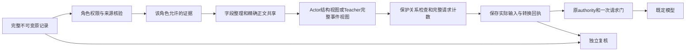

# 五站 Actor 和 Teacher 上下文压缩实施方案 v1

阅读范围：本页是按需查询的技术合同及版本记录，不是逐轮执行清单；历史排期不覆盖[当前 goal](../GOAL-PROMPT.zh-CN.md)。检查触发与退出统一按[日常执行规则](../FRAMEWORK_CHECK_WORKFLOW.md#execution-defaults)。

创建：2026-10-31；文档修订6（2026-11-10）。性质：交给下一位 agent 实施的设计与验收合同；不是已发布实现或实验通过记录。本次补充[上下文评价口径](#context-compression-evaluation)，并与[自适应观察规则](five-site-long-input-handling-20261101.md#adaptive-observation)对齐；候选配置及旧冻结策略/回执保持各自归属。

目标：shopping_admin、shopping、gitlab、reddit、map 五站全部接入统一的输入预算、压缩、来源绑定和独立复核。共用机制按角色及观察类型组合，网站只提供必要的结构规则，不复制五套压缩器。Actor 与 Teacher 均保留 token 硬限制；质量优先于压缩率。Actor短输入同样先做已验轻量整理，无安全收益时可原样通过并记录no-op；所有模式走同一预算和来源记录流程，设计适用不代表全部任务族已经验收。

Admin／Map先行顺序属于原批次历史安排；当前按 goal 的兼容组就绪情况推进，只有实际阻断当前消费者的上下文缺口进入本批。压缩改动及全部适用阶段通过必要测试、安装一致后，装配到具备原运行资格的题目批次。实际Actor/Teacher联动、发送复核、质量观察和资源收尾随逐批处理完成并复用证据，不另建压缩专属的整体测试、五站预跑、配对模型实验或全回归前置。项目原有最终整体验收只在原阶段门执行，压缩结果直接并入，不重复再跑一遍。

## 1 范围与既有规范的关系

范围覆盖五站Actor与Teacher，按实际消费者分批接入。本方案是[总体设计](codebase-architecture-v1.md)的增量补充，沿用其中分层、版本、权限、生命周期和测试合同；设计修订及摘要以 `configs/codebase-design-current.json` 为准，文档修订不代表运行发布。

本轮交付包括共用预算与结构处理、五站 Actor 适配、五站 Teacher 完整证据整理、实际发送与独立复核接线、随题目批次积累的质量证据和调用方切换。模块软件门之后进入原已准入批次，不等待五站先做完整压缩预验；剩余站点和任务族按各自批次接续。泛化要求是结构与接口可复用，不承诺未知页面、任意长度、任意模型均能压缩且无损。

采用确定性字段整理、精确重复正文共享和经过验证的结构缩减；保护字段完整性按第4节核验。

原始证据、判定器输入、恢复快照保持完整；角色压缩只改变明示版本的模型输入视图。五站原判定语义、train/dev/test 隔离、top-6 检索、4 候选、最多3轮修正、费用与并发授权、未知请求不重发等保持。不得将五站压缩的所有任务族完成作为 MapData 收尾或已合格训练链的新全局等待条件；总交付仍须把五站和适用调用方补齐。

## 2 原方案编写时的证据索引（历史范围，不是当前待办）

按以下顺序读取，先区分现行规范、历史记录、开发候选和实际验收：

1. [goal](../DEVELOPMENT.md)、[AGENTS](../../AGENTS.md)、START-HERE（workspace 材料，未发布）、[交接](../EXPORT.md)、文档入口（workspace 材料，未发布）。最新用户要求优先；作业状态以当前原回执为准，不仅看文档首段。
2. [总体设计](codebase-architecture-v1.md)、[模块入口](../FRAMEWORK_MODULES.md)、[增量检查流程](../FRAMEWORK_CHECK_WORKFLOW.md)、补充材料交接（workspace 材料，未发布）。不要重复迁移或生成索引。
3. 当前逐题接入表（workspace 材料，未发布）、工作包（workspace 材料，未发布）、批次（workspace 材料，未发布）、逐题映射（workspace 材料，未发布）、测试计划（workspace 材料，未发布）；依赖顺序参考原依赖图（workspace 材料，未发布），旧表数量不是运行资格。
4. 下表中的原证据与实现。先登记实际 release、源码摘要、模型/模板/策略版本和验收范围，再决定复用、适配或补测。

| 已有材料 | 能复用的部分 | 限制及下一步 |
|---|---|---|
| Map 原始预算审计4857750（workspace 材料，未发布） | 13份原输入及精确 tokenizer 计数；前12份1686–3487，第13份37839；输入28672、输出4096、窗口32768 | 仅此样本，不能推出五站长度分布；原失败与 unknown 保持 |
| Map 有限修复说明（workspace 材料，未发布）、Q 开发报告（workspace 材料，未发布）、Q 批次计划（workspace 材料，未发布） | 已有显式 ActorProjection、policy/2、执行/authority/复核装配候选；计划记载结构探针4857813为26787 tokens | 探针放得下不是模块或整题通过；Q 原先仅限特定任务，不能删除 scope 检查后宣称五站可用。原4857890是提交参数失败，计划已登记后续检查；接手读取最新回执，不重提已结束作业 |
| Actor 端口（workspace 材料，未发布）、模型预算门（workspace 材料，未发布） | ActorProjection 和原真实 tokenizer 预检；无静默截断 | 生产执行和独立复核必须同时消费新选择，不能绕开原 authority 或模型最终门 |
| Teacher 历史模块（workspace 材料，未发布）、验证记录（workspace 材料，未发布） | 相同完整页面的一跳共享，全部事件及来源绑定；历史三轮计数66187/78315/90428→24261/28006/31736 | 是历史实现/特定计数，不是新框架已接通；实际 Teacher 理解仍需验收。过去复杂格式有阅读错误，且部分问题契约改变，不能把分数差异全部归因于压缩 |
| Teacher 端口（workspace 材料，未发布）、RevisionInput（workspace 材料，未发布） | 只允许 teacher 可见的 teacher-input/1；Teacher.revise 返回绑定输入的 RevisionResult | 不将原始私有 DB、隐藏答案或整个依赖容器交给压缩器/模型 |

本方案编写时，Q/P 候选有独立开发检查；不把候选目录、已提交作业或计划标成通过。接手时核原包后继和冻结，不按此处旧Q/P状态重收已结束检查或重做已完成整合。Map 原一次整题额度已消费；本方案本身不新增原题重跑或付费额度。

## 3 Token 预算和配置

### 3.1 两个角色都要限制

分别冻结以下数值及其证据：

- `C`：实际模型与部署支持的上下文总窗口。
- `O`：本次请求的输出 token 上限；若供应商将 reasoning 与最终输出共计，按其实际口径预留，不只计算可见文字。
- `I_config`：该角色配置的输入上限；供应商有独立输入上限时还取其更小值。
- `M`：尚未包含在计数中的协议开销/保守余量，非负；不能重复扣已经计入 chat template 的开销。
- `I_hard = min(I_config, provider_input_limit 如有, C - O - M)`。配置必须有正的可用输入空间。
- `I_soft`：压缩触发和选优目标，满足 `0 < I_soft <= I_hard`；超软目标并不等于请求失败。

准入必须同时满足 `T <= I_hard` 和 `T + O + M <= C`。T 是完整最终请求的计数，包括系统提示、工具/动作说明、模板、图片等适用开销，不只是页面正文。片段计数只能用于诊断，BPE 边界使它们未必严格可加；准入总是重新计算最终组装结果。

| 角色 | 首版数值策略 | 超限处理 |
|---|---|---|
| Actor | 现行部署目标64K总窗口65536、输出4096，M=0时输入61440，输出减档禁用；精确资格和配置以实际release为准。原28672/32768只用于原冻结请求复核，24576不是新全局硬门 | 已验确定性整理；超过当前硬门按[长输入方案](five-site-long-input-handling-20261101.md)处理，未准入扩容/读取不能隐式启用；不回写旧请求、不静默截断 |
| Teacher | 沿用已选 OpenRouter 模型和输出配置，M0阶段核对真实模型/路由能力与现有 RunPlan；不得猜模型窗口。输入上限还受原费用配置限制；新策略软目标可取硬上限的85%，取整规则冻结 | 先用完整字段整理和正文共享；仍超限则阻断本次待发请求，其他合格题继续。不借用 Actor 的28672或历史本地36864 |

软目标是首版工程默认建议，不是质量指标，不为达到软目标继续丢信息。Teacher 模型、窗口、输出上限、价格计量或路由能力缺失时，报告配置阻断；补齐配置前可开发纯投影和离线夹具，但不发实际请求。服务端 tokenizer 不可得时明确记录 `estimated`，使用经核验的计数器和保守余量；无法建立可信界限时不冒充精确计数或执行付费探测。实际 usage 返回后对账，不能据其结果回写原准入事实。

请求模型/路由、tokenizer 文件、模板、编码设置、策略与预算全部进入冻结身份。实际后端能力变化要重新准入，不能在请求中途跟随 catalog/current。输入 token 门与费用门分离：复用现有共享预算、保守预留和结算，不创建第二套费用账本；压缩更短也不会自动增加授权请求数。

### 3.2 输出限制与失败

输出限额保留必要的完整 JSON/skill 空间，不为了多装输入而临时压缩 O。`finish_reason=length`、结构残缺或语义校验失败均保存原响应并按已有模型/轨迹合同处理，不伪装成合格目标或有效任务失败，不自动续写或重发。变更窗口、模型、输出限额属于新的配置/方法版本，需单独验证兼容性、资源和质量，不能只改一个数字。

## 4 压缩算法

### 4.1 共用的数据流



角色权限先于压缩。所有选择只基于公开任务、允许观察、已执行历史及冻结的结构规则；不得利用隐藏判定答案来决定删哪些字段。网页内容和模型提案始终作为不可信数据，不通过字段整理升级成系统指令。

共用流程按有限、有序的候选处理，无无限“删到能发”为止的循环：

1. 保存/绑定完整原记录，验证角色、站点、task/attempt/候选、时间和观察身份。
2. 构造允许材料。Actor 与 Teacher 使用不同类型，避免一个带 role 参数的私有大字典穿透边界。
3. 生成原样候选；生成精确整理候选。清理仅限已声明的序列化包装，不对值做隐式转换，不改空值、大小写、Unicode、数值精度或代码缩进。
4. 内容共享使用精确正文摘要定位并核原字节；相似正文不合并。仅共享内容，不合并事件、控件身份、重复请求或出现次数。一跳引用的正文必须在同一请求内；禁止循环、悬空、跨请求隐式字典。
5. Actor 按冻结适用策略再生成结构候选；Teacher 首版只到完整字段/完整正文整理。每个候选检查保护不变量并渲染为该角色完整请求。
6. 对合格候选计数；Actor先做已验轻量整理，较小页面采用保真紧凑全页或有理由的no-op，较大页面按[自适应观察规则](five-site-long-input-handling-20261101.md#adaptive-observation)选择已验局部视图或必要全页。Teacher仍保留完整允许事件。显式指定某已验格式时记录选择；同长度按冻结优先级确定，不随机选。无合格缩减且策略明示允许时可用能容纳的原样输入；超硬门且无合格范围读取则明确拒绝，不静默裁剪。历史identity优先只解释其原冻结版本。
7. 固定最终选择、原始/发送摘要、计数和保护回执，再进入原发送准入。相同原记录、版本和配置得到相同输出；重复只读处理不改变站点、账本或原输入。

原文已经保存、程序可以解码、模型真正理解是三个不同层次。gzip、文件去重或 KV 缓存不等于减少模型输入 token；不要用这些指标替代本方案的实际请求计数。

### 4.2 Actor 视图

必须保留任务目标、公开约束、当前完整 skill、允许动作、活动 URL/标签页、错误与加载状态、必要内容和全部适用交互关系。当前控件 ID 不能用旧页 ID 替换。表头/行列关系、父子层级、同名控件区分、选中/禁用/展开状态、输入值和可见/隐藏语义都是保护内容。

首版结构缩减仅允许：经过来源和版本验证的非交互空结构简化、已由同一节点/祖先精确表达的不可寻址重复文本消除、包装冗余整理。出现相同文本不等于节点冗余；非交互文本也可能是题目要求的答案。不能普遍删页眉、页脚、列表尾部或诊断表；不能盲目按“是否可点击”过滤正文。

以现有 Q Map 诊断视图作为首个实现证据。先验证其具名节点、控件/cell 的 ID、属性、值、相对结构和非重复文本；复用纯算法时重新证明其他结构的适用性。特定任务限制不得直接放宽为所有 Map 或五站。未知观察结构原样通过或因预算拒绝，不能归入“通用策略已支持”。

当前完整AX与动作历史分别计数。按任务需要启用已有Actor记忆策略，保持动作/返回/观察绑定并核适用证据；Teacher仍保留完整允许事件。

局部模式的单激活窗口、跨范围合并读取、送达记录、容量/读取额度候选配置及字面搜索规则统一见[自适应观察合同](five-site-long-input-handling-20261101.md#adaptive-observation)，本页不另设FIFO或另一套数值。正文移出窗口后仍可重读；`returned`与`included_in_model_input`只分别证明返回和实际输入送达，不证明模型已经核查。比较事实未可靠保留时，合并读取相关范围或采用已验事实记忆，不能以历史“读过”记录代替事实。

### 4.3 Teacher 视图

复用已有完整页面共享，按新框架边界拆分存储、投影、格式和审核。任务、初态和检索材料各保留一份；每个候选及每轮修正保留完整有序事件、候选 skill、模型提案、实际动作/返回/错误、前后观察、URL/tab、终态来源和允许的逐项反馈。未知字段默认完整保留或明确拒绝未支持 schema，不能静默丢弃。

建立不可拆的事件绑定：`candidate/attempt → generation → action/result → before/after observation`。缺动作字段、null、空字符串、未派发、未确认、执行失败、执行成功分别表示。动作存在不是成功证明，整题成功也不是每一步成功证明。

Teacher 必须能区分：Actor 当时实际看到的投影、原始完整观察，以及后来补取的终态/复核材料。允许反馈可以说明事实，但不能把后台目标映射、隐藏答案或正确路线扩充进输入。页面正文共享不跨候选混并因果；模型实际发送内容与投影的绑定由来源记录证明。

不把 Teacher 限为近期六步、不只保留成功候选、不用模型摘要替代全部失败/修订历史。正常、有效失败和 unknown 均按原合同呈现，不能为了减 token 改标签。首版 Teacher 页面正文不做 Actor 式内容删减，因此不得把 Actor 压缩结果作为其唯一原始轨迹来源。

## 5 五站的规则与任务覆盖

五站都登记 Actor 与 Teacher 两条路径。网站名不是唯一策略键：以角色、观察 schema/版本、任务能力及保护规则版本组合；主应用没有一长串 `if site == ...`。策略声明来自公开合同/受信任装配，不把私有预期答案带入选择逻辑。

| 网站 | 可复用的结构处理 | 保护内容和必须覆盖的变体 |
|---|---|---|
| shopping | 相同完整商品/订单页共享，重复结构与包装整理 | SKU与规格、价格/币种/数量、库存、账号、完整购物车成员、订单/配送状态、筛选/分页；相同名称不同规格、空结果、未加载、未保存 |
| shopping_admin | 表单/表格/报告结构规则，原始完整正文共享 | 字段标签和值、选中/禁用/错误、行列/记录ID、scope/store、保存与草稿、订单/商品/规则关系；编辑表单和报表/导出不能混为同语义 |
| gitlab | 导航结构、完整文件/讨论正文共享 | namespace/project/ref/path、代码原文与缩进、issue/MR身份、讨论层级/顺序、权限、保存结果、产物来源；同名项目、同文不同分支、空讨论与加载失败 |
| reddit | 导航结构、相同帖子正文共享、显式评论树 | 帖子/评论/论坛/作者身份、回复层级和排序、全文读取范围、投票/订阅、草稿与发布、媒体关联；同文多评论、删除项、空页与故障页 |
| map | 现有诊断视图复用，地图面板/表单/路线结构 | 坐标与精度/单位、起终点方向、模式、距离/时长、路线完整步骤、图层/缩放/bbox、请求/响应顺序、编辑/导出状态；反向路线、不同模式、空路线与未加载 |

列表/评论/路线/代码若要求完整读取，成员和顺序必须完整；存在一次重复内容不授权合并两个业务对象。原生网络/DB/文件判定证据不经模型压缩器过滤。

实施者建立覆盖表，每行至少含 `site, role, family, effective_batch_id, task_id, observation_schema, strategy_version, protected_rules, source_receipt, software_receipt, runtime_receipt, quality_scope, current_consumer, status, blocker`。用现有1983道 train 映射做元数据盘点；dev/test仍仅元数据，不读其私有答案/轨迹来设计策略。没有合格原轨迹的类型登记缺口，合成夹具只证明相应软件边界。

按完整兼容子组推进，列所有成员和语义差异；可以分片测试/运行。不能从同一工作包不同子组各抽一题拼成“整组”。共享通用代码的单元测试不必对每题重复，逐题准入与覆盖登记不能省略；一题通过不代替该组全部语义。

## 6 模块边界和接口

沿用 Python 3.11、严格 Pydantic 数据合同、Protocol、现有 CAS/RequestLedger/Trace 和 Slurm。首版不增加压缩模型服务。下面是职责映射，已有同职责文件优先扩展；表格不是必须新增文件的计数。一个文件不同时承担角色筛选、压缩、模型发送和资源收尾。

| 建议位置 | 职责 | 依赖边界 |
|---|---|---|
| `domain/context_budget.py` | BudgetProfile、TokenMeasurement、BudgetDecision | 纯数据与数值校验，复用现有 Actor 参数和 Money 类型，不引入另一费用合同 |
| `domain/context_projection.py` | ProjectionPolicy、ProjectionCandidate、ProjectionReceipt、来源关系 | 扩展/复用 Q 的 actor_projection 合同，角色输入分类型 |
| `ports/context_projection.py` | 计数、角色投影、核验端口 | 只依赖 domain/现有 lifecycle 端口 |
| `policies/context_budget.py` | 有限候选的预算选择 | 纯逻辑；不加载 tokenizer 或发请求 |
| `policies/context_structure.py` | 精确正文共享和已声明结构关系变换 | 不读取网站、DB或隐藏反馈 |
| `actor/context_projection.py` | Actor 投影组合与现有 ActorProjection 适配 | domain/ports/policies，不导入具体 sites |
| `teacher/context_projection.py` 与 `teacher/message_layout.py` | 允许事件/页面整理及可读格式 | 复用旧纯投影算法，角色间不互调，不从历史脚本导入运行逻辑 |
| `sites/<site>/context_rules.py` | 观察 schema、能力、保护范围和策略注册数据 | 公共 schema，不自行调用模型/判定器；共用结构算法不复制进五站 |
| `adapters/models/context_tokens.py` | 本地精确 tokenizer 或 provider 计数适配 | 实际阻塞I/O接 OperationControl；复用既有加载/本地暂存，不重载权重 |
| `application/context_preparation.py` 与 `application/context_review.py` | 权限、读取、纯投影、计数、保存、独立复核编排 | 只依赖 domain/ports/policies，不导入 actor/teacher/sites 具体实现 |
| `bootstrap/context_projection.py` | 解析冻结配置并注入策略、角色和计数器 | 唯一认识各具体实现的位置 |

既有外部接口优先保持：`ActorProjection.__call__(ActorPublicTurn) -> ActorPrompt`、`Teacher.revise(RevisionInput, OperationContext) -> RevisionResult`、原 ActorModel 及请求账本不另建替代入口。新增纯内部接口的逻辑形状如下；类型放 domain，职责不能由无约束 dict 替代：

```python
project_actor(turn: ActorPublicTurn, policy: ActorProjectionPolicy) -> ActorProjectionResult
project_teacher(bundle: AllowedTeacherEvidence, policy: TeacherProjectionPolicy) -> TeacherProjectionResult
count_request(request: RenderedModelInput, profile: TokenizerProfile,
              control: OperationControl) -> TokenMeasurement
select_candidate(candidates: tuple[MeasuredCandidate, ...],
                 budget: ContextBudgetProfile) -> ContextDecision
verify_projection(source: AllowedRoleEvidence, candidate: ProjectionCandidate,
                  policy: ProjectionPolicy) -> ProjectionCheck
prepare_context(request: ContextPreparationRequest,
                control: OperationControl) -> PreparedContextRef
```

这些是实施接口合同，不表示所列类已存在。`AllowedRoleEvidence` 是严格带角色的联合；Teacher 输入先经已有 authority 得到允许投影。纯 project/verify 不做I/O、不持有浏览器或模型、不生成新请求。只有带 control 的应用/适配方法读取和保存。Actor 旧端口的适配器只返回 ActorPrompt；内部回执由受控应用路径保存并绑定，不能为了写日志在纯投影器里隐式做I/O。

`PreparedContextRef` 是输入准备结果，不是发请求许可。是否可发仍由原 authority、源范围、费用和一次意图门决定。原 `RevisionInput` 仅接受 teacher-input/1，若确需改变 schema，必须同时迁移 producer/consumer/reviewer/export；优先保持现有允许投影 envelope 并显式冻结格式版本，不偷偷塞未知字段。

### 6.1 必需的数据字段

- **BudgetProfile**：role、model/provider/routing 身份、C/O/I_config/I_soft/M、计数口径、tokenizer/template 摘要、配置版本及原费用范围引用。正整数拒绝 bool、0、负值、NaN/Inf；关闭策略也不能关闭预算门。
- **ProjectionPolicy**：schema/implementation 版本、角色、适用观察/任务范围、保护规则、候选顺序、明确 no-op/fallback 行为、已验范围引用。执行、authority、独立复核固定同一选择。
- **ProjectionCandidate**：原始允许输入摘要、实际消息、正文表和逐事件映射、所有省略及理由、保护检查、no-op原因。大文本仍走现有证据引用，禁止把模型无法读取的外部路径当作已提供正文。
- **ProjectionReceipt**：run/task/attempt/candidate/round、原观察与实际Actor输入引用、发送字节摘要、策略/模型/模板摘要、原/新计数、计数精度、耗时、硬/软预算判断、变换类别和被保护内容检查。私有工程字段保存在私有回执，不直接混入公开 Actor 输入。
- **QualityReceipt**：具体数据与模型身份、对照条件、实际教师输出/复验、逐项错误与不确定性、适用网站/任务族。不能只有一个无范围的 `quality_passed=true`。

## 7 状态流转和异常出口

输入准备状态是回执中的阶段，不新建第二套 RunJournal/RequestLedger：

`source_verified → candidates_built → integrity_checked → budget_checked → input_saved → prepared`

之后走原请求状态机。预算/校验失败在派发前记录拒绝事实，保留未发送输入和原因。已存在 pending/dispatching/uncertain 的逻辑请求先走原核查路径，不能通过换压缩格式、request_id、worker或attempt来重发。

| 情况 | 必需行为 |
|---|---|
| 原样未超软目标，或候选不更短 | 使用策略允许的原样路径，写明 no-op；身份和内容不得偷偷改变 |
| 超软目标但不超硬上限 | 可使用已验且保真通过的候选或明示原样回退；不得仅因软目标失败阻塞 |
| 必需内容仍超硬上限 | 明确 `input_budget_exceeded`，无模型派发；保留原输入/计数/保护集，不能写成任务有效 failure0 |
| 未知策略/错误版本/错角色/跨任务引用 | 拒绝并定位绑定层，不隐式降级成另一策略 |
| 不支持的页面形状 | 按冻结规则原样处理；若原样超限则拒绝；登记该形状未支持 |
| 损坏来源/保护字段遗漏/悬空引用 | 拒绝，保留源与候选，不能仅重算摘要后放行 |
| 计数或保存超时/取消、CAS部分提交 | 不发请求，保留首错及已知引用/清理错；使用原有有界清理，不重做站点动作 |
| 请求已派发后断线/未知 | 原账本持久 unknown，禁止压缩重发；后续仅按原权限核对/补账 |
| 输出截断/不可解析/无效skill | 保存原返回，既有修订和复验规则处理；不伪造正常结束 |

日志至少能从一次失败定位到角色、组件、阶段、task/attempt/round、release、策略、源/实际输入摘要、计数、预算、operation/deadline、首错与清理状态。原文保存在受控证据内，不在日志泄露 key 或私有全文。

## 8 测试与质量验收

### 8.1 软件覆盖矩阵

| 类别 | 输入或故障 | 预期行为 |
|---|---|---|
| 正常/no-op | 五站短页、策略关闭、完整Teacher事件 | 原样路径内容一致；仍有预算/来源校验；无专用模型或网站副作用 |
| token边界 | soft±1、hard−1/hard/hard+1、输出恰好占满窗口、无剩余空间、模板占用 | hard恰好允许；hard+1拒绝；soft仅触发策略；完整请求计数与固定worker一致 |
| 数据类型 | 空材料、缺字段、bool数值、非法枚举、重复JSON键、非UTF-8、巨大输入 | 按合同拒绝并保存诊断；合法空业务结果区别于缺证据；字节/结构上限先于无界解析 |
| 精确共享 | 相同正文不同URL/候选/控件ID；相似正文；重复动作 | 仅正文可共享；事件、ID、次数、URL/顺序各自保留；不同正文不误并 |
| 关系保护 | 同名按钮、表头/跨行、嵌套评论、代码缩进、负数/小数/币种/经纬度、否定词 | 所需值和关系可从候选完整核对，无任务语义偷换 |
| 原因与时间 | proposal无action、null/空action、失败返回、后取终态、候选重试 | 不推断执行/成功，不串候选，不把终态当Actor已见内容 |
| 内容选择 | 长正文、列表尾部目标、折叠/不可见状态、恶意网页指令 | 任务需要内容不按位置删；不改变信任层级；不注入隐藏参考答案 |
| 非法引用 | 循环/嵌套/缺页、错scope、source hash漂移 | 拒绝；完整原始证据与候选均保留 |
| 重复/并发 | 同源同配置重复投影、共享只读缓存、两来源并行 | 输出稳定、不修改原源、不串可写状态；缓存内容不提供权限，paid同授权上限1 |
| I/O故障 | 计数超时/取消、保存失败、回执丢失、主错+清理错 | 无未准入派发；完整原错与清理状态；不因保存失败重跑原业务 |
| 参数/版本 | tokenizer/template/model/策略任一改变、provider计数估算 | 原通过记录不误复用；估算不写exact；发送与独立复核同一冻结版本 |
| 输出/请求 | length、坏JSON、provider拒绝、派发未知 | 原响应/账本保留，不变有效业务失败，不自动重发 |

同一公共机制的用例按覆盖关系复用，不把每种测试重复乘五站和全部题数。各站仍须有本站结构与语义反例。除了 encoder 与 decoder 相互检查，还从原记录独立提取保护字段、次数和关系作为预期，避免同一bug两端同时通过。

### 8.2 模型理解与蒸馏质量

质量证据随题目批次积累，不设独立压缩质量实验前置。分别记录结构正确、实际模型理解、修订后Actor复验、目标导出和下游SFT效果，不能将模块通过改写成后续各层已经完成。

1. 模块测试复用已有合格train轨迹及合成边界夹具。通过后直接接当前已准入的完整兼容子组；五站逐批积累实际覆盖，不先额外跑一组“压缩验收题”。test/dev仍按原阶段门，不用于调策略。
2. 每个实际批次利用原流程已经产生的Actor输入/返回、Teacher修订、Actor复验、判定/独立复核及资源关闭证据，附带记录压缩前后token、保护关系、输入版本、耗时及适用费用。无需为得到这些指标重复执行同一题。
3. 关键事实核对关注动作归属、对象ID、否定条件、错误、终态和角色隔离。优先在模块夹具和实际请求独立复核中检查；批次发现新问题时保存原事实，定位最小受影响模块、修复并补该类用例和相关回归，不默认重跑整批或所有网站。
4. Teacher实际输出经原方法Actor复验并按原规则导出；正常、有效失败和unknown分别记录。已有模型本身读错也要登记，不能仅凭某一题失败归因于压缩，也不能用另一模型自评取代原业务判定。
5. 有未变且可比的历史原样结果时，可以离线比较同模型/配置/证据范围；没有配对结果时明确相对质量尚未确定，不额外派发原样/压缩两轮调用，不把统计非劣证明设为进入下一批或小SFT的条件。
6. 原输入超窗口的实际批次标记为“超限恢复”，核事实保留及真实任务表现；不能虚构原样对照或把更换模型的结果归因于压缩。小SFT与正式test/dev复用原计划检查，不为压缩再启动一轮训练或整体评测。

发布记录写清哪些模块已通过、哪些实际批次使用了策略、哪些质量结论仍无证据。模块通过足以进入具备原资格的业务批次；普遍零质量损失不能由模块测试或少量任务推断。具体训练目标资格仍由原实际复验、独立复核及导出合同决定。

### 8.3 效率与复用

登录节点只编辑代码/文档和小型元数据。tokenizer重放、软件测试、真实worker、模型和网站操作全部经 Slurm。先预检新夹具、注入脚本与类型，再做昂贵运行。

每批登记精确 pytest node、源/夹具/配置/依赖身份及原回执。小改只跑失败节点和受影响消费者；通过且未变的检查复用。相同冻结版本共享一次静态检查与只读安装，测试可分片，可写实例隔离。公共B变化才补实际受影响AB/ABC；不要先完成全部AB任务池再接C。

使用现有检查器的重复 `--test-first <node>` 选项，不能在一个标志后堆多个位置参数。压缩模块通过后直接随已准入题目批次验证实际组合，不提交压缩专属的整体测试或 `--full-regression` 作业。项目原有最终整体门仍显式 `--full-regression`、不排除用例，但只在该既定阶段执行并纳入压缩改动，不单独重复一轮。复用计数缓存的key包含实际请求内容、角色/模型、tokenizer、模板、策略和配置；缓存不复用权限判断。缓存收益按实际测量记录。

<a id="context-compression-evaluation"></a>

### 8.4 上下文方案怎样衡量和选定

评价顺序为**事实与协议正确→完整请求可容纳→避免不必要读取→token及时间成本**。保守全页整理与有界局部选择分别登记；视口/局部视图没有呈现整页，不能宣称整页无损。少量样本只支持对应结构和消费者，不证明普遍不影响模型质量。

离线比较冻结同一允许快照、任务/skill/历史、能力与输出合同、模型、tokenizer、模板及预算配置；保留各候选策略身份。以相同最终协议组装紧凑全页基准、当前局部视图及修正视图，隔离选择差异；旧协议原请求单列，不与新协议数值混算。真实viewport只在原捕获含可见性依据时加入参考，缺元数据记不可比较，不新跑网站补造历史。使用合格train公开材料或明确工程夹具；旧成功路线和私有答案不交Actor。

| 维度 | 记录与判断 |
|---|---|
| 完整请求体积 | `T_full`与`T_selected`均用同一原生计数器/模板计最终请求，含系统、任务、skill、工具、历史和观察；降幅`1-T_selected/T_full`。局部正文token、字符数另列；旧字符减幅不得与新token减幅直接排名。硬门仍为实际`min(I,C-O-M)` |
| 信息保留与可达性 | 从原公开结构独立核必要导航/展开菜单、ID/名称/状态/层级、焦点/错误及表头/完整行组；紧凑导航可全展示时不得缺项。列保留/遗漏对象及可继续读取范围，不能仅用平均覆盖率掩盖关键内容缺失；屏幕外、未加载、未搜索与真实空结果区分 |
| 协议与执行事实 | 所有实际注册工具示例能由真实解析器接受；混合/错类型提案受控拒绝且不执行。实际统计解析拒绝、read提案/返回/送达、网站动作；拒绝不是搜索结果，送达不是模型已理解 |
| 多轮净成本 | 逐轮和整题记录生成数、读取生成数、输入/输出token总和、无进展/重复读取、真实动作。初始输入减少而读取轮次增加时核总量；不同终止阶段、模型/合同/环境的运行不得据此计算净提速 |
| 工程开销 | 分别记录选择/索引、原生计数、正文交换/读取/worker、准备、生成、返回保存和收尾；固定版本与资源，冷热分开，嵌套计时不相加。仅减调用数不换算成全题分钟或比例 |
| 业务及恢复 | 实际模型结果、动作、原语义判定、独立复核、Reset、物理终止及账本/任务登记逐项取证；软件/安装通过或token下降均不能代替 |

首批通过条件：相关保护事实及协议检查无缺口；支持范围内最终输入符合硬门，必要信息可继续读取；未变前序及同次已验正文没有再次执行昂贵生产/读取；精确安装与适用消费者一致。不得设置必须压到某百分比、必须填满6,000或必须取得业务正结果的门。

原生计数/实际消费者检查使用Slurm，复用已有精确计数与合格检查，只补变化或缺项。离线比较不调用模型或重发原请求；实际额外读取和任务质量随下一合法实例收证据，无可比数据明确标未验证，不增加全站压缩预跑、配对双调用或训练。工程失败回当前阶段，有效业务失败保留；统计质量未知不自动成为重复全链的理由。

## 9 开发顺序与逐步验收

| 增量 | 交付和完成条件 | 后续依赖与复用 |
|---|---|---|
| M0 范围与配置 | 核最新Q/P状态和冻结；五站×Actor/Teacher十格覆盖清单；从原计划核Actor/Teacher预算与模型计数口径；指出每个缺口及已有代码位置 | 小型元数据盘点即可开始；缺Teacher配置只阻实际请求，不阻纯模块开发 |
| M1 共用合同和预算 | 严格类型、有限候选选择、完整请求计数、保护/来源回执；正常/边界/非法/重复和相关I/O门通过 | 复用原engine/ledger；Q有已验同职责代码先合并，不再造同名框架 |
| M2 Actor模块与五站规则 | 先核Q原回执并复用Map修复；同端口接五站规则，接口/格式/schema/保真/预算/正常及边界异常、直接受影响调用方契约测试通过 | 通过的站点/策略即可随原已准入批次运行；固定worker真实预检和发送复核在该批完成，不另跑压缩预验整题；缺口站点继续接入 |
| M3 Teacher模块与五站规则 | 迁移历史纯投影；完整事件/正文、实际Actor可见范围、来源与允许反馈保持；消息构造/审核/导出接口及格式测试通过 | 依赖M1，可与M2独立部分并行；通过后接下一原已准入构建批次，不等待另一个整体测试门 |
| M4 随题目批次验证 | 在原任务流程中收实际输入、Actor/Teacher行为、修订复验、判定/独立复核和关闭；自动附带token及保护关系记录 | 是业务批次中的工作，不是独立测试阶段；复用已完成题目/回执，不新增配对模型调用，不扩大原费用或来源范围 |
| M5 随批发布与覆盖登记 | 模块通过后冻结该批版本并核接口/配置选择；批次完成即登记实际消费者、原回执和下一批适用范围，旧运行保全后完成切换 | 不设压缩专属五站整体验收或全回归；项目原整体Review/两来源并行/全回归仅在原阶段门执行一次，纳入本增量 |
| M6 完整覆盖与训练消费 | 各站/任务族依次接入已有批次；合格目标按原小SFT及test-dev/RL计划继续，汇报未覆盖项和质量结论范围 | 不为压缩重跑训练或全部任务；五站适用接口最终补齐，统计质量结论不足不成为新的全局前置 |

M4/M5是随批持续记录的职责，不是M2/M3之后串行等待的两轮验收。任一已就绪站点/策略满足模块门和原业务资格后即可进入下一题目批次，不等待其余网站模块完成。

当前范围和批次顺序以执行指南（workspace 材料，未发布）为准：Admin／Map原批次先收口，上下文改进随后；上述M0–M6是长期覆盖职责，不是本次新增七轮开发或验收。历史MapData或导航准备记录不直接授予当前执行资格，不把五站平台齐备作为两站前置。

失败修复按固定顺序：保存完整traceback、输入/输出、调用链、持久状态与复现条件；先解释根因及层级；做最小修改；先跑失败节点，再补受影响回归；接口/行为改变同步本方案、模块文档及实际配置。不能靠削弱断言、放宽保护范围或仅修单样本变绿。

## 10 发布和交接完成条件

每次汇报至少包含：入口到达阶段、下一阻断、最小变更、精确已执行/复用证据、下一验收出口。最终交付以下可追踪文件，实施者可沿用已有相同职责记录，不建立第二份相互矛盾的current：

- 五站×角色×任务族覆盖表，包含完整子组成员和未支持结构。
- 实际冻结预算/模型/策略/保护规则配置及消费者清单；Teacher未知配置必须在真实调用前填实。
- 分文件实现与精确模块测试回执、失败记录、实际题目批次及独立复核回执；原项目最终整体回归到期时引用其回执，不另交一份压缩专属整体测试结果。
- 原始/实际输入来源记录、token/耗时/成本统计与质量分层报告。
- 新默认入口/worker/authority/reviewer/Teacher修订/导出/SFT消费者的切换记录。旧运行保全后完成适用调用方迁移，不以“按需”永久漏掉某站。

必须分别登记 `implemented / software_verified / runtime_verified / quality_scope / current_consumers / blocked`，不能把十格都注册了写成十格质量通过。无可信内容缩减时，正确的no-op或预算拒绝可通过边界合同测试，但不能被计作该类超限任务已经解决。

## 11 外部项目参考

以下为2026-10-31查阅的上游main源码，提供设计参考，不作为本项目验收。借用具体实现前冻结commit及许可证；无需为了引用方案安装这些完整框架。

| 项目与源码 | 借鉴点 | 本方案取舍 |
|---|---|---|
| [AgentLab dynamic_prompting](https://github.com/ServiceNow/AgentLab/blob/main/src/agentlab/agents/dynamic_prompting.py) | 可缩减组件及迭代token计数；含删尾实现，迭代耗尽后仍可能返回超限提示 | 组件化处理；最终完整请求须满足硬门 |
| [browser-use MessageManager](https://github.com/browser-use/browser-use/blob/main/browser_use/agent/message_manager/service.py) | 摘要旧历史、保留首项和近期项，要求区分明确完成与进行中 | 明确事件状态；Teacher采用完整允许证据 |
| [OpenHands LLMSummarizingCondenser](https://github.com/OpenHands/software-agent-sdk/blob/main/openhands-sdk/openhands/sdk/context/condenser/llm_summarizing_condenser.py) | token/事件触发、保护前缀、在允许事件边界切分 | 保留原子事件及软硬条件 |

## 12 直接交接

使用唯一现行GOAL提示词（workspace 材料，未发布）和专项实施方案（workspace 材料，未发布）交接。先收口原最小修复批次，再做上下文改进；历史压缩提示词不作为本轮执行入口，不重复已完成能力和未变测试。
